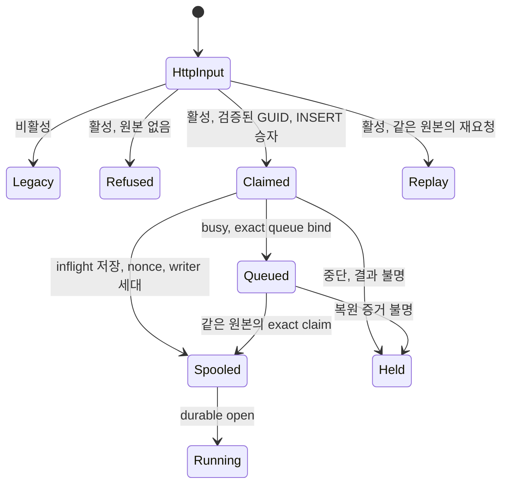

# #8274 조각 1b — 인증된 아이메시지 입력의 내구 원본

<!-- doc-path-refs: external imsg_inbound.py imsg_send.py imsg_fork.py -->

조각 1 리뷰 기준은 `91151eb3b84048e1c4263f9ec13b2fc328c9ea15`다. 아래 코드 좌표는 이 기준을 사용한다. `main` 대조는 `92970bd7920f1052133f028684d839760da2f4d5`다. 활성화는 조각 4에서 결정한다. [조각 1 설계](tui-o-agy.design.md) · [#8274](https://github.com/itismyfield/AgentDesk/issues/8274)

## 설계 델타

조각 1의 `AgyForeground::from_claim`은 실제 Discord 메시지, `Foreground`, inflight 저장 성공과 일치하는 nonce를 요구한다. headless 생산자는 `agy_foreground: None`을 전달한다. `AgySpool::reserve`는 숫자 메시지 ID를 create-once 디렉터리 이름으로 쓰고 `open`에 `discord_foreground`를 기록한다. agy HTTP의 직접 시작과 큐 등록은 서로 다른 합성 ID를 만들 수 있으므로 숫자만 넘기면 같은 GUID의 재입장을 차단할 수 없다. 좌표는 `provider_dispatch/stream_json_turn.rs:39,68,94,125`, `headless_turn.rs:1004,1133`, `store/agy_spool.rs:20,82,93,107`, `health/turn_deliver.rs:330,338,478`이다.

승인된 두 계약이다.

1. 입장 증거에 **인증된 iMessage 원본**을 추가한다. 기존 숫자 경로와 Discord `open` 형식을 유지한다. iMessage는 같은 목적지·provider 아래 별도 `imsg-<digest>` 디렉터리를 쓰고, `open`에 `imessage_http` 및 원본 digest를 기록한다. digest는 도메인과 버전을 고정한 SHA-256으로 검증된 GUID 바이트를 인코딩한다. 숫자 turn ID와 nonce는 실행·영수증 키로 유지한다. 조각 2 reader는 두 경로와 `open` 형식을 확인한다. segment, checkpoint, Done 경계와 recorded runner 호출은 공유한다.
2. 선택된 agy의 iMessage 입력은 `/turn/deliver`에서 원본을 한 번 인수한다. 비서 watcher의 `/turn/start` 선호 경로에는 실행 효과를 내기 전에 **409 `imessage_deliver_required`**를 반환한다. [기존 watcher 계약](../../api-thread-ingress.design.md#저장소-밖-스킬의-후속-수정)으로 고정한 fixture가 같은 목적지·provider·GUID를 deliver에 넘긴다. 일반 API headless와 루틴에는 기존 분기를 적용한다.

## 진입점 전수표

AgentDesk의 HTTP 경계부터 재입장까지는 고정 소스에서 확인했다. 수신 watcher는 저장소 밖 Mac 스킬이다. WSL에 정본 소스가 없어 그 구간은 #8125 설계가 기록한 당시 좌표를 인용한다. 실제 비서 target, 배포된 watcher의 revision과 요청 형식은 이 자료만으로 확인할 수 없다. 운영 설정, runtime, DB는 조사하지 않았다. [외부 스킬 소스 좌표](../../api-thread-ingress.design.md#저장소-밖-스킬의-후속-수정) · [#8125](https://github.com/itismyfield/AgentDesk/issues/8125)

| 진입점 | 소스 좌표 | 처리와 1b 경계 |
|---|---|---|
| 수신 및 목적지 선택 | 외부 `imsg_inbound.py:151–165,320–361,384–388,404–407,432–434`, `imsg_send.py:227–294,463–469`, `imsg_fork.py:62–77` | 인라인 답장은 발신 GUID에 등록한 target, 새 문자는 default target을 사용한다는 문서 근거가 있다. 비서 agy의 default/등록 경로 모두 아래 두 HTTP 입구를 대조한다. 문서의 Claude/Codex fork는 HTTP를 우회하므로 범위 밖이다. 전송 결과 불명 뒤에 새 턴으로 재시도하지 않는 watcher 경계를 유지한다. |
| 직접 또는 등록된 채널의 `/turn/start`와 409 fallback | `src/server/routes/domains/runtime.rs:133–137`, `src/server/routes/agents.rs:659,673,781,803,830–852`, `src/server/routes/agents_turn_target.rs:222–247` | 직접 target은 health starter, 검증된 child는 thread starter를 쓴다. body의 GUID는 receipt metadata로 허용되며 이 입구에는 `HumanInputCaller`, author preflight, HTTP origin INSERT가 없다. 외부 스킬 문서의 `imsg_inbound.py:220–238,320–361`은 start 409를 deliver로 넘긴다. 선택 agy의 자동 start에는 위 409 경계를 제안한다. |
| 직접 또는 등록된 채널의 `/turn/deliver` | `src/server/routes/auth.rs:213–274`, `src/server/routes/agents_turn_deliver.rs:127–176,187–281,285–315`, `src/server/routes/agents_turn_target.rs:58–70,80–157`, `src/server/routes/agents_turn_target/thread.rs:41–86` | 소켓 peer/Bearer 확인 뒤 body를 읽고 agent binding, provider, 실제 destination을 확인한다. child는 관측한 부모와 bound 부모가 일치해야 한다. iMessage obligation 경로, origin 있는 Legacy 경로, origin 없는 Legacy 경로가 갈린다. |
| iMessage obligation의 준비 및 인수 | `src/server/routes/agents_turn_deliver/origin_admission.rs:17–73,85–115`, `src/services/imsg_reply/admission.rs:124–218` | child/설정된 Herdr owner는 author preflight와 준비 후 인수한다. 그 외 직접 채널은 기존 lazy delivery를 쓴다. INSERT 승자만 실행한다. 같은 원본의 재요청은 저장 결과, pending, unknown 또는 conflict다. |
| Legacy HTTP origin의 준비 및 인수 | `src/server/routes/agents_turn_deliver/legacy_origin.rs:19–72`, `src/services/discord/health/turn_deliver/prepared.rs:13–81` | 기존 author·runtime 확인, `external` row 선점, 승자만 실행은 재사용할 수 있다. DB의 `source=external`은 reply 권한에서 제외된다. 사람 iMessage라는 별도의 입장 증거가 필요하다. |
| 즉시 시작 또는 busy 시 시작 재시도 | `src/services/discord/health/turn_deliver.rs:249–294,330–363,432–473`, `src/services/discord/router/turn_start.rs:29–43,131–136`, `src/services/discord/queue_io/input_owner/ingress.rs:349–383` | 직접 headless starter 또는 prepared Herdr로 간다. obligation이 있으면 효과 전 episode를 묶고 거절 시 해제한다. 안정된 iMessage 합성 ID를 정하는 `for_input`은 TUI owner 경로에 한정되어 있다. |
| busy pane 입력·handback | `src/services/discord/health/turn_deliver.rs:409–427`, `src/services/discord/health/turn_deliver/inject.rs:491–563,646–672`, `src/services/imsg_reply/mod.rs:70–87` | 기존 주입은 현재 episode에 합류하며, 확정 미전송이면 같은 원본이 큐로 돌아갈 수 있다. 선택 agy에는 새 턴의 start/queue만 배정한다. unconfirmed는 보류 상태를 유지한다. |
| 큐 저장 및 drain | `src/services/discord/health/turn_deliver.rs:374–396,478–506`, `src/services/discord/queue_dispatch/kickoff.rs:262`, `src/services/discord/gateway.rs:868`, `src/services/discord/router/ports.rs:56,77`, `src/services/discord/router/intake_dispatch/queued.rs:85–100,291–352` | queue entry의 source generation에는 origin 문자열이 들어갈 수 있다. 재구성 요청은 합성 메시지 ID와 `Foreground`를 넘긴다. 내구 row가 가리키는 queue entry를 검증한 뒤 exact claim에 연결한다. |
| 직접 생산자, 큐·worker 재입장과 복원 | `headless_turn/replay_start.rs:64–96,551–582`, `headless_turn.rs:955–1011,1133–1165`, `intake_turn.rs:1984–1991,2091`, `intake_turn/worker_entry.rs:49–58,116–151,160` (모두 `src/services/discord/router/message_handler/` 아래), `src/services/discord/recovery_engine/restore_inflight.rs:98,120` | 직접 headless inflight에는 origin receipt 문자열만 있다. 큐/worker/부팅은 일치하는 내구 증거를 복원한 경우에만 iMessage 입장자로 재구성한다. worker DTO의 Discord replay나 옛 형식에서 그 증거를 찾을 수 없으면 활성화 전에 경로를 보강하거나 인수된 원본을 명시적으로 보류한다. |
| DM·handoff·조회 | `src/server/routes/agents.rs:698–738,830–842,1067–1131`, `src/services/discord/agent_handoff.rs:402–405,529–577`, `src/server/routes/domains/runtime.rs:139–146` | start의 DM 변형은 별도 대상이다. handoff는 cc/cdx의 agent 간 입력이다. input-result, notice/echo 및 reply registration은 입장 판단의 근거에서 제외한다. |

## 입력 출처 분류표

| 입력 | 작성자와 전송자 | 입장 및 실행 소유자 |
|---|---|---|
| Live Discord foreground | Discord 사용자가 쓰고 gateway가 메시지 ID를 제공 | 기존 실제 목적지 mailbox claim과 해당 inflight nonce. 조각 1 Discord 규칙 적용. |
| 인증된 iMessage 채널 입력 | 사람이 iMessage를 쓰고 bridge가 GUID와 매핑된 Discord author를 전달 | HTTP caller와 채널 author를 확인한 뒤 origin admission row가 첫 인수를 보호한다. queue/inflight가 동일 원본을 소유하고 준비된 agy writer가 spool을 인수한다. iMessage reply obligation은 별도 응답 권한이다. |
| 증거가 없는 HTTP 사용자 입력 | HTTP caller가 text, source 또는 임의 origin을 제공 | 기본값은 기존 HTTP/Legacy 소유자. 활성 범위는 명시적 HTTP 처분. |
| 일반 headless API·DM·agent handoff | 프로그램 또는 요청 agent가 prompt를 제공 | 기존 API/DM/agent 실행 소유자. |
| 루틴·스케줄·백그라운드 | 서버의 routine 또는 scheduler가 입력 생성 | 기존 routine/스케줄 소유자. |
| 큐·worker·재기동 | 시스템이 저장된 원본을 이어받음 | 검증된 이전 작성자 및 owner를 복원한다. |

## 내구 원본과 보호 증거

- **정본 키**는 `(실제 destination, 정규 provider Antigravity, 원본 GUID)`다. GUID는 인증된 `/turn/deliver`의 iMessage origin으로 받고, 기존 길이 한도 안의 비어 있지 않은 정확한 값을 보존한다. bridge가 사용하는 접두사·대소문자를 유지한다. 발신 등록 GUID, 요청 UUID, 내용 해시, 합성 메시지 ID 또는 클라이언트 metadata의 승인 표식은 증거에서 제외한다. 검증된 실제 child와 논리 부모를 별도로 보존한다.
- **인증 경계**는 현재 `HumanInputCaller`가 허용하는 local peer와 server Bearer다. 둘 다 body의 iMessage 출처를 전달할 권한을 가진 주체라는 기존 전제에 의존한다. 서버가 Apple 수신 또는 특정 watcher 실행 파일을 별도로 증명할 수 있는 프로토콜은 현재 없다. 해당 증명이 요구되면 caller 계약도 설계 델타에 포함해야 한다. (`src/server/routes/auth.rs:213–274`, `src/server/routes/agents_turn_deliver.rs:127–132,227–249,285–300`)
- **HTTP 인수**는 caller, resolved target, 허용된 author, readiness를 확인한 뒤 기존 origin INSERT 승자만 얻는다. `imsg_reply_obligations.origin_id`는 전역 PK이며 v2 요청 해시는 provider·destination·author·source·text를 보호한다. 기존 전역 행의 다른 target 사용은 409다. 이 제약으로 tuple별 중복 0을 만족한다. 다른 target로 같은 GUID의 별도 인수가 필요하면 기존 reply 저장 계약도 별도 결정이 필요하다. `external` 행의 reply 권한은 기존 DB 제약이 통제한다. 옛 v1 해시와 출처·provider 미확인 행은 기존 결과를 재생할 수 있고, 새 typed 입장에는 양성 증거가 필요하다. (`migrations/postgres/0139_imsg_reply_obligations.sql:2–22`, `src/db/imsg_reply.rs:145–191,302–331`, `src/services/imsg_reply/admission.rs:38–87,140–172`)
- **실행 인수**는 INSERT 승자의 서버 내부 증거 또는 durable row와 동일 queue ID/turn ID에 묶인 복원 증거를 요구한다. reply 플래그가 꺼져 있어도 활성 iMessage 입력은 exact queue/turn bind가 필요하다. 같은 목적지·provider·GUID에 더해 inflight 생성의 실제 성공과 현재 mailbox nonce, session, writer 준비 세대를 대조한 뒤 durable `open`을 커밋한다. 디렉터리 확보 뒤 `open`에 실패한 경우 저장 부채 또는 명시적 실패로 남겨 두 번째 child의 실행을 막는다.
- **경합·중단** 시 같은 원본의 둘째 요청은 저장 결과를 받는다. 인수 전 장애는 명시적 retryable 거절이다. 인수 뒤 응답을 잃었으면 저장된 queue/inflight/spool 증거로 같은 의무를 복원한다. 실행·보존을 증명할 수 없는 창은 `admission_pending` 또는 `admission_unknown`과 이유를 드러내고 조사 대상으로 남긴다. 현 row는 prompt를 저장하지 않으므로 INSERT 직후 죽은 입력은 row 단독 복원 대상에서 제외한다.

## 활성 경계와 원본 없는 입력의 처분

기본은 비활성이다. 기본 경로에서 GUID 있는 deliver는 main의 기존 durable replay를 사용한다. 기존 obligation-enabled iMessage에서 GUID가 없으면 현재 400을 유지한다. 그 외 기존 origin 없는 deliver는 기존 시작·큐·주입 또는 명시적 오류를 반환한다. 근거는 `main`의 `agents_turn_deliver.rs:155–168,240–281,337–370`과 `db/imsg_reply.rs:152–167`이다.

| 활성 상태와 요청 | 처분 |
|---|---|
| 검증된 선택 agy + iMessage `/turn/start` | 위의 효과 없는 409 응답을 사용한다. `/turn/deliver`에서 인증 및 원본을 확인한다. |
| 검증된 선택 agy + `/turn/deliver`, GUID 없음/부적격 | 400 `origin_id_required` 또는 `invalid_origin`. iMessage 출처로 분류할 수 없는 선택 범위의 HTTP 사람 입력은 422 `unsupported_input_origin`. 입력 본문 없이 거절 이유를 관측한다. 기대 효과 수는 turn, queue, notice echo, pane, Legacy 모두 0이다. |
| 인증/author/대상 검증 실패 | 해당 인증·대상 오류를 반환한다. 불명확한 child에 대해서는 기존 거절을 적용한다. |
| 활성 대상의 writer/증거 저장 불가 | 인수 전에는 503. 이미 인수한 의무는 그 owner에 보존하며 재요청에 pending/unknown을 구분한다. |
| 준비된 writer + 인증된 iMessage | 내구 origin, exact queue/turn bind, inflight nonce와 스풀 `open`을 순서대로 확인한다. 진입의 선택 세대와 producer 직전 세대를 대조한다. 조각 1b의 sink는 기록용이다. 게시 소유권 전환은 조각 4에서 검증한다. |

watcher는 `PERSON_DISCORD`에 매핑되지 않은 발신자의 `409 imessage_deliver_required`를 받으면 start 재시도를 종료하고, 원본 GUID로 추적하는 사용자 가시 실패 알림을 내구 큐에 맡긴다. 알림 인수에 실패하면 작업을 보류하며 `gave_up`으로 종결하지 않는다. 이 watcher 분기 적용과 수용 확인은 활성화 조건이다.

idle agy의 deliver는 현재 start 분기에서 새 턴을 연다. busy 상태는 주입 가능한 TUI에서 pane으로 입력을 보내며, busy agy는 내구 큐에서 다음 턴을 기다린다. main `d97f7b9d655e4b0c8d83bb89e192968a5ea0f504`의 `src/services/discord/health/turn_deliver/inject.rs:406–410`은 Claude/Codex만 주입 대상으로 인정하며 `src/services/stream_json_cli/runner.rs:73`은 agy 실행에 stdin을 연결하지 않는다.

조각 4의 활성화 확인은 비서 watcher의 직접 start/409→deliver, 등록 답장→실제 destination, queue drain, 재시작에 걸친 원본 귀속을 포함한다. 2xx나 입력 echo만 확인한 입력은 소비 집계에서 제외한다. 기존 row의 삭제·일괄 변경이나 reply 만료·송신 권한 확대는 배선 범위 밖이다.

## 상태 차트와 검증

`WriterAdoption.tla:401–418,515–518,560–568`에서 기존 모델은 인증된 HTTP와 routine을 `AgyHeadlessAnswer`로 보낸다. 같은 모델에 아래 HTTP 입장 투영을 추가한다.

- TLC에서 같은 tuple의 직렬/동시 재요청, 큐에 둔 뒤 재기동, INSERT 뒤 응답 소실, 활성 경계와 missing/legacy/forged origin을 다룬다. 각 tuple의 start count는 1 이하이며 활성 범위의 원본 없는 요청은 명시적 거절을 얻어야 한다. 기존 Discord·routine cfg도 재실행한다.
- Rust RED는 현 head에 새 관찰점을 붙여 인증된 agy GUID의 spool 증거 누락, 활성 origin 없는 입력 처분 미구현을 드러낸다. GREEN은 직/큐 시작, 경합, 같은 GUID 재요청, 잘못된 provider/parent/author, 옛 row 및 crash 창의 pending/unknown까지 검증한다. 원인 제거 대조는 GUID create-once 경계 제거 및 원본 없는 거절 제거에서 각각 RED여야 한다.
- 실행 모델과 결과는 [WriterAdoption HTTP iMessage 검증](../../statecharts/tui-o-writer/agy-adoption.report.md#http-imessage-원본)에 기록했다.

## 조각 2 reader 입력

- 기존 숫자 경로는 기존 `open.data.ingress = "discord_foreground"` 및 숫자 `message_id`를 사용한다. HTTP는 `o_store/<destination>/agy/v1/imsg-<digest>`, `open.data.ingress = "imessage_http"`, `open.data.original_input_sha256 = "<digest>"`다. digest는 `b"agentdesk:agy:imessage-http:v1\0" + guid.as_bytes()`의 SHA-256 소문자 hex 64자리다. 디렉터리와 open digest가 일치해야 한다.
- HTTP open의 숫자 `message_id`와 `turn_key.id`는 실행을 가리키며 원본 슬롯 계산에서는 제외한다. `destination`, provider, 논리 부모, turn ID·nonce·writer generation, committed prefix·seq·해시는 기존 실행과 같은 방식으로 확인한다. 같은 실행의 inflight에 있는 `agy_imessage_source_sha256`도 open digest와 일치해야 한다. 증거가 충돌하거나 open을 아직 확인할 수 없으면 보류한다.
- PG는 기존 obligation PK와 binding을 재사용한다. `v3:agy:<logical_channel>:v2:<hash>`의 suffix는 기존 v2 요청 해시다. 부모와 exact queue/episode ID를 함께 확인한다. 구버전 v1·v2는 기존 HTTP 결과를 재생할 수 있고, 새 HTTP 스풀에 입장하려면 v3 원본과 exact bind가 필요하다.

## 크기 추정

기존 `/turn/deliver` 인수 저장소와 409 fallback을 재사용하는 안은 prod 16–22파일 / 순 코드 +650~1050으로 추정한다. 중간 추정은 HTTP 분기·증거 배선 +230, exact queue/inflight handoff·복원 +360, typed spool 원본·검증 +160, 범위·실패 처분 +150이다. 1,000줄이 넘는 intake/headless 본체는 호출 지점만 고치고 새 책임은 child 모듈에 둔다. +1200 정지선 이전에 설계 델타를 확인한다. 별도 origin 스키마나 worker 프로토콜 확장을 승인 범위에 넣으면 다시 추정한다. 실측은 구현 후 WSL의 `pr_cap_prod.py <조각 1 head> HEAD`로 한다.
