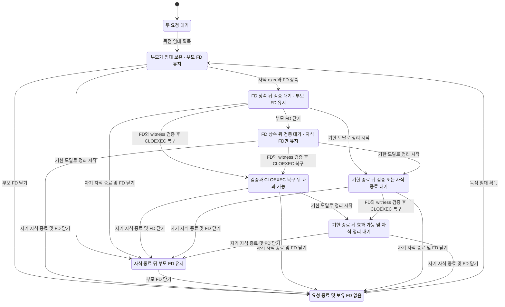

# I3a-A FD 상속 admission 모델 보강

이 보고서는 A의 **MODEL 증거**다. production 소스는 읽기만 했으며 실제 kernel/witness/프로세스 시험의 GREEN으로 승격하지 않는다. 기존 #8120 branch는 merge하지 않았다. immutable a5의 TLA/23cfg는 저장소 밖 원본 추출본 그대로 다시 실행했고, A의 중간 exec/admission 상태를 별도 `InstanceAdmission.tla`로 보강했다. 수학적 refinement-map theorem을 기계 증명한 것이 아니라 실제 계약의 행동 단계를 더 드러낸 모델이다.

## 수정 전과 보강 후

| 항목 | a5 기존 LeaseLifetime | A InstanceAdmission |
| --- | --- | --- |
| 단계 | Acquire→Start가 exec/FD상속/실행을 원자로 취급 | Pending→Held→Inherited→Admitted→Stopping/Released. Inherited에서 부모 crash를 따로 탐색 |
| FD/witness admission | Start 시 childFd 보유를 가정; 실제 첫 효과 전 검증 없음 | missing/foreign/unlocked/bad_witness는 정상모델에서 거절. Proof+CLOEXEC 뒤에만 gateway 효과 |
| scope | resource1·요청 A/B 각1회 | 고정 pool `.gateway.lease` resource1·요청 A/B 각1회. partial-overlap inventory/다른 host 없음 |
| deadline/no-retry | 별도 시간/제출 횟수 없음 | Bound2 추상 tick, 기한 후 spawn 차단·Stopping, request별 spawn≤1. 실제 초/stop grace 상한 증명은 아님 |
| 실행 | 원본 exact23 다시 실행: 23/23 기대일치, 정상4 GREEN/변이19 RED, ERROR0/skip0. instance10은 부분집합 | full10 cfg: 정상1 GREEN/변이9 expected RED, ERROR0/skip0. 정상5100 distinct states |
| 차트 | 기존 compact와 raw는 이전 L0 증거에 보존 | 별도 표시cfg valid입력만/Bound1: 315상태→9표시상태·21화살표. full5입력/Bound2 검증 대체 아님 |

기존 a5 TLA SHA256은 `68864d182b701d6d446b61480287be9303ac7895d76a5702eb69576882586c64`로 전후 동일하다. 새 source/cfg의 최종 SHA는 `reports/i3a-a/logs/model-admission-final-inputs.json` 및 summary에 있으며 full10/차트6 실행 뒤 모두 같은 바이트다. 최초 초안 late_spawn은 primed boolean RHS 괄호 누락으로 exit75 ERROR였고 RED로 세지 않았다. 원문을 보존했으며 수정 후 **10개 전부 현재 SHA로 재실행**했다.

새 cfg는 `admission/` 하위에 두어, 향후 기존 check_models.py의 root `*.cfg` exact23 선택 집합을 오염시키지 않는다. 정상/guard 변이는 같은 TLA 바이트에 Mut만 바꾼다. 표시cfg만 입력5→1/Bound2→1로 축소하며 구분해 보고한다.

## 네 규칙과 실제 A call graph

아래 production 좌표는 base aa64 위 최종 A candidate source를 읽어 확정했다. 정확한 여섯 생산 파일 SHA는 `reports/i3a-a/logs/model-source-freeze.json`에 있다. 아직 A commit 전이므로 root가 후속 commit을 이 바이트에 결박해야 한다. 이 모델 담당자의 runtime 실행 수는0이며 Python 담당 실측과 Rust GREEN 미실행은 별도 표시한다.

정상 caller는 `scripts/dev_instance/__main__.py:38`의 up parser → `:53–56` supervise → `lifecycle.py:49–75` validate/binary SHA/선언 env/고정 lease/명시 dcserver spawn → `src/cli/dcserver.rs:875–881` 최초 handle admission → `test_instance::lifecycle::admit_dcserver:19` → `admit:48`다. Rust `_test_lease` binding이 handler 수명 동안 File을 보유한다. test global duplicate cleanup은 dcserver.rs:919의 legacy_cleanup_if_unscoped 호출과 lifecycle.rs:13 guard로 비활성화하며 기존 root singleton은 유지한다. A 결과 live_ready=false/restarts0은 lifecycle.py:89–92다. **Admitted는 Ready가 아니다.** 실제 PG/Herdr/health 및 B 자원 cleanup은 이 모델 밖이다.

| 규칙 | 모델 행동/좌표 | 실제 production 연결 | 실제 runtime 증거 상태 |
| --- | --- | --- | --- |
| NoDualGateway | gateway 별도 변수, Admit54–64 이후만 true; child exit94–102에서 false. 117–118에서 gateway수+금지된 duplicate≤1 | lease.py:63–80의 kernel flock, lifecycle.py:73–75 단일 Popen·:92 restarts0, dcserver 첫 guard | Python14와 actual1000은 아래 별도 metadata. 실제 Rust admission GREEN은 NOT_RUN |
| NoHolderTheft | Holder12, Acquire32–39, ParentExit86–93/ChildExit94–102. parent FD close가 child holder lock을 풀지 않음 | lease.py:82–97 close-only; Rust HeldLease File 소유, LOCK_UN 호출 없음 | Python actual fd 상속/경쟁 BUSY/자기 wrapper SIGKILL은 별도 metadata. Rust 검증 syscall GREEN은 NOT_RUN |
| OrphanReacquire | 124–125: 모든 parent/child holder가 계속 사라진 조건에서 pending 요청이 결국 획득 단계를 통과. WF Acquire 가정 | 동일 fixed inode 재사용, lease.acquire:124–130; kernel lock 소유가 없을 때만 다음 acquire | **고아 자원 정리 생존성은 증명하지 않음.** Python의 wrapper-crash/마지막 holder 뒤 실제 재획득 metadata를 별도 연결 |
| NoForeignCleanup | 120의 ~foreignCleanup, mutation ForeignCleanup103–108만 비트를 바꿈 | lifecycle.py:34–46은 sole/unreaped Popen handle만 TERM/KILL; orphan rawPID kill 없음. dcserver 전역 cleanup test guard | 추상 boolean은 PID/receipt/lsof/root/socket 정리 안전성 증명 아님. Python sole Popen cleanup/path 음성은14시험 metadata. Rust legacy cleanup guard GREEN은 NOT_RUN |

AdmissionBeforeEffects(121)는 kernel/witness/CLOEXEC 추상 전제를 드러낸 추가 규칙이다. NoSpawnAfterDeadline(122)는 추상 시간이 지난 뒤 spawn 허용 branch를 제거하는 계약이다. SingleChildNoRetry(123)는 one-shot 요청별 구조적 spawn≤1만 확인하며 실제 supervisor 재시작 루프 전체를 증명하지 않는다.

## 실제 I/O와 추상 전제의 경계

| 실제 I/O/계약 | 모델 표현 | 실제 코드 좌표와 남는 입증 |
| --- | --- | --- |
| fixed parent/control path·private uid/mode/nlink/dev/inode | resource1 고정, identity boolean | Python lease.py:41–53/100–116; Rust lifecycle.rs:115–167. inode 교체·symlink/hardlink·동시 path 교체 안전은 모델에 없음 |
| owner record/body·root/instance/nonce·fd env | witness boolean, bad_witness 입력 거절 | Python lock획득 뒤 lease.py:70–79의 body publish/verify; Rust :52–73 env 형식/root/UUID·FD metadata, :92–98 pread body exact. owner record는 단독 배타권이 아니며 kernel 증거가 별도 |
| independent fresh-open BUSY | Proof의 owner 및 childFd 추상 조건 | Rust :74–81. 실제 EWOULDBLOCK witness와 잘못된 errno·probe free 거절을 runtime에서 확인해야 함 |
| inherited incoming FD의 same-OFD EXNB | childFd=true가 그 control lock을 실제 보유한다는 가정 | Rust :82 및 File 소유. fstat/probe만으로 same-OFD를 대신하지 않음. 두 kernel probe 사이 OS interleaving은 원자 Proof로 추상화했으므로 별도 runtime/race 검토가 필요 |
| path 재검사·CLOEXEC 복구 | Admit에서 Proof 확인 뒤 cloexec=true, 이후 gateway=true | Rust :86–111; actual fcntl 실패·provider/daemon exec 뒤 lease FD 없음은 모델 bool만으로 입증하지 않음 |
| wall/startup/stop grace | Bound2의 추상 Tick/Timeout | Python lifecycle.py:26–31/:69–83. 실제 monotonic 시간/Popen 지연·TERM/KILL 및 두 grace wait의 벽시계 상한은 runtime 시험 대상 |

정상 입력은 위 코드의 승인 경로를, missing/foreign/unlocked/bad_witness는 거절 경로를 추상화한다. 유효한 증거가 없는데도 통과하는 guard삭제를 mutation으로 탐색했다. 모델의 Proof boolean이 실제 syscall 결과를 자동으로 입증한다고 주장하지 않는다. child가 종료되지 않는 Stopping은 허용한다. A/B의 협력 종료/cleanup HOLD 정책을 무한 crash에도 결국 정리된다는 생존성으로 바꾸지 않는다.

## cfg 결과와 최소 반례

아래 상태 수는 원본 TLC가 첫 위반에서 멈춘 distinct 수다. statechart는 깨진 규칙을 제거해 더 탐색하므로 수가 다르다. raw state 번호는1부터, 보고의 행동 경로는 Init을0으로 센다.

| cfg Mut | 기대/실제 규칙 | exit | distinct states | 최소 행동 경로 |
| --- | --- | ---: | ---: | --- |
| none | GREEN | 0 | 5100 | 반례 없음 |
| duplicate_child | NoDualGateway | 12 | 18 | Init→Acquire→Spawn→Admit |
| foreign_cleanup | NoForeignCleanup | 12 | 11 | Init→Acquire→ForeignCleanup |
| late_spawn | NoSpawnAfterDeadline | 12 | 82 | Init→Acquire→Tick→Tick→Spawn |
| leak_fd | OrphanReacquire | 13 | 4743 | Init→Acquire→Spawn→Admit→ChildExit→ParentExit→stutter |
| non_atomic | NoHolderTheft | 12 | 34 | Init→ObserveFree→Acquire→Acquire |
| parent_unlock | NoHolderTheft | 12 | 20 | Init→Acquire→Spawn→ParentExit |
| skip_admission | AdmissionBeforeEffects | 12 | 22 | Init→Acquire→Spawn→Admit |
| skip_cloexec | AdmissionBeforeEffects | 12 | 18 | Init→Acquire→Spawn→Admit |
| skip_same_fd | AdmissionBeforeEffects | 12 | 22 | Init→Acquire→Spawn→Admit |

parent_unlock에서 **Inherited 직후 부모 crash** 3단계가 NoHolderTheft를 깨뜨린다. skip_admission은 검증 없는 효과3단계 뒤 부모 close→B Acquire/Spawn/Admit의7단계에서 NoDualGateway까지 깨진다. duplicate_child는 공유 FD가 있더라도 두 Gateway를 동시에 허용하면3단계에서 RED다. leak_fd는 intended parent/child FD가 모두 닫혔는데 금지된 helper가 남아 다음 acquire를 영구 막는 liveness 반례다.

## 정상 compact 상태 차트

이 그림은 `admission/chart-none.cfg`의 valid입력1/Bound1 표시 전용 탐색이다. full validation은 all5입력/Bound2로 별도5100상태를 확인했다. 표시에서 A/B 이름 대칭과 동일 표시 상태 안의441단계를 생략했으며 safety 탐색에는 포함했다. Inherited의 부모+자식 FD/자식 FD만 보유와 Stopping의 admission 전후를 구별했다. Admitted/Stopping 안의 부모 close는 표시 상태 안으로 합쳤고 raw에는 포함해 pre-admission 부모 crash를 숨기지 않았다.



그림 원문은 `InstanceAdmission.chart.mmd`다. statechart6회는 정상 표시1 exit0/변이5 exit1로 기대 일치했다. parent_unlock·skip_admission·duplicate_child·foreign_cleanup·leak_fd는500상태 그림 예산을 넘어 도구가 **버그 최단 경로만** 그렸고, 탐색 raw 전체는 보존했다. Rules not checked는 없다.

- parent_unlock: `reports/i3a-a/logs/model-admission-chart-parent_unlock/{report.md,chart.mmd,tlc*.out}`. NoHolderTheft3단계/NoDualGateway7단계.
- skip_admission: 같은 접두사의 `model-admission-chart-skip_admission/`. AdmissionBeforeEffects3단계/NoDualGateway7단계.
- duplicate_child: `model-admission-chart-duplicate_child/`. NoDualGateway3단계.
- foreign_cleanup: `model-admission-chart-foreign_cleanup/`. 추상 NoForeignCleanup2단계.
- leak_fd: `model-admission-chart-leak_fd/`. OrphanReacquire5단계 뒤 영구 stutter. 이 종료 후 새 Gateway 재획득과 auxiliary 자원 정리는 별개다.

## 가정·미구현 및 계수 제한

1. 지정 단일 host·global pool1·고정 `.gateway.lease` inode가 가정이다. 파일 교체/NFS/분산·다른 inventory 조합을 탐색하지 않는다.
2. 실제 open/fstat/pread/flock/fcntl 결과는 identity/witness/childFd/cloexec로 추상화한다. owner JSON은 권위가 아니며 actual kernel/same-OFD/CLOEXEC 증거는 runtime 시험에서 따로 확보해야 한다.
3. 요청 A/B 각1회와 유한 Bound를 사용한다. Acquire/Tick/Timeout/Reject의 weak fairness를 명시했으며 ChildExit/강제 orphan 정리의 eventual 성공은 가정하지 않는다. OrphanReacquire는 모든 intended holder가 결국 계속 사라지는 조건부 속성이고 Ready 도달이나 강제 cleanup 성공을 뜻하지 않는다.
4. 외부 cleanup은 boolean mutation만, 실제 health/PG/provider/Discord·receipt/PID 재사용·다운중 crash 복원·OS 벽시계 deadline/permission은 모델 밖이다. Wait는 환경의 stutter를 허용하므로 NoDeadlock GREEN을 별도 제품 교착해소 증거로 세지 않는다.

**actual concurrency1000은 Python 담당 실측만** 사용한다. 모델 A/B 두 요청, TLC5100 states, 표시315 states를1000회로 합산하지 않는다. 이 모델 담당의 actual I3a runtime/PG/cargo 실행은0이다. A의 실제 첫 효과 admission/부모 crash/foreign 거절/자원 종료 시험은 root/Python/Rust 담당의 결과를 별도로 연결해야 한다.

## 증거·재현·크기

- before a5 exact23: `reports/i3a-a/logs/model-l0-baseline-matrix.log`, `model-l0-baseline-matrix/results.json` 및 cfg별 raw.
- after final10: `model-admission-final-results.json`, `model-admission-final-*.log`; 정확 argv/exit/기대규칙/log SHA 포함.
- source/cfg SHA 및 scratch: `model-admission-final-inputs.json`; 전후바이트/현재 source 관측SHA: `model-admission-summary.json`; raw 최소 경로: `model-admission-shortest-traces.json`.
- statechart6 argv/log SHA: `model-admission-chart-results.json`, view: `model-admission.view.mjs`, normal/변이별 도구 report/chart/raw는 같은 logs 하위.
- 오류 초안(미집계): `model-admission-results.json`, `model-admission-late_spawn.log` exit75. 수정 전 입력 manifest와 scratch를 보존해 ERROR를 RED로 바꾸지 않았다.

저장소 root에서 아래 독립 재현 명령을 사용한다. 기존 a5-only와 현재 A-only를 **서로 다른 scratch 디렉터리**에 두며 root cfg를 섞지 않는다. a5 Git object가 없거나 cfg 집합이 다르면 실패한다. 저장된 view도 추적 문서로 포함했다. 이 코드 블록은 이번 읽기 검토에서 구문만 확인했으며 재실행 수에 더하지 않는다. 새 out만 사용하고 임시 파일을 지우거나 운영 endpoint에 접속하지 않는다.

```sh
unset TMUX TMUX_PANE
python3 -B - <<'PY'
import hashlib, os, re, shutil, subprocess, tempfile
from pathlib import Path
repo = Path.cwd().resolve()
scratch = Path(tempfile.mkdtemp(prefix="adk-i3a-reproduce-", dir="/private/tmp"))
old = scratch / "a5-only"
new = scratch / "A-only"
old.mkdir(); new.mkdir()
ref = "a5caed86eaf2f8a00faa6dba66b57b6d7c4a8264"
prefix = "docs/statecharts/e2e-run-lease"
paths = subprocess.check_output(["git", "ls-tree", "-r", "--name-only", ref, prefix], text=True).splitlines()
for name in paths:
    leaf = Path(name).name
    if name.endswith(".cfg") or leaf in {"LeaseLifetime.tla", "check_models.py"}:
        (old / leaf).write_bytes(subprocess.check_output(["git", "show", f"{ref}:{name}"]))
assert len(list(old.glob("*.cfg"))) == 23
src = repo / prefix
for leaf in ["InstanceAdmission.tla", "InstanceAdmission.view.mjs"]:
    shutil.copyfile(src / leaf, new / leaf)
shutil.copytree(src / "admission", new / "admission")
assert hashlib.sha256((new / "InstanceAdmission.tla").read_bytes()).hexdigest() == "28a1d8cc28db14b81cb6f804586bb4c9a244ccb7d51170fe8cdaa187322533aa"
java = "/opt/homebrew/opt/openjdk@25/libexec/openjdk.jdk/Contents/Home/bin/java"
jar = "/Users/itismyfield/.local/share/tla2tools/tla2tools-1.7.4.jar"
subprocess.run(["python3", "-B", str(old / "check_models.py"), "--self-test-selection"], check=True)
subprocess.run(["python3", "-B", str(old / "check_models.py"), "--java", java, "--jar", jar, "--out", str(scratch / "old-results")], check=True)
expected = {"none": None, "parent_unlock": "NoHolderTheft", "non_atomic": "NoHolderTheft",
            "skip_admission": "AdmissionBeforeEffects", "skip_same_fd": "AdmissionBeforeEffects",
            "skip_cloexec": "AdmissionBeforeEffects", "duplicate_child": "NoDualGateway",
            "foreign_cleanup": "NoForeignCleanup", "leak_fd": "OrphanReacquire",
            "late_spawn": "NoSpawnAfterDeadline"}
assert {p.name for p in (new / "admission").glob("admission-*.cfg")} == {f"admission-{m}.cfg" for m in expected}
matched = 0
for mut, rule in expected.items():
    result = subprocess.run([java, "-Xmx512m", "-XX:+UseParallelGC", "-cp", jar, "tlc2.TLC",
        "-workers", "1", "-metadir", str(scratch / f"{mut}-states"), "-config",
        str(new / "admission" / f"admission-{mut}.cfg"), str(new / "InstanceAdmission.tla")],
        text=True, capture_output=True, timeout=80)
    raw = result.stdout + result.stderr
    (scratch / f"new-{mut}.log").write_text(raw)
    violation = re.search(r"Invariant (\w+) is violated", raw)
    actual = violation[1] if violation else "OrphanReacquire" if "Temporal properties were violated" in raw else None
    good = (result.returncode == 0 and "Model checking completed. No error has been found." in raw) if rule is None else (result.returncode in (12, 13) and actual == rule)
    assert good, (mut, result.returncode, actual)
    matched += 1
assert matched == 10
chart = "/Users/itismyfield/.codex/skills/statechart/scripts/statechart"
env = {**os.environ, "JAVA": java, "TLA2TOOLS": jar, "JAVA_TOOL_OPTIONS": "-Xmx512m"}
for label, cfg, code in [("normal", "chart-none.cfg", 0), *[(m, f"admission-{m}.cfg", 1) for m in ("parent_unlock", "skip_admission", "duplicate_child", "foreign_cleanup", "leak_fd")]]:
    result = subprocess.run([chart, str(new / "InstanceAdmission.tla"), "--config", str(new / "admission" / cfg),
        "--view", str(new / "InstanceAdmission.view.mjs"), "--out", str(scratch / f"chart-{label}")], env=env)
    assert result.returncode == code
print("old23/new10/chart6 기대 일치:", scratch)
PY
```

공식 skill `pr_cap_prod.py`의 EXCLUDE `docs/*`가 model/cfg/report/chart를 제외한다. 이번 문서 경로는 production0파일/+0으로 분류되지만, **uncommitted 문서의 prospective 분류일 뿐 전체 A cap PASS 실측은 아니다**. 최종 commit 후 root가 공식 base/head cap을 별도로 실행해야 한다. 분류 원문은 `reports/i3a-a/logs/model-cap-classification.json`에 보존한다.

환경: macOS arm64, Java25.0.5/TLC2.19(tla2tools1.7.4), worker1/heap512MiB, Python3.14, SHELL=/bin/zsh. scratch는 저장소 밖 `/private/tmp/adk-i3a-admission-final-*`다. cargo profile=N/A·cargo0·PG0·운영 파일/프로세스/다른 worktree 접근0. 모델 소스/cfg 외 production 수정0이며 원본 a5 merge0이다.

## 최종 source 대조로 보정한 두 가정

최초 leak_fd 초안은 Spawn에서 helper FD를 만들었다. 이는 FD가 잘못되어 admission에서 거절되는 경로에서도 helper가 생겨 실제 A 전제와 달랐다. 최종 모델은 **유효 admission 이후에만** helper 전파 변이를 넣었다. 최종 liveness RED는 Acquire→Spawn→Admit→부모/자식 종료 뒤 남은 helper가 원인이다. 거절된 사전조건을 원인제거 RED로 세지 않는다. 이전 입력/raw는 `model-admission-pre-refinement/`에 보존하고 최종 집계에서 제외했다.

현재 Rust에는 child-side deadline 입력/검사가 없고 Python supervisor가 timeout 후 자기 자식에 TERM/KILL grace를 준다. 최종 모델은 **Stopping 상태에서도 올바른 FD/witness 검증이 끝나면 효과를 시작할 수 있게** 보수적으로 탐색한다. 기한 직후 모든 효과0 또는 child admission 자체의 시간 gate를 증명했다고 주장하지 않는다. 별도 NoSpawnAfterDeadline은 Python이 새 Popen 전에 남은 예산을 확인하는 계약만 다룬다. 이전의 과강한 admission-time 가정 입력/raw는 `model-admission-before-timeout-overapprox/`에 보존했다.

두 보정 뒤 full10과 statechart6을 모두 최종 source SHA로 다시 실행했다. 개발 중 여러 번 실행한 수를 unique cfg에 더하지 않는다. 실제 wall/stop grace·kill 실패/HOLD·FD/OFD syscall 음성은 runtime 담당의 별도 증거가 필요하다.

## 최종 candidate source freeze와 I/O 순서

Rust baseline stub 검증은 끝나 source가 복원됐고, foreign FD 본문을 canonical lease 확인 전에 읽는 순서도 수정됐다. 실제 순서는 witness 형식/root/instance/nonce(:52–65)→incoming FD metadata(:66–73)→canonical control inode metadata(:74–75)→independent-open BUSY(:77–81)→incoming same-OFD-compatible EXNB(:82)→control path 재개방 확인(:86–91)→본문 pread/exact witness(:92–98)→CLOEXEC(:99–108)→witness env 제거(:110)다. 최종 `legacy_cleanup_if_unscoped:13`와 dcserver 실제 호출(:919)도 확인했다.

이는 **소스의 I/O 순서 관측**이며 모델 Proof boolean으로 foreign-FD 본문 접근0을 증명한 것이 아니다. 해당 Rust negative/GREEN 실행은 아직 NOT_RUN이다. baseline2의 실제 assertion RED/build0/바이트 복원은 `reports/i3a-a/logs/rust-baseline.json`에 별도로 보존한다. baseline의 source/바이너리를 새 I/O 순서의 GREEN으로 재라벨하지 않는다.

최종 TLA SHA256은 `28a1d8cc28db14b81cb6f804586bb4c9a244ccb7d51170fe8cdaa187322533aa`다. 실제 source·final-inputs manifest·summary 세 값이 같다. helperFd 생성 변이는 Spawn이 아니라 Proof가 필요한 Admit 안에만 있고, Admit는 Inherited/Stopping 모두 허용한다. source freeze 때 모델 입력/11cfg 바이트가 모두 동일하여 TLC를 다시 실행하지 않았다. 검증된 모델 계보와 새 production source 관측 SHA를 혼합하지 않는다.

## a5와 현재 모델의 규칙값·행동 대응

| 약속 | a5 기본/변이 값 | 현재 기본/변이 값 | A source 연결과 범위 |
| --- | --- | --- | --- |
| noDual | NoDualGateway=NoDualWriter, Active≤1 GREEN; duplicate_child RED | gateway bool은 Stopping에도 유지, 총≤1 GREEN; duplicate_child RED | Python 단일 spawn/restarts0 + global control lease + Rust 첫 admission. Ready/실제 Gateway 관측은 별도 |
| noHolderTheft | Holder⇒owner 동일 GREEN; Start 뒤 parent_unlock RED | 같은 규칙 GREEN; Inherited에서 부모 종료 직후 parent_unlock RED | close-only wrapper/File RAII. pre-admission 부모 crash 단계를 보강 |
| orphan reacquire | NextRequestProgress GREEN; helper leak RED | 같은 조건부 속성을 OrphanReacquire로 명명, GREEN; valid Admit 뒤 helper leak RED | intended holder가 모두 끝난 뒤 kernel 재획득. auxiliary cleanup 성공/Ready 도달은 뜻하지 않음 |
| noForeignCleanup | foreignCleanup 추상비트 false GREEN, mutation true RED | 동일 추상비트 false GREEN/변이 RED | sole Popen handle/legacy cleanup guard의 실제 동작은 runtime 증거 필요. PID 정리 알고리즘 증명 아님 |

## Python actual 증거: 모델과 별도 계수

- `reports/i3a-a/logs/python-source-freeze.json`, `reports/i3a-a/logs/python-target-result.json`, `reports/i3a-a/logs/python-target-green.log`: selected/executed/passed14, failed0, skip0. 세 Python 생산 파일이 이 freeze의 SHA와 같은지 읽기 대조했다. PG_actual=false/live_ready=false다.
- actual1000은 위 Python14 중 한 시험의 내부 시도 집합이다. independent open1000, 실제 common gate에 도달한 distinct worker32, winner1/EWOULDBLOCK999/other0/duplicate0, winner는 결과1000 수집까지 FD를 유지했다. **worker_ready32는 인스턴스 Ready가 아니다.** 모델 A/B 두 요청·5100상태·315표시모델상태와 합산하지 않는다.
- `reports/i3a-a/logs/python-kernel-exclusion-1000-result.json`, `reports/i3a-a/logs/python-last-holder-close-result.json`, `reports/i3a-a/logs/python-mutants.json`: 실제 assertion RED·바이트 복원을 별도 보존한다. 강화한1000 재생은 같은 kernel 변이이며 distinct mutant6으로 세지 않는다.
- Python source freeze에는 자기 wrapper SIGKILL→child 생존 중 EWOULDBLOCK→협력 종료→same inode 재획득과 parent close→child cooperative exit→재획득 증거가 있다. raw orphan PID kill이나 B down/reap 완료를 주장하지 않는다.
- `reports/i3a-a/logs/rust-baseline.json`는 build0/실제 assertion RED2/skip0이며 **현재 final Rust GREEN은 NOT_RUN**이다. 전체 A 완료/health/PG/Ready로 승격하지 않는다.

compact 표시에서는 Admitted/Stopping 안의 부모 FD close와 종료한 요청 수 차이를 합쳤다. Inherited의 부모+자식 보유/자식만 보유 및 Stopping 중 admission 전후 효과 가능성은 구별한다. 생략한 단계는 raw 탐색에 포함되며 버그 규칙 조합이 다른 상태를 합치지 않았다.
