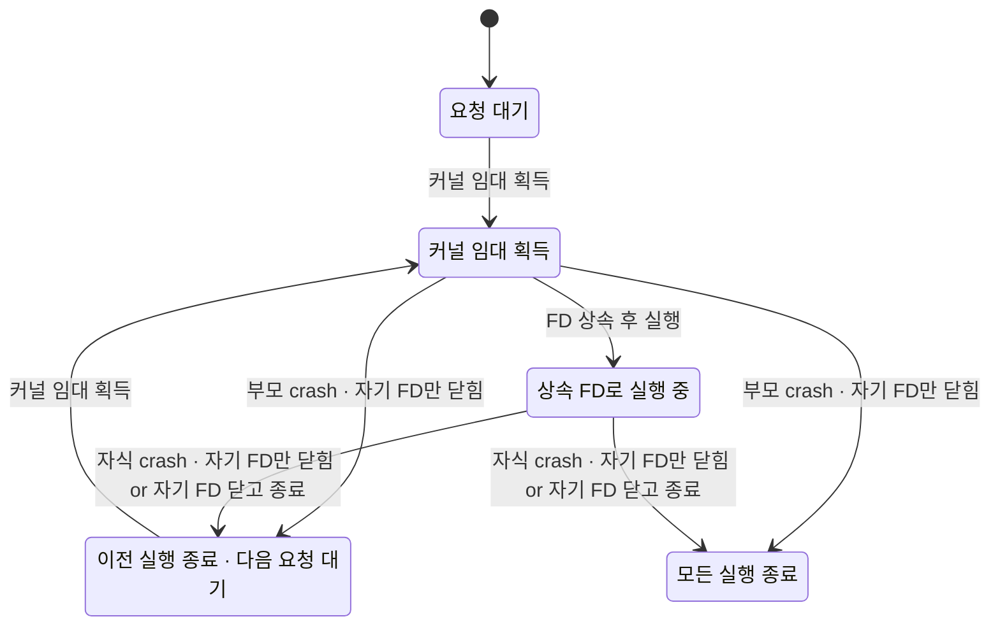

# Run lease · test instance FD 수명 검증

2026-11-13 KST, L0. **현재 production lease를 수정하지 않았다.** 아래 GREEN은 제안한 고정 inode flock/상속 FD/전송 journal 계약의 유한 모델 및 임시 파일 OS 실험이다. 현재 제품의 lease 안전성을 GREEN으로 승인하지 않는다.

## 코드 기준과 범위

코드 감사 기준 `origin/main=79bebdd4eaa29b289bf88412825baa7d70a6ac77`, 레인 기반 `21c80274`다.

| 현재 main 좌표 | 관측·경계 |
| --- | --- |
| `scripts/e2e/tui_relay/lease.py:15` | cell 별칭별 경로이며 실제 parent 쌍 단일 resource가 아님 |
| `scripts/e2e/tui_relay/lease.py:34` | read 후 TTL 비교. live holder의 커널 배타권 확인 없음 |
| `scripts/e2e/tui_relay/lease.py:41` | O_TRUNC open, read와 원자적 획득이 아님 |
| `scripts/e2e/tui_relay/lease.py:44` | owner 쓰기 뒤 FD가 닫힌 후 context를 실행함 |
| `scripts/e2e/tui_relay/lease.py:50` | 이전 context가 후계 파일도 unconditional unlink할 수 있음 |
| `scripts/e2e/run_tui_relay.py:5416` | 현재 일반 하네스의 cell lease 진입 |
| `scripts/e2e/post_deploy_turn_smoke.py:428` | 현재 reset 경로의 같은 lease 사용 |

이 기존 결함은 그대로 남겨 후속 S1의 시험 전용 lease 구현과 분리했다. 운영 run/설정/프로세스/DB에 쓰지 않았고 새 kill·unlink·TTL 회수 권한을 추가하지 않았다. 제안 정본은 `docs/e2e-continuous.design.md` §6과 `docs/test-infra.design.md` §4.1이다.

`Kind=run`은 parent 쌍 입력 writer, `Kind=instance`는 bot-set Gateway child다. 같은 FD 수명 메커니즘을 각각 독립 실행하며 **instance lifetime lock이 run channel lock을 대체하지 않는다**. 한 모델은 resource 하나와 요청 A/B 각 1회만 다룬다. instance 실행은 네트워크 전송을 생략하고, run 실행은 durable pending→전송→늦은 수락→ACK/settlement→해제를 추가한다. 두 요청은 TTL/스케줄 횟수를 표현하기 위한 임의 운영 상한이 아니라 최소 경쟁 반례다.

## 불변식·생존성

- `NoDualWriter` / `NoDualGateway`: Running·Prepared·Draining의 활성 child≤1. 동일 FD를 두 child에 넘기는 뮤턴트도 RED다.
- `NoHolderTheft`: parent·driver·금지된 helper 중 FD를 가진 주체의 owner가 바뀌거나 사라지지 않는다.
- `WriterHasInheritedFd`: 실행 허용 시 driver가 FD를 직접 보유한다. startup의 실제 inode/instance witness 검증 구현은 I3a/S1에 남는다.
- `UncertainSendJournaled` / `NoNewWriterDuringUncertainty`: 미확정 전송은 내구 기록으로 남고 후계는 PausedUncertain으로 대기한다. ACK 불명 상태의 늦은 서버 수락은 새 writer와 겹치지 않는다.
- `NoSendAfterRelease` / `NoForeignCleanup`: 해제 뒤 옛 실행의 새 send와 외부 cleanup 권한은 없다. 이미 보낸 HTTP의 늦은 **수락**은 새 send와 구분한다.
- `NextRequestProgress`: clean(미완결 전송 없음·실제 처리 종료)과 **의도한 parent+driver FD가 모두 없음**이 이후 안정적으로 유지되면, weak fairness 하에 각 Pending 요청이 결국 Held로 진행한다. 이 속성은 Running 진입까지 주장하지 않는다. 정상 모델에는 helper holder가 없다. `leak_fd`는 금지된 helper가 남아 **의도한 수명이 끝난 뒤에도** 진행을 막는 반례다. 이를 ‘helper까지 포함한 모든 holder 종료’ 증명이라고 부르지 않는다.
- `NextRequestStarts`: 별도 `*-live-*.cfg`에서 `CrashEnabled=FALSE`, startup/resume/send/finish/release와 실제 ACK/수락/settlement/reconcile가 weakly fair라는 추가 가정하에 각 요청이 Running에 도달한다. 영원한 provider 장애·ACK 유실·임의 crash 하에서 진행을 보장하지 않는다.

미완결 기록 작성 직전/직후 crash, parent/driver 각각의 crash, owner 진단 기록이 없어도 FD가 남는 경우, ACK 전에 parent/driver가 모두 종료되는 경우를 탐색한다. Prepare 뒤 전송 전에 둘 다 죽어 정확한 미전송 witness가 없는 경우 기록을 자동 삭제하지 않으므로 pause가 영구 지속될 수 있다. 조건부 liveness 전제가 성립하지 않는 정직한 불확정 상태다. receipt 본문은 배타권 결정에 쓰지 않아 옛 owner receipt의 생존 추정/TTL이 권위를 갖지 않는다.

## S0 r2: 공통 CI 등록과 전체 위반 집합

2026-11-13 17:22 KST, 기반 `a5caed86eaf2f8a00faa6dba66b57b6d7c4a8264`. 공통 `scripts/ci/statecharts_tlc.py`와 `.github/workflows/statecharts-tlc.yml` 경로에 L0 **23 cfg를 빠짐없이 등록**했다. `docs/statecharts/expected.tsv`의 셋째 열은 전체 invariant/deadlock 위반, 넷째 열은 전체 liveness 위반이다. 이 절이 CI 기대값 정본이며 아래 최초 실행의 ‘첫 위반’ 표는 조사 이력이다.

수정 전 같은 공통 CLI의 `--base HEAD --head HEAD`는 `NO_TARGETS`와 함께 23개의 `config not listed in expected.tsv`를 출력하고 **exit 1 RED**였다. 첫 위반에서 멈추는 이전 개별 실행만으로는 누락된 `NoDualGateway`·`NoDualWriter`·`NoNewWriterDuringUncertainty`가 기대값에서 빠지므로 이를 CI 결과로 재사용하지 않았다.

공통 runner가 위반 safety rule을 제거하며 재실행한 뒤 각 PROPERTY를 **한 개씩** 검사하는 원래 로직으로 전체 집합을 실측했다. fairness precheck도 그대로 적용했다. source/model 분류·선택·판정에는 수정을 가하지 않았고, 외부 `run_common_logged.py`는 공통 `main`에 같은 CLI 인자를 전달하며 `run_java` 반환 원문만 보존했다. 지정 모델만 실행하기 위해 저장소 밖 scoped root에 TLA/cfg 원본 23개와 해당 expected 23행을 복사했고, 원본과 복사본의 바이트 동일성을 확인했다.

등록 후 공통 CLI **23/23 기대집합 정확 일치, exit 0, ERROR 0, skip 0**. **TLC 85회 + fairness precheck 23회**, `--jobs 2 --timeout 300`, 총 **45.5초**, cfg당 최대 **6.2초**다. 4개 정상 cfg는 전체 safety/liveness가 GREEN이고 19개 뮤턴트는 기대한 전체 위반 집합이 RED다. ‘RED가 발생했다’만으로 PASS하지 않고 각 cfg의 누락/추가 위반이 모두 없는지 공통 runner가 대조했다.

유계 조건은 resource 1개, 요청 `A/B` 각 1회, 유한 phase/FD/전송 상태이며 모델/cfg를 바꾸거나 `CONSTRAINT`·`-depth`·simulation으로 탐색을 잘라 통과시키지 않았다. run 모델의 네트워크 상태는 단일 전송으로 순서화하며 instance 모델은 전송을 생략한다. `Spec`은 획득 WF를, `FairSpec`은 no-crash cfg에서 startup/ACK/settlement/종료의 WF를 추가한다. `NextRequestProgress`는 clean과 의도한 parent+driver FD 비보유의 안정적 유지에만 조건부이고, `NextRequestStarts`는 no-crash+fair 환경에서만 주장한다. helper FD leak은 금지한 helper가 의도한 수명 뒤 진행을 막는 반례다. production 구현·실제 Discord E2E 완료를 뜻하지 않는다.

| config | 기대하는 전체 safety/deadlock 위반 | 기대하는 전체 liveness 위반 |
| --- | --- | --- |
| instance-duplicate_child.cfg | NoDualGateway,NoDualWriter | - |
| instance-foreign_cleanup.cfg | NoForeignCleanup | - |
| instance-leak_fd.cfg | - | NextRequestProgress |
| instance-live-leak_fd.cfg | - | NextRequestStarts |
| instance-live-none.cfg | - | - |
| instance-missing_fd.cfg | NoDualGateway,NoDualWriter,WriterHasInheritedFd | - |
| instance-non_atomic.cfg | NoDualGateway,NoDualWriter,NoHolderTheft | - |
| instance-none.cfg | - | - |
| instance-parent_unlock.cfg | NoDualGateway,NoDualWriter,NoHolderTheft | - |
| instance-ttl_takeover.cfg | NoDualGateway,NoDualWriter,NoHolderTheft | - |
| run-clear_on_idle.cfg | UncertainSendJournaled | - |
| run-duplicate_child.cfg | NoDualGateway,NoDualWriter | - |
| run-foreign_cleanup.cfg | NoForeignCleanup | - |
| run-leak_fd.cfg | - | NextRequestProgress |
| run-live-leak_fd.cfg | - | NextRequestStarts |
| run-live-none.cfg | - | - |
| run-missing_fd.cfg | NoDualGateway,NoDualWriter,NoNewWriterDuringUncertainty,WriterHasInheritedFd | - |
| run-no_pending.cfg | UncertainSendJournaled | - |
| run-non_atomic.cfg | NoDualGateway,NoDualWriter,NoHolderTheft,NoNewWriterDuringUncertainty | - |
| run-none.cfg | - | - |
| run-parent_unlock.cfg | NoDualGateway,NoDualWriter,NoHolderTheft,NoNewWriterDuringUncertainty | - |
| run-send_after_release.cfg | NoSendAfterRelease | - |
| run-ttl_takeover.cfg | NoDualGateway,NoDualWriter,NoHolderTheft,NoNewWriterDuringUncertainty | - |

원시 증거: `/Users/itismyfield/.adk/release/lane-runs/hl-20260925/i8120/logs/s0r2/tlc/registration-before.log`(등록누락 RED), `discovery-v2.console.log`와 `discovery-v2/`(전체 집합 발견), **`registered.console.log`와 `registered/`**(최종 23 기대일치). 각 cfg 하위 `fairness.cfg.log`와 `runN.cfg.log`는 공통 runner가 실제 실행한 원문이며 `registered/results.json`에 전체 broken/rules/runs/seconds를 기록했다. 첫 logger 시도에는 인자 위치 오류가 있어 `discovery.console.log`에 남겼으며 검증 증거에는 사용하지 않았다.

모델 SHA256 `68864d182b701d6d446b61480287be9303ac7895d76a5702eb69576882586c64`는 최초 L0와 같다. 공통 runner SHA256 `75d0532ebd0f6b64ee4dd7a0de9ad3e5e8ccb709a12e6daf0f4104ab7369debe`, fairness helper SHA256 `c370fe698546292f4ecd898467d6b84bff0c63b1d842623f8a0d5dc64fc887e9`. cfg 23개도 기반 HEAD 대비 바이트 변경 0이다. Java/TLC/OS 환경은 아래 증거 목록과 같고 cargo·PG·운영 프로세스·Discord 실행 0이다.

정확한 공통 CLI 재현(증거의 scoped root 사용, production root 아님):

```sh
JAVA_TOOL_OPTIONS=-Xmx512m python3 scripts/ci/statecharts_tlc.py --root /Users/itismyfield/.adk/release/lane-runs/hl-20260925/i8120/logs/s0r2/tlc/discovery-root --java /opt/homebrew/opt/openjdk@25/libexec/openjdk.jdk/Contents/Home/bin/java --jar /Users/itismyfield/.local/share/tla2tools/tla2tools-1.7.4.jar --timeout 300 --jobs 2
```

저장소 CI는 PR diff의 expected.tsv 추가 23행으로 이 cfg들을 선택하고, nightly/manual에서는 다른 등록 모델과 함께 전부 선택한다. CI workflow를 실행·변경하지 않았다.

## 최초 개별 TLC 결과

**23 configs = 정상 4 GREEN + 원인 뮤턴트 19 expected RED, ERROR 0, skip 0.** 정상 run 224 states, instance 20 states; 실제 Running liveness의 fair/no-crash run 49, instance 16 states다. 뮤턴트 RED는 의도된 실패이며 검사 harness는 규칙명과 nonzero exit를 대조해 전체 exit 0이다.

| config | 결과 | 첫 위반 규칙 | distinct states | TLC exit |
| --- | --- | --- | ---: | ---: |
| instance-duplicate_child.cfg | RED | NoDualWriter | 4 | 12 |
| instance-foreign_cleanup.cfg | RED | NoForeignCleanup | 6 | 12 |
| instance-leak_fd.cfg | RED | NextRequestProgress | 24 | 13 |
| instance-live-leak_fd.cfg | RED | NextRequestStarts | 9 | 13 |
| instance-live-none.cfg | GREEN | 없음 | 16 | 0 |
| instance-missing_fd.cfg | RED | WriterHasInheritedFd | 4 | 12 |
| instance-non_atomic.cfg | RED | NoHolderTheft | 19 | 12 |
| instance-none.cfg | GREEN | 없음 | 20 | 0 |
| instance-parent_unlock.cfg | RED | NoHolderTheft | 9 | 12 |
| instance-ttl_takeover.cfg | RED | NoHolderTheft | 12 | 12 |
| run-clear_on_idle.cfg | RED | UncertainSendJournaled | 29 | 12 |
| run-duplicate_child.cfg | RED | NoDualWriter | 4 | 12 |
| run-foreign_cleanup.cfg | RED | NoForeignCleanup | 6 | 12 |
| run-leak_fd.cfg | RED | NextRequestProgress | 152 | 13 |
| run-live-leak_fd.cfg | RED | NextRequestStarts | 25 | 13 |
| run-live-none.cfg | GREEN | 없음 | 49 | 0 |
| run-missing_fd.cfg | RED | WriterHasInheritedFd | 4 | 12 |
| run-no_pending.cfg | RED | UncertainSendJournaled | 16 | 12 |
| run-non_atomic.cfg | RED | NoHolderTheft | 19 | 12 |
| run-none.cfg | GREEN | 없음 | 224 | 0 |
| run-parent_unlock.cfg | RED | NoHolderTheft | 9 | 12 |
| run-send_after_release.cfg | RED | NoSendAfterRelease | 30 | 12 |
| run-ttl_takeover.cfg | RED | NoHolderTheft | 12 | 12 |

수정 전/후는 **현 제품 vs 안전한 제안 모델**의 구별이다. 현재 lease의 TTL·read/O_TRUNC race·옛 unlink는 아래 Python 재생에서 각각 RED가 확인됐다. 제안에서 해당 권한/비원자 획득을 빼면 GREEN이고 같은 원인을 cfg 뮤턴트로 되살리면 RED다. production 수리를 완료했다는 뜻이 아니다.

| 원인 | 원인 재도입 결과 | 제안 기본 모델 |
| --- | --- | --- |
| TTL 경과만으로 live 임대 탈취 | run/instance `ttl_takeover`: NoHolderTheft RED | TTL 권위 없음, GREEN |
| 관측과 획득 분리·동시 writer | run/instance `non_atomic`: NoHolderTheft RED; 상태차트의 후속 경로 NoDualWriter/Gateway RED | 원자 flock 획득, GREEN |
| 부모 crash가 child의 lock까지 해제 | run/instance `parent_unlock`: NoHolderTheft RED | 자기 FD close만, GREEN |
| exec에서 FD 상속 누락을 허용 | run/instance `missing_fd`: WriterHasInheritedFd RED; 후속 부모 crash→두 writer 경로 RED | 상속 FD 보유 후 Ready, GREEN |
| helper로 FD 전파 | acquire liveness와 실제 Running liveness 모두 RED | helper 비보유, GREEN |
| journal 누락/idle snapshot만으로 삭제/해제 후 send | 각 해당 불변식 RED | ACK+settlement 대조까지 pause, GREEN |

TLC raw trace는 State 1부터 센다. 최소 실패 경로는 다음과 같다.

| 뮤턴트 | 깨진 약속 | raw TLC 최소 경로 |
| --- | --- | --- |
| ttl_takeover | 살아 있는 FD holder를 탈취하지 않음 | 1 Init→2 Acquire→3 ExpireDiagnostic→4 Acquire |
| non_atomic | 동시에 입력권을 획득하지 않음 | 1 Init→2 ObserveFree→3 Acquire→4 Acquire |
| parent_unlock | 부모 crash 뒤 child FD의 배타권 유지 | 1 Init→2 Acquire→3 Start→4 ParentCrash |
| missing_fd | driver가 FD 없이 실행하지 않음 | 1 Init→2 Acquire→3 Start |
| duplicate_child | 한 FD group에 live child 하나 | 1 Init→2 Acquire→3 Start(twin) |
| no_pending | 전송 전에 내구 기록 존재 | 1 Init→2 Acquire→3 Start→4 Prepare→5 Send |
| clear_on_idle | 늦은 서버 수락을 idle 하나로 배제하지 않음 | 위 Send까지→6 ClearFromIdleSnapshot |
| send_after_release | 해제된 옛 실행이 새 send하지 않음 | Prepare까지→5 ChildCrash→6 Send |
| foreign_cleanup | 새 외부 cleanup 권한 없음 | 1 Init→2 Acquire→3 ForeignCleanup |
| leak_fd | 의도한 holder 종료 뒤 다음 획득 진행 | 1 Init→2 Acquire→3 Start→4 ParentCrash→5 ChildCrash→stutter |
| live-leak_fd | fair/no-crash에서도 다음 Running 진행 | Acquire→Start→Prepare→Send→ACK→수락→settle→reconcile→Finish→ReleaseParent→stutter |

`statechart`는 첫 위반 뒤에도 규칙을 하나씩 제거해 탐색하므로 mutation chart 보고서의 state 수는 첫 오류에서 멈추는 위 matrix와 다르다. 위 네 필수 뮤턴트의 추가 NoDualWriter/Gateway 최소 경로는 도구 보고서의 0-based 0→5 단계다. TTL은 Acquire→TTL→Start→Acquire→Start, 비원자 획득은 ObserveFree→Acquire→Start→Acquire→Start, 부모 해제/FD 누락은 Acquire→Start→ParentCrash→Acquire→Start다. raw 전체는 evidence의 `chart-compact-*/report.md`와 `tlc-*.out`이다.

## 상태 차트

[run 상태 차트](run-none.chart.mmd)는 11 표시 상태/29 화살표, [instance FD 차트](instance-none.chart.mmd)는 5 표시 상태/7 화살표다. 도구가 같은 표시 상태 안의 단계 471/23개를 생략한다. parent FD만 닫혀도 driver FD가 남는 단계와 ACK 수신처럼 표면 상태를 바꾸지 않는 단계는 raw TLC에서 확인한다. 이 생략은 동일 상태에 머무는 단계이며 안전성 탐색에는 포함된다. 뮤턴트의 전체 차트와 최단 경로는 raw evidence에 보존했고, 위 표는 각 위반의 경로를 별도로 드러낸다.



## Python OS 재생

`replay_os.py`: **10/10 assertions PASS, 실패 0, skip 0**. 여기서 ‘PASS’는 명시한 관측과 기대가 일치한다는 뜻이며, current 결함 재생의 기대는 안전성 RED다.

- 현재 production `lease.acquire`를 import하고 **임시 디렉터리**에서 TTL=0(같은 만료 분기를 기다림 없이 선택) context A/B의 동시 생존, barrier로 `_read_lease` 둘 다 완료한 뒤 open하는 writer 2개, 옛 context 종료가 후계 경로를 unlink하는 현상을 확인했다. hook은 read 사이의 scheduling만 제어하며 소스 바이트는 바꾸지 않는다.
- 실제 `fcntl.flock(LOCK_EX|LOCK_NB)`은 두 번째 writer를 거부하고 마지막 FD close 뒤 재획득된다.
- 임시 wrapper→child exec에서 동일 device/inode의 FD 상속을 `fstat`으로 확인했다. **자기 wrapper만 SIGKILL(-9)** 한 뒤 child가 살아 있으면 경쟁 획득은 실패한다. child FD close를 pipe로 확인한 뒤 성공한다.
- 상속 누락과 명시 LOCK_UN 뮤턴트는 살아 있는 child에도 경쟁 획득이 성공하는 반례를 실제 OS에서 보였다. 이 프로그램은 누락을 일부러 허용하는 실험 child이며 제품 startup 코드가 아니다.
- production `lease.py` SHA256 전후 동일: `4eb66bc7d9f568b6efe1fb627f3b598892e8524ffe57a71221387036d240aca9`. journal/foreign-cleanup 뮤턴트는 production 구현이 아직 없어 모델 수준이며 실제 Discord 또는 dcserver에서 재생했다고 주장하지 않는다.

## 증거 목록

TLC matrix 원시 로그·JSON: `/Users/itismyfield/.adk/release/lane-runs/hl-20260925/i8120/logs/l0/matrix-final/` (`results.json` 포함). OS raw: `/Users/itismyfield/.adk/release/lane-runs/hl-20260925/i8120/logs/l0/os-replay-final.log`, `os-replay-final.json`. matrix 선택 self-test raw: `/Users/itismyfield/.adk/release/lane-runs/hl-20260925/i8120/logs/l0/selection-check-final.json`.

실행 선택기는 필수 **정확한 23 cfg 이름 집합**을 비교한다. mock **5/5**: 23개 정상 허용; 빈 0개·필수 누락 22개·unknown 단독 1개·unknown 추가 24개 모두 거부. glob 0건의 `all([])`나 축소 matrix가 PASS할 수 없다. 이 보강은 TLC spec/cfg 바이트를 바꾸지 않아 이미 완료된 23개 결과를 재사용했다.

| 입력/실행물 | SHA256 |
| --- | --- |
| LeaseLifetime.tla | `68864d182b701d6d446b61480287be9303ac7895d76a5702eb69576882586c64` |
| check_models.py (초기 first-violation 실행) | `7ee5ac094575b548ed010eb212fea38156d5005138fb4a9fa64a3cbbb91bd30c` |
| check_models.py (r2 공통 adapter) | `892e7640996f113b52c9fd421090d8570b462a10dcd98dd30f93da3d9279681a` |
| replay_os.py | `0ede9764cbd2d2413c6c47b40d0796cf177b0b3d0eeee81206a279deb9290d4d` |
| TLC jar | `936a262061c914694dfd669a543be24573c45d5aa0ff20a8b96b23d01e050e88` |
| Java binary | `8cccd49f6c87c6762b9753f7e7415d15b7043ffa12be57eb9a93b39725ac3273` |

각 cfg SHA256은 matrix JSON에 있다. 뮤턴트는 cfg의 Mut만 달라 **TLA 원본 복원 작업 자체가 없다**. 23 결과 모두 같은 spec SHA256이고 마지막 정상 `run-none`이 모든 run mutation 검사와 같은 바이트를 사용했다. 현재 production 소스도 OS 재생 전후 같았다.

환경: macOS aarch64, Homebrew OpenJDK 25.0.5.0.3, TLC 2.19/tla2tools 1.7.4, Python `3.14.10`, `SHELL=/bin/zsh`, `TMPDIR=/var/folders/7h/1gr2yb5933b36t80rxpj60lr0000gn/T/`. TLC worker=1, heap=512MiB. cargo profile=N/A, cargo/PG/Discord/provider 실제 실행 모두 0. 모델 helper는 임시 pipe와 파일만 쓰고 종료했다. 차트 보조 view는 저장소 밖 `/Users/itismyfield/.adk/release/lane-runs/hl-20260925/i8120/logs/l0/lease.view.mjs`에 있으며 검증 정본 언어는 TLA+와 Python이다.

재현(기존 Java/TLC 경로 지정, 새 out 디렉터리 사용):

```sh
python3 -B docs/statecharts/e2e-run-lease/check_models.py --self-test-selection
python3 -B docs/statecharts/e2e-run-lease/check_models.py --java /opt/homebrew/opt/openjdk@25/libexec/openjdk.jdk/Contents/Home/bin/java --jar /Users/itismyfield/.local/share/tla2tools/tla2tools-1.7.4.jar --out /tmp/i8120-l0-recheck
python3 -B docs/statecharts/e2e-run-lease/replay_os.py --out /tmp/i8120-l0-os-recheck.json
TLA2TOOLS=/Users/itismyfield/.local/share/tla2tools/tla2tools-1.7.4.jar JAVA=/opt/homebrew/opt/openjdk@25/libexec/openjdk.jdk/Contents/Home/bin/java JAVA_TOOL_OPTIONS=-Xmx512m /Users/itismyfield/.codex/skills/statechart/scripts/statechart docs/statecharts/e2e-run-lease/LeaseLifetime.tla --config docs/statecharts/e2e-run-lease/run-none.cfg --view /Users/itismyfield/.adk/release/lane-runs/hl-20260925/i8120/logs/l0/lease.view.mjs --out /tmp/i8120-l0-chart-recheck
```

## 남는 구현 전제

고정 inode와 동일 open-file-description 전달, host 단일성, 정확한 parent/bot-set resource key, 실제 `fstat`/instance witness 검증, startup admission 앞 fail-closed, CLOEXEC 복구, mutation journal의 atomic/durable 쓰기 및 실제 nonce/ACK 대조는 아직 제품 구현으로 증명하지 않았다. 모델은 파일시스템 전원 손실·inode 교체·NFS/SSH 분산 임대·실제 Discord Gateway·provider 내부 상태·receipt 기반 cleanup 알고리즘을 탐색하지 않는다. `foreign_cleanup`은 권한 추가 금지 계약의 mutation assertion이며 PID 소유권 판별 구현의 증명이 아니다. helper FD 전파 금지는 모델과 liveness 반례로 확인했으며 실제 provider/daemon spawn 배선 검증은 #8124 I3a에 남는다.

<!-- doc-path-refs: external /Users/itismyfield/.adk/release/lane-runs/hl-20260925/i8120/logs/l0/ /tmp/i8120- -->

자체 `check_models.py`는 정확한 23 cfg 선택과 JSON 증거 보관용 adapter로 유지한다. 기대 집합은 `docs/statecharts/expected.tsv`에서 읽고, 실행·fairness·전체 위반 판정은 `scripts/ci/statecharts_tlc.py`의 `check_cfg`에 위임해 중복 기대값/판정기를 제거했다. `--timeout 300 --jobs 2`는 공통 CI 기본 실행 인자와 같다.
