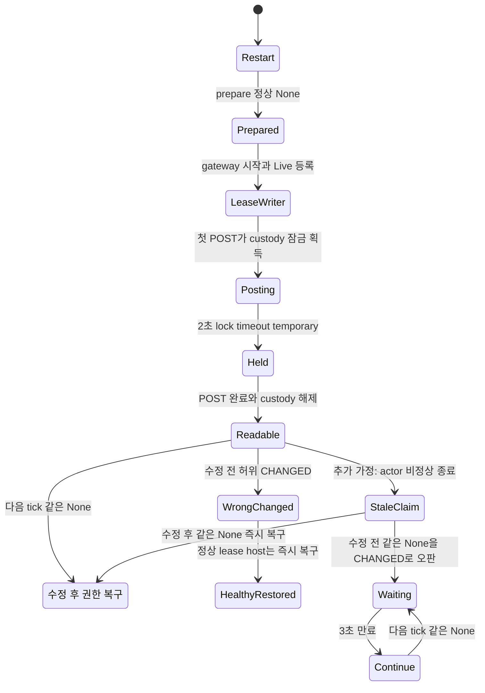

# ExecutionAuthority: temporary refresh recovery

기준 코드는 `02887f80a0da52493b223e0b91e10f605999b66e`다. `Fix="main"`은 #7733 이전, `fix1`은 배포된 #7733, `fix2`는 이번 레인에서 구현한 같은 absent permit의 복구, `nowait`는 모든 host retirement 대기를 건너뛰는 음성 대조군이다. 모델은 생산 gate를 전수조사한 뒤 **provider lease gate와 execution permit gate만** 사용한다. 별도의 “permit 없는 view gate”는 생산 코드에 없다. `fix2`는 `refresh`가 Option permit 전체를 전달하고 `resume_execution`이 verified permit과 다음 permit이 모두 None이면 Held view를 제거하는 수리와 대응한다. 계측용 진단 기록은 권한 판정을 바꾸지 않아 모델의 권한 상태에 포함하지 않는다.

아래 기존 경로의 file:line 좌표는 기준 코드의 좌표다. 이번 구현의 최종 좌표와 실행 증거는 레인 `report-2.md`에 기록한다.

이번 모델은 출력 custody 경합과 허위 CHANGED를 증명한다. **제공된 운영 표본의 영구 입력 중단 원인 전체를 확정한 모델은 아니다.** 정상 tracked lease writer는 배포된 `fix1`에서도 허위 CHANGED를 기록한 뒤 대기 없이 view를 복원한다. 영구 wait 반례에는 아래의 추가 abnormal host 사건이 필요하며, 그 사건은 운영 표본에서 관측되지 않았다.

## 생산 시작 경로와 모델 값 영역

공통 생산 constructor는 `runtime_bootstrap/o_writer_host.rs:361-400`이며 :398에서 항상 provider별 `ownership::gate`를 전달한다. `tui_o/ownership.rs:190-196`은 같은 provider에 같은 Arc를 돌려주며 생산에서 map 제거/교체는 없다. `writer/host.rs:555-582`는 Some(Ok(permit))에 한해서 이 gate를 permit.gate로 대체한다. None은 `pg_gateway=true`일 때 lease gate로만 시작하고, Err view는 claim을 release하고 시작하지 않는다.

| 시작 진입점 | gate / 닫히는 사건 | None / 같은 permit / 다른 permit / temporary | 모델·시험 대응 |
|---|---|---|---|
| `runtime_bootstrap.rs:256 prepare → :409 spawn → o_writer_host.rs:425 start` | None이면 lease; Some(Ok)이면 permit | None은 미관리 경로, same은 같은 gate 복구, different는 아래 fence, temporary는 Hold | `Prepare→StartWriter→TrackWriter`; 기존 #7733 live intake와 unmanaged 정상 global gate 회귀시험 |
| worker `runtime_bootstrap.rs:325 spawn_execution` | permit만 시작, None/Err는 host 없음 | same 복구; different는 old gate close/retire; temporary retained+uncertain | 같은 permit 시작 행동, worker 대칭 REST 시험 |
| standby `runtime_bootstrap.rs:380 spawn_execution` | worker와 같음 | 위와 같음 | 같은 permit 시작 행동, standby 대칭 REST 시험 |
| 재spawn `owner_cleanup.rs:23 refresh→:26 spawn_execution` | Some(Ok) permit만; 기존 claim 있으면 중복 시작 생략 | None/Err 새 host 없음; same 기존 gate 보존; different retire | `SpawnExecution`; same permit gate/claim 유지 시험 |
| 공통 `o_writer_host.rs:398,:639` | constructor 기본은 lease, spawn_execution은 permit만 실제 시작 | 위 모든 진입점의 gate 선택 정본 | `hg=0` lease, `hg>0` permit |
| `gateway_lease.rs:566`와 caller `gateway_runtime.rs:91-100` | host 생성이 아니라 lease acquired. release/handback/shutdown close, keepalive 실패 uncertain, 재획득 reacquired, peer 소유 lost | refresh는 lease gate 자체를 열거나 닫지 않음 | lease가 정상 Owned인 구간. lease 장애는 별도 조건으로 범위 밖 명시 |
| `host.rs:785-817` 내부 store 재개 | 기존 host/claim/같은 gate 재사용 | gate 종류를 새로 만들지 않으며 위 행렬 유지 | tracked host의 gate identity 보존, resident same permit 시험 |

`hk`는 gate 종류만 뜻하지 않는다. `none`은 claim 없음, `claim`은 start_managed가 claim을 얻은 뒤 Live 등록 전, `lease`/`permit`은 각각의 gate를 등록한 live host, `stale`는 abnormal exit 뒤 Live는 제거되고 claim만 남은 상태다. claim lifecycle의 근거는 `host.rs:549,:855-859,:988` 및 `ReadinessClaim::clear` :127-143이다. **stale은 세 번째 gate가 아니다.**

permit gate는 `channel_policy.rs:478-483`에서 temporary이면 uncertain, non-temporary면 close된다. 같은 tuple은 retained permit을 :517-526에서 같은 gate로 복구하며 실제 owner/generation 변경은 old gate를 닫고 host retirement를 확인한다. lease gate의 정상 종료/불확실 처리는 `gateway_lease.rs:590-593,:620-624,:644,:669,:691`, `shutdown.rs:259-263`에 있다. execution refresh는 이 lease를 교체하지 않는다.

## 행동과 운영 시각 대조

| 모델 행동 | 생산 코드 / 의미 | 운영 표본과의 관계 |
|---|---|---|
| 초기 restart → `Prepare` | `runtime_bootstrap.rs:256`, `owner_execution.rs:42-50`: None 정상 read면 view 없음 | 재시작 뒤 unmanaged 판정이면 gateway 시작만 가능 |
| `StartWriter → TrackWriter` | `host.rs:549` claim, :855 actor spawn, :859 gate Live 등록 | 새 관측에서 hosted는 17:21:14.982~15.037, resume 15.072~25.878. 정상 실행이라면 17:21:27 첫 POST보다 약 12초 전에 등록됨 |
| `FirstPostBegins` | `outbound/o_writer_io.rs:128-145`, `owner_record/output.rs:95,:143-157`: Discord raw future 동안 custody xact lock 유지 | first_post 17:21:27.425. 60초 raw timeout보다 짧은 POST도 2초 lock timeout을 일으킴 |
| `TickFails` | `ownership/execution.rs:134-140` lock_timeout=2s, `owner_execution.rs:125-134` temporary suspend | 17:21:29.869 temporary lock timeout과 부합. 실제 PG backend holder ID까지 관측한 것은 아님 |
| `FirstPostCompletes` | raw 완료/guard rollback으로 custody 해제 | first_posted 17:21:33.149 |
| `TickObserves` | `owner_execution.rs:139-155`는 None 복구를 시도하지 않고 CHANGED로 분류 | 17:21:33.151 prior_permit=false/next_permit=false와 일치. CHANGED 로그는 hosted_under 검사 **전**이므로 이 로그만으로 false/3초 timeout을 알 수 없음 |
| `HostAbnormalExit` | `host.rs:988` join 실패→settled=false, :612에서 release 생략, Drop :141-143이 Live만 제거하고 hosted claim 유지 | **추가 가정**. 제공 표본에 actor 비정상 종료나 stale claim 증거가 없음 |
| `WaitTimeout` 반복 | `owner_execution.rs:161-170` hosted_under=false, is_hosted=true 3초 지속이면 continue | stale claim에서는 실코드 반례. 정상 tracked lease에서는 이 경로를 타지 않으므로 운영의 영구 중단 원인은 미확정 |

첫 번째 운영 표본의 17:13:07 temporary→17:14:35 CHANGED 간격은 단일 채널 모델로 설명하지 않는다. refresh는 provider 채널을 순차 처리하고, 다른 채널 작업·lease 상태·actor 건강성 증거가 없으므로 간격을 추정 원인으로 채우지 않는다.

## 규칙과 검사 결과

- `SameUnmanagedReadmits`: 동일 None을 읽고 CHANGED로 분류한 적이 없어야 한다. `misclassified`는 이 분류 사건을 기억하는 **모델 전용 history monitor**다. 정상 lease host가 즉시 view를 제거해도 잘못된 CHANGED 분류를 놓치지 않는다. 생산 새 상태를 제안하지 않는다.
- `TemporaryReadHolds`: 읽기 오류인 동안 접수는 Hold다. 처음 실패하거나 연속 실패해도 이전 권한 없이 열리지 않는다.
- `NoForeignPermitHost`: 다른 tuple을 설치할 때 옛 permit host가 살아 있으면 안 된다.
- `AuthorityResumes`: identity 변경이 없는 실행에서는 PG가 다시 답한 뒤 execution view는 결국 held가 아니게 된다. stale claim이어도 execution authority를 영구 보류하면 실패한다.
- `AdmissionResumes`: identity가 같고 abnormal stale host가 발생하지 않은 실행에서는 live 입력이 결국 재개된다. prepare/start/track, POST 완료, refresh tick, permit retire/spawn에 약한 공정성을 둔다.
- `UnconditionalAdmissionResumes`: host 건강성 전제가 전혀 없는 원래 뜻의 `<>[]Admitted`도 별도로 실행한다. **stale host 자체는 이번 수정으로 고치지 않으므로 수정 후에도 실패한다.** 이 실패를 이름 변경으로 숨기지 않는다.

모든 변경 cfg를 그대로 읽고, liveness 실행에서만 safety invariant 줄을 제거한 임시 cfg에 PROPERTY 한 줄을 더했다. bounds나 Fix 값을 바꾸지 않았다. safety RED는 raw TLC rc=12 / statechart rc=1, liveness RED는 raw TLC rc=13이다.

| cfg / 의미 | bounds (failure/change) | safety | AuthorityResumes | 건강한 host의 AdmissionResumes | 무조건 AdmissionResumes |
|---|---:|---|---|---|---|
| `ExecutionAuthorityMain.cfg` / #7733 전 | 1/0 | RED 12: SameUnmanagedReadmits | RED 13 | RED 13 | RED 13 |
| `ExecutionAuthorityDeployed.cfg` / 수정 전 배포 #7733 | 1/0 | RED 12: SameUnmanagedReadmits | RED 13: 추가 stale claim 사건 필요 | **GREEN 0** | RED 13 |
| `ExecutionAuthority.cfg` / 수정 후 | 2/2 | **GREEN 0**, 555 distinct | **GREEN 0** | **GREEN 0** | **RED 13**, stale host / 실제 identity 변경 별도 |
| `ExecutionAuthorityNoWait.cfg` / fence 제거 mutant | 2/2 | RED 12: NoForeignPermitHost | GREEN 0 | GREEN 0 | RED 13 |

따라서 liveness 통과만으로 fence 안전성을 보증하지 않으며, 정상 host 조건을 생략해 입력 복구를 주장하지 않는다. `expected.tsv`에는 수정 전의 의도된 safety 실패와 수정 후 성공, fence mutant 실패를 등록했다. CI 검사기는 수정하지 않았다. CI safety 전체 21 cfg는 예상 violation 집합과 일치해 rc=0이다. CI는 여전히 PROPERTY를 거부하며 liveness 자동 실행 등록은 #7764 레인의 별도 범위다.

## 최단 반례와 복구

수정 전 safety 최단 경로는 7 step이다. **추가 crash 없이도** restart→prepare None→gateway start→Live track→첫 POST custody 획득→temporary timeout→POST 완료→정상 None에서 허위 CHANGED가 나온다. 정상 lease host라면 그 tick에 view를 바로 복원하므로 이것은 영구 중단 반례가 아니다.

수정 전 `AuthorityResumes`의 10-state lasso는 위 흐름 중 POST 완료 뒤 **추가 `HostAbnormalExit`**를 넣고 정상 None→CHANGED/대기→3초 timeout→정상 None/대기를 영원히 반복한다. actor abnormal event가 운영에서 있었다고 주장하지 않는다. 수정 후 같은 None은 gate 종류나 claim 상태를 조회하기 전에 복구되므로 authority liveness가 통과한다. stale actor가 여전히 입력을 못 받는 것은 `UnconditionalAdmissionResumes` 실패로 남는다.

실행한 차트는 `logs/authority-r1-deployed-classification-chart/chart.mmd`와 fixed 차트에 있다. 수정 전 차트는 17 state/20 arrow이고, 같은 label 안에 머무는 7개 step만 숨긴다. 제공된 운영 순서 중 미확정 추가 사건을 화살표에 “추가 가정”으로 표시한다. 관측된 정상 lease 경로의 핵심 Mermaid는 다음과 같다(별도 전체 생성 차트에는 stale 갈래도 포함).



## 이전 범위 밖 항목 재검토

| 기존 범위 밖 | 이번 결함과의 관계 / 이번 범위 |
|---|---|
| lease loss/re-acquisition | view가 복구되어도 lease Unknown/Lost면 입력은 닫혀야 한다. 모델은 lease Owned 구간에 한정한다. 이번 수리가 lease를 강제로 열지 않는다. 실제 운영 중단의 다른 가능성은 미확정으로 남는다. |
| host crashes | **포함**: abnormal join으로 Live 없는 stale claim이 남는 행동. 이 사건은 authority의 영구 wait를 재현하지만 실제 운영에서 관측됐다는 주장은 하지 않는다. host 건강성 없는 무조건 admission liveness는 수정 후에도 실패함을 검사한다. |
| other channels | custody key는 provider+channel이므로 다른 채널 POST가 같은 key를 직접 잠그지는 않는다. provider 순차 refresh/PG 부하로 지연이 늘 수 있으나 한 채널 모델에서 제외한다. |
| O output path | **포함**: 첫 POST가 custody를 획득·보유·해제하고 held 동안만 lock timeout이 발생한다. Discord 응답 내용·취소·재전송은 모델 밖이며 기존 output owner fence를 바꾸지 않는다. |

기타 한계: local native binding 검증, Fresh→Bound 정제, 외국 executor의 read error 문자열, DB SQL별 latency는 추상화했다. owner tuple 변화는 A/B로 표현한다. 현재 생산에 routed intake row DELETE가 없다는 코드 전수조사에 따라 managed→unmanaged 전이는 여전히 없으며, 새 retention이 생기면 재검토해야 한다.

## 재현 명령과 증거

저장소 root에서 safety를 재현한다.

```sh
python3 scripts/ci/statecharts_tlc.py \
  --java /opt/homebrew/opt/openjdk/bin/java \
  --jar /Users/itismyfield/.local/share/tla2tools/tla2tools-1.7.4.jar
```

모든 cfg의 liveness를 재현한 스크립트는 레인 증거 `logs/run-authority-r2.py`다. 각 cfg를 TemporaryDirectory에 복사하고 INVARIANT 줄을 제거한 뒤 `PROPERTY AuthorityResumes`, `PROPERTY AdmissionResumes`, `PROPERTY UnconditionalAdmissionResumes`를 각각 추가한다. raw 결과는 `logs/*-r2.log`, 요약은 `logs/authority-r2-summary.json`이다. 재부팅 뒤 모델·cfg·expected.tsv의 SHA256이 저장된 입력과 같고 16개 로그가 각각 정상 종료한 것을 확인하여 완료된 결과를 재사용했다(`logs/authority-final-source-hashes.json`). 중간에 끊긴 전체 CI 검사만 다시 끝까지 실행한 로그는 `logs/statecharts-ci-final.log`다. 상태 수 555는 수정 후 safety와 각 liveness에서 각각 확인했다. Java/TLC 오류는 실패로 구분했으며 rc12/13 이외 오류를 성공으로 집계하지 않았다.

전체 생성 차트를 새 출력 폴더에 재생성하는 명령은 다음과 같다. scratch source는 저장소 모델 복사본에 `UnmanagedInit == Init /\ pg="none"`만 더하고, cfg는 같은 1 failure/0 change로 고정하여 permit 경로를 숨긴 시각화다. 위 전체 cfg 검사와 분리한다.

```sh
TLA2TOOLS=/Users/itismyfield/.local/share/tla2tools/tla2tools-1.7.4.jar \
JAVA=/opt/homebrew/opt/openjdk/bin/java \
/Users/itismyfield/.codex/skills/statechart/scripts/statechart \
  <lane-logs>/authority-r1-source/ExecutionAuthority.tla \
  --config <lane-logs>/authority-r1-source/deployed.cfg \
  --view <lane-logs>/authority-r1-source/authority.view.mjs \
  --out /tmp/authority-new-output
```
