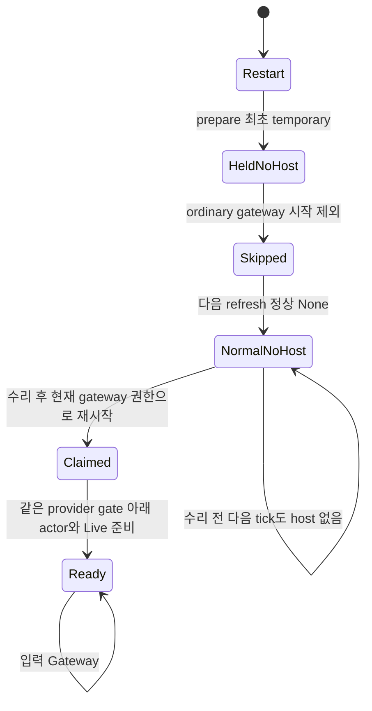

# ExecutionAuthority: prepare 실패 뒤 누락된 gateway writer 복구

기준 수리 전 코드는 `46f4d73a2d78ccdc77c52369c7106cea07c61b1c`다. r2 모델은 `Prepare`가 항상 성공하고 `TickFails`는 이미 writer가 첫 POST를 잡은 뒤에만 가능했다. 따라서 첫 prepare 실패 때문에 **claim 자체가 만들어지지 않는 부팅**은 이전 PASS의 검증 범위에 없었다. r3는 이 누락을 생산 시작 경로에 맞춰 추가했다.

이번 모델은 두 결함을 분리한다. `None → temporary → None`의 허위 CHANGED는 fix2에서 이미 수리했다. 최초 prepare 실패로 시작이 제외된 unmanaged writer를 정상 None 뒤 다시 시작시키는 연결은 fix3가 추가한다. 운영 17:21 표본의 영구 입력 중단 원인 전체를 확정했다는 뜻은 아니며, actor crash나 stale claim을 그 표본에 임의로 더하지 않는다.

## 시작 경로와 값 영역

생산 host gate는 provider lease와 execution permit 두 종류다. permit 없는 Held view는 별도의 gate가 아니며 `cutover::boot_ownership`이 candidate를 제거한다. gateway ordinary spawn도 claim 이전에 해당 채널을 제외한다. worker/standby의 기존 `spawn_execution`은 verified permit view가 있는 채널을 대상으로 유지한다.

| 모델 요소 | 생산 대응 |
|---|---|
| `Prepare` / `PrepareFails` | `runtime_bootstrap.rs:256`의 `owner_execution::prepare`; 성공이면 None/permit 설치, 최초 일시 오류면 permit 없는 Held 설치 |
| `StartWriter` / `StartWriterSkipsHeld` | ordinary gateway spawn과 `boot_ownership`의 Err candidate 제외; 제외 시 `Readiness::claim` 자체를 부르지 않음 |
| `TickObserves` | 기존 2초 cleanup의 정상 execution 관측; fix2/fix3는 같은 None의 Held view만 제거 |
| `SpawnExecution` | 기존 worker/standby/managed permit 시작. unmanaged의 view None을 대상으로 넓히지 않음 |
| `ResumeGatewayWriter` | r3 cleanup의 gateway 전용 복구 시작 연결. 정상 None과 claim 없음, 같은 provider의 유일한 현재 gateway 시작 권한이 있어야 함 |
| `TrackWriter` | claim 이후 store/actor 준비와 Live 등록. 건강한 저장소·metadata가 결국 준비된다는 시작 공정성 |
| `FirstPostBegins → TickFails → FirstPostCompletes` | 기존 출력 custody 획득·2초 lock timeout·Discord future 완료 뒤 해제 |
| `HostAbnormalExit` / `hk="stale"` | 별도 actor/host 비정상 종료로 Live 없이 claim만 남음. 이번 P1 반례에는 필요하지 않은 추가 사건 |

기존 시작 경로 전수표를 유지한다. 아래 좌표는 최초 조사 기준 `02887f80a0`이며 r3에서 기존 gate 선택을 바꾸지 않는다. r3의 새 복구 진입점은 위 행동 표의 `ResumeGatewayWriter`다.

| 시작 진입점 | gate / 닫히는 사건 | None / 같은 permit / 다른 permit / temporary | 모델·시험 대응 |
|---|---|---|---|
| `runtime_bootstrap.rs:256 prepare → :409 spawn → o_writer_host.rs:425 start` | None이면 lease; Some(Ok)이면 permit | None은 미관리 경로, same은 같은 gate 복구, different는 아래 fence, temporary는 Hold | `Prepare→StartWriter→TrackWriter`; 기존 #7733 live intake와 unmanaged 정상 global gate 회귀시험 |
| worker `runtime_bootstrap.rs:325 spawn_execution` | permit만 시작, None/Err는 host 없음 | same 복구; different는 old gate close/retire; temporary retained+uncertain | 같은 permit 시작 행동, worker 대칭 REST 시험 |
| standby `runtime_bootstrap.rs:380 spawn_execution` | worker와 같음 | 위와 같음 | 같은 permit 시작 행동, standby 대칭 REST 시험 |
| 재spawn `owner_cleanup.rs:23 refresh→:26 spawn_execution` | Some(Ok) permit만; 기존 claim 있으면 중복 시작 생략 | None/Err 새 host 없음; same 기존 gate 보존; different retire | `SpawnExecution`; same permit gate/claim 유지 시험 |
| 공통 `o_writer_host.rs:398,:639` | constructor 기본은 lease, spawn_execution은 permit만 실제 시작 | 위 모든 진입점의 gate 선택 정본 | `hg=0` lease, `hg>0` permit |
| `gateway_lease.rs:566`와 caller `gateway_runtime.rs:91-100` | host 생성이 아니라 lease acquired. release/handback/shutdown close, keepalive 실패 uncertain, 재획득 reacquired, peer 소유 lost | refresh는 lease gate 자체를 열거나 닫지 않음 | lease가 정상 Owned인 구간. lease 장애는 별도 조건으로 범위 밖 명시 |
| `host.rs:785-817` 내부 store 재개 | 기존 host/claim/같은 gate 재사용 | gate 종류를 새로 만들지 않으며 위 행렬 유지 | tracked host의 gate identity 보존, resident same permit 시험 |

`hk`는 gate 종류만 뜻하지 않는다. `none`은 claim 없음, `claim`은 start_managed가 claim을 얻은 뒤 Live 등록 전, `lease`/`permit`은 각각의 gate를 등록한 live host, `stale`는 abnormal exit 뒤 Live는 제거되고 claim만 남은 상태다. claim lifecycle의 근거는 `host.rs:549,:855-859,:988` 및 `ReadinessClaim::clear` :127-143이다. **stale은 세 번째 gate가 아니다.**

permit gate는 `channel_policy.rs:478-483`에서 temporary이면 uncertain, non-temporary면 close된다. 같은 tuple은 retained permit을 :517-526에서 같은 gate로 복구하며 실제 owner/generation 변경은 old gate를 닫고 host retirement를 확인한다. lease gate의 정상 종료/불확실 처리는 `gateway_lease.rs:590-593,:620-624,:644,:669,:691`, `shutdown.rs:259-263`에 있다. execution refresh는 이 lease를 교체하지 않는다.

`Role="gateway"`는 단순 문자열 역할보다 구체적인 **시작 판정 권한**의 추상값이다. 현재 provider가 같고, health registry의 Gateway entry가 같은 SharedData Arc를 가리키며, shutting_down/restart_pending이 아니고, 해당 채널이 현재 런타임에 허용되는 조건을 통과한 경우다. worker/standby 대조는 이 권한이 없다. 등록 누락·지난 SharedData·비활성/채널 불허는 같은 gateway 자격 실패로 소스와 PG 대조시험에서 확인한다; 각 세부 guard를 별도 모델 변수로 만들지는 않았다.

`Lease`는 시작 판정 시 provider lease의 `owned`/`unknown`/`lost` 샘플이다. permit gate의 ExecutionOwned는 이 provider lease 값이 아니다. worker/standby/Unknown/Lost 네 음성 cfg는 역할·lease 상태를 고정한 대조이며, **샘플 뒤 lease 전환을 모델링하지 않는다.** 생산도 gate mutex로 host claim 생성을 원자화하지 않는다. 샘플 뒤 lease가 바뀌면 이미 생겼거나 방금 생긴 host는 같은 provider gate의 기존 until_owned/readiness/raw-effect fence를 따른다. 이 모델의 safety를 “lease가 Lost면 기존 host claim을 제거해야 한다”는 불변식으로 읽으면 안 된다.

`UniqueGateway`는 같은 provider의 Gateway registry entry가 현재 SharedData 하나뿐이라는 복구 전용 guard다. 일반 부팅의 `StartWriter`는 기존 `CanStartUnmanaged`(역할·lease)만 사용하고, 새 `ResumeGatewayWriter`만 `CanRecoverUnmanaged`(역할·lease·유일성)를 사용한다. 모델 전용 `recovered_gateway` history monitor와 `NoAmbiguousRecoveryStart`는 복수 Gateway에서 새 복구 경로가 claim을 만들지 않음을 검사한다. 기존 ordinary boot에도 유일성 규칙이 있다고 가정하지 않는다.

이 guard가 필요한 이유는 실제 PG gateway lease는 token_hash별이고 O gate는 provider별이기 때문이다. 모델은 토큰별 실제 lease owner/epoch를 독립적으로 추적하지 않는다. 같은 provider의 복수 Gateway는 복구를 fail closed하는 범위이며, 정밀 lease binding까지 이 모델이 증명했다는 뜻이 아니다.

## 새 prepare 실패 반례

`ExecutionAuthorityBeforeGateway.cfg`는 r2의 fix2를 그대로 보존했다. 실제 TLC의 가장 짧은 AdmissionResumes 반례는5개 상태다.

1. restart: PG는 unmanaged None, execution view 없음, host/claim 없음.
2. `PrepareFails`: 최초 읽기 일시 실패로 Held view 설치; host는 여전히 없음.
3. `StartWriterSkipsHeld`: ordinary gateway spawn이 candidate에서 제외하므로 claim도 없음.
4. `TickObserves`: PG 정상 None을 읽어 execution Held는 제거되지만 `spawn_execution`은 None view를 고르지 않음.
5. stuttering: 기존 tick은 정상 None을 계속 읽어도 host 없음이 유지되어 입력이 계속 Hold.

이 경로는 actor crash, stale claim, lease loss, owner 변경, 첫 POST를 필요로 하지 않는다. 기존 O 채널의 Committed store가 건강하다는 이번 회귀시험 전제에서 순수하게 시작 연결이 빠진 반례다.



fix3의 `ResumeGatewayWriter`는 같은 조건에서 claim을 만들고 기존 `TrackWriter`를 통해 입력을 재개한다. 기존 claim이 있으면 이 행동은 disabled이므로 stale claim을 지우거나 덮어쓰지 않는다. managed permit 시작과 retirement는 이전 행동을 그대로 사용한다.

## 규칙과 실제 결과

- `SameUnmanagedReadmits`: 동일 None을 허위 CHANGED로 분류하지 않는다. 모델 history monitor는 생산 새 권한 상태가 아니다.
- `TemporaryReadHolds`: 첫 prepare 실패와 이후 연속 실패 모두 정상 관측 전에는 접수를 열지 않는다.
- `NoForeignPermitHost`: 다른 tuple이 설치되었는데 옛 permit host가 살아 있으면 안 된다.
- `NoUnauthorizedUnmanagedHost`: 고정 역할/lease 대조에서 gateway 자격과 Owned lease 없이 unmanaged host/claim을 만들지 않는다.
- `NoAmbiguousRecoveryStart`: 복수 Gateway registry에서는 새 복구 시작 경로가 unmanaged claim을 생성하지 않는다. 기존 ordinary boot의 권한 계약을 넓히지 않는다.
- `AuthorityResumes`: identity가 바뀌지 않는 실행에서 정상 관측 후 authority Held가 영구 유지되지 않는다.
- `AdmissionResumes`: identity가 같고 stale host가 발생하지 않으며 이 런타임이 해당 채널을 처리할 권한이 있으면 실제 입력이 결국 재개된다. 기존 네 positive cfg는 모두 gateway/Owned이므로 이 권한 조건을 추가해도 기존 속성의 의미가 약해지지 않는다.
- `UnconditionalAdmissionResumes`: 건강성·역할 권한 전제를 두지 않는 원래 무조건 속성도 유지·실행한다. 죽은 writer나 권한 없는 unmanaged 런타임에서 입력을 열지 않으므로 해당 RED를 숨기지 않는다.

| cfg / 의미 | Safety raw rc | AuthorityResumes | AdmissionResumes | UnconditionalAdmissionResumes |
|---|---:|---:|---:|---:|
| `ExecutionAuthorityMain.cfg` / #7733 전 | 12 | 13 | 13 | 13 |
| `ExecutionAuthorityDeployed.cfg` / #7733 | 12 | 13 | 13 | 13 |
| `ExecutionAuthorityBeforeGateway.cfg` / r2 수리 전 | 0 | 0 | 13 | 13 |
| `ExecutionAuthority.cfg` / r3 수리 후 | 0 | 0 | 0 | 13 |
| `ExecutionAuthorityNoWait.cfg` / retirement 제거 mutant | 12 | 0 | 13 | 13 |
| `ExecutionAuthorityWorker.cfg` / worker / Owned | 0 | 0 | 0 | 13 |
| `ExecutionAuthorityStandby.cfg` / standby / Owned | 0 | 0 | 0 | 13 |
| `ExecutionAuthorityUnknown.cfg` / gateway / Unknown | 0 | 0 | 0 | 13 |
| `ExecutionAuthorityLost.cfg` / gateway / Lost | 0 | 0 | 0 | 13 |
| `ExecutionAuthorityAmbiguousGateway.cfg` / 복수 gateway / Owned | 0 | 0 | 0 | 13 |


raw rc0=해당 검사 통과, safety12=선언된 invariant 반례, temporal13=liveness 반례다. 수정 후 positive cfg는 safety·authority·admission **GREEN**이며 safety 탐색은 **951 distinct states**다. 수정 전 main/fix1/fix2/nowait의 AdmissionResumes는 모두 **RED13**이다. fix2는 authority와 safety가 원래 GREEN이어도 prepare 실패 뒤 실제 입력은 돌아오지 않음을 드러낸다.

worker/standby/Unknown/Lost/복수 Gateway cfg의 조건부 AdmissionResumes0은 권한 없는 unmanaged 입력을 열었다는 뜻이 아니다. 그 경우 input liveness의 serving-runtime 전제가 거짓이며, managed permit의 정상 시작 경로는 계속 검사한다. 새 unmanaged 시작 금지는 별도 `NoUnauthorizedUnmanagedHost`와 `NoAmbiguousRecoveryStart` safety가 검사한다. 기존 claim 중복 방지는 hk=none이라는 생성 행동의 전제와 실제 생산 claim 시험으로 대조하며, 모델이 동시 host 두 개를 별도 개체로 탐색하는 것은 아니다.

cfg는 INVARIANT와 SPECIFICATION만 갖는다. liveness는 각각 같은 cfg의 INVARIANT 줄만 제거하고 임시 PROPERTY 한 줄을 더한 복사본에서 실행했다. bounds나 Fix 값을 실행 때 바꾸지 않았다. `expected.tsv`는 예상 safety 위반 집합을 저장하는 기존 형식을 유지한다. BeforeGateway의 safety `-`는 temporal 통과를 뜻하지 않으며, 수리 전 AdmissionResumes13/수리 후0을 주석과 이 표에 분리했다. CI liveness 등록은 #7764 레인의 별도 범위로, 이 레인은 CI 검사기 소스를 바꾸지 않았다.

전체 CI safety는 **27 cfg / 196.5초 / rc0**으로 예상 violation 집합과 일치했다. 최종 rc와 원시 로그는 레인 `model-r3.md`에 기록한다.

## 범위와 가정

- 로컬 O 채널의 정상 Committed store/metadata와 scheduler/기존 cleanup·host start의 약한 공정성을 가정한다. 디스크 손상, native source proof 실패, 초기화가 영구 멈추는 actor 건강성은 이번 P1의 전제가 아니다.
- lease/role은 각 cfg에서 고정되어 있다. lease-loss 뒤 기존 host의 대기/재획득을 없애는 새 계약을 만들지 않는다.
- gateway 복구의 새 권한 계약은 정상 None·허용된 유일한 현재 gateway·Owned 샘플·기존 claim 보존이다. 새 authority source를 만들지 않고 기존 health registry/provider gate/host claim을 재사용한다. 새로운 시작 연결과 safety 계약이므로 단순 delta 이상으로 첫 리뷰가 필요한 변경임을 인계 보고서에 표시한다.
- 출력 custody와 Discord 요청 직렬화는 유지한다. 처음 prepare의 오류는 출력 경로 없이도 가능하도록 모델에 추가했지만, 기존 첫 POST lock timeout 행동도 남겼다.
- runtime 역할·허용 channel·current SharedData mismatch의 세부 interleaving, token_hash별 lease owner/epoch, 여러 채널의 순차 지연은 별도 변수로 탐색하지 않는다. 생산 부정 대조와 source 좌표로 보완해야 한다.
- 현재 production의 routed intake row 삭제가 없어 managed→unmanaged 전이는 없다. owner A/B는 identity/executor/generation/session_ref tuple 변화의 추상화이며 새 retention이 생기면 이 가정을 다시 검토해야 한다.
- 운영 장기 중단의 실제 branch 판별은 r2에 추가한 outcome/readmission 계측을 이용한 별도 관측 사항이다. 이번 P1 경로를 수리했다고 특정 운영 표본에 최초 prepare 오류가 있었다고 단정하지 않는다.

## 이전 범위 밖 항목 재검토

| 기존 범위 밖 | 이번 결함과의 관계 / 이번 범위 |
|---|---|
| lease loss/re-acquisition | 시작 판정의 Owned/Unknown/Lost 음성 대조를 추가했다. 고정 cfg는 sample 이후 lease 전환 자체를 탐색하지 않으며 기존 gate fence를 재사용한다. |
| host crashes | abnormal join 뒤 stale claim 행동은 유지한다. 이번 최초 prepare 실패 반례에는 필요하지 않다. stale 건강성을 수리하지 않으므로 무조건 admission은 여전히 RED다. |
| other channels | custody key는 provider+channel이다. provider 순차 refresh/PG 부하 지연, 여러 채널 공정성은 한 채널 모델 밖이다. |
| O output path | 첫 POST의 custody 보유·해제와 lock timeout 행동은 포함한다. 최초 prepare 실패는 host/POST 이전에도 가능하도록 추가했다. Discord 응답·취소·재전송과 출력 직렬화 계약은 바꾸지 않는다. |

## 재현과 증거

레인 증거 루트는 `/Users/itismyfield/.adk/release/lane-runs/hl-20260925/i7731b`다.

```sh
python3 <lane>/logs/run-authority-r3.py
python3 scripts/ci/statecharts_tlc.py \
  --java /opt/homebrew/opt/openjdk/bin/java \
  --jar /Users/itismyfield/.local/share/tla2tools/tla2tools-1.7.4.jar
```

첫 명령은 scratch TemporaryDirectory에 모델/cfg를 복사하여 safety와 세 liveness를 10cfg×4=40회 실행한다. 원시 결과 `logs/*-r3.log`, 요약 `logs/authority-r3-summary.json`, 모델/cfg/expected SHA256은 `logs/authority-r3-source-hashes.json`이다. source 모델에 PROPERTY를 직접 넣지 않는다. 전체 CI는 `logs/statecharts-ci-r3.log`이며, 진행 중 로그를 PASS로 쓰지 않는다.
