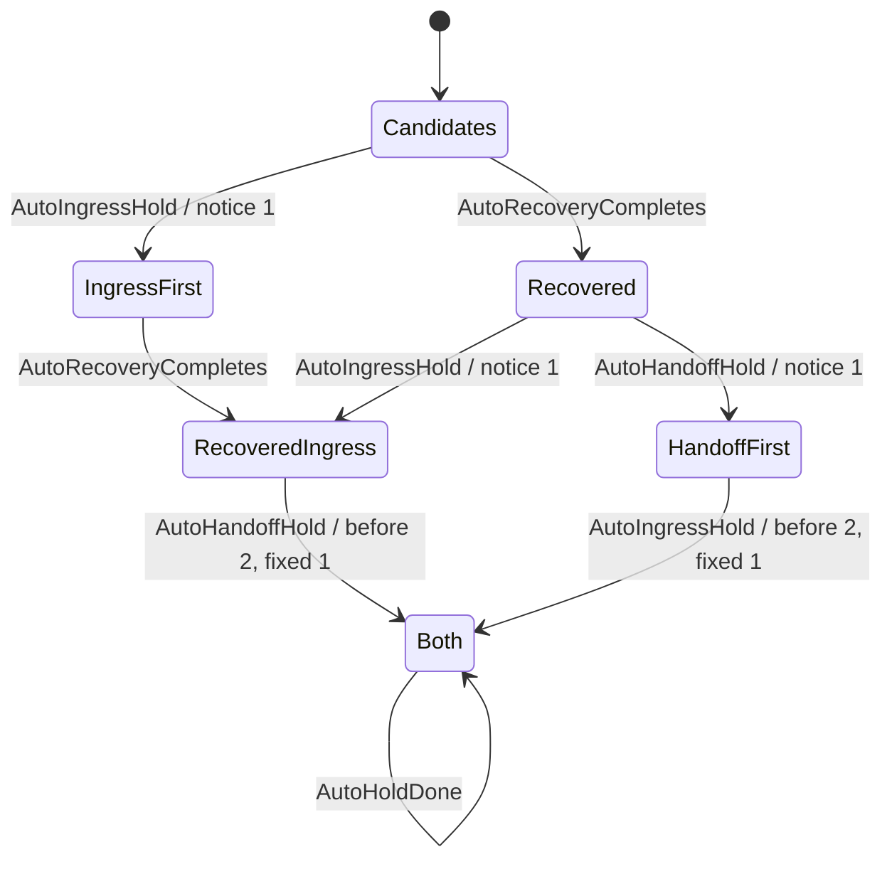

# Automatic hold notice ownership

A recovery admission can notify its original once, then a handoff can encounter an unavailable idle observer and attempt a second notice under another Hold reason. Automatic callers share the original's first notice; direct per-reason test calls retain their existing contract.

## Code and model mapping

| Boundary | Production coordinate | Model coordinate |
|---|---|---|
| Automatic ingress | `queue_io/input_owner/ingress.rs:448-458`, `held_once:254-261` | `InputOwnership.tla:794 AutoIngressHold` |
| Recovery opens and wakes existing owner | `runtime_bootstrap.rs:35-42` | `:804 AutoRecoveryCompletes` |
| Refusal maps idle_unobserved to ScreenMissing | `provider_dispatch/owner_input.rs:194-199`; `ingress.rs:158-169`, `handoff_held:237` | `:811 AutoHandoffHold` |
| One atomic notice decision and record | existing `NOTICED:274`, same mutex predicate and insert `:281-288` | Each notice action reads the previous notice count and updates it atomically |
| Direct held per-reason compatibility | `ingress.rs:242-251` test wrapper supplies false to the same common algorithm | Outside the automatic-only slice; existing production test assertions remain unchanged |

Coordinates refer to the intended repair after the temporary source mutant is restored. The model does not depend on a test-only production policy: the automatic predicate is `ticket == key && (once_per_original || same_hold)` under the existing mutex. Both production automatic callers use true. No production state, timer or retry loop is added.

## Model boundary

The slice fixes one stable original/ticket, durable and unattempted, native idle, missing idle observer and an available HTTP client. It counts hold POST attempts, not successful delivery after an HTTP failure. Existing process-local memory and recording before HTTP failure are preserved assumptions; persistent dedupe across a restart is not claimed.

No model variable is added. Existing `notices` counts automatic notice attempts in this slice. `claim` records seen callers (`none`, ingress-only `deferred`, handoff-only `handed`, both `joined`); `screen` records reconcile closed/open; `heldBy` retains the first reason. Remaining variables, including observer/row, are frozen by `AutoHoldFrame`. All 107 pre-existing operators remain byte-identical; 8 operators are appended.

The ingress candidate's recovery reason can have been selected before its exact-turn await. Therefore recovery can complete and the handoff notice can win before that ingress candidate publishes. Both winner orders are explored. Direct `held` reason-by-reason tests and unrelated draft/retained notices are outside this automatic-only invariant.

```tla
AutomaticHoldNoticeOnce == claim # "none" => notices = 1
```

The existing draft-specific `DraftToldOnce` contains a <=1 bound but does not require a hold notice when the count is zero. F7's preflight action sets notices=1 and cannot express this second reason. The new rule covers both zero and duplicate automatic notices after a caller runs without changing either old rule.



## Checked configurations

| cfg | Policy | Plain TLC | Single-cfg checker with no allowed failure | Actual broken rule |
|---|---|---:|---:|---|
| InputOwnershipAutoHoldBefore.cfg | Old per-(ticket,Hold) automatic keys | 12 | 1 | AutomaticHoldNoticeOnce |
| InputOwnershipAutoHold.cfg | Automatic once per original | 0 | 0 | - |
| InputOwnershipAutoHoldReasonKey.cfg | Repair removed: automatic key includes reason again | 12 | 1 | AutomaticHoldNoticeOnce |

The shortest before counterexample has 4 states: notices0 → ingress notices1 → recovery opens, notices1 → handoff with another reason, notices2. It sends no keys and retains the input. The repair-removal mutant returns the same counterexample. The fixed model has 7 reachable states and 10 generated states. Its two final joined states retain either first reason (`recovery` or `missingSource`) with exactly notices1, input held and pastes0.

`expected.tsv` registers the before/mutant failures explicitly. The full official checker reports rc=0 for 54 cfg / 117 TLC runs in 101.8 seconds; expected/actual mismatches0, model tree bytes unchanged throughout. Old51 expected rows remain byte-equivalent as fields. The new slice checks safety only; no new temporal delivery claim is made while the observer remains unavailable.

Model SHA256: `3a5fa10f2bdc01a922bc381f471754333345906b697210285bb308e5e5328a18`.

Evidence under the lane logs directory:

- `ci2-hold-targeted.json`, `ci2-hold-{before,fixed,reason-key-mutant}-{tlc,checker}.log`.
- `ci2-hold-fixed-state-coverage.json`, `ci2-hold-probes/fixed.states.dump`: both possible first winners.
- `ci2-hold-statecharts.log`, `ci2-hold-statecharts-summary.md/.json`, `ci2-hold-statecharts-run.json`: all cfg safety/temporal selections and actual results.
- `ci2-hold-model-edit.json`, `ci2-hold-probes/InputOwnership.before.tla`, `expected.before.tsv`: preservation proof and prior bytes.

Official command:

```text
python3 scripts/ci/statecharts_tlc.py --java /opt/homebrew/opt/openjdk/bin/java --jar /Users/itismyfield/.local/share/tla2tools/tla2tools-1.7.4.jar
```
