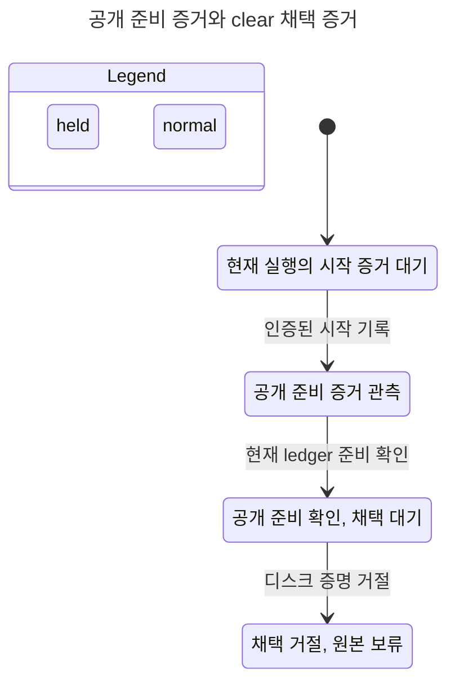
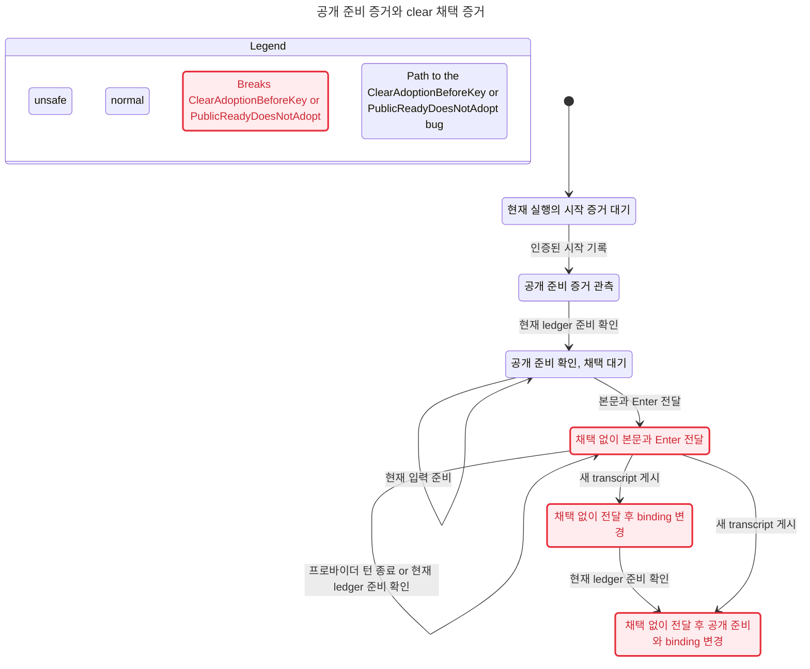

MODEL_DONE selected74=37GREEN/37expectedRED baseline68=33GREEN/35expectedRED expected_sets_preserved=68

# 공개 준비 증거와 clear 채택 증거

기준소스 `8389d4253cd9bd88588f971c39a2b3ded454e991`와 두 권한을 합성한 모델을 검증했다. 최종 TLA SHA256 `ddfa336fa833b3a450425a61d02b69249cbac150f2b004649d178c1ef23e9f3d`. 이 작업의 production/Rust 변경은0이다. 기존68cfg를수정전에실제로돌린뒤확장후74cfg를전부돌렸고,기존68의기대·실제broken집합과cfg bytes는모두보존됐다. 기존expected574행은byte동일이며신규6행만공식parser/normalizer로등록했다.

## 분리한 계약

인증ledger Pending/현재SessionStart/source가유효하면별도디스크cert가무효여도public Ready는성립할수있다. public Ready는old binding retirement/clear채택성공을뜻하지않는다. 디스크cert채택을기다리는입력은실제첫키전에별도Adopt/Refuse를거친다. 거절하면원본·oldBinding을보존하며키와효과는0이다. 유효한cert또는명시된증거회복뒤에만정확히1회전달진행성을요구한다. 영구무효cert의전달진행성을약속하지않는다.

새전역VARIABLE은없다. 기존r레코드에ledgerCurrent/diskCurrent/awaitingAdoption/adopted/adoptionRefused/repairLeft6필드를추가했다. 기존Mode에서는새필드가상수이고새3action이모두비활성이므로기존전이는필드제거투영아래같다. InputPath의INSTANCE/substitution/Init본문은변경하지않았다. 준비전pane-alive나clear를Busy권한으로승격하지않는다.

모델좌표: Ready:84, AdoptAwaitedClear:202, RefuseAwaitedClear:205, RepairClearCertificate:209, Submit:215, ClearAdoptionBeforeKey:325.

구체판독경계는 `src/services/claude_tui/readiness/source.rs:48`와 `readiness/clear.rs:14,104`의인증ledger evidence/publicobserve, 별도 `readiness/source/clear.rs:78,145,150`의cert검증/채택, `src/services/claude/herdr_turn/first_input.rs:99-122`의awaiting-clear adopt관문→composer실제키순서다. 기존관문이이미있다는코드좌표이며새생산가드를도입했다는주장이아니다. 실제키0·cancel·samePending경쟁은root의해당Rust시험검증대상이다.

## 실제 checker 결과

| phase | cfg | GREEN | expected RED | TLC | fairness | Java | exit | 초 |
|---|---:|---:|---:|---:|---:|---:|---:|---:|
| merged-before | 68 | 33 | 35 | 171 | 58 | 229 | 0 | 284.036 |
| new-six | 6 | 4 | 2 | 18 | 6 | 24 | 1 | 18.678 |
| after | 74 | 37 | 37 | 189 | 64 | 253 | 0 | 296.916 |

공식 `scripts/ci/statecharts_tlc.py`의main/check_cfg/fairness를그대로사용했고외부wrapper에서run_java출력만보관했다. 최종checker0은반례없음이아니라등록된expected RED까지실제집합이정확히같다는뜻이다. 초기새6canary의exit1은Bypass뮤턴트의예측에PublicReadyDoesNotAdopt결과가하나더관측된불일치이며원본을보존했다. 규칙/행동을약화하지않고신규뮤턴트행에그결과를추가한뒤최종74전수에서정확일치했다. 기존574행수정0이다.

전체148cfg실행은TLC378+fairness128=Java506이며506raw SHA가전부results metadata와일치한다. 최종수용전후2phase만세면142cfg/TLC360+fairness122=Java482다. 전체rawexit0=408/11=2/12=58/13=38;11은기존InputPath.cfg의등록NoDeadlock반례,12는safety,13은liveness반례다. after74의error/미검사/expected부정합0이다. 준비3분을포함한활성시간14.338분으로30분한도안이며merge대기시간은제외했다.

| 새cfg(모듈 ClaudeReadiness, Spec) | 기대=실제 위반 | 최종 TLC exits | fairness |
|---|---|---|---|
| `ClaudeReadinessDualBypass.cfg` | ClearAdoptionBeforeKey, PublicReadyDoesNotAdopt | 12,12,0,0 | 0 |
| `ClaudeReadinessDualCoupled.cfg` | PublicLedgerReadyEventually | 0,13 | 0 |
| `ClaudeReadinessDualInvalid.cfg` | GREEN | 0,0,0 | 0 |
| `ClaudeReadinessDualRecovery.cfg` | GREEN | 0,0,0,0 | 0 |
| `ClaudeReadinessDualStaleLedger.cfg` | GREEN | 0,0 | 0 |
| `ClaudeReadinessDualValid.cfg` | GREEN | 0,0,0 | 0 |

## 판독 가능한 경로

정상Invalid은공개준비가성립한뒤디스크증명을거절해원본보류로간다. 공식statechart결과는83상태/244step이며4상태/3화살표로요약했다. 같은표시안의191step을숨기며시작점·거절도달경로를보존한다.



Adoption-bypass는기존관문을생략한가상뮤턴트이며실제main결함이라고단정하지않는다. ClearAdoptionBeforeKey는시작→공개준비→입력준비→본문+Enter의4step에서깨지고, PublicReadyDoesNotAdopt는거기에턴종료→현재준비관측→새transcript게시가더해진7step에서깨진다. 서로다른위반상태를분리한공식chart는289상태/1005step을6상태/8화살표로요약하며같은표시안779step만숨겼다. 별도Coupled뮤턴트는publicReady에diskcert를결합해유효ledger의준비진행성을깨뜨린다.



## 재현·원문·한계

```sh
export TLA2TOOLS=~/.local/share/tla2tools/tla2tools-1.7.4.jar JAVA=/opt/homebrew/opt/openjdk/bin/java
python3 scripts/ci/statecharts_tlc.py --base <comparison-base> --head <model-head> --jobs 1
~/.codex/skills/statechart/scripts/statechart docs/statecharts/input-single-path/ClaudeReadiness.tla --config docs/statecharts/input-single-path/ClaudeReadinessDualInvalid.cfg --view docs/statecharts/input-single-path/clear-authorities.view.mjs --out /tmp/clear-authorities-invalid-new
```

외부원문은 `/Users/itismyfield/.adk/release/lane-runs/hl-20260925/i8114/logs/impl13-model`의 `{merged-before,new-six,after}/{checker.log,results.json,source-hashes.json,raw/*.out,raw/*.cfg}` 및 `chart-{invalid,bypass}-final/{report.md,chart.mmd,tlc.out,...}`다. `summary.json`은초기canary불일치·최종exact집합·전체rawSHA·시간·등록수를보존한다. `registration.json`/`registration-check.log`는공식parse/normalized/check_result와574행보존근거다. 공식3-way merge CLI의새commit 검증을수행한것처럼주장하지않는다. `zero-target/checker.log`와result.json은0선정공식CLI의실제rc1/Java0을보존한다. 0대상을성공으로세지않았다.

새6cfg는N=1이고기존68cfg의N=1/N=2범위와별개다. ledgerCurrent와diskCurrent는nonce/source/currentPending/consumption/새SessionStart의서로다른검증결과를각불리언으로접는다. 인증원문파싱·디스크IO·ownernotice가시성·물리pane·runtime cancel 타이밍을이모델이독립증명하지는않는다. 모델Held는기존owner가원본을보존한상태이며실제공지/held-watch진행은기존owner모델·Rust검증의무다. recovery모드는거절뒤인증서가회복되는외부가정을명시한다. 본모델을통해publicReadySome만으로키가나갔다거나무효cert가채택됐다고해석하지않는다.
