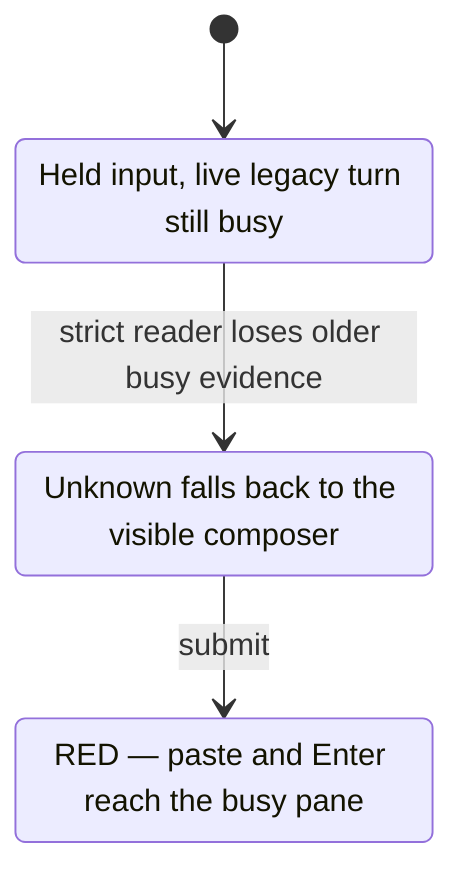
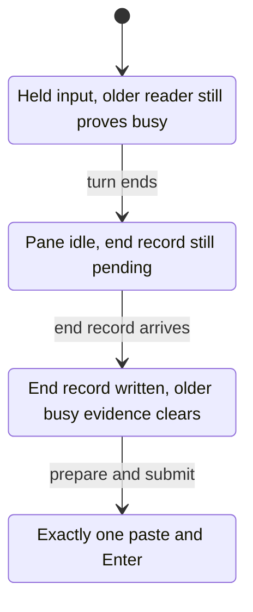

# Codex readiness, busy, end and /stop judgment (#8082 design d3, slice A)

Model: [`CodexReadiness.tla`](CodexReadiness.tla), view [`codex-readiness.view.mjs`](codex-readiness.view.mjs).
Written against production code `082c77aa4e06b81c76b614f55b8fed73ce01923f`. Design: [`docs/codex-readiness-rollout.design.md`](../../codex-readiness-rollout.design.md).
The d3 model was written before any production change. Slice A added the `EnterGap` constant after the Codex 0.169.0 capture (`tests/fixtures/hook_payload/codex-0.169.0.json`); the 68 d3 configs keep `EnterGap = "hook"` and their results.

## What the model covers

One Codex pane on tmux or Herdr, two queued inputs, and these events: Codex becomes the pane's running process, a person presses Enter in the TUI, `task_started` reaches the rollout a moment later, a turn ends, the end record reaches the rollout late / never / unnamed, the Stop hook arrives or is lost, Codex archives the idle rollout to `.zst`, the process exits, dcserver restarts, a follow-up enters the tmux 45 s pane wait and the wait times out, the launch options or the binding change so that tmux warm reuse is refused, a UserPromptSubmit hook arrives and no turn follows, a new incarnation is launched, and `/stop` is asked on an owned running turn.

- `before` is the code as it is. tmux: the intake pre-check sends a follow-up to the queue while the lenient rollout reader says busy (an open turn, `turn_aborted`, or an end event it does not know); otherwise the follow-up waits up to 45 s for the pane to read ready, and on a timeout the pane is replaced and the prompt goes in the new argv. Herdr: the pane is read and the input is refused when it does not read ready. `/stop` is judged from the pane.
- `after` judges from the bound rollout's latest turn read from this incarnation's floor, the Stop hook of the same turn, the UserPromptSubmit hook of a turn not yet recorded, and the provider process. It re-reads its proof right before the first key. A readiness replacement happens only when the process is gone, or when the rollout is unreadable, has been quiet, and the process has no child. A replacement for a reason that is not about readiness (changed launch options, a binding mismatch) happens as before, behind the intake pre-check.
- The other modes each remove one guard of `after`.

What changed in d3: the replacement reason axis (`Config`, `ConfigChange`, `ConfigReplace`), the lenient reader also reading an unknown end as busy, and the release of the UserPromptSubmit evidence by a readable `task_started` (`RecordStart`) or by expiry under the stage 4 guard (`UpsExpire`), with a hook that no turn follows (`PersonBlocked`).

What changed from d1 to d2: the host axis and the tmux timeout replacement (`Admit`, `TimeoutReplace`, `ArgvLaunch`); the window between a person's Enter and the `task_started` record (`PersonEnter`, `RecordStart`, `ups`); and the removal of the `Quiet` oracle. The model no longer knows whether a quiet turn has ended: `QuietObserved` and `NoChildObserved` are what the code can observe, and `Silent` lets a running turn show the same readings as an ended one.

The model takes the process reading as proof that a booted Codex takes keys. Codex 0.157.1 reports SessionStart only with the first prompt (`tests/fixtures/hook_payload/codex-0.157.1.json`, run `tui_bypass_startup_clear`), so no hook marks the boot; the design keeps a reduced pane check for the first input of a new execution. A turnless incarnation that the model calls ready is, in the code, the launch's own first-input path.

Assumptions: a turn that AgentDesk starts is recorded as started at once (its own submission is serialized by the channel mailbox; the `InputOwnership*` models cover that order). Whether Codex archives the rollout of a live TUI is not confirmed; the model lets a turn start after the archive.

Not modelled: a person's draft and modals (unchanged by #8082), the check after Enter (a draft read, design section 1.6), the `StrandedDraft` and `SubmitFailed` replacement reasons and the session cleanup without a replacement (design section 1.7), the gap between the intake pre-check and the replacement, callers that skip the pre-check, the input owner's reservation and receipt, and the relay of a turn's output. Herdr refuses changed launch options today, so `Config` is tmux only.

Value ranges come from the entry-point table of the design (section 1): `NativeEnd{Open, Ended, NoStart, Unknown}` (`codex_tui/busy_inject/rollout.rs:35`), the lenient reader (`tui_turn_state.rs:343`), pane liveness (`platform/tmux.rs:1005`, `session_host/herdr_gate.rs:61`·`:78`), the session-keyed ready latch (`codex_tui/input.rs:298`~`:362`), the hook buffer (`claude_tui/hook_registry.rs:52`), the tmux wait and replacement (`codex_tui/warm_followup.rs:542`~`:557`, `codex/absence_launch.rs:248`~`:286`), and `TurnVerdict::NonSteerable` for a pane without a busy entry (`busy_inject/rollout.rs:14`).

## Rules

| Rule | Meaning |
|---|---|
| `CodexNoEarlyInput` | no Idle-route key reaches a running turn |
| `CodexNoShellInput` | no key reaches a pane whose Codex has not booted or has exited |
| `CodexNoDuplicate`, `CodexNoSilentLoss` | each input is written at most once, and a written input is counted |
| `CodexNoRunningKill` | a replacement or relaunch never kills a running turn |
| `CodexStopNoFalseIdle` | `/stop` never answers "nothing is running" while its own turn runs |
| `CodexStopKeyOnOpenTurn` | the stop key is written only while its own turn is open |
| `CodexPendingEventuallyDelivered` (PROPERTY) | a missing or late signal never holds or refuses an input for good |

## Results

`scripts/ci/statecharts_tlc.py` on the 74 configs: GREEN 40, expected RED 34, unexpected 0. For the 68 d3 configs the `statechart` command gave the same rule sets; every run ended with exit 0 (36) or 1 (32).

### Before and after, per scenario and host (pane unread unless noted)

"L" is `CodexPendingEventuallyDelivered`. Cfg names drop the `CodexReady` prefix.

| Scenario | Before, Herdr | Before, tmux | After |
|---|---|---|---|
| narrow pane only | `BeforeNarrow` RED L | `BeforeTmuxNarrow` GREEN (the pane is replaced after 45 s) | `AfterNarrow`, `AfterNarrowHerdr` GREEN |
| a person's turn | `BeforePerson` RED L | `BeforeTmuxPerson` (readable pane) RED `CodexNoRunningKill` | `AfterPerson`, `AfterPersonHerdr` GREEN |
| end record lost, Stop hook seen | `BeforeLostRecord` RED L | `BeforeTmuxLostRecord` RED L | `AfterLostRecord`, `AfterLostRecordHerdr` GREEN |
| end record and Stop hook lost | `BeforeLostBoth` RED L | `BeforeTmuxLostBoth` RED L | `AfterLostBothBusy`, `AfterLostBothBusyHerdr` GREEN with the busy entry; `AfterLostBothHeld` RED L without it |
| unnamed end record | `BeforeUnnamed` RED L | `BeforeTmuxUnnamed` RED L | with the Stop hook `AfterUnnamedHook`, `AfterUnnamedHookHerdr` GREEN; without it `AfterUnnamed` (tmux) GREEN, `AfterUnnamedHerdr` RED L before #8128, `AfterUnnamedHerdr8128` GREEN; after a person's turn `AfterUnnamedPerson`, `AfterUnnamedPersonHerdr8128` GREEN |
| rollout archived to `.zst` | `BeforeCompressed` RED L | `BeforeTmuxCompressed` GREEN | `AfterCompressed` GREEN; `AfterCompressedHerdr` RED L before #8128, `AfterCompressedHerdr8128` GREEN |
| dcserver restart after a lost end record, busy entry available | `BeforeRestart` RED L | `BeforeTmuxRestart` GREEN | `AfterRestart`, `AfterRestartHerdr` GREEN |
| process exit | `BeforeExit` RED L | `BeforeTmuxExit` GREEN | `AfterExit`, `AfterExitHerdr` GREEN |
| launch options or binding changed (tmux) | not modelled (refused today) | `BeforeTmuxConfig` GREEN; with a person's turn `BeforeTmuxConfigPerson` (readable pane) RED `CodexNoRunningKill` | `AfterConfig`, `AfterConfigPerson`, `AfterConfigCompressed` GREEN |
| a UserPromptSubmit hook and no turn | no hook evidence before | no hook evidence before | `AfterBlockedPrompt`, `AfterBlockedPromptHerdr` GREEN |

Liveness, RED before and GREEN after, same host on both sides: on Herdr the narrow pane, a person's turn, the lost end record, both lost with the busy entry, the unnamed end with a Stop hook, the restart and the exit; on tmux the two lost-end-record scenarios (with the busy entry for the both-lost case) and the unnamed end. On Herdr an unreadable rollout (archived, or an unnamed end without a Stop hook) stays RED until #8128. `CodexReadyBeforeWide` (Herdr, readable pane) is GREEN: the pane judgment is correct when it can be read, so the design must replace what the pane covered and not only remove it.

On tmux the unread pane alone is not a liveness defect before: the pane is replaced. The liveness defect before is the lenient reader: after a lost end record, a `turn_aborted` or an unknown end event it keeps saying busy and follow-ups stay queued (`BeforeTmuxLostRecord`, `BeforeTmuxLostBoth`, `BeforeTmuxUnnamed`). An unnamed `task_complete` reads idle to the lenient reader and behaves like the narrow-pane row. The other defects before are the relaunch cost and the kill of a turn a person started (`BeforeTmuxPerson`, `BeforeTmuxConfigPerson`). The tmux column is the Discord entry, which runs the intake pre-check; callers that skip it are not modelled.

### After, still RED (residuals; design section 8)

| cfg | Breaks | Meaning |
|---|---|---|
| `CodexReadyAfterLostBothHeld` | L | a turn that reads open, both end signals lost, no busy entry: the input stays held. Opening the relaunch here kills running turns (`CodexReadyReclaimOpen`) |
| `CodexReadyAfterCompressedHerdr`, `CodexReadyAfterUnnamedHerdr` | L | Herdr has no replacement path before #8128; the input is refused |
| `CodexReadyAfterEnterRestart` | `CodexNoEarlyInput` | dcserver restarts between a person's Enter and the `task_started` record; the UserPromptSubmit evidence is lost |
| `CodexReadyAfterArchivedSilentTurn` | `CodexNoRunningKill` | a person's turn on an archived rollout stays silent and childless past the quiet window: the evidence expires and stage 4 replaces the pane. Depends on whether Codex archives a live rollout (unconfirmed) |

`CodexReadyAfterSilentModel` (a quiet running turn that reads open) is GREEN: an open turn is never relaunched. `CodexReadyAfterSilentTool` (a person's turn on an archived rollout running a quiet tool) is GREEN: the child check holds both the expiry and stage 4.

### The Enter gap as Codex 0.169.0 writes it (slice A)

The d3 model took the UserPromptSubmit hook as delivered before `task_started` is written (`EnterGap = "hook"`, the 0.157.1 reading). The 0.169.0 capture shows the other order: `task_started` is written about 13 ms after the Enter (seen in the capture driver's log; the fixture keeps no Enter time), and the SessionStart and UserPromptSubmit hooks arrive 0.1 s to 1.0 s after that record. So on 0.169.0 the hook never covers the gap; the start record closes it. `EnterGap = "record"` takes the record as written with the Enter, `EnterGap = "silent"` keeps the moment before it, in which no signal says busy.

| cfg | `EnterGap` | Result | Meaning |
|---|---|---|---|
| `CodexReadyAfterPerson`, `…Herdr` (d3) | hook | GREEN, unchanged | the hook covers the gap (0.157.1) |
| `CodexReadyAfterPersonRecordFirst`, `…Herdr` | record | GREEN | the open turn is the Busy evidence from the Enter on |
| `CodexReadyAfterEnterGapSilent` | silent | RED `CodexNoEarlyInput` | the moment between the Enter and the start record has no signal; residual R3 restated for 0.169.0 |
| `CodexReadyAfterUnnamedPersonRecordFirst` | record | GREEN | a person's turn that ends unnamed with no Stop hook is still replaced and delivered |
| `CodexReadyAfterSilentToolRecordFirst` | record | GREEN | on an archived rollout the hook that follows the unreadable start record holds Busy while a child runs |
| `CodexReadyAfterArchivedSilentTurnRecordFirst` | record | RED `CodexNoRunningKill` | residual R4, same as with the hook first |

No liveness result changed: every config that was GREEN or RED on `CodexPendingEventuallyDelivered` in d3 is the same, and no new config breaks it.

In d2 the UserPromptSubmit evidence was released by an end signal only. That held an input for good after a person's turn ended unnamed with no Stop hook, and after a hook that no turn followed (`CodexReadyUpsUntilEnd`, `CodexReadyUpsUntilEndBlocked`). Releasing it removes that hold and lets the archived-rollout residual open without a restart.

### A held owner input on an older start record

The owner-input regression test starts a live turn with `task_started.turn_id` and no `root_turn_id`. The strict reader cannot identify that turn, so its readiness verdict is `Unknown`; the older rollout reader still positively reads it as busy. Slice A discarded that positive busy reading and used the pane instead. Codex shows its composer marker during a running turn too, so that fallback sent the held input before the turn ended.

`after-held-unknown` reproduces this intake decision. `after-held-keep-busy` preserves the older reader's positive busy evidence on an unknown strict verdict; an older Idle reading does not upgrade Unknown to proven Idle. These modes start just after the previous inflight row disappears, with one held owner front, one running legacy turn, and the composer marker visible. The strict reader keeps both `legacy-started` and `legacy-ended` unknown; only the older busy reading distinguishes the period before the end. The existing `CodexNoEarlyInput` invariant is unchanged.

| cfg | Mode | `CodexNoEarlyInput` | Delivery / duplicate rules | States / steps |
|---|---|---|---|---|
| `CodexHeldOwnerBefore.cfg` | `after-held-unknown` | RED, shortest path 2 steps | hold | 14 / 30 |
| `CodexHeldOwnerAfter.cfg` | `after-held-keep-busy` | GREEN | hold | 7 / 13 |

Both configs also check `CodexTypeOK`, `CodexNoShellInput`, `CodexNoSilentLoss`, `CodexNoRunningKill`, both stop invariants, deadlock, and `CodexPendingEventuallyDelivered`. The RED replay is the unchanged assertion in `a_held_codex_input_runs_once_after_its_live_busy_pane_turns_idle_pg`: after the old inflight row is cleared, its temporary event trace observes a paste while the pane is still busy (paste 1, Enter 0 at the failed assertion). The GREEN replay keeps the input held, writes the end record and turns the pane idle, then observes exactly one paste followed by Enter.

All 74 existing `CodexReadiness` configs were also rerun through `scripts/ci/statecharts_tlc.py`'s `check_cfg`: selected 74, executed 74, unexpected results 0. Their expected rule sets are unchanged; `expected.tsv` was not edited.

The owner's earlier reservation, row removal, late hold and wake are covered by `InputOwnership.tla` (`DriveStartWaits`, `DriveStartLateHolds`, `AttemptRowClears`, `StartOwnTurn` and `NativeHeldResumes`). This extension supplies the busy diagnostic assumption those transitions consume; it does not change the ownership, cancellation or settlement model. The real regression test drives the complete gateway and turn-mode path. Human drafts, modals, restarts and unrelated replacement paths are outside this focused case and remain in their existing configs.

The shortest RED path and the GREEN path through delivery are:





These projections hide the recheck after prepare and the delivered input's later completion. Reproduce with the existing cfg as a template, without changing `expected.tsv`:

```sh
case_dir=$(mktemp -d /tmp/codex-held-owner.XXXXXX)
cp docs/statecharts/input-single-path/CodexReadiness.tla "$case_dir/"
cp docs/statecharts/input-single-path/codex-readiness.view.mjs "$case_dir/"
python3 - "$case_dir" <<'PY'
from pathlib import Path
import sys
out = Path(sys.argv[1])
template = Path('docs/statecharts/input-single-path/CodexReadyAfterPersonRecordFirst.cfg').read_text()
template = template.replace('N = 2', 'N = 1').replace('Person = 1', 'Person = 0')
template = template.replace('Screen = "unread"', 'Screen = "ok"').replace('BusyRoute = TRUE', 'BusyRoute = FALSE')
for name, mode in [('Before', 'after-held-unknown'), ('After', 'after-held-keep-busy')]:
    (out / f'CodexHeldOwner{name}.cfg').write_text(template.replace('Mode = "after"', f'Mode = "{mode}"'))
PY
for version in Before After; do
  ~/.claude/skills/statechart/scripts/statechart "$case_dir/CodexReadiness.tla" \
    --config "$case_dir/CodexHeldOwner$version.cfg" --view "$case_dir/codex-readiness.view.mjs" \
    --out "$case_dir/$version"
done
```

### Guards of the design, one removed at a time

| cfg | Removed guard | Breaks |
|---|---|---|
| `CodexReadyNoFallback` | Stop-hook tier and the relaunch | L |
| `CodexReadyLatchAuthority` | the latch only wakes | `CodexNoEarlyInput` |
| `CodexReadyNoProcess` | process check | `CodexNoShellInput` |
| `CodexReadyNoRevalidate` | proof read again before the first key | `CodexNoEarlyInput` |
| `CodexReadyNoFloor` (Herdr) | incarnation floor | L |
| `CodexReadyNoChildCheck` | child-process check before the expiry and the relaunch | `CodexNoRunningKill` (same constants as the GREEN `CodexReadyAfterSilentTool`) |
| `CodexReadyTimeoutReplace` | no replacement on a timeout while the judgment is not ready | `CodexNoRunningKill` |
| `CodexReadyReclaimOpen` | the relaunch opens only on an unreadable rollout | `CodexNoRunningKill` |
| `CodexReadyNoUps` | UserPromptSubmit evidence | `CodexNoEarlyInput` |
| `CodexReadyUpsUntilEnd`, `CodexReadyUpsUntilEndBlocked` | release of the UserPromptSubmit evidence by `task_started` or expiry | L |
| `CodexReadyGuardAllReasons` | the readiness check applies to readiness replacements only (here it is asked of every reason) | L |

### /stop (Herdr)

| cfg | Judgment | Result |
|---|---|---|
| `CodexStopBeforeWide` | pane, readable | GREEN |
| `CodexStopScreenNarrow` | pane, unread (ready already moved) | RED `CodexStopNoFalseIdle` |
| `CodexStopAfterNarrow` | rollout | GREEN |
| `CodexStopAfterCompressed` | rollout unreadable: answers "unobserved", not "idle" | GREEN |
| `CodexStopAfterLateNoHook` | rollout, end record late and Stop hook lost | RED `CodexStopKeyOnOpenTurn` (known residual) |

## Counterexamples replayed against the code

| cfg | Path | Code | Confirmed |
|---|---|---|---|
| `CodexReadyBeforeNarrow` | boot → Idle; the pane never reads as a composer; the input stays queued | Herdr `composer_ready` times out (`codex/herdr_turn.rs:316`~`:336`); the rollout ready latch is ignored when the captured pane is not accepted (`codex_tui/input.rs:274`) | yes, Herdr and the owner path |
| `CodexReadyBeforeTmuxNarrow` (GREEN) | boot → Idle → 45 s wait → the pane is replaced and the prompt goes in the argv | `try_codex_tui_warm_followup` returns `Fallback` after the wait (`warm_followup.rs:542`~`:557`); `absence_launch.rs:248`~`:286` runs `Replacement::begin`, kills the pane and relaunches | yes |
| `CodexReadyBeforeTmuxPerson` | a follow-up waits; a person presses Enter; the wait times out; the replacement kills the person's turn | `Replacement::begin` checks the turn row and the nonce only (`discord/codex_absence/replacement.rs:63`~`:103`); nothing reads the rollout or the process children | yes, by reading; not reproduced by a test |
| `CodexReadyBeforeTmuxLostRecord`, `CodexReadyBeforeTmuxUnnamed` | the turn ends, its end record is lost or is an event the reader does not know; the lenient reader keeps saying busy; follow-ups stay queued | the intake pre-check queues while the lenient reader says busy (`intake_turn.rs:1549`~`:1575`, `tui_followup.rs:464`); `codex_event_msg_turn_state` maps `task_complete` to Idle and every other event, `turn_aborted` included, to Streaming (`tui_turn_state.rs:727`~`:736`) | by reading; not reproduced |
| `CodexReadyBeforeTmuxConfigPerson` | the launch options change; a person presses Enter; the next follow-up finds warm reuse ineligible; the pane is replaced | eligibility returns `Fallback` before any readiness read (`warm_followup.rs:92`~`:98`, `:513`~`:523`) and `absence_launch.rs:274` replaces. Confirmed in the model with the timeout replacement disabled | by reading; not reproduced |
| `CodexReadyGuardAllReasons` | the launch options change on an idle pane; the replacement is refused because the pane is neither gone nor stuck; the input is never delivered | the d2 wording put one check before `absence_launch.rs:274`, which every warm fallback reason passes | design defect of d2, fixed in section 1.7 |
| `CodexReadyUpsUntilEnd` | a person's turn starts and ends unnamed with no Stop hook; the UserPromptSubmit evidence stays; stage 4 never opens | the d2 wording released the evidence by an end signal only | design defect of d2, fixed in section 2 |
| `CodexReadyNoFallback` | the turn's end is never provable; the input waits for good | the owner start maps `NoStart \| Unknown` to `Screen::Unknown` and watches again without bound (`provider_dispatch/owner_input.rs:829`, `:771`) | yes, for the owner path as it is today |
| `CodexReadyLatchAuthority` | turn 1 ends and latches; a person starts turn 2; the latch still reads ready | the latch is removed only by `take` (`input.rs:342`); `task_started` does not clear it (`rollout_tail/parser.rs:467`~`:480`). Today the pane check vetoes it, so this is a rule for the new code | guard needed |
| `CodexReadyNoFloor` | the process exits before the end record is written; the resumed incarnation reads the old turn as open | `read_native_end` scans back to the file's latest `task_started` and knows no incarnation boundary (`busy_inject/rollout.rs:98`~`:105`) | yes |
| `CodexReadyTimeoutReplace` | boot → a person presses Enter → the timeout replaces the pane | the same `Fallback` path, if the new wait keeps it for a `Busy` judgment | guard needed (design section 2) |
| `CodexReadyReclaimOpen` | an owned turn runs and reads open; quiet and childless; the relaunch kills it | a read-only launch has no busy entry (`TurnVerdict::NonSteerable`), and a long model response writes nothing and has no child | guard needed |
| `CodexReadyNoUps`, `CodexReadyAfterEnterRestart` | a person presses Enter; `task_started` is not written; the rollout still reads the previous end; an Idle-route input is written | the rollout is the only turn signal without the hook; Codex queues the input, so nothing is lost | residual for hookless launches and a restart inside the window |
| `CodexStopScreenNarrow` | own turn runs; the pane shows no running marker; `/stop` answers idle | `herdr_turn_in_progress` needs `recent_codex_active_turn_marker` (`input/herdr_cancel.rs:14`); `deliver` returns `Idle` (`codex_stop_delivery.rs:776`~`:785`) | yes |
| `CodexStopAfterLateNoHook` | the turn ended in the TUI; its record is not written and no Stop hook arrived; the rollout still reads open | design residual; the pane has the same window while the spinner is still drawn | accepted, see design section 8 |

A related candidate found while replaying, not a model path: the lenient reader classifies `turn_aborted` as Streaming (`tui_turn_state.rs:727`~`:736`), and `tui_busy_followup_diagnostic` reads Codex through it (`tui_followup.rs:455`). Not reproduced by a test or in production.

## Charts

- [`codex-readiness.chart.mmd`](codex-readiness.chart.mmd): `CodexReadyAfterPerson`.
- [`codex-readiness.before.chart.mmd`](codex-readiness.before.chart.mmd): `CodexReadyBeforeNarrow` (Herdr).
- [`codex-readiness.before-tmux.chart.mmd`](codex-readiness.before-tmux.chart.mmd): `CodexReadyBeforeTmuxPerson`.
- [`codex-readiness.held.chart.mmd`](codex-readiness.held.chart.mmd): `CodexReadyAfterLostBothHeld`.
- [`codex-readiness.guard-all.chart.mmd`](codex-readiness.guard-all.chart.mmd): `CodexReadyGuardAllReasons`.
- [`codex-readiness.ups.chart.mmd`](codex-readiness.ups.chart.mmd): `CodexReadyUpsUntilEnd`.
- [`codex-readiness.no-fallback.chart.mmd`](codex-readiness.no-fallback.chart.mmd): `CodexReadyNoFallback`.
- [`codex-readiness.stop-screen.chart.mmd`](codex-readiness.stop-screen.chart.mmd): `CodexStopScreenNarrow`.
- [`codex-readiness.enter-gap.chart.mmd`](codex-readiness.enter-gap.chart.mmd): `CodexReadyAfterEnterGapSilent` (the 4-step path: boot, a person's Enter, an input proven ready before the start record, the key reaches the running turn).

The charts do not draw steps that stay in one label (a restart that changes nothing visible, a refused proof, the idle wait step).

## Run

```sh
export TLA2TOOLS=~/.local/share/tla2tools/tla2tools-1.7.4.jar JAVA=/opt/homebrew/opt/openjdk/bin/java
cd docs/statecharts/input-single-path
~/.claude/skills/statechart/scripts/statechart CodexReadiness.tla --config CodexReadyAfterPerson.cfg --view codex-readiness.view.mjs --out /tmp/sc-codex-ready
```
