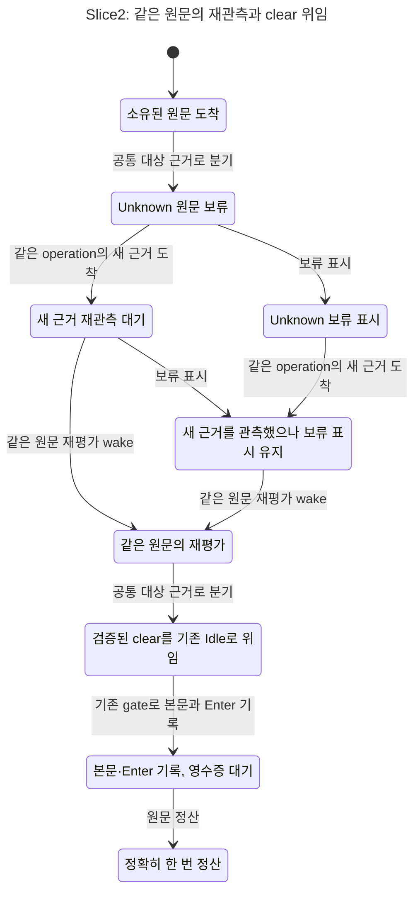

# Slice2 동적 재관측 상태 모델 (#8114)

읽기 전용 HEAD 관측: `5b99644e2eab6279c31404ba9fbb561bfaecc3cc` (17:53 KST). Root가 #8113/batch merge 및 Slice2 작업을 진행하는 공유 worktree이므로 이 SHA는 관측 시점 표시다. 이 산출물은 제안 계약의 모델 검증이며 Rust 구현/빌드/운영 결과를 뜻하지 않는다. S1 공개 IO·owner 계약과 기존 `HerdrBusyInput.tla`/30cfg/기대집합은 변경하지 않았다.

## 기존 모델의 공백과 추가 범위

기존 모델은 `ClearState`가 cfg 상수이고 `RetryHeld`가 Busy `Eligible`만 재검사한다. 그러므로 **UnknownHeld 이후 clear 증거가 새로 도착하는 전이**, 그 clear를 Busy 권한으로 바꾸지 않는 Idle 재평가 wake, UnknownKeep/clear-discard의 늦은 probe는 직접 모델링하지 않았다. 정적 verified-clear Before/Fixed는 이미 GREEN이며 이를 main 회귀라고 뒤집지 않는다.

같은 input-single-path 영역에 작은 `HerdrBusyReobserve` projection을 추가했다. 기존 모델의 입·출력 소유/송신 계약을 재설계하지 않고 한 captured operation·unattempted front·한 번의 source/owner 근거 변경만 다룬다. 구체 호스트 분기/registry/production state를 새로 제안하지 않는다.

| 모델 행동/값 | 코드 또는 승인 계약 대응 | 권한 |
|---|---|---|
| `Drive`, early/late Entry | 공통 대상 관측을 early tmux diagnostic 앞과 late 실행에서 사용 | Entry는 caller 위치이며 host selector가 아님 |
| `SourceExact`, `observer` | source native/path/dev/ino/nonce-current 근거를 합친 술어; 실제 O는 `tui_o/turn_mode.rs:41` confirmed와 `writer/host.rs:372` accepts가 필요 | Ready source와 실제 producer capability가 함께 있을 때만 Busy |
| `Publish`, `Reobserve`, `Reevaluate` | 기존 held_watch의 read-only probe→같은 원문 재평가; `held_watch.rs:146 leads`는 unattempted front만 봄 | 같은 nonce/target/front/generation의 아직 dispatchable한 원문만 wake |
| 새 verified clear | `claude/herdr_turn.rs:320 awaited_clear`가 검증한 현재 실행의 Pending | Busy 권한이 아니며 기존 Idle로 재평가 위임 |
| `terminal`, `terminalEffects` | 기존 UnknownKeep/clear-discard 정산 상태를 표현하는 ghost 값 | 새 DB column/가드/receipt 프로토콜이 아님; 늦은 probe도 원문을 부활시키지 않음 |
| `Write`, `Receipt`, `Settle` | 고정된 S1의 per-write exact-target gate/transport 경계와 별도 native receipt | transport ACK와 provider receipt는 다름; existing Idle readiness는 외부 계약 |

`owned`는 durable row 존재 여부가 아니라 **현재 unattempted front로 다시 dispatch할 권한**이다. UnknownKeep는 숫자 front/nonce/generation이 같더라도 이 권한이 없고, 원문을 clear가 처분한 경우도 같다. 모델은 늦은 stale probe가 여전히 도착할 수 있다고 보수적으로 둔다.

## 상태 차트



- [재관측 wake가 빠진 Before](herdr-busy-reobserve.before.chart.mmd): UnknownHeld→새 verified clear→표시된 Held에 영구 머무름.
- [UnknownKeep 부활 mutant](herdr-busy-reobserve.resurrect.chart.mmd): 이미 불확실 송신된 원문을 재평가하면 이중 전달까지 도달한다.
- [clear-discard control](herdr-busy-reobserve.discard.chart.mmd): 처분 뒤 새 clear 근거가 도착해도 key0을 유지한다.
- chart는 같은 표시 안의 `Reobserve` flag/receipt proof 변화 등을 합친다. 완전한 action 경로는 원시 TLC 로그에 있다. 잘못된 owner wake와 원문 부활은 별도 표시로 구분했다.

## 규칙·전제·한계

- Safety: 입력 전달 최대1, 정산된 입력의 전달 정확히1+receipt, Busy에는 Exact source+실제 observer, clear는 Busy 권한0, wake에는 같은 owner/target/front/generation, UnknownKeep/discard 부활0.
- Liveness: 입력은 전달되거나 명시적 Held/처분 상태가 된다. 정상 source 회복·O 수용 회복은 턴 종료 없이 전달되고, verified same-nonce clear는 기존 Idle 재평가로 이어진다. 모든 시나리오는 실제 `Publish`를 관측해야 해 초기 상태의 우연한 PASS를 막는다.
- prior native turn의 종료 전이는 **없다**. local drive/probe/notice 및 외부 근거 도착에 weak fairness를 적용한다. 실제 타이머 지연 상한을 증명하지 않는다.
- `ClearObserverHeldFixed`는 Busy O capability가 없어도 clear를 Busy로 승인하지 않고 Idle **재평가**를 깨우는 계약을 검사한다. 기존 Idle의 쓰기는 그 경로 자체의 readiness/부팅 계약을 추상화하므로 이 cfg를 O 미준비 상태의 직접 key 허가 증거로 읽지 않는다.
- `UnknownkeepFixed`는 may-have-sent의 최악값 effects=1에서 시작하고, discard는 실제 Held 뒤 처분한 다음 새 근거를 받는다. unknown effect=0/1 전체 저장 프로토콜을 재증명하지 않으며 actor의 기존 terminal-state 권한을 전제로 한다. 이 terminal closure는 늦은 source probe에 대한 투영이며, 별도 receipt 근거가 나중에 원문을 정산하는 경로까지 운영상 금지한다는 뜻이 아니다.
- SourceExact의 여러 file identity 요소는 하나의 predicate로 묶고 sourceNonce 불일치로 대표 counterexample을 만들었다. filesystem/DB 원자성, arbitrary 재시작·무제한 queue·복수 probe event, physical transport 구현은 이 작은 projection 범위 밖이다. 기존 30cfg의 S1/재시작/송신 불확실성 검사와 Rust 실제 진입점 시험이 그 경계를 맡는다.
- 신규 Before는 **Slice2 재관측 wake 미활성화 투영**이다. 이것만으로 현재 main의 Rust RED를 재현했다고 주장하지 않는다. 정적 clear 위임을 이미 지원하는 기존 Before GREEN은 그대로 보존했다. 실제 implementation RED/GREEN은 root의 별도 시험이 필요하다.

## 기존 30cfg — 기대집합 보존/제안 전후/활성화 관계

기존 `Policy=fixed`는 원래 전체 #8114 제안의 상태이며, S1에서 early/late 신규 승인이 활성화됐다는 뜻이 아니다. 기존 30개 TLA/cfg 및 기대 행은 byte 그대로다. 아래는 새로 실제 돌린 결과이며 기대/실제는 순서 무관 집합으로 대조한다. early/late 정적 경계와 재시작/기존 IO는 이 표, 동적 reobserve 활성화는 다음 표가 맡는다.

| 기존 cfg | policy / entry / clear | 기대 위반 | 실제 위반 | Slice2 관계 |
|---|---|---|---|---|
| AwaitedClearBefore | before / late / verified | 없음 | 없음 | 기존 Idle clear 위임; 동적 재관측은 별도 projection |
| AwaitedClearBusy | fixed / late / verified | VerifiedClearNeverBusy,VerifiedClearEventuallyDelegates | VerifiedClearEventuallyDelegates,VerifiedClearNeverBusy | 기존 Idle clear 위임; 동적 재관측은 별도 projection |
| AwaitedClearFixed | fixed / late / verified | 없음 | 없음 | 기존 Idle clear 위임; 동적 재관측은 별도 projection |
| AwaitedClearUnverifiedBefore | before / late / unverified | 없음 | 없음 | Slice1 기존 전달/보류/제어 계약; 동적 재관측은 별도 projection |
| AwaitedClearUnverifiedFixed | fixed / late / unverified | 없음 | 없음 | Slice1 기존 전달/보류/제어 계약; 동적 재관측은 별도 projection |
| Before | before / late / none | HealthyBusyEventuallyInjected | HealthyBusyEventuallyInjected | Slice1 기존 전달/보류/제어 계약; 동적 재관측은 별도 projection |
| Blocked | fixed / late / none | 없음 | 없음 | Slice1 기존 전달/보류/제어 계약; 동적 재관측은 별도 projection |
| BlockedBefore | before / late / none | 없음 | 없음 | Slice1 기존 전달/보류/제어 계약; 동적 재관측은 별도 projection |
| Cleared | fixed / late / none | 없음 | 없음 | Slice1 기존 전달/보류/제어 계약; 동적 재관측은 별도 projection |
| ClearedBefore | before / late / none | ClearedHoldEventuallyInjected | ClearedHoldEventuallyInjected | Slice1 기존 전달/보류/제어 계약; 동적 재관측은 별도 projection |
| DropHeld | fixed / late / none | NoSilentLoss,BusyResolvedWithoutTurnEnd | BusyResolvedWithoutTurnEnd,NoSilentLoss | Slice1 기존 전달/보류/제어 계약; 동적 재관측은 별도 projection |
| EarlyBefore | before / early / none | NoUnrelatedEarlyDiagnostic,HealthyBusyEventuallyInjected | HealthyBusyEventuallyInjected,NoUnrelatedEarlyDiagnostic | early 정적 관측 순서; 동적 재관측은 별도 projection |
| EarlyDiagnosticFirst | fixed / early / none | NoUnrelatedEarlyDiagnostic | NoUnrelatedEarlyDiagnostic | early 정적 관측 순서; 동적 재관측은 별도 projection |
| EarlyFixed | fixed / early / none | 없음 | 없음 | early 정적 관측 순서; 동적 재관측은 별도 projection |
| ExcludeHerdr | fixed / late / none | HealthyBusyEventuallyInjected | HealthyBusyEventuallyInjected | Slice1 기존 전달/보류/제어 계약; 동적 재관측은 별도 projection |
| Fixed | fixed / late / none | 없음 | 없음 | Slice1 기존 전달/보류/제어 계약; 동적 재관측은 별도 projection |
| NoBootWake | fixed / late / none | BusyResolvedWithoutTurnEnd | BusyResolvedWithoutTurnEnd | Slice1 기존 전달/보류/제어 계약; 동적 재관측은 별도 projection |
| RebindTarget | fixed / late / none | NoForeignTarget | NoForeignTarget | Slice1 기존 전달/보류/제어 계약; 동적 재관측은 별도 projection |
| Replace | fixed / late / none | 없음 | 없음 | Slice1 기존 전달/보류/제어 계약; 동적 재관측은 별도 projection |
| ReplaceBefore | before / late / none | ScenarioReached | ScenarioReached | Slice1 기존 전달/보류/제어 계약; 동적 재관측은 별도 projection |
| ReplayUnknown | fixed / late / none | InputAtMostOnce,CompletedExactlyOnce,ReceiptEventuallySettled | CompletedExactlyOnce,InputAtMostOnce,ReceiptEventuallySettled | Slice1 기존 전달/보류/제어 계약; 동적 재관측은 별도 projection |
| RestartMay | fixed / late / none | 없음 | 없음 | Slice1 기존 전달/보류/제어 계약; 동적 재관측은 별도 projection |
| RestartMayBefore | before / late / none | ScenarioReached | ScenarioReached | Slice1 기존 전달/보류/제어 계약; 동적 재관측은 별도 projection |
| RestartSent | fixed / late / none | 없음 | 없음 | Slice1 기존 전달/보류/제어 계약; 동적 재관측은 별도 projection |
| RestartSentBefore | before / late / none | ScenarioReached | ScenarioReached | Slice1 기존 전달/보류/제어 계약; 동적 재관측은 별도 projection |
| SilentHold | fixed / late / none | BusyResolvedWithoutTurnEnd | BusyResolvedWithoutTurnEnd | Slice1 기존 전달/보류/제어 계약; 동적 재관측은 별도 projection |
| Tmux | fixed / late / none | 없음 | 없음 | Slice1 기존 전달/보류/제어 계약; 동적 재관측은 별도 projection |
| TmuxBefore | before / late / none | 없음 | 없음 | Slice1 기존 전달/보류/제어 계약; 동적 재관측은 별도 projection |
| WriterHeld | fixed / late / none | 없음 | 없음 | Slice1 기존 전달/보류/제어 계약; 동적 재관측은 별도 projection |
| WriterHeldBefore | before / late / none | 없음 | 없음 | Slice1 기존 전달/보류/제어 계약; 동적 재관측은 별도 projection |

## 신규 24cfg — 동적 재관측 제안 전후와 mutants

SourceLate/WriterLate/ClearEarly/ClearLate는 Before→Fixed 짝이다. Foreign/SourceMismatch/ObserverHeld/UnknownKeep/Discard는 Fixed의 거절/처분 control, 나머지는 하나의 권한·wake 규칙을 제거한 mutant다.

| 신규 cfg | policy / entry / scenario | statechart exit | 기대=실제 위반 |
|---|---|---:|---|
| BusyClear | Fixed / late / clear | 1 | BusyNeedsExactSourceObserver,ClearIsNotBusyAuthority,VerifiedClearReevaluatesIdle |
| ClearEarlyBefore | Before / early / clear | 1 | HealthyRecoveryDelivers,VerifiedClearReevaluatesIdle |
| ClearEarlyFixed | Fixed / early / clear | 0 | 없음 |
| ClearLateBefore | Before / late / clear | 1 | HealthyRecoveryDelivers,VerifiedClearReevaluatesIdle |
| ClearLateFixed | Fixed / late / clear | 0 | 없음 |
| ClearObserverHeldFixed | Fixed / late / clear-observer-held | 0 | 없음 |
| DiscardFixed | Fixed / late / discard | 0 | 없음 |
| DiscardResurrect | Fixed / late / discard | 1 | NoResurrection,WakeNeedsSameOwner |
| ForeignFrontFixed | Fixed / late / foreign-front | 0 | 없음 |
| ForeignGenerationFixed | Fixed / late / foreign-generation | 0 | 없음 |
| ForeignNonceFixed | Fixed / late / foreign-nonce | 0 | 없음 |
| ForeignTargetFixed | Fixed / late / foreign-target | 0 | 없음 |
| IgnoreGeneration | Fixed / late / foreign-generation | 1 | VisibleResolution,WakeNeedsSameOwner |
| IgnoreNonce | Fixed / late / foreign-nonce | 1 | VisibleResolution,WakeNeedsSameOwner |
| NoClearWake | Fixed / late / clear | 1 | HealthyRecoveryDelivers,VerifiedClearReevaluatesIdle |
| NoObserver | Fixed / late / observer-held | 1 | BusyNeedsExactSourceObserver,ScenarioObserved |
| ObserverHeldFixed | Fixed / late / observer-held | 0 | 없음 |
| SourceLateBefore | Before / late / source | 1 | HealthyRecoveryDelivers |
| SourceLateFixed | Fixed / late / source | 0 | 없음 |
| SourceMismatchFixed | Fixed / late / source-mismatch | 0 | 없음 |
| UnknownKeepResurrect | Fixed / late / unknownkeep | 1 | AtMostOnce,NoResurrection,SettledExactlyOnce,WakeNeedsSameOwner |
| UnknownkeepFixed | Fixed / late / unknownkeep | 0 | 없음 |
| WriterLateBefore | Before / late / writer | 1 | HealthyRecoveryDelivers |
| WriterLateFixed | Fixed / late / writer | 0 | 없음 |

공식 checker는 기존30: exit0, TLC119회+fairness30회, 16 GREEN/14 expected RED, 90.4초; 신규24: exit0, TLC100회+fairness24회, 13 GREEN/11 expected RED, 170.2초다. 합계 **54cfg / GREEN29 / expected RED25 / TLC219회+fairness54회**이고 기대집합54/54가 일치했다. **미실행 cfg/속성0**이다. 예상 RED의 statechart exit1은 알려진 반례이며 checker의 기대 대조 실패와 다르다.

`NoObserver` mutant는 Held를 건너뛰어 `ScenarioObserved`도 깨고, foreign identity wake mutant는 잘못 깨운 뒤 S1 write gate에 막혀 visible-resolution liveness도 깨는 부수 반례가 나온다. UnknownKeep 부활 mutant는 원문 부활·잘못된 owner wake·이중 전달·잘못된 정산을 함께 깨며, discard 부활 mutant는 effects가 처음0이어도 처분 원문 부활 규칙을 깨뜨린다. 반례를 없애려고 기대를 완화하지 않았다.

## 재현·증거·실행 종료

```sh
export TLA2TOOLS=~/.local/share/tla2tools/tla2tools-1.7.4.jar
export JAVA=/opt/homebrew/opt/openjdk/bin/java
~/.codex/skills/statechart/scripts/statechart \
  docs/statecharts/input-single-path/HerdrBusyReobserve.tla \
  --config docs/statecharts/input-single-path/HerdrBusyReobserveClearLateFixed.cfg \
  --view docs/statecharts/input-single-path/herdr-busy-reobserve.view.mjs \
  --out /tmp/i8114-reobserve-fixed-new
```

원시 증거는 레인 `logs/impl3-model/`이다. `old30-ci.log`/`projection-ci.log`는 실제 official checker stdout/exit, `old30-ci-raw`/`projection-ci-raw`는 각 JVM stdout·cfg·원문 exit를 보존한다(합계273개). `final-counts-hashes.json`은 카운트/모델·cfg·view SHA256, `old30-table.md`/`projection-table.md`는 이 문서의 전체 표 원문이다. `chart-final`은 최종 소스로 재생성한 4개 chart의 공식 도구 결과다.

root의 headroom BLOCKED 종료 지시에 따라 checker/이미 진행 중이던 chart만 회수했고 새 validator는 시작하지 않았다. TLA/Java 프로세스0 확인 뒤 종료한다. Rust/운영 DB/store/설정 접근·cargo·Git/index/HEAD 쓰기0. root가 stage/commit한다.
