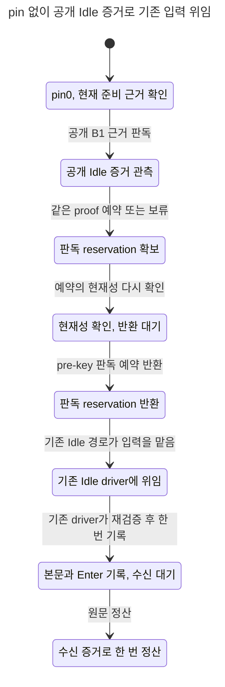

# A안 cold Idle 위임 상태 모델 (#8114)

조사 source는 `6d44fde3c30fa107e33d3cfc4644de4a35f135a4`이며 코디네이터가 승인한 A안을 별도 projection으로 표현했다. 새 TLA SHA256 `5e77aec04237813888eabf3d68abac4b8e576f92b04adc1b9e287f7e0014664f`. Rust 구현·실제 cold/late 시험의 GREEN을 뜻하지 않는다. 기존60 TLA/cfg와 expected RED27은 바꾸지 않았다.

## 상태 차트

[Cold Before](herdr-cold-idle.before.chart.mmd), [A안 Fixed](herdr-cold-idle.chart.mmd), [같은 원문 재관측](herdr-cold-idle.reobserve.chart.mmd), [현재성 검사 제거](herdr-cold-idle.stale-mutant.chart.mmd), [판독 예약 반환 제거](herdr-cold-idle.reservation-mutant.chart.mmd).



pin은 FALSE, 후속 hook 수는0으로 모든 전이에서 유지한다. 공개 B1 Idle 근거를 관측하고 reserve/current를 통과한 판독 예약을 반환한 뒤 기존 Idle driver가 자신의 current/first-key를 다시 검사한다. 본문·Enter 기록은 native receipt와 다른 상태이며 receipt 이후에만 정산한다.

## 경계·코드 대응

| 모델 | 실제 또는 제안 경계 | 뜻 |
|---|---|---|
| Before | 기준 `host_input/busy/herdr.rs:259,295` → `intake_turn/owned_busy.rs:46` | pin0에서 current_source가 먼저 실패해 공개 Idle 가능성에 도달하기 전 Held 소비 |
| Observe | public `readiness/mod.rs:61,66` Proof/observe | B1의 source/terminal/floor/runtime 검증 결과만 opaque proof로 소비; private Source 노출0 |
| Reserve/CheckCurrent | `readiness/mod.rs:225,257` | observation 이후 proof/stamp/current가 바뀌면 위임 거절 |
| Release | `readiness/mod.rs:270` not_sent | pre-key 분류 reservation을 반환해 driver의 새 reserve를 막지 않음 |
| Delegate/Write/Receipt | A안의 Idle 분류 위임 + 기존 Idle driver 계약 | 분류는 Busy 권한이 아니며 실제 준비·reservation·first-key·transport·receipt는 기존 경로 소유 |
| Reobserve/Reevaluate | A안의 같은 operation + 기준 `owned_busy.rs:306,314` owner/front 경계 | 같은 owner/target/front/generation/nonce이며 아직 소유한 Held만 새 근거로 깨움 |

Before의 Observe는 fixture가 이미 확인한 공개 Idle 근거의 가용성을 모델이 관측하는 단계이며, 기존 early caller가 그 API를 실제 호출했다는 뜻이 아니다. Fixed가 그 근거를 소비해 위임한다. 실제 B1 Proof 생성 가능성은 모델의 전제다. cold 정상 순서에서 그 전제가 실제로 성립하는지는 구현 레인의 실제 launch→hook-before-Stat→Stat/Bound→native terminal/Idle/no-later-hook 시험으로 증명해야 한다. 모델의 Before RED만으로 Rust 재현 성공을 주장하지 않는다.

## 실제 신규23 cfg — 전후·대조군·뮤턴트

공식 checker main/check_cfg에 raw Java 출력 캡처만 붙여 실행했다. **23/23 기대 집합 일치, GREEN13/의도RED10, 오류0/미검사0, actual checker exit0/48.882초. TLC87회 + fairness23회 =110 JVM 실행**이다. 아래는 cfg별 실제 집합이며 TLC exit12는 safety,13은 liveness 위반이다. checker exit0은 등록한 기대 집합과의 일치다.

| cfg | 기대 위반 | 실제 위반 | TLC 실행 | TLC 실제 exit 집합 |
|---|---|---|---:|---|
| `BusyFixed` | 없음 | 없음 | 3 | 0 |
| `ColdBefore` | HealthyIdleProgress | HealthyIdleProgress | 4 | 0,13 |
| `ColdFixed` | 없음 | 없음 | 4 | 0 |
| `DiscardFixed` | 없음 | 없음 | 3 | 0 |
| `ForeignFrontFixed` | 없음 | 없음 | 3 | 0 |
| `ForeignGenerationFixed` | 없음 | 없음 | 3 | 0 |
| `ForeignNonceFixed` | 없음 | 없음 | 3 | 0 |
| `IgnoreCurrentProof` | IdleDelegationNeedsCurrentProof | IdleDelegationNeedsCurrentProof | 4 | 0,12 |
| `IgnoreCurrentReservation` | IdleDelegationNeedsCurrentProof | IdleDelegationNeedsCurrentProof | 4 | 0,12 |
| `IgnoreFront` | IdleDelegationNeedsSameOwner,WakeNeedsSameOwner | IdleDelegationNeedsSameOwner,WakeNeedsSameOwner | 5 | 0,12 |
| `IgnoreGeneration` | IdleDelegationNeedsSameOwner,WakeNeedsSameOwner | IdleDelegationNeedsSameOwner,WakeNeedsSameOwner | 5 | 0,12 |
| `IgnoreNonce` | IdleDelegationNeedsSameOwner,WakeNeedsSameOwner | IdleDelegationNeedsSameOwner,WakeNeedsSameOwner | 5 | 0,12 |
| `MovedTargetFixed` | 없음 | 없음 | 3 | 0 |
| `NoRelease` | HealthyIdleProgress,IdleReservationReleased | HealthyIdleProgress,IdleReservationReleased | 5 | 0,12,13 |
| `NoWake` | HealthyIdleProgress | HealthyIdleProgress | 4 | 0,13 |
| `ReobserveBefore` | HealthyIdleProgress | HealthyIdleProgress | 4 | 0,13 |
| `ReobserveFixed` | 없음 | 없음 | 4 | 0 |
| `Resurrect` | IdleDelegationNeedsSameOwner,NoResurrection,WakeNeedsSameOwner | IdleDelegationNeedsSameOwner,NoResurrection,WakeNeedsSameOwner | 6 | 0,12 |
| `StaleProofFixed` | 없음 | 없음 | 3 | 0 |
| `StaleReservationFixed` | 없음 | 없음 | 3 | 0 |
| `UnknownFixed` | 없음 | 없음 | 3 | 0 |
| `UnknownKeepFixed` | 없음 | 없음 | 3 | 0 |
| `WrongNonceFixed` | 없음 | 없음 | 3 | 0 |

- ColdBefore/Fixed는 똑같은 pin0·유효 public Idle proof·후속hook0에서 `HealthyIdleProgress`가 RED→GREEN이다. Before도 visible Held는 남기므로 `VisibleResolution`만으로 결함 제거를 판정하지 않았다.
- Busy/Unknown/wrong nonce/moved target은 pin0에서 계속 Held/key0이다. foreign front/generation/nonce 재관측도 Held를 유지한다. 기존 Busy strict source/observer 권한은 별도 기존60 모델이 담당한다.
- stale-proof는 observe 뒤 reserve 전, stale-reservation은 reserve 뒤 current 전 증거를 바꾼다. Fixed는 Held/key0이며 IgnoreCurrent는 잘못된 Idle 위임을 safety RED로 잡는다. 기존 driver의 독립 current 검사도 남아 있어 그 mutant를 새 write 권한으로 확대하지 않는다.
- ReobserveBefore/Fixed와 NoWake는 같은 소유 원문에 새 public Idle 근거가 생겼을 때 wake 누락을 liveness RED로 구별한다. `ScenarioReached`를 요구해 실제 근거 도착 없이 성공하는 공허한 GREEN을 막았다.
- NoRelease는 위임 반환은 하지만 pending reservation을 남기는 실제 not_sent 누락 투영이다. 기존 driver는 거절하고 visible Held를 남긴다. 따라서 `IdleReservationReleased` safety와 `HealthyIdleProgress` liveness만 RED이며 visible-loss로 과장하지 않는다.
- UnknownKeep는 may-have-sent 최악값 effects1에서 시작한다. discard는 Held 이후 clear가 처분한 뒤 근거를 받는다. 둘 다 원문 부활0이며 Resurrect mutant는 owner/terminal 경계에서 RED다. 기존 awaited_clear·post-key uncertainty·restart의 상세 전이는 기존60에 그대로 둔다.

## 대표 반례와 chart 한계

- `HealthyIdleProgress`: 유효 Idle 원문은 후속 hook 없이 기존 경로에서 정산돼야 한다. ColdBefore report0–3: pin0→유효 공개 Idle 관측→strict pin 때문에 Held→보류 표시에 영구 정지.
- `IdleDelegationNeedsCurrentProof`: 현재와 다른 proof를 Idle 위임 근거로 쓰면 안 된다. IgnoreCurrentProof report0–6: 관측→증거 변경→거절 누락→판독 예약 반환→잘못된 Idle 위임.
- `IdleReservationReleased`: 분류 token은 실제 driver에 넘기기 전에 반환돼야 한다. NoRelease report0–5: 공개 근거→reserve/current→반환 누락→예약이 남은 Idle 위임. 같은 report의 `HealthyIdleProgress`0–7은 driver 거절→visible Held 영구 정지를 보인다.

view는 action을 null로 숨기지 않는다. 같은 표시 안의 proof/receipt/notice 상태만 접힌다. 대표 chart의 states/steps/접힌 step은 다음과 같다.

- ColdBefore: 4 states/7 steps, same-label 4, actual tool exit1.
- ColdFixed: 9 states/17 steps, same-label 10, actual tool exit0.
- ReobserveFixed: 26 states/53 steps, same-label 32, actual tool exit0.
- IgnoreCurrentProof: 9 states/17 steps, same-label 9, actual tool exit1.
- NoRelease: 8 states/15 steps, same-label 8, actual tool exit1.

## 기존60·선택기 보존

`baseline60.json`에 기준6d44의 두 TLA+60cfg(62파일) SHA와60 expected 행을 고정했다. 작업 종료 때62파일과60행이 전부 byte 동일함을 확인했다. 기존 GREEN33/expectedRED27의 impl4 결과는 같은 source라 보존되며 이번에60cfg를 재실행하지 않았다. 새23cfg만 독립 expected23행으로 등록했다. 합83cfg의 기대 분류는 GREEN46/RED37이며 이는 한 번에83cfg를 돌렸다는 뜻이 아니다.

공식 selector source는 기준6d44와 byte 동일하다. new module 변경과 new expected 행 변경은 각각23cfg를 선택한다. 실제 빈 root CLI는 NO_TARGETS/선택0/TLC0/exit1을 반환했고 PASS표를 만들지 않았다. raw/evidence는 `selection-evidence.json`, `no-targets.log`다. 실제 PR base/head의 전체 선택은 구현 commit의 다른 checker 변경을 포함할 수 있으므로 이23cfg root와 구분한다.

## 추상화·검토 항목

- 외부 evidence version1→2는 opened source/stamp/runtime-current가 바뀐 경계를 대표하며 B1 내부 reservation의 숫자 revision 증가 자체를 재구현하지 않는다. B1 observe/reserve/current/not_sent는 기존 opaque 계약이다. 분류 token 반환 후 driver는 새 증거를 얻는다.
- 동일 원문 하나·단일 근거 도착·한 번의 source invalidation으로 bound를 뒀다. 무제한 queue, 모든 fd/DB/FS interleaving, arbitrary restart는 범위 밖이다. 기존60의 at-most-once/receipt/재시작·송신 불확실성 계약을 대체하지 않는다.
- source identity·modal/physical writer·nonce/owner 검증의 세부 요건은 public Proof와 captured target의 전제다. Busy pin/observer를 완화하는 action은 없고 pin/hook은 항상0이다. 실제 producer/B1/2b를 모델이 수정하거나 hook 합성으로 정상 순서를 바꾸지 않는다.
- 동시성: observe→reserve 및 reserve→current 두 경계의 invalidation controls/mutants를 검사했다. 임의의 current 검사 이후 physical key 경합은 기존 Idle driver의 자기 current/first-key/target gate가 맡는다.
- 옛 형식 복원은 이번 새 projection 대상이 아니며 기존60의 source/nonce/restart 전제를 유지했다. 문서만 선언한 guard가 되지 않도록 version/nonce/target/front/generation/reservation을 동적 state로 뒀다.
- 잘못된0/PASS는 ScenarioReached, 구체 HealthyIdleProgress, actual23개 선택·실행·기대집합 대조, 실제 NO_TARGETS exit1로 막았다. 모델 GREEN은 Rust/PG 통과가 아니다.

## 원문과 재현

원문 root: `/Users/itismyfield/.adk/release/lane-runs/hl-20260925/i8114/logs/impl5-model/`. `results.json`은23cfg 실제 결과와110개 Java exit, `raw/<cfg>/`는 각 TLC/fairness 원문이다. `source-hashes.json`과 `summary.json`에 최종 source/문서 hash 및 기존60 보존을 남긴다.

초기23cfg 실행은NoRelease가 제어 자체를 막는 투영이었고, 실제 pending leak에 맞춰 보완한 뒤 최종23cfg를 재실행했다. 초기 stdout/results-first와 refinement 설명을 보존했다. chart도 final source로 다시 생성했고, 재관측의 증거 불충분/현재성 거절 누락/예약 반환 누락 label만 바꾼 뒤 영향받는 chart를 공식 도구로 재생성했다. 기대 집합을 완화하지 않았고 기존60의 기대 행 수정0이다.

```sh
unset TMUX TMUX_PANE
export TLA2TOOLS=~/.local/share/tla2tools/tla2tools-1.7.4.jar
export JAVA=/opt/homebrew/opt/openjdk/bin/java
python3 scripts/ci/statecharts_tlc.py --root <새23cfg-snapshot-root> --jobs 2
~/.codex/skills/statechart/scripts/statechart docs/statecharts/input-single-path/HerdrColdIdle.tla --config docs/statecharts/input-single-path/HerdrColdIdleColdFixed.cfg --view docs/statecharts/input-single-path/herdr-cold-idle.view.mjs --out <새-output-folder>
```

jar1.7.4 SHA256 `936a262061c914694dfd669a543be24573c45d5aa0ff20a8b96b23d01e050e88`. cargo/운영/production Rust·B1·2b 수정/커밋·index 쓰기0, 새 production 파일·trait·flag0이다. A안 설계와 B안 보류 이유는 주 설계의 A안 절에 있다.
