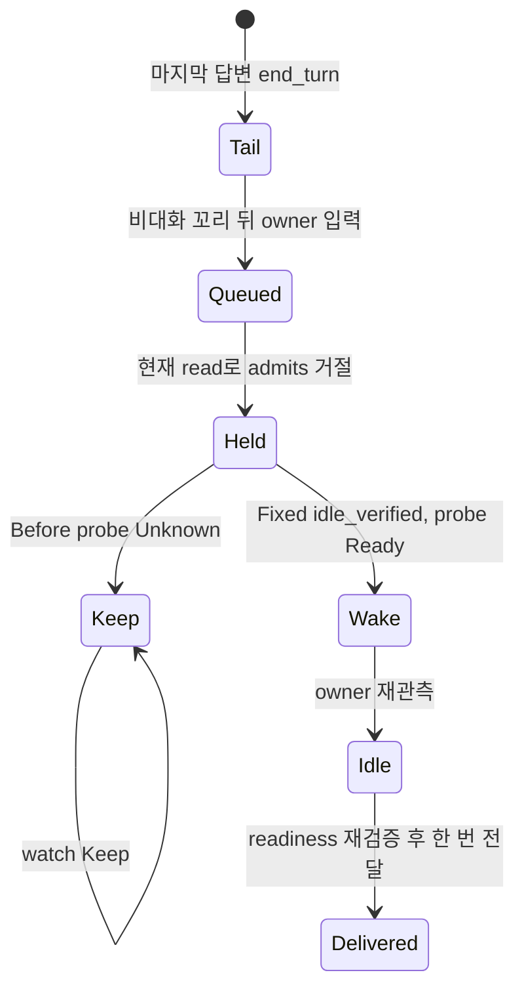
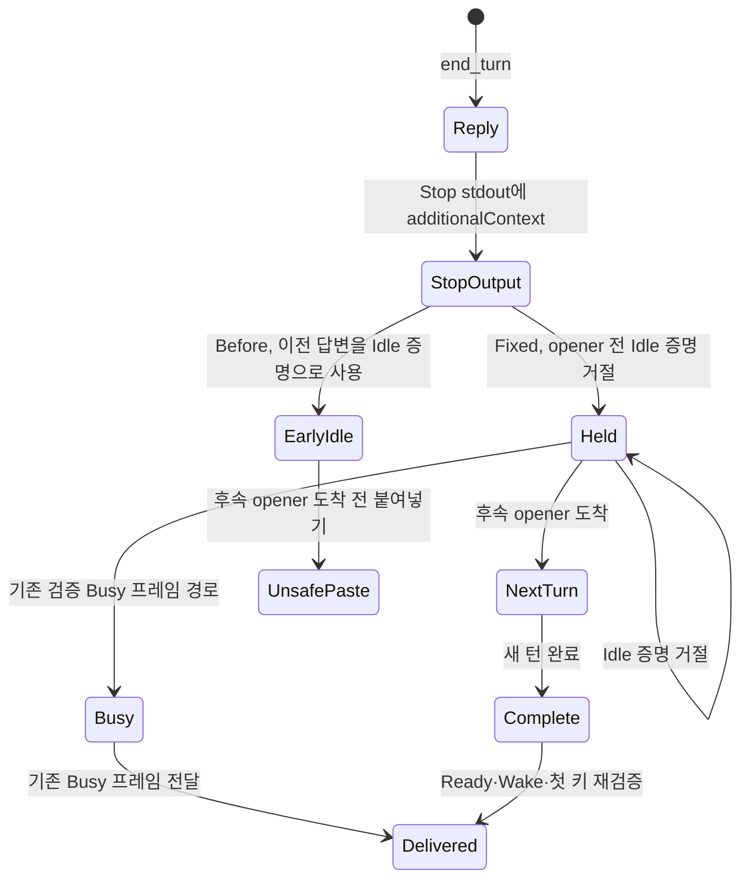

# 유휴 압축 꼬리의 입력 진행성

기준 코드 `984d802d9f`. 기존 `HerdrBusyReobserve`는 source 발행·writer 회복을 다루며 마지막 대화와 비대화 꼬리를 구별하지 않는다. 작은 `HerdrIdleMeta` 모델을 같은 입력 단일 경로 폴더에 추가했다. 운영 transcript를 사용하지 않고 합성된 기록 종류만 표현한다.

## 코드와 모델 값

| 모델 값·행동 | 기준 코드 좌표 | 투영 |
|---|---|---|
| `Turn="closed"`, `AppendNeutralTail` | `src/services/tui_turn_state/claude_meta.rs:6`; `src/services/tui_turn_state.rs:584` | 마지막 assistant `end_turn` 뒤 첨부·informational 알림·메타만 있다. Before는 `permission-mode`에서 Unknown이고 두 번째 walk도 Idle을 내지 않는다. |
| `Turn="tool"` | `src/services/tui_turn_state/claude_meta.rs:32` | 뒤의 메타를 넘어 tool_use를 읽으면 기존 Busy를 유지한다. |
| `Turn="streaming"`, `"compacting"`, `"new-prompt"`, `"tool-result"`, `"unknown"`, `"torn"` | `src/services/tui_turn_state/claude_meta.rs:32`; `src/services/tui_turn_state.rs:628` | 끝답변의 증명을 막는 기록이다. 구체 장벽의 Rust 재현 시험과 연결하며 이 모델은 모두 Idle이 아닌 결과로 합친다. |
| `Turn="legacy-result"` | `src/services/tui_turn_state.rs:597` | stale result 뒤 session permission marker는 기존 Unknown을 유지해야 한다. |
| `Observed` | `src/services/claude_tui/host_input/busy/herdr.rs:250` | 같은 검증 source에서 읽은 Idle/Busy 외에는 Held로 바꾼다. |
| `IdleVerified`, `ReadSource` | `src/services/claude_tui/host_input/busy/herdr.rs:237`; `:275` | readiness 증명이 성공하면 source 캡처 전 Idle 반환. source·nonce·reservation 재검증을 이미 만족하는 건강한 실행을 투영한다. |
| Before의 readiness 실패 | `src/services/claude_tui/readiness/evidence.rs:113`; `:132`; `:51` | informational은 종료 증거를 비우며 첨부 user는 activity가 되고 permission marker는 barrier다. 턴 상태와 함께 정본 분류를 써야 다음 probe가 회복한다. |
| `CheckAdmits` | `src/services/claude_tui/host_input/busy.rs:231` | 기존 busy snapshot의 source와 현재 read source가 같고 현재 Idle/Busy여야 허가한다. readiness가 먼저 성공해 source가 없으면 한 번 거절하는 실제 분기도 보존한다. |
| `ProbeReady` | `src/services/claude_tui/host_input/busy.rs:192` | Busy 또는 idle_verified만 Ready다. source가 있는 Idle만으로는 Ready가 아니다. |
| `HeldWatch` | `src/services/discord/queue_io/input_owner/held_watch.rs:62` | 같은 owner front에서 Ready면 Wake, Unknown이면 Keep. |
| `OwnerRetry`, `IdlePaste` | `src/services/claude_tui/host_input/busy/herdr.rs:274` | Wake는 제출 자체가 아니다. owner가 Idle 경로로 다시 들어가 첫 키 전에 readiness를 재검증한 뒤 전달한다. |

`Observed`의 Fixed는 claude_meta의 “도구 block 없는 assistant end_turn + 알려진 비대화 꼬리” 판정과 readiness의 같은 정본 사용을 한 계약으로 투영한다. 나머지 source/nonce/owner/pane 증명은 바꾸지 않는다. 위 좌표는 기준 SHA의 위치이며 최신 구현의 자세한 분류·진입점 전수표는 구현 보고서에 있다.

## 규칙과 실행 결과

- `IdleInputEventuallyResolves`: 쉬는 pane에 도착한 입력은 결국 전달되거나 이유를 보이고 끝난다. 이 건강한 단일 source 모델에는 오류 종료 행동이 없으므로 실제로는 반드시 전달되어야 한다.
- `NoIdlePasteOnRunningTurn`, `NoRunningIdleDelegation`: 도구 대기·스트리밍·압축 진행 중인 턴을 Idle로 위임하거나 Idle 붙여넣기하지 않는다. 기존 Busy 프레이밍은 명시적인 별도 경로이며 이 수리가 새로 허용하는 Idle 제출과 구별한다.
- `IdleNeedsClosedReply`: 새 Idle 증명에는 마지막 끝답변이 있어야 한다. stale result만으로 증명하지 않는다.
- `AtMostOneDelivery`, `WakeRequiresReady`, `TypeOK`와 deadlock도 검사한다. `ScenarioReached`는 입력을 받지 않은 상태의 거짓 PASS를 막는다.

| cfg | 실제 기대집합 |
|---|---|
| `HerdrIdleMetaBefore` | liveness `IdleInputEventuallyResolves` RED; safety 유지 |
| `HerdrIdleMetaFixed` | 모든 safety·liveness GREEN |
| `Tool`, `Streaming`, `Compacting`, `NewPrompt`, `ToolResult`, `Unknown`, `Torn`, `LegacyResult` | safety 및 입력 도착 GREEN. 진행 중·불명확 실행의 종료를 가정하지 않으므로 해당 cfg에는 idle liveness를 요구하지 않는다. |
| `AnyMetaIdle` | `NoRunningIdleDelegation`, `IdleNeedsClosedReply`, `NoIdlePasteOnRunningTurn` RED |

공식 checker 실제 결과 **11/11 cfg 기대집합 일치, GREEN9 / expected RED2, TLC 본검사27회, 오류·미검사0**. 독립 statechart 실행도 같은 11개 cfg에서 exit0 9개/예상 exit1 2개다. before 차트 5 states/4 arrows, fixed 차트 7 states/6 arrows다. 동작에 weak fairness를 두어 실행 가능한 재관측·owner 재개·전달이 영원히 스케줄되지 않는 실행을 제외한다. 벽시계 지연 상한을 증명하지 않는다.

## 반례와 차트

[Before 차트](herdr-idle-meta.before.chart.mmd), [Fixed 차트](herdr-idle-meta.fixed.chart.mmd), [과잉 Idle mutant](herdr-idle-meta.unsafe-idle.chart.mmd).

Before의 `IdleInputEventuallyResolves` 반례: 0 마지막 대화 보존 → 1 neutral tail → 2 owner 입력 → 3 admits 거절 → 4 probe Unknown/Keep 뒤 영구 정지. Fixed는 같은 거절 뒤 Ready/Wake → owner Idle 재선택 → 한 번 전달한다.

과잉 Idle mutant의 `NoRunningIdleDelegation`과 `IdleNeedsClosedReply` 최단 반례는 0–3이며 tool_use 턴에서 Idle 증명을 만든다. `NoIdlePasteOnRunningTurn`은 그 뒤 4 Wake → 5 Idle 경로 → 6 실제 붙여넣기까지의 반례다. 모델 반례의 실제 코드 replay는 아래 합성 fixture 시험에 연결한다. Rust 실행 성공·수정 전 RED 여부는 구현 보고서의 원시 결과로 판정하며 모델 결과로 대체하지 않는다.

| 반례의 행동 | 실제 Rust replay 시험명 끝부분 |
|---|---|
| 끝답변 → attachment/informational/메타 꼬리 | `tui_turn_state::idle_compaction_tests::idle_compaction_tail_preserves_the_completed_reply` |
| tool/streaming/compact 장벽 뒤 메타 | `tui_turn_state::idle_compaction_tests::idle_compaction_metadata_does_not_finish_running_or_compacting_turns` |
| 같은 정본을 사용한 readiness 증명 | `readiness::tests::idle_compaction_tests::idle_compaction_proves_readiness_without_a_later_stop_hook` |
| 끝답변 뒤 새 activity를 readiness로 승격 금지 | `readiness::tests::idle_compaction_tests::idle_compaction_readiness_refuses_activity_after_the_completed_reply` |
| 옛 terminal·unknown·torn 장벽 보존 | `tui_turn_state::idle_compaction_tests::idle_compaction_tail_does_not_cross_an_old_terminal_or_unknown_record` |
| 기존 source snapshot의 실제 admits 재독 | `observation_tests::idle_compaction_tests::a_captured_busy_source_admits_after_idle_compaction_metadata` |
| 실제 held front → probe Ready → held_watch Wake → 전달 | `idle_compaction_tests::an_idle_compaction_tail_wakes_and_delivers_the_actual_held_front_pg` |



view에서 숨긴 action은 없다. 끝 상태의 unchanged와 Keep 반복은 같은 표시 내부로 접힌다. 한 owner front와 고정된 정상 source·pane·nonce만 다루며 modal·draft·DB 읽기 실패·pane Missing Bound·전송 불확실성·동시 입력·legacy 경로는 제외한다. 그 조건의 Keep을 이번 원인으로 간주하거나 새 fallback을 허가하지 않는다.

## 재현과 원시 증거

원시 증거는 레그 로그의 `statechart/`에 있다. `checker.log`, `results.json`, `charts-results.json` 및 `chart-*-final/tlc*.out`은 실제 실행 결과다. `expected.tsv`에는 새 cfg 11행만 추가하며 기존 기대집합을 바꾸지 않는다. README는 `index.d` 정본 한 행을 추가하고 공식 생성기로 갱신한다.

```sh
export TLA2TOOLS="$HOME/.local/share/tla2tools/tla2tools-1.7.4.jar"
export JAVA="$(command -v java)"
python3 scripts/ci/statecharts_tlc.py --root <11cfg-snapshot-root> --jobs 2 --report-json <새-results.json>
~/.codex/skills/statechart/scripts/statechart <snapshot>/HerdrIdleMeta.tla \
  --config <snapshot>/HerdrIdleMetaFixed.cfg \
  --view docs/statecharts/input-single-path/herdr-idle-meta.view.mjs \
  --out <새-output-folder>
python3 scripts/ci/statechart_index.py
```

## Stop continuation의 늦은 opener 경계

후속 검토는 기존 11cfg에 실제 CLI 저장 순서의 3cfg를 더한다. `StopBefore`는 최초 구현의 넓은 hook_success 중립 목록, `StopFixed`는 **root Stop + stdout JSON의 일치 `hookEventName="Stop"` + 비어있지 않은 `additionalContext`**를 장벽으로 다루는 좁힌 판정이다. `QuietStop`은 정상 quiet Stop 성공을 중립으로 보존한다. 큐 receipt 전체를 금지하거나 새 queue 권위를 추가하지 않는다.

설치된 CLI의 정적 embedded JS만 읽었으며 운영 transcript·설정은 읽지 않았다. `hookName`은 표시 이름이어서 event 판정 근거가 아니며, 실제 event는 `attachment.hookEvent`다. 이전 설치 2.1.325 binary SHA256은 `84590fefe6338be9087f5814b61f9a54c5f21524163a4c127cb5a808e31009f2`다. 다음은 운영 내용 없는 합성 저장형이다.

```json
{"type":"attachment","attachment":{"type":"hook_success","hookEvent":"Stop","hookName":"synthetic hook","content":"","stdout":"{\"hookSpecificOutput\":{\"hookEventName\":\"Stop\",\"additionalContext\":\"continue\"}}","stderr":"","exitCode":0}}
```

| 설치 CLI·정적 source 좌표 | 확인한 실제 순서 |
|---|---|
| 2.1.326 byte296930475 `Jt` | hook output을 top-level attachment로 감싼다. |
| 2.1.326 byte297025717, byte297026917 | Stop 추가context를 해석하면서 stdout 원문을 포함한 hook_success를 만든다. decision=block은 별도 hook_blocking_error이므로 이미 장벽이다(byte297021023). |
| 2.1.326 byte303287938 → byte303290604 | Stop 소비자가 hook_success message를 먼저 yield하고 후속 hook_additional_context opener는 나중에 yield한다. |
| 2.1.326 byte293625734, byte293627734 | 저장 필터는 progress를 제외하지만 stdout이 비어 있지 않은 hook_success는 보존한다. 앞선 hook_progress가 저장 장벽이라고 가정할 수 없다. |
| 2.1.325 byte292667333, byte292668504, byte298809181, byte298811675, byte289366319 | 이전 설치 버전도 추가context 해석 → hook_success → 후속 opener, progress 저장 제외라는 같은 순서다. |
| 2.1.326 byte318957555, byte318957742 | 유휴 압축 informational 알림은 compactConversation 완료와 guard 해제 뒤 append한다. 완료 알림 자체를 진행 중 압축의 opener로 바꾸지 않는다. |
| 2.1.326 byte296978216, byte308615062 | PreCompact는 outside-REPL hook 결과를 모아 compact 결과의 표시 문자열로 반환한다. root Stop처럼 transcript hook_success를 먼저 yield하는 근거가 없어 PreCompact 전체를 새 장벽으로 좁히지 않는다. |

따라서 마지막 end_turn 뒤 **continuation을 명시한 Stop hook_success만 저장되고 다음 opener는 아직 없는 prefix**는 실제 가능한 경계다. 이전 완료를 그대로 신뢰하면 Idle 증명과 붙여넣기까지 가능하다. 이 경우만 판정을 좁힌다. 정상 UserPromptSubmit은 `readiness/mod.rs:678`의 pending floor와 `:738`의 revision 갱신이 proof를 폐기하고, `:285`의 floor 검사는 새 activity/terminal을 요구한다. AgentDesk가 요청한 Stop continuation은 `:691`의 continuation floor와 `:291`의 새 시각 검사가 막으며, 다른 hook의 출력은 그 ledger가 미리 알 수 없어 위 transcript 장벽이 필요하다.

`ContinuationOpener`는 hook_success 뒤 어느 시점에도 도착할 수 있다. `ContinuationFinishes`는 그 뒤의 새 완료다. 새 opener가 첫 키 준비 뒤 도착하면 `RevalidateIdle`/`RevalidateBusy`가 기존 source·stamp 재검증 거절을 투영한다. 두 새 행동은 기존 첫 키 보호를 모델에 표현하며 새 생산 우회가 아니다.

- `StopBefore`: `IdleNeedsClosedReply`·`NoProofBeforeStopContinuationOpener` 최단 반례0–3은 end_turn → continuation stdout 성공 → owner 입력 → opener 전 Idle 증명이다. `NoIdlePasteDuringStopContinuation` 반례0–6은 probe Wake → owner 재개 → 진행 중 continuation 위 Idle 붙여넣기까지 간다.
- `StopFixed`: opener 전에는 Idle 증명을 거절한다. 표준 observer의 Streaming/Busy와 검증 source가 있으면 기존 Busy 프레이밍은 유지하며, Idle 붙여넣기는 후속 턴의 새 완료 뒤에만 허가한다. safety와 eventual resolution 모두 GREEN이다. 실제 Idle 제출 입구의 키0은 Rust 준비 시험으로 별도 검증한다.
- `QuietStop`: 추가context가 없는 quiet 성공은 정상 Idle 전달하며 safety·liveness GREEN이다.

최종 공식 checker **14/14 cfg 기대집합 일치, GREEN11 / expected RED3, 본검사39회·fairness14회, 오류·미검사0**. 기존 11cfg의 위반집합은 그대로다. 새 3cfg의 독립 statechart도 예상 exit1/exit0/exit0이다. Before 40states/59steps(차트12states/18arrows), Fixed21/29(차트9/9), Quiet7/7(차트7/6)이다. [Stop Before](herdr-idle-meta.stop-before.chart.mmd), [Stop Fixed](herdr-idle-meta.stop-fixed.chart.mmd), [Quiet Stop](herdr-idle-meta.quiet-stop.chart.mmd). 새 view도 null로 숨긴 action이 없으며 같은 표시 안의 opener 도착·완료·대기 변화는 내부로 접힌다. 실제 parser/준비 입구 재현은 `idle_compaction_safety_tests::stop_hook_context_before_its_user_record_holds_the_actual_preparation_path`에 연결한다. 큐·UPS·Stop fence·압축 prefix는 같은 모듈의 `queued_receipts_then_user_prompt_submit_fence_the_previous_idle_reply`, `continuing_stop_keeps_idle_metadata_and_late_terminals_fenced_until_a_new_reply`, `each_compaction_attachment_and_notice_preserves_only_an_already_completed_reply`가 다룬다. 해당 Rust 실행과 바뀐 Stop 분기 mutant RED는 구현 시험 증거로 별도 판정한다.



새 원시 증거는 레그 로그 `statechart-stop/`의 checker.log/results.json 및 최종 `chart-*-r2/` 세 디렉터리다. 재현 명령은 앞 절과 같고 root에는 최종14cfg snapshot을 쓰며, Stop 차트의 view는 `herdr-idle-meta-stop.view.mjs`로 지정한다. expected.tsv 새3행을 추가하고 index.d 한 행을 수정한 뒤 공식 statechart_index.py를 다시 실행했다.
