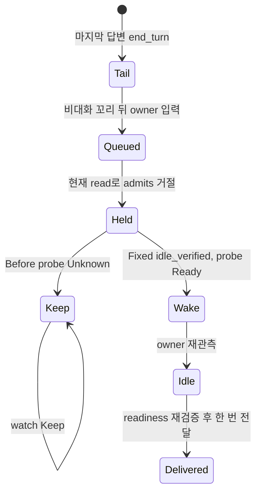

# 유휴 압축 꼬리의 입력 진행성

기준 코드 `984d802d9f`. 기존 `HerdrBusyReobserve`는 source 발행·writer 회복을 다루며 마지막 대화와 비대화 꼬리를 구별하지 않는다. 작은 `HerdrIdleMeta` 모델을 같은 입력 단일 경로 폴더에 추가했다. 운영 transcript를 사용하지 않고 합성된 기록 종류만 표현한다.

## 코드와 모델 값

| 모델 값·행동 | 기준 코드 좌표 | 투영 |
|---|---|---|
| `Turn="closed"`, `AppendNeutralTail` | `src/services/tui_turn_state/claude_meta.rs:6`; `src/services/tui_turn_state.rs:584` | 마지막 assistant `end_turn` 뒤 첨부·informational 알림·메타만 있다. Before는 `permission-mode`에서 Unknown이고 두 번째 walk도 Idle을 내지 않는다. |
| `Turn="tool"` | `src/services/tui_turn_state/claude_meta.rs:32` | 뒤의 메타를 넘어 tool_use를 읽으면 기존 Busy를 유지한다. |
| `Turn="streaming"`, `"compacting"`, `"new-prompt"`, `"tool-result"`, `"unknown"`, `"torn"` | `src/services/tui_turn_state/claude_meta.rs:32`; `src/services/tui_turn_state.rs:628` | 끝답변의 증명을 막는 기록이다. 구체 장벽의 Rust 재현 시험과 연결하며 이 모델은 모두 Idle이 아닌 결과로 합친다. |
| `Turn="legacy-result"` | `src/services/tui_turn_state.rs:597` | stale result 뒤 session permission marker는 기존 Unknown을 유지해야 한다. |
| `Observed` | `src/services/claude_tui/host_input/busy/herdr.rs:250` | 같은 검증 source에서 읽은 Idle/Busy 외에는 Held로 바꾼다. |
| `IdleVerified`, `ReadSource` | `src/services/claude_tui/host_input/busy/herdr.rs:237`; `:275` | readiness 증명이 성공하면 source 캡처 전 Idle 반환. source·nonce·reservation 재검증을 이미 만족하는 건강한 실행을 투영한다. |
| Before의 readiness 실패 | `src/services/claude_tui/readiness/evidence.rs:113`; `:132`; `:51` | informational은 종료 증거를 비우며 첨부 user는 activity가 되고 permission marker는 barrier다. 턴 상태와 함께 정본 분류를 써야 다음 probe가 회복한다. |
| `CheckAdmits` | `src/services/claude_tui/host_input/busy.rs:231` | 기존 busy snapshot의 source와 현재 read source가 같고 현재 Idle/Busy여야 허가한다. readiness가 먼저 성공해 source가 없으면 한 번 거절하는 실제 분기도 보존한다. |
| `ProbeReady` | `src/services/claude_tui/host_input/busy.rs:192` | Busy 또는 idle_verified만 Ready다. source가 있는 Idle만으로는 Ready가 아니다. |
| `HeldWatch` | `src/services/discord/queue_io/input_owner/held_watch.rs:62` | 같은 owner front에서 Ready면 Wake, Unknown이면 Keep. |
| `OwnerRetry`, `IdlePaste` | `src/services/claude_tui/host_input/busy/herdr.rs:274` | Wake는 제출 자체가 아니다. owner가 Idle 경로로 다시 들어가 첫 키 전에 readiness를 재검증한 뒤 전달한다. |

`Observed`의 Fixed는 claude_meta의 “도구 block 없는 assistant end_turn + 알려진 비대화 꼬리” 판정과 readiness의 같은 정본 사용을 한 계약으로 투영한다. 나머지 source/nonce/owner/pane 증명은 바꾸지 않는다. 위 좌표는 기준 SHA의 위치이며 최신 구현의 자세한 분류·진입점 전수표는 구현 보고서에 있다.

## 규칙과 실행 결과

- `IdleInputEventuallyResolves`: 쉬는 pane에 도착한 입력은 결국 전달되거나 이유를 보이고 끝난다. 이 건강한 단일 source 모델에는 오류 종료 행동이 없으므로 실제로는 반드시 전달되어야 한다.
- `NoIdlePasteOnRunningTurn`, `NoRunningIdleDelegation`: 도구 대기·스트리밍·압축 진행 중인 턴을 Idle로 위임하거나 Idle 붙여넣기하지 않는다. 기존 Busy 프레이밍은 명시적인 별도 경로이며 이 수리가 새로 허용하는 Idle 제출과 구별한다.
- `IdleNeedsClosedReply`: 새 Idle 증명에는 마지막 끝답변이 있어야 한다. stale result만으로 증명하지 않는다.
- `AtMostOneDelivery`, `WakeRequiresReady`, `TypeOK`와 deadlock도 검사한다. `ScenarioReached`는 입력을 받지 않은 상태의 거짓 PASS를 막는다.

| cfg | 실제 기대집합 |
|---|---|
| `HerdrIdleMetaBefore` | liveness `IdleInputEventuallyResolves` RED; safety 유지 |
| `HerdrIdleMetaFixed` | 모든 safety·liveness GREEN |
| `Tool`, `Streaming`, `Compacting`, `NewPrompt`, `ToolResult`, `Unknown`, `Torn`, `LegacyResult` | safety 및 입력 도착 GREEN. 진행 중·불명확 실행의 종료를 가정하지 않으므로 해당 cfg에는 idle liveness를 요구하지 않는다. |
| `AnyMetaIdle` | `NoRunningIdleDelegation`, `IdleNeedsClosedReply`, `NoIdlePasteOnRunningTurn` RED |

공식 checker 실제 결과 **11/11 cfg 기대집합 일치, GREEN9 / expected RED2, TLC 본검사27회, 오류·미검사0**. 독립 statechart 실행도 같은 11개 cfg에서 exit0 9개/예상 exit1 2개다. before 차트 5 states/4 arrows, fixed 차트 7 states/6 arrows다. 동작에 weak fairness를 두어 실행 가능한 재관측·owner 재개·전달이 영원히 스케줄되지 않는 실행을 제외한다. 벽시계 지연 상한을 증명하지 않는다.

## 반례와 차트

[Before 차트](herdr-idle-meta.before.chart.mmd), [Fixed 차트](herdr-idle-meta.fixed.chart.mmd), [과잉 Idle mutant](herdr-idle-meta.unsafe-idle.chart.mmd).

Before의 `IdleInputEventuallyResolves` 반례: 0 마지막 대화 보존 → 1 neutral tail → 2 owner 입력 → 3 admits 거절 → 4 probe Unknown/Keep 뒤 영구 정지. Fixed는 같은 거절 뒤 Ready/Wake → owner Idle 재선택 → 한 번 전달한다.

과잉 Idle mutant의 `NoRunningIdleDelegation`과 `IdleNeedsClosedReply` 최단 반례는 0–3이며 tool_use 턴에서 Idle 증명을 만든다. `NoIdlePasteOnRunningTurn`은 그 뒤 4 Wake → 5 Idle 경로 → 6 실제 붙여넣기까지의 반례다. 모델 반례의 실제 코드 replay는 아래 합성 fixture 시험에 연결한다. Rust 실행 성공·수정 전 RED 여부는 구현 보고서의 원시 결과로 판정하며 모델 결과로 대체하지 않는다.

| 반례의 행동 | 실제 Rust replay 시험명 끝부분 |
|---|---|
| 끝답변 → attachment/informational/메타 꼬리 | `tui_turn_state::idle_compaction_tests::idle_compaction_tail_preserves_the_completed_reply` |
| tool/streaming/compact 장벽 뒤 메타 | `tui_turn_state::idle_compaction_tests::idle_compaction_metadata_does_not_finish_running_or_compacting_turns` |
| 같은 정본을 사용한 readiness 증명 | `readiness::tests::idle_compaction_tests::idle_compaction_proves_readiness_without_a_later_stop_hook` |
| 끝답변 뒤 새 activity를 readiness로 승격 금지 | `readiness::tests::idle_compaction_tests::idle_compaction_readiness_refuses_activity_after_the_completed_reply` |
| 옛 terminal·unknown·torn 장벽 보존 | `tui_turn_state::idle_compaction_tests::idle_compaction_tail_does_not_cross_an_old_terminal_or_unknown_record` |
| 기존 source snapshot의 실제 admits 재독 | `observation_tests::idle_compaction_tests::a_captured_busy_source_admits_after_idle_compaction_metadata` |
| 실제 held front → probe Ready → held_watch Wake → 전달 | `idle_compaction_tests::an_idle_compaction_tail_wakes_and_delivers_the_actual_held_front_pg` |



view에서 숨긴 action은 없다. 끝 상태의 unchanged와 Keep 반복은 같은 표시 내부로 접힌다. 한 owner front와 고정된 정상 source·pane·nonce만 다루며 modal·draft·DB 읽기 실패·pane Missing Bound·전송 불확실성·동시 입력·legacy 경로는 제외한다. 그 조건의 Keep을 이번 원인으로 간주하거나 새 fallback을 허가하지 않는다.

## 재현과 원시 증거

원시 증거는 레그 로그의 `statechart/`에 있다. `checker.log`, `results.json`, `charts-results.json` 및 `chart-*-final/tlc*.out`은 실제 실행 결과다. `expected.tsv`에는 새 cfg 11행만 추가하며 기존 기대집합을 바꾸지 않는다. README는 `index.d` 정본 한 행을 추가하고 공식 생성기로 갱신한다.

```sh
export TLA2TOOLS="$HOME/.local/share/tla2tools/tla2tools-1.7.4.jar"
export JAVA="$(command -v java)"
python3 scripts/ci/statecharts_tlc.py --root <11cfg-snapshot-root> --jobs 2 --report-json <새-results.json>
~/.codex/skills/statechart/scripts/statechart <snapshot>/HerdrIdleMeta.tla \
  --config <snapshot>/HerdrIdleMetaFixed.cfg \
  --view docs/statecharts/input-single-path/herdr-idle-meta.view.mjs \
  --out <새-output-folder>
python3 scripts/ci/statechart_index.py
```
