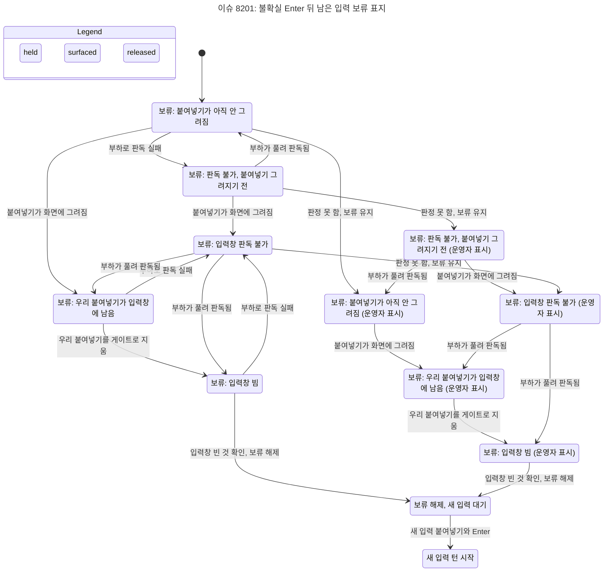

# #8201 herdr 입력 보류 표지 상태 모델

코드 SHA: `934a49997e95ffb0d54ae8eed2d7653ea6c1e4bf` (origin/main, 2026-11-16). 설계 문서: [8201-herdr-input-hold.design.md](../../design/8201-herdr-input-hold.design.md). 이 산출물은 설계 계약의 모델 검증이다. Rust 구현·빌드·운영 결과를 뜻하지 않는다. 기존 `HerdrBusyInput.tla`와 그 cfg·기대 집합은 바꾸지 않았다.

## 범위

`HerdrBusyInput`의 "uncertain" 단계를 herdr 실행 nonce 보류 표지(`runtime/herdr_input_holds/<nonce>`) 쪽으로 세분한 작은 투영이다. 살아 있는 Bound 실행 하나, 불확실하게 끝난 원 입력 하나, 그 뒤에 오는 입력 하나를 다룬다. 값 범위는 설계 문서 1장 전수표에서만 가져왔다.

| 모델 요소 | 코드 대응 |
|---|---|
| `Scenario`(enterRefused / enterSendFail / pasteSendFail) | `host_input.rs` `InputRun`: `Indeterminate{confirmed:1, Refused}`(11-16 사건, `Cancelled{confirmed:1}`도 같음) / `Indeterminate{confirmed:1, Send}` / `Indeterminate{confirmed:0, Send}` |
| `hold` 초기 TRUE | W1 `first_input.rs` `write`의 `hold` (C1 `composer_settled`가 아니면 남음) |
| `StartBefore` | R1/R2 `herdr_turn.rs` `not_held` 거절 → Opaque start failure 2회 → retained (`queued_head/v2/start_failure.rs` `start_failed`) |
| `Paste` | 표지가 없을 때의 기존 입력창 게이트(`herdr_turn/composer.rs` `when_idle`: Person·AgentDesk 거절, Unread 대기) |
| `BusyInject` | `host_input/busy/herdr.rs` `Adapter::submit`(표지를 읽지 않음) |
| `End` | C5~C10(종료·행 끝·retire, 실행이 끝날 때만) |
| `Crash`/`Boot` | dcserver 재시작: 표지 파일은 남고 메모리 카운터는 사라짐 |
| `Resolve` | 설계 3.3 `resolve_hold`(제안): transcript → busy → 정착·판독 → 빈 입력창 해제 / 우리 붙여넣기 게이트 지우기 / 사람 초안·증명 불가 시 유지와 운영자 표시 |
| `Render`, `TranscriptWrite`, `LoadSpike`/`LoadEnds`, `PersonTypes`/`PersonLeaves` | 환경: 붙여넣기가 그려짐, transcript에 user 기록, 부하로 판독 실패/회복, 사람이 입력창 사용 |

## 규칙

- Safety: `OriginalAtMostOnce`(같은 입력 제출 2회 0), `NoPasteOverResidue`(남은 글 위에 새 입력을 붙이지 않음), `NoReleaseOnResidue`(남은 글이 있는 채로 해제하지 않음), `UndeliveredIsTrue`(미전달 판정은 Enter가 실제로 안 들어갔을 때만).
- Liveness: `HoldEventuallyReleased`(실행이 살아 있어도 보류는 결국 풀림), `HoldReleasedOrSurfaced`(풀리거나 운영자에게 표시됨, 모든 시나리오), `LaterInputStarts`(나중 입력이 retained로 끝나지 않고 턴을 시작함).
- 공정성: 시스템 동작(`Resolve`·`Paste`·`BusyInject`·`StartBefore`·`End`·`Boot`)과 환경의 회복(`Render`·`TranscriptWrite`·`TurnEnd`·`LoadEnds`·`PersonLeaves`)에 weak fairness를 둔다. `PersonTypes`·`LoadSpike`·`Crash`에는 두지 않는다. 시간 상한(정착 창)은 "landed≠pending ∧ rendered"라는 사실로 추상화했다.

## 설계안 상태 차트 (`HerdrInputHoldFixed`)



- [수정 전 차트](herdr-input-hold.before.chart.mmd): 시작 거절 2회 뒤 retained, 표지는 판독 회복과 관계없이 영원히 남는다(반복 구간 표시).
- [정착 창 없음 + 재전달 대조군](herdr-input-hold.resend.chart.mmd): "Enter 도착, transcript 기록 전"을 미전달로 판정해 두 번 제출되고, "그려지기 전 붙여넣기"를 빈 것으로 읽어 새 입력이 남은 글 위에 붙는다.
- 차트는 상태 이름을 독자 관점으로 묶었다. `Stay`(아무것도 안 함)와 판정을 못 한 같은 상태 안의 반복은 그리지 않는다. 전체 동작 경로는 TLC 원시 출력에 있다.

## 수정 전 RED 경로 (`HerdrInputHoldBefore`)

`HoldEventuallyReleased`·`HoldReleasedOrSurfaced`·`LaterInputStarts`가 모두 깨진다. 경로는 다음과 같다. 0) 보류, 붙여넣기 남음 → 1) 새 입력 시작이 표지에 거절됨 → 2) 다시 거절되어 retained → 3) 붙여넣기가 그려짐 → 4~5) 판독 실패와 회복을 반복해도 표지는 영원히 남는다. 운영 11-16 사건(18:05 불확실 → 18:32 두 메시지가 각각 provider_start 2회 실패 뒤 retained)과 같은 모양이다.

## 결과 (기대 집합 = 실제 집합)

| cfg | 시나리오 | 기대 위반 | 실제 위반 | 상태 수 |
|---|---|---|---|---|
| `HerdrInputHoldBefore` | main 동작: 붙여넣기만 남은 채 Bound 실행 생존 | HoldEventuallyReleased, HoldReleasedOrSurfaced, LaterInputStarts | HoldEventuallyReleased, HoldReleasedOrSurfaced, LaterInputStarts | 12 |
| `HerdrInputHoldBeforeEnds` | main + 실행 종료(C5~C10) | LaterInputStarts | LaterInputStarts | 24 |
| `HerdrInputHoldBeforeUnreadable` | main + 판독 계속 불가 | HoldEventuallyReleased, HoldReleasedOrSurfaced, LaterInputStarts | HoldEventuallyReleased, HoldReleasedOrSurfaced, LaterInputStarts | 6 |
| `HerdrInputHoldEnterSendFail` | 설계: Enter 송신 실패(들어갔을 수도) | 없음 | 없음 | 42 |
| `HerdrInputHoldFixed` | 설계: 사건 재현(enterRefused) | 없음 | 없음 | 24 |
| `HerdrInputHoldIgnoreTranscript` | 대조군: transcript 확인 생략 | UndeliveredIsTrue | UndeliveredIsTrue | 17 |
| `HerdrInputHoldLegacyChip` | 설계: v1 표지 + 접힌 칩 | HoldEventuallyReleased, LaterInputStarts | HoldEventuallyReleased, LaterInputStarts | 12 |
| `HerdrInputHoldLegacyPrefix` | 설계: v1 표지 + `[User:` 머리 보임 | 없음 | 없음 | 24 |
| `HerdrInputHoldNoSettle` | 대조군: 정착 창 없이 판정 | LaterInputStarts, NoPasteOverResidue, NoReleaseOnResidue | LaterInputStarts, NoPasteOverResidue, NoReleaseOnResidue | 4 |
| `HerdrInputHoldNoSettleEnter` | 대조군: 정착 창 없음 + Enter 송신 실패 | LaterInputStarts, NoPasteOverResidue, NoReleaseOnResidue, UndeliveredIsTrue | LaterInputStarts, NoPasteOverResidue, NoReleaseOnResidue, UndeliveredIsTrue | 4 |
| `HerdrInputHoldPasteSendFail` | 설계: 붙여넣기 송신 실패 | 없음 | 없음 | 15 |
| `HerdrInputHoldPersonLeaves` | 설계: 사람 초안이 결국 비워짐 | 없음 | 없음 | 33 |
| `HerdrInputHoldPersonStays` | 설계: 사람 초안이 계속 남음 | HoldEventuallyReleased, LaterInputStarts | HoldEventuallyReleased, LaterInputStarts | 24 |
| `HerdrInputHoldReleaseOnResidue` | 대조군: 우리 글을 지우지 않고 해제 | LaterInputStarts, NoReleaseOnResidue | LaterInputStarts, NoReleaseOnResidue | 6 |
| `HerdrInputHoldReleaseOnUnread` | 대조군: 판독 불가를 빈 것으로 | LaterInputStarts, NoReleaseOnResidue | LaterInputStarts, NoReleaseOnResidue | 10 |
| `HerdrInputHoldResendNoSettle` | 대조군: 정착 창 없음 + 미전달 재전달 | LaterInputStarts, NoPasteOverResidue, NoReleaseOnResidue, OriginalAtMostOnce, UndeliveredIsTrue | LaterInputStarts, NoPasteOverResidue, NoReleaseOnResidue, OriginalAtMostOnce, UndeliveredIsTrue | 4 |
| `HerdrInputHoldRestart` | 설계 + dcserver 재시작 1회 | 없음 | 없음 | 88 |
| `HerdrInputHoldUnreadable` | 설계: 판독 계속 불가 | HoldEventuallyReleased, LaterInputStarts | HoldEventuallyReleased, LaterInputStarts | 6 |

- `PersonStays`·`Unreadable`·`LegacyChip`의 `HoldEventuallyReleased` 위반은 **예상된 것**이다. 남은 글이 사람 것이거나 판독·증명할 수 없으면 안전 기본값으로 보류를 유지한다. 대신 `HoldReleasedOrSurfaced`는 통과한다(상한 2회 뒤 운영자 표시).
- `BeforeEnds`: main에서도 실행이 끝나면 C5~C10이 표지를 푼다. 하지만 나중 입력은 이미 retained 경로를 탄다. 후계 launch는 이 투영 밖이다.
- 대조군의 `LaterInputStarts` 위반은 잘못 해제한 뒤 남은 글이 보여 기존 입력창 게이트가 새 입력을 막는 결과다.

## 한계

- 표지 하나, 나중 입력 하나, 재시작 1회만 다룬다. 여러 입력이 쌓이는 큐, front claim 번호, 알림 outbox는 기존 `HerdrBusyInput`·owner 모델이 맡는다.
- `own_draft` digest 일치, 측정 레이아웃 판독, 게이트 지우기의 키 단위 동작은 하나의 술어(`Shown`)로 묶었다. 지우기가 부분 실패하는 경로는 "입력창에 우리 글이 남음"으로 다시 판정된다고 가정한다.
- 정착 창은 실제 시간이 아니라 "Enter가 transcript에 도달했고 붙여넣기가 그려졌다"는 사실로 추상화했다. 실제 창 길이(`busy_inject::TIMING.confirm_window` 이상)는 구현 시험이 정한다.
- Codex 경로는 같은 구조라 같은 모델로 대표한다. Codex 첫 입력의 session start 미관측(C4)은 `landed=yes`이고 bind가 늦는 경우로 대응된다. 접힌 `[Pasted Content N chars]`는 `LegacyChip`처럼 증명 불가로 다룬다.

## 다시 만들기

```sh
export TLA2TOOLS=~/.local/share/tla2tools/tla2tools-1.7.4.jar JAVA=/opt/homebrew/opt/openjdk/bin/java
for c in docs/statecharts/input-single-path/HerdrInputHold*.cfg; do
  n=$(basename "${c%.cfg}")
  ~/.claude/skills/statechart/scripts/statechart docs/statecharts/input-single-path/HerdrInputHold.tla \
    --config "$c" --out "<새 폴더>/$n"
done
```

차트 이름표는 레인 실행 폴더의 보기 모듈(`--view`)로 붙였다. TLC 판정은 보기 모듈과 무관하다.
