# #8201 herdr 입력 보류 표지 상태 모델 (개정 5)

코드 SHA: `934a49997e95ffb0d54ae8eed2d7653ea6c1e4bf` (origin/main, 2026-11-16). 설계: [8201-herdr-input-hold.design.md](../../design/8201-herdr-input-hold.design.md). 개정 5는 xh 재리뷰 4(P1-1 in_flight 영구 보류와 DoD 충돌, P2-1 receipt 창의 미래 정보 의존)를 코디네이터 결정에 따라 반영했다. 설계 계약의 모델 검증이며 Rust 구현·운영 결과가 아니다. 기존 `HerdrBusyInput.tla`와 그 cfg는 바꾸지 않았다.

## 범위

살아 있는 Bound 실행 하나에서 불확실하게 끝난 입력과 그 뒤 입력을 다룬다. `SecondHold`에서는 같은 실행에 두 번째 보류가 생긴다. 표지 기록(재시작에도 남음)과 프로세스 메모리, 입력창·stash·transcript의 실제 상태(환경), 판정기가 보는 관측(`Shown`)을 분리했다. 값 범위는 설계 1장 전수표에서 가져왔다.

v2 보류는 결과를 모르는 `in_flight`에서 시작한다. `hold()`가 `send_outcome=in_flight`·`unsent_proof=none`을 먼저 기록하고, 쓰기가 붙여넣기 키 → Enter 키 → 결과 기록(원자적)을 지난다. 개정 5부터 규칙 7(판독 가능한 빈 입력창, digest 없음, 미전달 증거 없음, 창 경과)은 보류를 **유지하지 않는다**. 그 보류의 알림 row를 먼저 확보한 뒤 "전달 미확인"(`unconfirmed`)으로 해제한다. 원 입력을 다시 보내지 않고 키도 보내지 않는다.

| 모델 요소 | 코드·설계 대응 |
|---|---|
| `hold` / `reserved` | W1 `hold` 파일 / W4 `readiness::reserve`의 `Entry.pending`(재시작 시 `Boot`가 지움, P5) |
| `sendStep` / `writer` | 설계 3.1 `send_outcome`. `held`·`pasted`·`entered`는 모두 표지에서 `in_flight`이고, `recorded`는 최종 결과다. `writer`는 표지를 만든 `write`가 살아 있으며 composer 잠금을 쥐고 있음(메모리, A16) |
| `PasteKey` → `EnterKey` → `RecordOutcome` | `first_input.rs` `write`: 붙여넣기, Enter, `InputRun` 결과를 받은 뒤 `send_outcome`·`unsent_proof`를 한 번에 기록 |
| `unsentProof`, `cleanup`, `unclear`, `intent`, `enqueued` (표지에 남음) | 설계 3.1 `unsent_proof`(단조), `cleanup_phase`, `unclear_passes`, `notice_intent_at`, `notice_enqueued_at` |
| `keysSent`, `clearReceipt`, `lock`, `watch`, `trigger` (메모리) | 이 프로세스에서 지움 키를 보냄, 정리 단계에서 빈 입력창을 본 뒤 receipt 창이 지남(규칙 5b), 해제 단위의 composer 잠금, 근거 변화 감시, 판정 예정 |
| `ReceiptWindow`, `ClearReceiptWindow` | 시간만 본다. transcript 기록이 아직 오는 중인지(`landed = pending`)는 판정기가 알 수 없으므로 창 경과의 조건이 아니다(개정 5, 리뷰 P2-1) |
| `ReleaseUnconfirmed` | 규칙 7과, 정리 단계(`clearing`)에서 비었는데 우리 키로 비운 것이 확인되지 않은 5b: 알림 의도 → enqueue → 확보 기록 → 해제 단위(`Settle("unconfirmed")` → `Unlink`) |
| `holdId`, `rows`, `sentFor` | 보류 identity, outbox 영구 dedupe row(키별), 보류별로 만들어진 알림 row 수 |
| `overtaken` (유령 변수) | 원 입력이 나중 입력보다 늦게 pane에 닿았음 |
| `StartBefore` | main R1/R2 `not_held` 거절 → Opaque start failure 2회 → retained |
| `Paste` / `BusyInject` | `when_idle`(쓰기가 끝났고 표지·예약·잠금이 없으며 기존 분류기에서 빈 입력창) / busy 주입(표지를 읽지 않음) |
| `Existing` / `Shown` | 기존 분류기 / 판정기: 판독 가능 관문(stash 보이면 Unread)을 지난 본문은 그대로 넘겨 정확 일치 검사까지 감 |
| `Keep` → `Arm` | 판정이 보류를 유지한 뒤 감시를 등록하기까지의 틈. `missed`는 그 틈(알림 enqueue 등)에 근거가 바뀌었음. `Arm`은 판정이 쓴 근거와 비교해 바뀌었으면 곧바로 다시 판정한다(설계 3.5, A6) |
| `Resolve` | 설계 3.3 규칙 1~9. 쓰기가 잠금을 놓은 뒤(`~Writing`)에만 돈다. `in_flight`는 Enter가 갔을 수 있는 것으로 본다(`EnterMayNow`) |
| `Bump` → `EnqueueNotice` → `RecordEnqueued` | 판정 실패 계수, 한도에서 알림 의도 기록(①) → 보류 키로 enqueue(②, 실패 가능 `EnqFail`) → row 확보 기록(③). 셋은 따로 전이하고 그 사이에 재시작이 끼어들 수 있다 |
| `PersonSubmitsOurs` | 지우기 기록 뒤 키 전에 사람이 우리 글에 Enter(`personSubmits`) |
| `Unhold` | 모든 표지 삭제가 지나는 한 곳. 잔여물(입력창의 우리 글·고친 글, stash)을 실제 상태로 계산 |

## 규칙

- Safety:
  - `OriginalAtMostOnce`, `NoPasteOverResidue`, `NoHumanTextDeleted`, `NoReleaseOnResidue`, `UndeliveredIsTrue`, `DeliveredIsTrue`, `NoticeAtMostOnce`(보류마다 row ≤ 1)
  - 개정 5에서 추가:
    - `UnconfirmedNoticed`: "전달 미확인" 해제에는 그 보류의 알림 row가 있다. `NoticeAtMostOnce`와 합치면 정확히 1개다.
    - `OriginalNotOvertaken`: 원 입력이 나중 입력보다 늦게 닿지 않는다.
  - S1에서 추가(리뷰 5 P1-1): `UnconfirmedNoticeGuides`: "전달 미확인" 해제의 알림 row 문구가 원 입력이 전달되지 않았을 수 있다는 것과 다시 보내라는 안내를 담는다. row는 보류마다 한 번만 쓰이므로(`guided`는 enqueue 때 정해짐) 문구는 처음 쓰인 이유(`noticeWhy`: 보류 유지·미확인 해제)와 무관해야 한다.
- Liveness:
  - `HoldEventuallyReleased`
  - `HoldReleasedOrNoticed` = `hold ~> (~hold ∨ 이 보류의 알림 row ≥ 1)`(보류 단위). 판독 불가·사람 글·v1처럼 증명할 수 없는 보류에 대한 종결 계약이다.
  - `ReadableOursCleaned`
  - `LaterInputStarts`
- 공정성: `Resolve`·`EnqueueNotice`는 `trigger`가 있을 때만 가능하다. 시작, 근거 변화 Wake, row 확보 전 자체 재시도, 부팅 뒤 front 재구동이 `trigger`를 만든다. `RecordEnqueued`는 대기 중인 Wake를 지우지 않는다. 환경 회복, 쓰기의 세 단계, 시스템 동작에는 weak fairness를 둔다. `PersonTypes`·`PersonEdits`·`PersonStashSubmit`·`PersonSubmitsOurs`·`LoadSpike`·`Crash`·enqueue 실패에는 두지 않는다.
- 창: 정착 창은 붙여넣기 키 뒤, receipt 창은 Enter 키 뒤에 시작한다. 쓰기가 없으면(결과 기록 뒤이거나 재시작으로 쓰기가 죽은 뒤) 표지 기록 시각부터 잰다. 정리 뒤 receipt 창은 정리 단계에서 빈 입력창을 처음 본 뒤에 시작한다. 어느 창도 transcript가 아직 오는 중인지 알지 못한다.

## 설계안 차트 (`HerdrInputHoldFixed`)

```mermaid
---
title: "이슈 8201: 불확실 Enter 뒤 남은 입력 보류 표지 (개정 5)"
---
stateDiagram-v2
  state "Legend" as legend {
    lg0: held
    lg1: released
  }
  class lg0 yellow
  class lg1 teal
  s0: 보류(in_flight, 키 전, 쓰기 진행): 입력창 빔 #183; 정착 창 안 #183; receipt 창 안
  s1: 보류(in_flight, 붙여넣기 뒤, 쓰기 진행): 붙여넣기가 아직 안 그려짐 #183; 정착 창 안 #183; receipt 창 안
  s2: 보류(in_flight, Enter 뒤, 쓰기 진행): 붙여넣기가 아직 안 그려짐 #183; 정착 창 안 #183; receipt 창 안
  s3: 보류(in_flight, 붙여넣기 뒤, 쓰기 진행): 우리 붙여넣기가 입력창에 남음 #183; 정착 창 안 #183; receipt 창 안
  s4: 보류(in_flight, Enter 뒤, 쓰기 진행): 붙여넣기가 아직 안 그려짐 #183; 정착 창 안
  s5: 보류: 붙여넣기가 아직 안 그려짐 #183; 정착 창 안 #183; receipt 창 안
  s6: 보류(in_flight, Enter 뒤, 쓰기 진행): 우리 붙여넣기가 입력창에 남음 #183; 정착 창 안 #183; receipt 창 안
  s7: 보류(in_flight, 붙여넣기 뒤, 쓰기 진행): 우리 붙여넣기가 입력창에 남음 #183; receipt 창 안
  s8: 보류: 붙여넣기가 아직 안 그려짐 #183; 근거 변화 대기 #183; 정착 창 안 #183; receipt 창 안
  s9: 보류: 붙여넣기가 아직 안 그려짐 #183; 정착 창 안
  s10: 보류(in_flight, Enter 뒤, 쓰기 진행): 우리 붙여넣기가 입력창에 남음 #183; 정착 창 안
  s11: 보류(in_flight, Enter 뒤, 쓰기 진행): 우리 붙여넣기가 입력창에 남음 #183; receipt 창 안
  s12: 보류: 우리 붙여넣기가 입력창에 남음 #183; 정착 창 안 #183; receipt 창 안
  s13: 보류: 붙여넣기가 아직 안 그려짐 #183; 근거 변화 대기 #183; 정착 창 안
  s14: 보류: 붙여넣기가 아직 안 그려짐 #183; 다시 판정 예정 #183; 정착 창 안
  s15: 보류(in_flight, Enter 뒤, 쓰기 진행): 우리 붙여넣기가 입력창에 남음
  s16: 보류: 우리 붙여넣기가 입력창에 남음 #183; 근거 변화 대기 #183; 정착 창 안 #183; receipt 창 안
  s17: 보류: 우리 붙여넣기가 입력창에 남음 #183; 다시 판정 예정 #183; 정착 창 안 #183; receipt 창 안
  s18: 보류: 우리 붙여넣기가 입력창에 남음 #183; 정착 창 안
  s19: 보류: 우리 붙여넣기가 입력창에 남음 #183; receipt 창 안
  s20: 보류: 우리 붙여넣기가 입력창에 남음, 지우기 기록됨 #183; receipt 창 안
  s21: 보류: 우리 붙여넣기가 입력창에 남음 #183; 근거 변화 대기 #183; 정착 창 안
  s22: 보류: 우리 붙여넣기가 입력창에 남음 #183; 다시 판정 예정 #183; 정착 창 안
  s23: 보류: 우리 붙여넣기가 입력창에 남음 #183; 다시 판정 예정 #183; receipt 창 안
  s24: 보류: 우리 붙여넣기가 입력창에 남음
  s25: 보류: 입력창 빔, 지움 키 보냄, 정리 뒤 receipt 창 안 #183; receipt 창 안
  s26: 보류: 우리 붙여넣기가 입력창에 남음, 지우기 기록됨 #183; 다시 판정 예정 #183; receipt 창 안
  s27: 보류: 우리 붙여넣기가 입력창에 남음, 지우기 기록됨
  s28: 보류: 우리 붙여넣기가 입력창에 남음 #183; 다시 판정 예정
  s29: 보류: 입력창 빔, 지움 확인, 정리 뒤 receipt 창 안 #183; receipt 창 안
  s30: 보류: 입력창 빔, 지움 키 보냄, 정리 뒤 receipt 창 안 #183; 다시 판정 예정 #183; receipt 창 안
  s31: 보류: 입력창 빔, 지움 키 보냄, 정리 뒤 receipt 창 안
  s32: 보류: 입력창 빔, 지움 키 보냄, 정리 뒤 receipt 지남 #183; receipt 창 안
  s33: 보류: 우리 붙여넣기가 입력창에 남음, 지우기 기록됨 #183; 다시 판정 예정
  s34: 보류: 입력창 빔, 지움 확인, 정리 뒤 receipt 창 안 #183; 근거 변화 대기 #183; receipt 창 안
  s35: 보류: 입력창 빔, 지움 확인, 정리 뒤 receipt 창 안 #183; 다시 판정 예정 #183; receipt 창 안
  s36: 보류: 입력창 빔, 지움 확인, 정리 뒤 receipt 창 안
  s37: 보류: 입력창 빔, 지움 확인, 정리 뒤 receipt 지남 #183; receipt 창 안
  s38: 보류: 입력창 빔, 지움 키 보냄, 정리 뒤 receipt 창 안 #183; 다시 판정 예정
  s39: 보류: 입력창 빔, 지움 키 보냄, 정리 뒤 receipt 지남 #183; 다시 판정 예정 #183; receipt 창 안
  s40: 보류: 입력창 빔, 지움 키 보냄, 정리 뒤 receipt 지남
  s41: 예약 정산됨, 표지 지우는 중: 입력창 빔, 지움 확인, 정리 뒤 receipt 지남 #183; receipt 창 안
  s42: 보류: 입력창 빔, 지움 확인, 정리 뒤 receipt 창 안 #183; 근거 변화 대기
  s43: 보류: 입력창 빔, 지움 확인, 정리 뒤 receipt 창 안 #183; 다시 판정 예정
  s44: 보류: 입력창 빔, 지움 확인, 정리 뒤 receipt 지남 #183; 다시 판정 예정 #183; receipt 창 안
  s45: 보류: 입력창 빔, 지움 확인, 정리 뒤 receipt 지남
  s46: 보류: 입력창 빔, 지움 키 보냄, 정리 뒤 receipt 지남 #183; 다시 판정 예정
  s47: 보류 해제, 새 입력 대기
  s48: 예약 정산됨, 표지 지우는 중: 입력창 빔, 지움 확인, 정리 뒤 receipt 지남
  s49: 보류: 입력창 빔, 지움 확인, 정리 뒤 receipt 지남 #183; 다시 판정 예정
  s50: 새 입력 턴 시작
  [*] --> s0
  s0 --> s1: 쓰기: 붙여넣기 키
  s1 --> s2: 쓰기: Enter 안 닿음
  s1 --> s3: 붙여넣기가 화면에 그려짐
  s2 --> s4: receipt 대기 시간이 지남
  s2 --> s5: 쓰기 결과 기록(미전달 증거 포함)
  s2 --> s6: 붙여넣기가 화면에 그려짐
  s3 --> s6: 쓰기: Enter 안 닿음
  s3 --> s7: 붙여넣기 정착 시간이 지남
  s4 --> s9: 쓰기 결과 기록(미전달 증거 포함)
  s4 --> s10: 붙여넣기가 화면에 그려짐
  s5 --> s8: 판정 못 함, 보류 유지
  s5 --> s9: receipt 대기 시간이 지남
  s5 --> s12: 붙여넣기가 화면에 그려짐
  s6 --> s10: receipt 대기 시간이 지남
  s6 --> s11: 붙여넣기 정착 시간이 지남
  s6 --> s12: 쓰기 결과 기록(미전달 증거 포함)
  s7 --> s11: 쓰기: Enter 안 닿음
  s8 --> s14: receipt 대기 시간이 지남
  s8 --> s17: 붙여넣기가 화면에 그려짐
  s9 --> s13: 판정 못 함, 보류 유지
  s9 --> s18: 붙여넣기가 화면에 그려짐
  s10 --> s15: 붙여넣기 정착 시간이 지남
  s10 --> s18: 쓰기 결과 기록(미전달 증거 포함)
  s11 --> s15: receipt 대기 시간이 지남
  s11 --> s19: 쓰기 결과 기록(미전달 증거 포함)
  s12 --> s16: 판정 못 함, 보류 유지
  s12 --> s18: receipt 대기 시간이 지남
  s12 --> s19: 붙여넣기 정착 시간이 지남
  s13 --> s22: 붙여넣기가 화면에 그려짐
  s14 --> s13: 판정 못 함, 보류 유지
  s14 --> s22: 붙여넣기가 화면에 그려짐
  s15 --> s24: 쓰기 결과 기록(미전달 증거 포함)
  s16 --> s22: receipt 대기 시간이 지남
  s16 --> s23: 붙여넣기 정착 시간이 지남
  s17 --> s16: 판정 못 함, 보류 유지
  s17 --> s22: receipt 대기 시간이 지남
  s17 --> s23: 붙여넣기 정착 시간이 지남
  s18 --> s21: 판정 못 함, 보류 유지
  s18 --> s24: 붙여넣기 정착 시간이 지남
  s19 --> s20: 우리 글 정확 일치, 지우기 기록
  s19 --> s24: receipt 대기 시간이 지남
  s20 --> s25: 게이트로 지움 키를 보냄
  s20 --> s27: receipt 대기 시간이 지남
  s21 --> s28: 붙여넣기 정착 시간이 지남
  s22 --> s21: 판정 못 함, 보류 유지
  s22 --> s28: 붙여넣기 정착 시간이 지남
  s23 --> s26: 우리 글 정확 일치, 지우기 기록
  s23 --> s28: receipt 대기 시간이 지남
  s24 --> s27: 우리 글 정확 일치, 지우기 기록
  s25 --> s29: 지움 확인 기록
  s25 --> s31: receipt 대기 시간이 지남
  s25 --> s32: 정리 뒤 receipt 시간이 지남
  s26 --> s30: 게이트로 지움 키를 보냄
  s26 --> s33: receipt 대기 시간이 지남
  s27 --> s31: 게이트로 지움 키를 보냄
  s28 --> s33: 우리 글 정확 일치, 지우기 기록
  s29 --> s34: 빈 입력창, 정리 뒤 receipt 대기
  s29 --> s36: receipt 대기 시간이 지남
  s29 --> s37: 정리 뒤 receipt 시간이 지남
  s30 --> s35: 지움 확인 기록
  s30 --> s38: receipt 대기 시간이 지남
  s30 --> s39: 정리 뒤 receipt 시간이 지남
  s31 --> s36: 지움 확인 기록
  s31 --> s40: 정리 뒤 receipt 시간이 지남
  s32 --> s37: 지움 확인 기록
  s32 --> s40: receipt 대기 시간이 지남
  s33 --> s38: 게이트로 지움 키를 보냄
  s34 --> s43: receipt 대기 시간이 지남
  s34 --> s44: 정리 뒤 receipt 시간이 지남
  s35 --> s34: 빈 입력창, 정리 뒤 receipt 대기
  s35 --> s43: receipt 대기 시간이 지남
  s35 --> s44: 정리 뒤 receipt 시간이 지남
  s36 --> s42: 빈 입력창, 정리 뒤 receipt 대기
  s36 --> s45: 정리 뒤 receipt 시간이 지남
  s37 --> s41: 미전달 증명, 예약 정산
  s37 --> s45: receipt 대기 시간이 지남
  s38 --> s43: 지움 확인 기록
  s38 --> s46: 정리 뒤 receipt 시간이 지남
  s39 --> s44: 지움 확인 기록
  s39 --> s46: receipt 대기 시간이 지남
  s40 --> s45: 지움 확인 기록
  s41 --> s47: 표지를 지움
  s41 --> s48: receipt 대기 시간이 지남
  s42 --> s49: 정리 뒤 receipt 시간이 지남
  s43 --> s42: 빈 입력창, 정리 뒤 receipt 대기
  s43 --> s49: 정리 뒤 receipt 시간이 지남
  s44 --> s41: 미전달 증명, 예약 정산
  s44 --> s49: receipt 대기 시간이 지남
  s45 --> s48: 미전달 증명, 예약 정산
  s46 --> s49: 지움 확인 기록
  s47 --> s50: 새 입력 붙여넣기와 Enter
  s48 --> s47: 표지를 지움
  s49 --> s48: 미전달 증명, 예약 정산
  class s0 yellow
  class s1 yellow
  class s2 yellow
  class s3 yellow
  class s4 yellow
  class s5 yellow
  class s6 yellow
  class s7 yellow
  class s8 yellow
  class s9 yellow
  class s10 yellow
  class s11 yellow
  class s12 yellow
  class s13 yellow
  class s14 yellow
  class s15 yellow
  class s16 yellow
  class s17 yellow
  class s18 yellow
  class s19 yellow
  class s20 yellow
  class s21 yellow
  class s22 yellow
  class s23 yellow
  class s24 yellow
  class s25 yellow
  class s26 yellow
  class s27 yellow
  class s28 yellow
  class s29 yellow
  class s30 yellow
  class s31 yellow
  class s32 yellow
  class s33 yellow
  class s34 yellow
  class s35 yellow
  class s36 yellow
  class s37 yellow
  class s38 yellow
  class s39 yellow
  class s40 yellow
  class s41 yellow
  class s42 yellow
  class s43 yellow
  class s44 yellow
  class s45 yellow
  class s46 yellow
  class s47 teal
  class s48 yellow
  class s49 yellow
  class s50 teal
```



- [수정 전 차트](herdr-input-hold.before.chart.mmd): 시작 거절 2회 뒤 retained, 표지 영구.
- [결과 기록 전 재시작](herdr-input-hold.restart-in-flight.chart.mmd): `in_flight`로 남은 표지. 원문이 남았으면 정리해서 "미전달"로, 빈 입력창이면 알림 row를 확보한 뒤 "전달 미확인"으로 풀리고 다음 입력이 시작된다.
- [in_flight 영구 보류 대조군](herdr-input-hold.in-flight-keep.chart.mmd): 개정 4 동작. 빈 입력창인데 알림 뒤 영구 보류.
- [예약 미정산 대조군](herdr-input-hold.no-settle-reservation.chart.mmd): 표지를 지워도 "보류 해제, readiness 예약 남음"에서 멈춘다.

## 주요 반례

- `MutInFlightKeep`(개정 5): 키 전 재시작 → 빈 입력창, 증거 없음 → 판정 실패 2회 → 알림 → 근거 변화 대기에서 영구(HoldEventuallyReleased·LaterInputStarts RED). 설계는 같은 경로에서 알림 row 확보 뒤 해제한다.
- `MutNoWriteLock`(개정 5): 판정이 쓰기 잠금을 기다리지 않으면 쓰기가 살아 있는지 몰라 창을 표지 기록 시각부터 잰다. 붙여넣기 키 직후(아직 안 그려짐) 빈 입력창으로 보고 알림 → 전달 미확인 해제 → 새 입력이 남은 글 위에 붙고 → 원 입력의 Enter가 나중에 닿는다(OriginalNotOvertaken·NoPasteOverResidue·NoReleaseOnResidue RED).
- `MutLateTranscriptAfterClearReceipt`(개정 5, 리뷰 P2-1 권고): 지우기 기록 → 사람이 우리 글에 Enter → 정리 뒤 receipt 창이 transcript보다 먼저 끝남 → 보존된 증거로 "미전달" 판정(UndeliveredIsTrue RED). 설계는 정리 단계 빈 입력창 중 우리 키로 비운 것이 확인되지 않은 경우를 "전달 미확인"으로 해제하고 알림을 보낸다.
- `MutInFlightAsRefused`: Enter가 pane에 닿음 → 결과 기록 전 재시작 → `in_flight`를 `enter_refused`처럼 읽어 미전달 판정(UndeliveredIsTrue RED).
- `MutSightingGate`: 우리 본문이 보이지만 규칙 3이 막아 판정 실패 → 알림 뒤 영구 보류(ReadableOursCleaned·HoldEventuallyReleased RED).
- `MutNonceKey`: 첫 보류 알림(키 E) → 해제 → 두 번째 보류(판독 불가) → 같은 키 E라 이 보류의 알림 0(HoldReleasedOrNoticed RED).
- `MutFreshBasis`(S1 수리): 판독 불가 판정 → 알림 enqueue 중(감시 등록 전) 부하가 끝나 판독 회복 → 감시가 등록 시점의 새 화면을 기준으로 잡아 변화 없음 → "근거 변화 대기"에서 영구(HoldEventuallyReleased·HoldReleasedOrNoticed·LaterInputStarts·ReadableOursCleaned RED). 같은 경로에서 판정이 쓴 근거를 감시 기준으로 넘기면(`LoadSpike`) 다시 판정해 해제한다.
- `MutStopOnIntent`: 판독 불가 → 알림 의도 기록 → enqueue 실패 → 재시도를 멈춤 → 알림 0으로 영구.

## 결과 (기대 집합 = 실제 집합, 41 cfg)

| cfg | 시나리오 | 기대 위반 | 실제 위반 | 상태 수 |
|---|---|---|---|---|
| `HerdrInputHoldBefore` | main: 사건 재현 | HoldEventuallyReleased, HoldReleasedOrNoticed, LaterInputStarts, ReadableOursCleaned | HoldEventuallyReleased, HoldReleasedOrNoticed, LaterInputStarts, ReadableOursCleaned | 28 |
| `HerdrInputHoldBeforeEnds` | main + 실행 종료(C5~C10) | LaterInputStarts | LaterInputStarts | 56 |
| `HerdrInputHoldEnqueueFail` | 설계: 판독 불가 + 첫 enqueue 실패(예상) | HoldEventuallyReleased, LaterInputStarts | HoldEventuallyReleased, LaterInputStarts | 169 |
| `HerdrInputHoldEnterSendFail` | 설계: Enter 송신 실패(transcript 늦으면 전달 미확인 해제) | 없음 | 없음 | 307 |
| `HerdrInputHoldFixed` | 설계: 사건 재현(enterRefused, Cancelled{1} 포함), in_flight → 결과 기록 | 없음 | 없음 | 73 |
| `HerdrInputHoldLegacy` | 설계: v1 표지 + 남은 글(예상) | HoldEventuallyReleased, LaterInputStarts | HoldEventuallyReleased, LaterInputStarts | 49 |
| `HerdrInputHoldLoadSpike` | 설계: 첫 판독 실패 뒤 회복 | 없음 | 없음 | 608 |
| `HerdrInputHoldMutEmptyOnlyWake` | 대조: 빈 입력창일 때만 깨움 | HoldEventuallyReleased, HoldReleasedOrNoticed, LaterInputStarts, ReadableOursCleaned | HoldEventuallyReleased, HoldReleasedOrNoticed, LaterInputStarts, ReadableOursCleaned | 624 |
| `HerdrInputHoldMutFreshBasis` | 대조(S1 수리): 판정이 쓴 근거 대신 감시 등록 시점의 새 화면을 감시 기준으로(판독 불가 뒤 회복, 알림 enqueue 중 화면 변화) | HoldEventuallyReleased, HoldReleasedOrNoticed, LaterInputStarts, ReadableOursCleaned | HoldEventuallyReleased, HoldReleasedOrNoticed, LaterInputStarts, ReadableOursCleaned | 638 |
| `HerdrInputHoldMutInFlightAsRefused` | 대조: 결과 미기록(in_flight)을 enter_refused로 취급(+in_flight 재시작) | UndeliveredIsTrue | UndeliveredIsTrue | 140 |
| `HerdrInputHoldMutHeldOnlyNotice` | 대조(S1): 보류 알림 문구에 미확인·재전송 안내 없음(판독 불가로 먼저 알림 → 빈 입력창 미확인 해제, +in_flight 재시작) | UnconfirmedNoticeGuides | UnconfirmedNoticeGuides | 1138 |
| `HerdrInputHoldMutInFlightKeep` | 대조(개정 5): 규칙 7에서 보류 유지(개정 4 동작, +in_flight 재시작) | HoldEventuallyReleased, LaterInputStarts | HoldEventuallyReleased, LaterInputStarts | 321 |
| `HerdrInputHoldMutLateTranscriptAfterClearReceipt` | 대조(개정 5): 정리 단계 빈 입력창을 미전달로(사람 Enter + 늦은 transcript) | UndeliveredIsTrue | UndeliveredIsTrue | 56 |
| `HerdrInputHoldMutNoSelfRetry` | 대조: 자체 재시도 없음 | HoldEventuallyReleased, HoldReleasedOrNoticed, LaterInputStarts | HoldEventuallyReleased, HoldReleasedOrNoticed, LaterInputStarts | 74 |
| `HerdrInputHoldMutNoSettleReservation` | 대조: 예약 미정산 해제 | LaterInputStarts | LaterInputStarts | 69 |
| `HerdrInputHoldMutNoWriteLock` | 대조(개정 5): 판정이 쓰기 잠금을 기다리지 않음(+Enter 송신 실패) | LaterInputStarts, NoPasteOverResidue, NoReleaseOnResidue, OriginalNotOvertaken | LaterInputStarts, NoPasteOverResidue, NoReleaseOnResidue, OriginalNotOvertaken | 780 |
| `HerdrInputHoldMutNonceKey` | 대조: 실행 nonce 단위 알림 dedupe | HoldReleasedOrNoticed | HoldReleasedOrNoticed | 628 |
| `HerdrInputHoldMutOpaqueFailure` | 대조: 보류를 start failure로 | LaterInputStarts | LaterInputStarts | 765 |
| `HerdrInputHoldMutReleaseOnResidue` | 대조: 우리 글을 안 지우고 해제 | LaterInputStarts, NoReleaseOnResidue | LaterInputStarts, NoReleaseOnResidue | 23 |
| `HerdrInputHoldMutReleaseOnUnread` | 대조: 판독 불가를 빈 것으로 | LaterInputStarts, NoReleaseOnResidue | LaterInputStarts, NoReleaseOnResidue | 73 |
| `HerdrInputHoldMutResendNoSettle` | 대조: 창 없이 미전달 판정 + 재전달 | LaterInputStarts, NoPasteOverResidue, NoReleaseOnResidue, OriginalAtMostOnce, UndeliveredIsTrue | LaterInputStarts, NoPasteOverResidue, NoReleaseOnResidue, OriginalAtMostOnce, UndeliveredIsTrue | 25 |
| `HerdrInputHoldMutShapeDelete` | 대조: 모양·접두어·접은 공백으로 삭제 | NoHumanTextDeleted | NoHumanTextDeleted | 51 |
| `HerdrInputHoldMutSightingGate` | 대조: 규칙 3이 우리 본문까지 차단 | HoldEventuallyReleased, LaterInputStarts, ReadableOursCleaned | HoldEventuallyReleased, LaterInputStarts, ReadableOursCleaned | 85 |
| `HerdrInputHoldMutSkipPasteSettle` | 대조: enterRefused가 정착 창 생략 | LaterInputStarts, NoPasteOverResidue, NoReleaseOnResidue | LaterInputStarts, NoPasteOverResidue, NoReleaseOnResidue | 20 |
| `HerdrInputHoldMutStopOnIntent` | 대조: 알림 의도만 보고 재시도 중단(+enqueue 실패) | HoldEventuallyReleased, HoldReleasedOrNoticed, LaterInputStarts | HoldEventuallyReleased, HoldReleasedOrNoticed, LaterInputStarts | 123 |
| `HerdrInputHoldMutTimeReceipt` | 대조: 시각 이후 user를 전달 증거로 | DeliveredIsTrue, LaterInputStarts, NoReleaseOnResidue | DeliveredIsTrue, LaterInputStarts, NoReleaseOnResidue | 72 |
| `HerdrInputHoldPasteSendFail` | 설계: 붙여넣기 송신 실패 | 없음 | 없음 | 105 |
| `HerdrInputHoldPersonEdits` | 설계: 사람이 우리 글을 고친 뒤 보냄(덧붙임·공백 포함) | 없음 | 없음 | 343 |
| `HerdrInputHoldPersonLeaves` | 설계: 사람 초안이 결국 비워짐 | 없음 | 없음 | 580 |
| `HerdrInputHoldPersonStays` | 설계: 사람 초안이 계속 남음(예상) | HoldEventuallyReleased, LaterInputStarts | HoldEventuallyReleased, LaterInputStarts | 278 |
| `HerdrInputHoldPersonSubmits` | 설계: 지우기 기록 뒤 키 전에 사람이 우리 글에 Enter(transcript가 창보다 늦을 수 있음) | 없음 | 없음 | 329 |
| `HerdrInputHoldPreNoticedInFlight` | 설계(S1): 판독 불가로 보류 알림이 먼저 나간 뒤 빈 입력창 미확인 해제(+in_flight 재시작). 같은 cfg를 main 정책으로 돌리면 HoldEventuallyReleased·HoldReleasedOrNoticed·ReadableOursCleaned·LaterInputStarts RED | 없음 | 없음 | 1669 |
| `HerdrInputHoldRestart` | 설계 + 결과 기록 뒤 재시작 1회(지우기 기록·키·확인·정산·삭제 사이 어디서나) | 없음 | 없음 | 329 |
| `HerdrInputHoldRestartInFlight` | 설계: 결과 기록 전 재시작(키 전·붙여넣기 뒤·Enter 뒤) | 없음 | 없음 | 323 |
| `HerdrInputHoldRestartInFlightPaste` | 설계: pasteSendFail + 결과 기록 전 재시작 | 없음 | 없음 | 417 |
| `HerdrInputHoldRestartInFlightSend` | 설계: enterSendFail + 결과 기록 전 재시작(Enter가 실제로 간 경우 포함) | 없음 | 없음 | 748 |
| `HerdrInputHoldRestartInFlightTwice` | 설계: enterSendFail + 결과 기록 전 재시작 + 어디서나 두 번째 재시작(알림·해제 사이 포함) | 없음 | 없음 | 2085 |
| `HerdrInputHoldRestartUnreadable` | 설계: 판독 불가 + 재시작(알림 의도·enqueue·확보 사이 포함, 예상) | HoldEventuallyReleased, LaterInputStarts | HoldEventuallyReleased, LaterInputStarts | 558 |
| `HerdrInputHoldSecondHold` | 설계: 같은 실행에서 두 번째 보류(판독 불가) | 없음 | 없음 | 630 |
| `HerdrInputHoldStashOther` | 설계: C-s → 다른 입력 B → stash 복귀 | 없음 | 없음 | 554 |
| `HerdrInputHoldUnreadable` | 설계: 판독 계속 불가(예상) | HoldEventuallyReleased, LaterInputStarts | HoldEventuallyReleased, LaterInputStarts | 101 |

- 예상 위반(PersonStays·Unreadable·RestartUnreadable·EnqueueFail·Legacy): 남은 글이 사람 것이거나, 판독할 수 없거나, v1 표지라 증명할 수 없으면 보류를 유지한다. 보류 단위 `HoldReleasedOrNoticed`와 `NoticeAtMostOnce`는 통과한다. 이 경우는 이슈 DoD의 "입력창에 글이 남은 경우"이거나 입력창을 읽을 수 없는 경우다.
- `RestartInFlight*` 네 cfg는 개정 5에서 GREEN이다. `RestartInFlightSend`·`RestartInFlightTwice`는 Enter가 실제로 pane에 닿은 뒤 결과 기록 전에 재시작한 경로를 포함한다. 거기서도 `OriginalAtMostOnce`(같은 입력 2회 제출 0)와 `OriginalNotOvertaken`(다음 입력이 원 입력을 앞지르지 않음)이 통과한다. `RestartInFlightTwice`는 알림 의도·enqueue·확보 기록·정산·삭제 사이의 두 번째 재시작을 포함하며, `NoticeAtMostOnce`·`UnconfirmedNoticed`가 통과한다.
- 개정 5에서 뺀 대조군:
  - `MutIgnoreTranscript`, `MutOverwriteProof`: 규칙 7 해제가 두 결함을 흡수한다. transcript를 무시하거나 증거를 덮어써도 빈 입력창은 알림과 "전달 미확인" 해제로 끝나므로 어떤 규칙도 깨지지 않는다. 남는 비용은 불필요한 알림 1회와 덜 정확한 표시다. 증거를 따로 보존하는 계약(P1-B)은 설계에 그대로 남는다(설계 5장).
  - `MutSkipClearReceipt`: `MutLateTranscriptAfterClearReceipt`로 바꿨다.
- `PreNoticedInFlight` GREEN(S1, 리뷰 5 P1-1): 판독 불가 2회로 보류 알림 row가 먼저 생기고, 판독이 회복된 뒤 빈 입력창에서 미확인 해제한다. 해제는 기존 row를 다시 쓰지 않으므로 그 row의 문구가 처음부터 미확인·재전송 안내를 담아야 `UnconfirmedNoticeGuides`가 통과한다. 이유별 문구로 되돌린 `MutHeldOnlyNotice`는 이 규칙만 깬다.
- `SecondHold` GREEN: 두 보류 각각이 해제되거나 자기 알림을 받는다.
- `BeforeEnds`: main에서도 실행이 끝나면 표지는 풀린다.

## 한계 (설계 6장 A1~A16로 넘김)

- 판독 가능 관문과 무손실 본문 복원의 정확성(A1·A4), 정착·receipt 창 길이(A3. 개정 5부터 창은 시간만 보며 transcript가 창보다 늦게 와도 "미전달"로 잘못 판정하지 않는다), digest 대조(A5), 해제 단위가 이 입력의 예약만 정산하는 것(A1·A2), owner scope 안 감시 등록(A8), `NotDurable` 재시도(A9), 재시작 뒤 `recovery` 울타리(A12), 지움 키와 사람 입력이 같은 순간에 겹치는 경합(A15)과 결과 기록의 원자성(A16)은 가정이며 S1 시험이 증명한다.
- 보류 둘, 다른 입력 B 하나, 재시작 1회, enqueue 실패 1회, 사람의 우리 글 Enter 1회까지만 다룬다. 큐·front 번호는 기존 모델이 맡는다.
- `/clear`·새 incarnation·herdr 서버 교체·tmux 복귀와의 교차는 모델에 없다. Codex 첫 입력의 source 미확정 단계(A14)도 없다.

## 다시 만들기

```sh
export TLA2TOOLS=~/.local/share/tla2tools/tla2tools-1.7.4.jar JAVA=/opt/homebrew/opt/openjdk/bin/java
for c in docs/statecharts/input-single-path/HerdrInputHold*.cfg; do
  n=$(basename "${c%.cfg}")
  ~/.claude/skills/statechart/scripts/statechart docs/statecharts/input-single-path/HerdrInputHold.tla \
    --config "$c" --out "<새 폴더>/$n"
done
```

차트 이름표는 레인 실행 폴더의 보기 모듈(`--view`)로 붙였다. TLC 판정은 보기 모듈과 무관하다.
