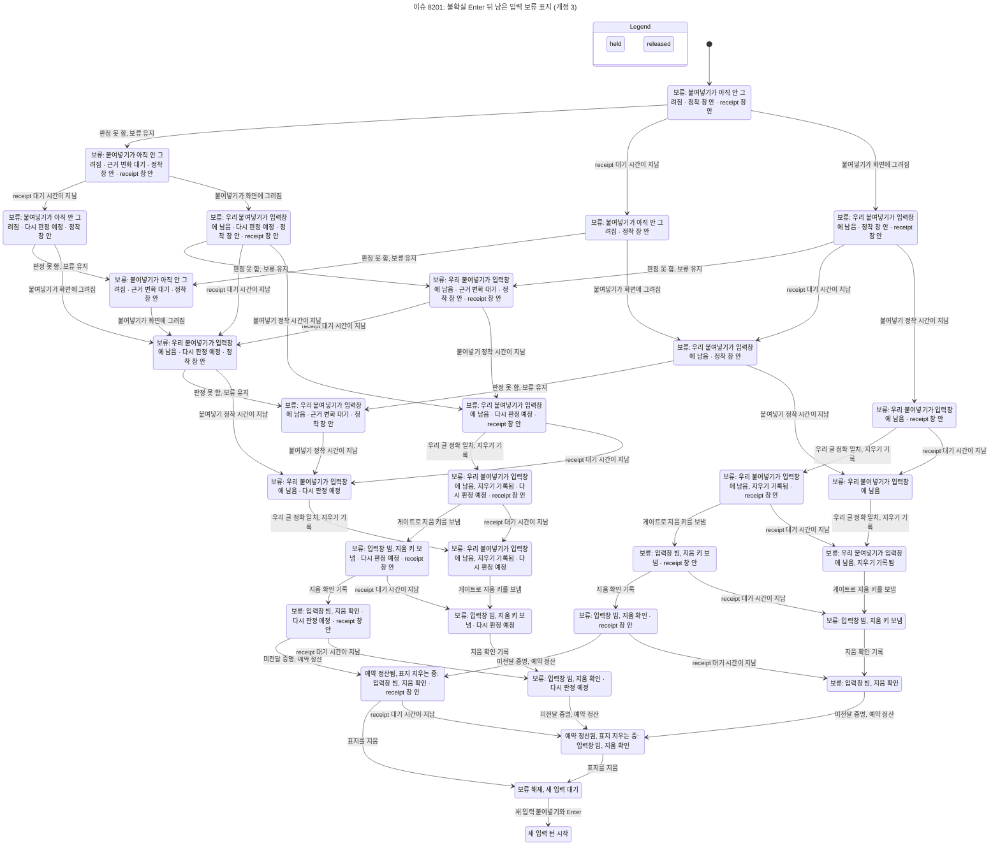

# #8201 herdr 입력 보류 표지 상태 모델 (개정 3)

코드 SHA: `934a49997e95ffb0d54ae8eed2d7653ea6c1e4bf` (origin/main, 2026-11-16). 설계: [8201-herdr-input-hold.design.md](../../design/8201-herdr-input-hold.design.md). 개정 3은 pro 재리뷰 2(P1-A·P1-B·P1-C, P2-C)를 반영했다. 설계 계약의 모델 검증이며 Rust 구현·운영 결과가 아니다. 기존 `HerdrBusyInput.tla`와 그 cfg는 바꾸지 않았다.

## 범위

살아 있는 Bound 실행 하나에서 불확실하게 끝난 입력과 그 뒤 입력을 다룬다. `SecondHold`에서는 같은 실행에 두 번째 보류가 생긴다. 표지 기록(재시작에도 남음)과 프로세스 메모리, 입력창·stash·transcript의 실제 상태(환경), 판정기가 보는 관측(`Shown`)을 분리했다. 값 범위는 설계 1장 전수표에서 가져왔다.

| 모델 요소 | 코드·설계 대응 |
|---|---|
| `hold` / `reserved` | W1 `hold` 파일 / W4 `readiness::reserve`의 `Entry.pending`(재시작 시 `Boot`가 지움, P5) |
| `unsentProof`, `cleanup`, `unclear`, `intent`, `enqueued` (표지에 남음) | 설계 3.1 `unsent_proof`(단조), `cleanup_phase`, `unclear_passes`, `notice_intent_at`, `notice_enqueued_at` |
| `keysSent`, `lock`, `watch`, `trigger` (메모리) | 이 패스에서 지움 키를 보냄, 해제 단위의 composer 잠금, 근거 변화 감시, 판정 예정 |
| `holdId`, `rows`, `sentFor` | 보류 identity, outbox 영구 dedupe row(키별), 보류별로 만들어진 알림 row 수 |
| `StartBefore` | main R1/R2 `not_held` 거절 → Opaque start failure 2회 → retained |
| `Paste` / `BusyInject` | `when_idle`(표지·예약·잠금이 없고 기존 분류기에서 빈 입력창) / busy 주입(표지를 읽지 않음) |
| `Existing` / `Shown` | 기존 분류기 / 판정기: 판독 가능 관문(stash 보이면 Unread)을 지난 본문은 그대로 넘겨 정확 일치 검사까지 감(개정 3) |
| `Resolve` | 설계 3.3 규칙 1~9. 규칙 8은 지우기 기록(증거 함께) → 지움 키 → 확인을 따로 전이한다 |
| `Settle` → `Unlink` | 설계 3.4 해제 단위: 예약 정산 → 표지 삭제 |
| `Bump` | 판정 실패 계수 → 한도에서 알림 의도 기록 → 보류 키로 enqueue(실패 가능, `EnqFail`) → row 확보 전까지 자체 재시도 |
| `Unhold` | 모든 표지 삭제가 지나는 한 곳. 잔여물(입력창의 우리 글·고친 글, stash)을 실제 상태로 계산 |

## 규칙

- Safety: `OriginalAtMostOnce`, `NoPasteOverResidue`, `NoHumanTextDeleted`, `NoReleaseOnResidue`, `UndeliveredIsTrue`, `DeliveredIsTrue`, `NoticeAtMostOnce`(보류마다 row ≤ 1).
- Liveness:
  - `HoldEventuallyReleased`
  - `HoldReleasedOrNoticed` = `hold ~> (~hold ∨ 이 보류의 알림 row ≥ 1)`. 보류 단위이며, 개정 3에서 강화했다.
  - `ReadableOursCleaned`(개정 3): 우리 본문이 읽히면 결국 지워지거나 입력창이 바뀐다.
  - `LaterInputStarts`
- 공정성: `Resolve`는 `trigger`가 있을 때만 가능하다. 시작, 근거 변화 Wake, row 확보 전 자체 재시도, 부팅 뒤 front 재구동이 `trigger`를 만든다. 환경 회복과 시스템 동작에 weak fairness를 둔다. `PersonTypes`·`PersonEdits`·`PersonStashSubmit`·`LoadSpike`·`Crash`·enqueue 실패에는 두지 않는다.

## 설계안 차트 (`HerdrInputHoldFixed`)



- [수정 전 차트](herdr-input-hold.before.chart.mmd): 시작 거절 2회 뒤 retained, 표지 영구.
- [증거 덮어쓰기 대조군](herdr-input-hold.overwrite-proof.chart.mmd): 지우기 기록 → 지움 키 → 재시작 → 빈 입력창인데 미전달 증거가 없어 알림 뒤 영구 보류(리뷰 P1-B 재현).
- [예약 미정산 대조군](herdr-input-hold.no-settle-reservation.chart.mmd): 표지를 지워도 "보류 해제, readiness 예약 남음"에서 멈춘다.

## 주요 반례 (개정 3 대조군)

- `MutSightingGate`: 붙여넣기 반영 → 우리 본문이 보이지만 규칙 3이 막아 판정 실패 → 정착 뒤에도 같음 → 알림 뒤 영구 보류(ReadableOursCleaned·HoldEventuallyReleased RED).
- `MutOverwriteProof`: 정착 → 우리 글 정확 일치, 지우기 기록(증거 덮어씀) → 지움 키 → dcserver 재시작 → 부팅 → 빈 입력창이지만 미전달 증거 없음 → 판정 실패 2회 → 알림 → 영구.
- `MutNonceKey`: 첫 보류 판독 실패 2회 → 알림(키 E) → 판독 회복 → 정리·정산·해제 → 다음 입력 시작 → 두 번째 보류(판독 불가) → 판정 실패 2회 → 같은 키 E라 기존 row가 반환되어 이 보류의 알림 0 → 재시도 종료(HoldReleasedOrNoticed RED).
- `MutStopOnIntent`: 판독 불가 → 판정 실패 2회 → 알림 의도 기록 → enqueue 실패 → 의도만 보고 재시도를 멈춤 → 알림 0으로 영구.

## 결과 (기대 집합 = 실제 집합, 31 cfg)

| cfg | 시나리오 | 기대 위반 | 실제 위반 | 상태 수 |
|---|---|---|---|---|
| `HerdrInputHoldBefore` | main: 사건 재현 | HoldEventuallyReleased, HoldReleasedOrNoticed, LaterInputStarts, ReadableOursCleaned | HoldEventuallyReleased, HoldReleasedOrNoticed, LaterInputStarts, ReadableOursCleaned | 18 |
| `HerdrInputHoldBeforeEnds` | main + 실행 종료(C5~C10) | LaterInputStarts | LaterInputStarts | 36 |
| `HerdrInputHoldEnqueueFail` | 설계: 판독 불가 + 첫 enqueue 실패(예상) | HoldEventuallyReleased, LaterInputStarts | HoldEventuallyReleased, LaterInputStarts | 40 |
| `HerdrInputHoldEnterSendFail` | 설계: Enter 송신 실패 | 없음 | 없음 | 103 |
| `HerdrInputHoldFixed` | 설계: 사건 재현(enterRefused, Cancelled{1} 포함) | 없음 | 없음 | 39 |
| `HerdrInputHoldLegacy` | 설계: v1 표지 + 남은 글(예상) | HoldEventuallyReleased, LaterInputStarts | HoldEventuallyReleased, LaterInputStarts | 20 |
| `HerdrInputHoldLoadSpike` | 설계: 첫 판독 실패 뒤 회복 | 없음 | 없음 | 152 |
| `HerdrInputHoldMutEmptyOnlyWake` | 대조: 빈 입력창일 때만 깨움 | HoldEventuallyReleased, HoldReleasedOrNoticed, LaterInputStarts, ReadableOursCleaned | HoldEventuallyReleased, HoldReleasedOrNoticed, LaterInputStarts, ReadableOursCleaned | 154 |
| `HerdrInputHoldMutIgnoreTranscript` | 대조: transcript 확인 생략 | HoldEventuallyReleased, LaterInputStarts | HoldEventuallyReleased, LaterInputStarts | 97 |
| `HerdrInputHoldMutNoSelfRetry` | 대조: 자체 재시도 없음 | HoldEventuallyReleased, HoldReleasedOrNoticed, LaterInputStarts | HoldEventuallyReleased, HoldReleasedOrNoticed, LaterInputStarts | 25 |
| `HerdrInputHoldMutNoSettleReservation` | 대조: 예약 미정산 해제 | LaterInputStarts | LaterInputStarts | 35 |
| `HerdrInputHoldMutNonceKey` | 대조: 실행 nonce 단위 알림 dedupe | HoldReleasedOrNoticed | HoldReleasedOrNoticed | 158 |
| `HerdrInputHoldMutOpaqueFailure` | 대조: 보류를 start failure로 | LaterInputStarts | LaterInputStarts | 143 |
| `HerdrInputHoldMutOverwriteProof` | 대조: clearing이 미전달 증거를 덮어씀(+재시작) | HoldEventuallyReleased, LaterInputStarts | HoldEventuallyReleased, LaterInputStarts | 159 |
| `HerdrInputHoldMutReleaseOnResidue` | 대조: 우리 글을 안 지우고 해제 | LaterInputStarts, NoReleaseOnResidue | LaterInputStarts, NoReleaseOnResidue | 12 |
| `HerdrInputHoldMutReleaseOnUnread` | 대조: 판독 불가를 빈 것으로 | LaterInputStarts, NoReleaseOnResidue | LaterInputStarts, NoReleaseOnResidue | 42 |
| `HerdrInputHoldMutResendNoSettle` | 대조: 창 없이 미전달 판정 + 재전달 | LaterInputStarts, NoPasteOverResidue, NoReleaseOnResidue, OriginalAtMostOnce, UndeliveredIsTrue | LaterInputStarts, NoPasteOverResidue, NoReleaseOnResidue, OriginalAtMostOnce, UndeliveredIsTrue | 8 |
| `HerdrInputHoldMutShapeDelete` | 대조: 모양·접두어·접은 공백으로 삭제 | NoHumanTextDeleted | NoHumanTextDeleted | 25 |
| `HerdrInputHoldMutSightingGate` | 대조: 규칙 3이 우리 본문까지 차단 | HoldEventuallyReleased, LaterInputStarts, ReadableOursCleaned | HoldEventuallyReleased, LaterInputStarts, ReadableOursCleaned | 24 |
| `HerdrInputHoldMutSkipPasteSettle` | 대조: enterRefused가 정착 창 생략 | LaterInputStarts, NoPasteOverResidue, NoReleaseOnResidue | LaterInputStarts, NoPasteOverResidue, NoReleaseOnResidue | 10 |
| `HerdrInputHoldMutStopOnIntent` | 대조: 알림 의도만 보고 재시도 중단(+enqueue 실패) | HoldEventuallyReleased, HoldReleasedOrNoticed, LaterInputStarts | HoldEventuallyReleased, HoldReleasedOrNoticed, LaterInputStarts | 42 |
| `HerdrInputHoldMutTimeReceipt` | 대조: 시각 이후 user를 전달 증거로 | DeliveredIsTrue, LaterInputStarts, NoReleaseOnResidue | DeliveredIsTrue, LaterInputStarts, NoReleaseOnResidue | 37 |
| `HerdrInputHoldPasteSendFail` | 설계: 붙여넣기 송신 실패 | 없음 | 없음 | 60 |
| `HerdrInputHoldPersonEdits` | 설계: 사람이 우리 글을 고친 뒤 보냄(덧붙임·공백 포함) | 없음 | 없음 | 133 |
| `HerdrInputHoldPersonLeaves` | 설계: 사람 초안이 결국 비워짐 | 없음 | 없음 | 109 |
| `HerdrInputHoldPersonStays` | 설계: 사람 초안이 계속 남음(예상) | HoldEventuallyReleased, LaterInputStarts | HoldEventuallyReleased, LaterInputStarts | 69 |
| `HerdrInputHoldRestart` | 설계 + 재시작 1회(지우기 기록·키·확인·정산·삭제 사이 어디서나) | 없음 | 없음 | 165 |
| `HerdrInputHoldRestartUnreadable` | 설계: 판독 불가 + 재시작(예상) | HoldEventuallyReleased, LaterInputStarts | HoldEventuallyReleased, LaterInputStarts | 81 |
| `HerdrInputHoldSecondHold` | 설계: 같은 실행에서 두 번째 보류(판독 불가) | 없음 | 없음 | 158 |
| `HerdrInputHoldStashOther` | 설계: C-s → 다른 입력 B → stash 복귀 | 없음 | 없음 | 173 |
| `HerdrInputHoldUnreadable` | 설계: 판독 계속 불가(예상) | HoldEventuallyReleased, LaterInputStarts | HoldEventuallyReleased, LaterInputStarts | 23 |

- 예상 위반(PersonStays·Unreadable·RestartUnreadable·EnqueueFail·Legacy): 남은 글이 사람 것이거나, 판독할 수 없거나, v1 표지라 증명할 수 없으면 키를 보내지 않고 보류를 유지한다. 보류 단위 `HoldReleasedOrNoticed`와 `NoticeAtMostOnce`는 통과한다(보류마다 알림 정확히 1회). 강제 삭제는 하지 않는다.
- `SecondHold` GREEN: 두 보류 각각이 해제되거나 자기 알림을 받는다.
- `BeforeEnds`: main에서도 실행이 끝나면 표지는 풀린다. 나중 입력은 이미 retained 경로이고, 후계 launch는 이 투영 밖이다.

## 한계 (설계 6장 A1~A15로 넘김)

- 판독 가능 관문과 무손실 본문 복원의 정확성(A1·A4), 정착·receipt 창 길이(A3), digest 대조(A5), 해제 단위가 이 입력의 예약만 정산하는 것(A1·A2), owner scope 안 감시 등록(A8), `NotDurable` 재시도(A9), 재시작 뒤 `recovery` 울타리(A12), 지움 직후 사람의 제출(A15)은 가정이며 S1 시험이 증명한다.
- 보류 둘, 다른 입력 B 하나, 재시작 1회, enqueue 실패 1회까지만 다룬다. 큐·front 번호는 기존 모델이 맡는다.
- `/clear`·새 incarnation·herdr 서버 교체·tmux 복귀와의 교차는 모델에 없다. Codex 첫 입력의 source 미확정 단계(A14)도 없다.

## 다시 만들기

```sh
export TLA2TOOLS=~/.local/share/tla2tools/tla2tools-1.7.4.jar JAVA=/opt/homebrew/opt/openjdk/bin/java
for c in docs/statecharts/input-single-path/HerdrInputHold*.cfg; do
  n=$(basename "${c%.cfg}")
  ~/.claude/skills/statechart/scripts/statechart docs/statecharts/input-single-path/HerdrInputHold.tla \
    --config "$c" --out "<새 폴더>/$n"
done
```

차트 이름표는 레인 실행 폴더의 보기 모듈(`--view`)로 붙였다. TLC 판정은 보기 모듈과 무관하다.
