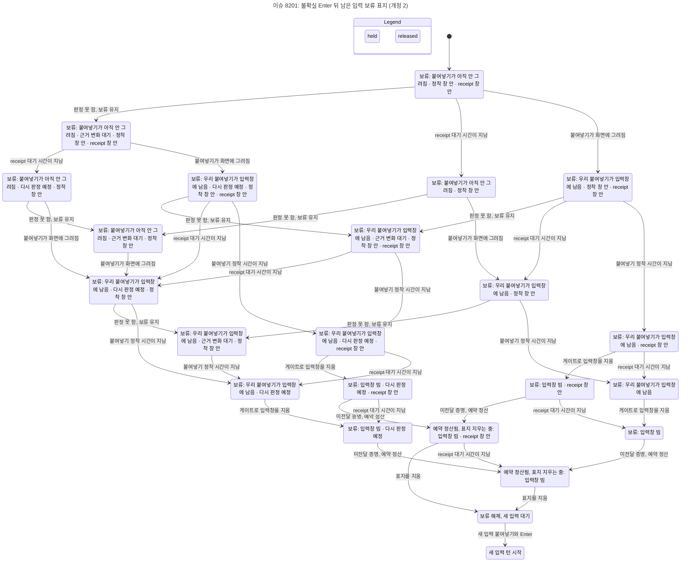

# #8201 herdr 입력 보류 표지 상태 모델 (개정 2)

코드 SHA: `934a49997e95ffb0d54ae8eed2d7653ea6c1e4bf` (origin/main, 2026-11-16). 설계: [8201-herdr-input-hold.design.md](../../design/8201-herdr-input-hold.design.md). 개정 2는 pro 설계 리뷰(P1-1~P1-4, P2-1)를 반영했다. 설계 계약의 모델 검증이며 Rust 구현·운영 결과가 아니다. 기존 `HerdrBusyInput.tla`와 그 cfg는 바꾸지 않았다.

## 범위

살아 있는 Bound 실행 하나, 불확실하게 끝난 원 입력 하나, 그 뒤 입력 하나를 다룬다. 그 입력이 남긴 두 상태(파일 표지, readiness 예약)와 입력창·stash·transcript의 실제 상태(환경), 그리고 판정기가 보는 관측(`Shown`)을 분리했다. 값 범위는 설계 1장 전수표에서 가져왔다.

| 모델 요소 | 코드·설계 대응 |
|---|---|
| `hold` / `reserved` | W1 `hold` 파일 / W4 `readiness::reserve`의 `Entry.pending` (재시작 시 `Boot`가 지움, P5) |
| `Scenario` | `InputRun` 결과(enterRefused·enterSendFail·pasteSendFail)와 그 뒤 사람·부하 사건 |
| `StartBefore` | main R1/R2 `not_held` 거절 → Opaque start failure 2회 → retained |
| `Paste` | `when_idle`: 표지 없음 ∧ 예약 없음 ∧ 잠금 없음 ∧ 기존 분류기에서 빈 입력창 |
| `BusyInject` | busy 주입(표지를 읽지 않음) |
| `Existing` / `Shown` | 기존 분류기(그려지기 전 붙여넣기는 빈 것으로, 빈 입력창의 stash는 안 보임) / 판정기(`draft_sighting` = `Settled`만 빈 것, stash 보이면 Unread) |
| `Resolve` | 설계 3.3 규칙 1~9: 바쁨 대기 → v2 digest 전달 → 판독 불가 계수 → 정착 대기 → 미전달 증명이 있으면 해제 단위 → v1 빈 입력창 해제 → 전달 불명 대기·계수 → 정확 digest 지우기 → 그 밖 보류·계수 |
| `Settle` → `Unlink` (`lock`) | 설계 3.4 해제 단위: 예약 정산 → 표지 삭제, 사이 crash 가능 |
| `trigger`/`watch`/`Wake` | 설계 3.5: 근거 변화 탐침이 Wake, 알림 전까지 자체 재시도 |
| `unclear`/`noticed` (표지에 남음), `notices` (실제 발송 수) | 설계 3.5 알림 1회 |
| `Unhold` | 모든 표지 삭제가 지나는 한 곳. 잔여물(입력창의 우리 글·고친 글, stash)을 실제 상태로 계산 |
| `PasteWindow` / `ReceiptWindow` | 붙여넣기 정착 창 / receipt 창. 창이 반영·기록 지연보다 길다는 것은 가정(A3) |

## 규칙

- Safety: `OriginalAtMostOnce`, `NoPasteOverResidue`, `NoHumanTextDeleted`, `NoReleaseOnResidue`, `UndeliveredIsTrue`, `DeliveredIsTrue`, `NoticeAtMostOnce`.
- Liveness: `HoldEventuallyReleased`, `HoldReleasedOrNoticed`(풀리거나 알림 1회), `LaterInputStarts`.
- 공정성: `Resolve`는 `trigger`가 있을 때만 가능하다. 시작, 근거 변화 Wake, 알림 전 자체 재시도, 부팅 뒤 front 재구동이 `trigger`를 만든다. 무조건적인 재실행은 없다(리뷰 P1-3). 환경 회복(`Render`·창 경과·`TranscriptWrite`·`TurnEnd`·`LoadEnds`·`PersonLeaves`·`StashReturns`·`OtherTurnEnd`)과 시스템 동작에 weak fairness를 둔다. `PersonTypes`·`PersonEdits`·`PersonStashSubmit`·`LoadSpike`·`Crash`에는 두지 않는다.

## 설계안 차트 (`HerdrInputHoldFixed`)



- [수정 전 차트](herdr-input-hold.before.chart.mmd): 시작 거절 2회 뒤 retained, 표지 영구.
- [예약 미정산 대조군](herdr-input-hold.no-settle-reservation.chart.mmd): 정확히 지우고 표지를 지워도 "보류 해제, readiness 예약 남음"에서 멈춘다(리뷰 P1-1 재현).
- `Stay`와 같은 이름표 안의 반복은 그리지 않는다. 전체 경로는 레인 실행 폴더의 TLC 출력에 있다.

## 주요 반례

- `Before` (HoldEventuallyReleased 등): 보류 → 새 입력 시작이 표지에 거절됨 → 다시 거절되어 retained → 붙여넣기 반영·정착 뒤에도 영구.
- `MutNoSettleReservation`: … → 게이트로 입력창을 지움 → 미전달 증명, 예약 정산(뮤턴트는 정산 생략) → 표지를 지움 → "보류 해제, readiness 예약 남음"에서 영구.
- `MutTimeReceipt`: 붙여넣기 반영 → 사람이 우리 글을 stash하고 B를 보냄 → B 턴 끝 → B를 전달 증거로 보고 해제(stash에 우리 글이 남은 채).
- `MutShapeDelete`: 붙여넣기 정착 → 사람이 우리 글 뒤에 덧붙임 → 모양으로 우리 글이라 판단하고 지움 → 사람 글 삭제.
- `MutEmptyOnlyWake`: 판독 실패 1회 → 판독 회복(우리 글 보임) → 정착 대기 → 정착 창이 지나도 빈 입력창이 아니라 깨지 않음 → 알림도 없이 영구.
- `MutVolatileCounter`: 판정 실패 2회 → 알림 → 재시작 → 계수 초기화 → 다시 2회 → 알림 두 번.
- `MutResendNoSettle`: Enter 도착·transcript 기록 전 → 창 없이 미전달로 정산하고 재전달 → 두 번 제출.

## 결과 (기대 집합 = 실제 집합, 26 cfg)

| cfg | 시나리오 | 기대 위반 | 실제 위반 | 상태 수 |
|---|---|---|---|---|
| `HerdrInputHoldBefore` | main: 사건 재현 | HoldEventuallyReleased, HoldReleasedOrNoticed, LaterInputStarts | HoldEventuallyReleased, HoldReleasedOrNoticed, LaterInputStarts | 18 |
| `HerdrInputHoldBeforeEnds` | main + 실행 종료(C5~C10) | LaterInputStarts | LaterInputStarts | 36 |
| `HerdrInputHoldEnterSendFail` | 설계: Enter 송신 실패 | 없음 | 없음 | 91 |
| `HerdrInputHoldFixed` | 설계: 사건 재현(enterRefused) | 없음 | 없음 | 31 |
| `HerdrInputHoldLegacy` | 설계: v1 표지 + 남은 글(예상) | HoldEventuallyReleased, LaterInputStarts | HoldEventuallyReleased, LaterInputStarts | 20 |
| `HerdrInputHoldLoadSpike` | 설계: 첫 판독 실패 뒤 회복 | 없음 | 없음 | 118 |
| `HerdrInputHoldMutEmptyOnlyWake` | 대조: 빈 입력창일 때만 깨움 | HoldEventuallyReleased, HoldReleasedOrNoticed, LaterInputStarts | HoldEventuallyReleased, HoldReleasedOrNoticed, LaterInputStarts | 120 |
| `HerdrInputHoldMutIgnoreTranscript` | 대조: transcript 확인 생략 | HoldEventuallyReleased, LaterInputStarts | HoldEventuallyReleased, LaterInputStarts | 85 |
| `HerdrInputHoldMutNoSelfRetry` | 대조: 자체 재시도 없음 | HoldEventuallyReleased, HoldReleasedOrNoticed, LaterInputStarts | HoldEventuallyReleased, HoldReleasedOrNoticed, LaterInputStarts | 25 |
| `HerdrInputHoldMutNoSettleReservation` | 대조: 예약 미정산 해제 | LaterInputStarts | LaterInputStarts | 27 |
| `HerdrInputHoldMutOpaqueFailure` | 대조: 보류를 start failure로 | LaterInputStarts | LaterInputStarts | 106 |
| `HerdrInputHoldMutReleaseOnResidue` | 대조: 우리 글을 안 지우고 해제 | LaterInputStarts, NoReleaseOnResidue | LaterInputStarts, NoReleaseOnResidue | 12 |
| `HerdrInputHoldMutReleaseOnUnread` | 대조: 판독 불가를 빈 것으로 | LaterInputStarts, NoReleaseOnResidue | LaterInputStarts, NoReleaseOnResidue | 42 |
| `HerdrInputHoldMutResendNoSettle` | 대조: 창 없이 미전달 판정 + 재전달 | LaterInputStarts, NoPasteOverResidue, NoReleaseOnResidue, OriginalAtMostOnce, UndeliveredIsTrue | LaterInputStarts, NoPasteOverResidue, NoReleaseOnResidue, OriginalAtMostOnce, UndeliveredIsTrue | 8 |
| `HerdrInputHoldMutShapeDelete` | 대조: 모양·접두어만으로 삭제 | NoHumanTextDeleted | NoHumanTextDeleted | 25 |
| `HerdrInputHoldMutSkipPasteSettle` | 대조: enterRefused가 정착 창 생략 | LaterInputStarts, NoPasteOverResidue, NoReleaseOnResidue | LaterInputStarts, NoPasteOverResidue, NoReleaseOnResidue | 10 |
| `HerdrInputHoldMutTimeReceipt` | 대조: 시각 이후 user를 전달 증거로 | DeliveredIsTrue, LaterInputStarts, NoReleaseOnResidue | DeliveredIsTrue, LaterInputStarts, NoReleaseOnResidue | 36 |
| `HerdrInputHoldMutVolatileCounter` | 대조: 판정 실패 계수를 메모리에만 | HoldEventuallyReleased, LaterInputStarts, NoticeAtMostOnce | HoldEventuallyReleased, LaterInputStarts, NoticeAtMostOnce | 82 |
| `HerdrInputHoldPasteSendFail` | 설계: 붙여넣기 송신 실패 | 없음 | 없음 | 52 |
| `HerdrInputHoldPersonEdits` | 설계: 사람이 우리 글에 덧붙인 뒤 보냄 | 없음 | 없음 | 84 |
| `HerdrInputHoldPersonLeaves` | 설계: 사람 초안이 결국 비워짐 | 없음 | 없음 | 84 |
| `HerdrInputHoldPersonStays` | 설계: 사람 초안이 계속 남음(예상) | HoldEventuallyReleased, LaterInputStarts | HoldEventuallyReleased, LaterInputStarts | 52 |
| `HerdrInputHoldRestart` | 설계 + 재시작 1회(정산·삭제 사이 포함) | 없음 | 없음 | 109 |
| `HerdrInputHoldRestartUnreadable` | 설계: 판독 불가 + 재시작(예상) | HoldEventuallyReleased, LaterInputStarts | HoldEventuallyReleased, LaterInputStarts | 81 |
| `HerdrInputHoldStashOther` | 설계: C-s → 다른 입력 B → stash 복귀 | 없음 | 없음 | 128 |
| `HerdrInputHoldUnreadable` | 설계: 판독 계속 불가(예상) | HoldEventuallyReleased, LaterInputStarts | HoldEventuallyReleased, LaterInputStarts | 23 |

- 예상 위반(PersonStays·Unreadable·RestartUnreadable·Legacy): 남은 글이 사람 것이거나, 판독할 수 없거나, v1 표지라 증명할 수 없으면 키를 보내지 않고 보류를 유지한다. `HoldReleasedOrNoticed`와 `NoticeAtMostOnce`는 통과한다(알림 정확히 1회). 강제 삭제는 하지 않는다.
- `BeforeEnds`: main에서도 실행이 끝나면 표지는 풀린다. 나중 입력은 이미 retained 경로이고, 후계 launch는 이 투영 밖이다.

## 한계 (설계 6장 A1~A14로 넘김)

- 정착·receipt 창이 반영·기록 지연보다 길다는 것(A3), digest 대조의 정확성(A4·A5), 해제 단위가 이 입력의 예약만 정산한다는 것(A1·A2), owner scope 안 감시 등록(A8), 재시작 뒤 `recovery` 울타리(A12)는 가정이며 S1 시험이 증명한다.
- 입력 하나, 다른 입력 B 하나, 재시작 1회만 다룬다. 큐·front 번호·outbox는 기존 모델이 맡는다.
- `/clear`·새 incarnation·herdr 서버 교체·tmux 복귀와의 교차는 모델에 없다.
- Codex 경로(S3)는 같은 구조로 대표하지만, 첫 입력의 source 미확정 단계는 모델에 없다(A14).

## 다시 만들기

```sh
export TLA2TOOLS=~/.local/share/tla2tools/tla2tools-1.7.4.jar JAVA=/opt/homebrew/opt/openjdk/bin/java
for c in docs/statecharts/input-single-path/HerdrInputHold*.cfg; do
  n=$(basename "${c%.cfg}")
  ~/.claude/skills/statechart/scripts/statechart docs/statecharts/input-single-path/HerdrInputHold.tla \
    --config "$c" --out "<새 폴더>/$n"
done
```

차트 이름표는 레인 실행 폴더의 보기 모듈(`--view`)로 붙였다. TLC 판정은 보기 모듈과 무관하다.
