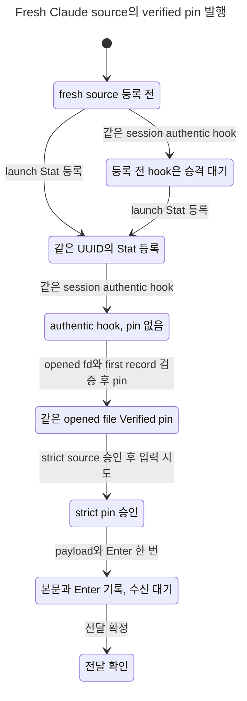

# Fresh Claude source producer 상태 모델 (#8114 Slice2b)

기준 source: 2b `1c4742af92ef9c5223bfee19c17294864243336f`를 B1 뒤 병합한 `9cef49fb89` 작업트리. 모델 검증은 Rust 구현의 시험 결과를 대신하지 않는다. TLA는 2b의153줄 원문(SHA256 `1a72fa92a935b9e759be2d3615dbe013319743ce758b761a5be9bdbad4b9a770`)을 그대로 사용했다. B1의 기존30 cfg와 별도 재관측24 cfg/모델, 기존54 expected 행은 보존했다. producer6 cfg와 독립 expected6행을 저장소에 등록했다.

## 상태 차트

[Fresh GREEN](herdr-producer.chart.mmd), [producer 제거 RED](herdr-producer.absent.chart.mmd), [identity 검사 제거 RED](herdr-producer.identity-mutant.chart.mmd). 아래 본문과 Enter 기록 상태는 transport 경계이며 수신 증거를 뜻하지 않는다. NativeProof 뒤 정산을 통해 전달 확인에 도달한다.



view는 action을 null로 숨기지 않는다. 같은 표시 안의 notice·proof·반복 hook 등 전이는 chart 안으로 접힌다(Fresh122, Absent28, IgnoreIdentity146개 step). 정확한 action 경로와 liveness cycle은 원시 보고서/TLC 로그에 있다.

## producer 계약과 코드 대응

| 모델 action/guard | 현재 code 좌표 | 의미 |
|---|---|---|
| RegisterStat | `src/services/tui_prompt_dedupe/runtime_binding/codex_hook.rs:20` | Launch는 Stat 등록이며 verified pin을 만들지 않음 |
| AuthenticHook | `src/services/tui_prompt_dedupe/runtime_binding/claude_source.rs:405` | 같은 native UUID의 authentic hook이 기존 source를 찾음 |
| PromoteVerified | `src/services/tui_prompt_dedupe/runtime_binding/claude_source.rs:114` | same execution nonce의 unverified current SourceId와 opened transcript 검증 결과가 같을 때만 기존 publisher 호출 |
| opened identity/first record | `src/services/claude_tui/source_verify.rs:165` | 한 opened fd에서 identity와 첫 record 관측 |
| globalPin + nonceCurrentPin | `src/services/tui_prompt_dedupe/binding_events.rs:446` | 기존 record_verified/Plan::Verified의 durable publication을 하나의 action으로 추상화 |
| RepeatVerifiedHook | `src/services/tui_prompt_dedupe/runtime_binding/claude_source.rs:121` | 이미 verified이면 새 unverified source를 얻지 못해 pin을 다시 기록하지 않음 |
| Eligible | `HerdrBusyInput.tla:33` | 기존 O/host/target 조건과 두 verified pin 모두 필요; pin 없는 fresh source의 admission 완화 없음 |

등록 전 hook은 earlyHook만 남긴다. 등록 후 authentic hook이 다시 도착해야 승격한다. `AuthenticHookReached`를 ON/OFF 양쪽에서 검사해 hook 자체가 없어서 성공하는 공허한 결과를 막았다. 기존30 cfg는 이미 verified source라는 초기 전제를 유지하며, 동적 회복/clear wake는 별도24 cfg가 담당한다. verified clear는 Busy 권한이 아니며 같은 owner/target/front/generation의 기존 Idle 재평가만 깨운다. UnknownKeep와 clear-discard는 원문을 부활시키지 않는다.

## 실제60 cfg 검증

명시60 cfg root로 공식 `scripts/ci/statecharts_tlc.py`의 main/check_cfg를 실행하고 run_java 출력만 보존하도록 감쌌다. checker exit0, 201.088초, 기대 집합60/60 일치, GREEN33/의도RED27, 오류0/미검사0. TLC249회와 fairness precheck60회(합309 JVM 실행)가 모두 종료했다. 각 config는 safety 재검사 뒤 property를 하나씩 실제 TLC로 검사했다.

| 묶음 | cfg | GREEN | 기대RED | TLC 실행 | fairness |
|---|---:|---:|---:|---:|---:|
| 기존 정적/재시작 경계 | 30 | 16 | 14 | 119 | 30 |
| 기존 동적 reobserve | 24 | 13 | 11 | 100 | 24 |
| 신규 producer | 6 | 4 | 2 | 30 | 6 |

| producer cfg | 기대 위반 | 실제 위반 | TLC 실행 | TLC 실제 exit 집합 |
|---|---|---|---:|---|
| `ProducerAbsent` | HealthyBusyEventuallyInjected,ProducerEventuallyVerified | HealthyBusyEventuallyInjected,ProducerEventuallyVerified | 6 | 0,13 |
| `ProducerFresh` | 없음 | 없음 | 7 | 0 |
| `ProducerIgnoreIdentity` | VerifiedPinMatchesRegistered | VerifiedPinMatchesRegistered | 5 | 0,12 |
| `ProducerLegacy` | 없음 | 없음 | 4 | 0 |
| `ProducerReplacement` | 없음 | 없음 | 4 | 0 |
| `ProducerWrongFirst` | 없음 | 없음 | 4 | 0 |

TLC exit12는 invariant 위반, exit13은 liveness 위반이다. checker exit0은 위반이 없다는 뜻이 아니라 등록한 기대 집합과 실제 집합의 일치다. producer 대표3개의 statechart 실행은 Fresh exit0(66states/167steps), Absent exit1(18/45), IgnoreIdentity exit1(66/167)로 새로 생성했다. 나머지3개는 이번 공식 checker로 검증했으며 chart 재생성 대상은 아니다.

반례별 규칙·경로:

- `ProducerEventuallyVerified`, `HealthyBusyEventuallyInjected`: pin이 발행되고 턴 종료를 기다리지 않고 전달되어야 한다. Absent report0–4: fresh→pin 없어 보류→Stat등록→보류표시→authentic hook 뒤 pin 없음에 영구 정지.
- `VerifiedPinMatchesRegistered`: verified pin은 등록된 path/dev/ino와 같아야 한다. IgnoreIdentity report0–3: fresh→Stat등록→authentic hook→replacement inode의 잘못된 pin.

Rust의 fresh launch/hook 및 inode replacement 계약 시험은 구현 레인의 별도 증거가 필요하다. 모델만으로 운영 성공이나 code replay 성공을 주장하지 않는다.

## 공식 선택기의0대상 계약

0대상은 `NO_TARGETS`와 함께 exit1을 반환하며 TLC/PASS표를 만들지 않는다. 기존 document-only/diverged-main, docs-only, clean-delete3시험의 기대를 이 계약으로 강화했다. 수정 전3/3fail(exit1), 수정 후 SelectionCliTest11pass(exit0), source-removal mutant3/3fail(exit1). 외부 복사본만 변형했고 저장소 checker 원문 SHA는 전후 같다. 전체 Python selftest54pass/skip0(exit0,17.190초; 실제 TLC fairness 통합시험 포함).

실제 CLI 빈 root: selected0, TLC0, `NO_TARGETS`, exit1. changed-path API 정적 확인은 producer module36cfg, 두 module60cfg, 신규 expected6행6cfg, README0cfg였다. checker 파일 변경은 기존 선택 정책상 전체494cfg를 선택한다. 이번60cfg root 실행은 전체 PR494cfg CI 실행의 대체 증거가 아니다. 실제 `--base/--head`는 commit된 diff를 사용하므로 최종 구현 commit 뒤의 PR선택 결과는 별도 확인한다.

## 범위와 한계

fresh same-native-UUID/no foreign Pending, same execution nonce, complete history와 authentic hook 도착을 전제로 한다. path/dev/ino와 첫 session 검증은 bounded identity 값으로 투영했다. 두 hook은 기존 pane authority로 직렬화된다. 실제 fd 수명/파일 교체 세부 경합, append 실패·복구, DB/FS 원자성, 무제한 queue, 모든 재시작은 Rust/runtime 계약이 맡는다. pin 두 곳의 publication은 기존 writer의 단일 계약으로 추상화했으며 신규 원자성 증명이 아니다. O 소유·writer 수용과 입력 owner/front 계약도 기존 경계다. liveness는 weak fairness이며 벽시계 지연 상한을 뜻하지 않는다.

## 원문·재현

원문 root: `/Users/itismyfield/.adk/release/lane-runs/hl-20260925/i8114/logs/impl4-model/`.
`source-manifest.json`은62개 TLA/cfg의 실행 전 hash, `results.json`은60cfg 결과와309개 실제 Java exit, `raw/<cfg>/`는 모든 TLC/fairness 원문이다. 현재62파일은 실행 snapshot과 byte 동일하다. `selection-evidence.json`은 explicit changed-path API 결과다. sibling `impl4-model-selector-{red,green,mutant,full}.log`, `impl4-model-no-targets.log`, `impl4-model-selector-evidence.json`에 선택기 근거와 raw SHA가 있다.

```sh
unset TMUX TMUX_PANE
export TLA2TOOLS=~/.local/share/tla2tools/tla2tools-1.7.4.jar
export JAVA=/opt/homebrew/opt/openjdk/bin/java
python3 scripts/ci/statecharts_tlc.py --root <새60cfg-snapshot-root> --jobs 2
python3 -m unittest tests.test_statecharts_tlc
~/.codex/skills/statechart/scripts/statechart docs/statecharts/input-single-path/HerdrBusyInput.tla --config docs/statecharts/input-single-path/HerdrBusyInputProducerFresh.cfg --view docs/statecharts/input-single-path/herdr-producer.view.mjs --out <새-output-folder>
```

jar1.7.4 SHA256 `936a262061c914694dfd669a543be24573c45d5aa0ff20a8b96b23d01e050e88`. 상세 raw exit 표와 재현 runner는 위 logs에 있다. cargo/production Rust/운영 접근/커밋·index 쓰기는 이 모델 작업에서0이다.
