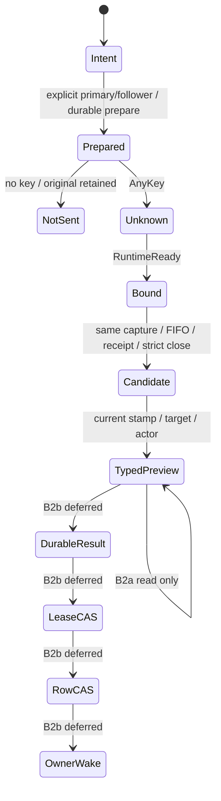

# Native input B2 — 활성화 전 경계

기준 B1 `ccd3752cbae7b1a5c451809dddf5c509d88bc72c`. B1 리뷰 P2 세 건의 fixture는 같은 O capture를 재생한다.

| 경로 | 수정 전 Rust | 수정 뒤 Rust | 모델 RED → GREEN |
|---|---|---|---|
| receipt=two, one 먼저 close | foreign one 결과 | 첫 close0, 전체 two1 | ReceiptBefore: NoForeignReceiptProof·EvidenceEventuallyOwn 위반 → ReceiptFixed 위반0 |
| popAll 뒤 다음 원본의 dequeue | 제거된 원본이 dequeue 소비 | popAll FIFO 해제, 다음 원본1 | PopAllBefore: PopAllNoDebt·EvidenceEventuallyOwn 위반 → PopAllFixed 위반0 |
| Taken/Attached 뒤 다른 본문의 opener | Pending 지속 | 보존된 take/attachment 범위로 다음 run 가입 | OpenBefore: EvidenceEventuallyOwn 위반 → OpenFixed 위반0 |

수정 전 선택3=실행3=실패3, ignored0. 수정 후 native 선택21=실행21=통과21, ignored0. 실제 PG17.11, 단일 시험 스레드. 일반 remove의 늦은 dequeue fixture는 유지한다. popAll에만 넣던 인위적인 추가 dequeue를 없애고 추가 dequeue 없는 독립 fixture를 더했다.

`NativeInputPreparation.tla`의 review는 receipt one/two·FIFO 잔여·Taken/Attached 가입을 유한 추상화한다. source/receipt 유일성의 구체 조건은 Rust fixture와 뮤턴트가 검증하며 모델의 무조건적인 입장 허가로 대체하지 않는다. 기존 pre-key Prepare/AnyKey/NotSent·explicit primary pin 네 cfg도 계속 검사한다.

`statecharts_tlc.py --root <동일 바이트 scratch> --jobs 2`: NativeInputAttribution20 + NativeInputPreparation10 = 30cfg, rc0, 기대 위반 집합 일치, 121.7초. 원시 로그 `/Users/itismyfield/.adk/lane-runs/i8148/logs/b2-tlc.txt`, 원본 바이트 SHA 목록 `b2-tlc-source-sha.json`.

NativeInputAttribution의 결과→CAS→row→wake·boot·WARN 추상 전이는 B2 후속 활성화 대상이다. 현재 운영 완료 actor가 이를 소비했다고 주장하지 않는다. no-key 원본은 완료/철회가 아니며 시간은 종결 증거가 아니다.

## B2a 정지 경계

B2 첫 P2 커밋 `52d18480b` 뒤의 작업은 읽기 전용 observer/pre-key 포트·typed admission 비활성 검증까지다. 운영 입력 producer는 `native_intent`를 만들지 않으며, 결과 writer·finalizer actor loop·bridge의 NativeSettled·boot debt 소비·WARN은 연결하지 않는다. ordinary 입력은 기존 V2 등록 경로다. 명시 intent를 넣은 fixture만 cold effect의 기존 `prepare_history`→arm 경계에서 ticket을 저장한다. prepare 뒤 NotSent/AnyKey/RuntimeReady의 원본 상태를 결과로 바꾸지 않는다.

- O worker는 full capture를 poll하기 전에 ticket/source 후보가 있을 때만 관측을 설치한다. effect poll도 동일 capture를 읽고 stamp를 붙인다. tail/typed resume처럼 full prefix가 없는 capture는 native 완료 후보를 내지 않는다. 새 ticket을 worker 생성 뒤에 등록했을 때의 강제 replay/wake 연결은 B2b다.
- 후보 stamp는 source binding·watch generation·binding seq·revision·complete-line through다. 이것은 완료 허가가 아니다. 비활성 typed admission은 현 capture stamp·실행 target·episode·captured/current actor 일치를 요구한다. follower는 결과 후보만 가질 수 있으며 parent cleanup 권한은 없다.
- `NativePreparationTypedBefore`는 pre-key/source guard를 건너뛰면 NoUntypedAdmission RED, `TypedFixed`는 GREEN이다. NativeTypedAdmission은 read-only이며 NoNativeSettlement를 유지한다. 나머지 NativeInputAttribution20cfg의 release/row/wake·boot·WARN은 여전히 B2b 목표 동작이다.
- 모델32cfg가 rc0·기대 위반 집합 일치(116.0초). 바이트 목록 `b2-tlc-a-source-sha.json`, 원시 `b2-tlc-a.txt`. 상태 모델의 GREEN을 아직 연결하지 않은 운영 liveness의 PASS로 세지 않는다.

도식은 enqueue/remove/popAll·외부 opener/closer의 상세 분기를 합치고 crash/인접 종료를 숨긴다. 상세 반례와 liveness는 두 TLA 모듈/cfg에 남긴다.

## B2b 잔여와 +1100 정지선

B2a staged tree의 공식 `pr_cap_prod.measure` 실측은 prod7파일/+272였다(최종 HEAD 수치는 레인 보고서). 잔여 작업을 같은 단위의 새 순 코드로 다시 세면 아래와 같다. B1의 +780~1060 전체 추정에서 단순 차감하지 않는다. B1에서 아직 빠져 있던 실제 producer의 episode/actor 운반과 custody-only 복원·안내 outbox·중립 종료 연결을 이번 코드 조사에서 구체화했기 때문이다.

| 미구현 표면 | 잔여 순 코드 | 코드 접점·빠진 계약 |
|---|---:|---|
| 명시 primary/follower 운영 producer | +95~140 | `provider_dispatch/owner_input.rs::{hand_busy, OwnerTurn::into_busy_pane, execute_front}`; 일반 `pump::submit_front`는 sources만 쓰며 native intent 생성자 호출은 cfg(test)다. 실제 primary를 시작할 때 actor/nonce/generation을 capture해야 함 |
| durable 결과/안내 → actor CAS → row CAS/admission | +195~280 | `turn_finalizer/{actor_state,terminal_handler,episode,completion_admission}`; 현재 native admission은 preview뿐. `Registry::record_native_outcome/ack_native_withdrawal_notice`는 cfg(test), lease가 먼저 사라진 debt와 row IO 실패 재개·persistent outbox 뒤 ack가 필요 |
| bridge O 범위·중립 종료 | +95~140 | `turn_bridge/stream_loop/exit_reconcile.rs::StreamLoopOutcome`, `stream_tick.rs::StreamTickOutcome`, `post_loop_finalize.rs::run_post_loop_finalize`; 현재 Completed/AuthorityLost뿐이며 NativeSettled·cancel 후처리 회피·own response cutoff 연결이 없음 |
| boot/custody-only·incarnation·원본 복원 | +130~185 | `runtime_bootstrap.rs`의 reaper 호출, `inflight/removal/boot_custody.rs::preserve_native_before_boot_reap`, `input_owner/recovery.rs::recover`; 현재 preserve와 history projection만 있고 native 결과/debt 소비는 없음 |
| Cancel/Terminate/clear/stop/operator release 경쟁 | +100~160 | d1 인접 경로 전수표. 공통 native 결과 CAS와 각 기존 종료 경로의 captured episode/target 연결, successor 보존을 더해야 함 |
| WARN(native idle 미종결 1회) | +65~90 | native lifecycle leaf 및 `Settlement.warned`; 현재 보존 필드일 뿐 clock 경계·IO 실패·재시작 dedupe producer 없음 |
| 관측→actor 비동기 연결·event 유실 wake | +40~65 | `activity/native_input::{prepare,snapshot,observe}`, `input_owner/drive::wake`, `runtime_bootstrap::complete_active_reconcile`; 새 ticket 뒤 full replay 및 missed wake 보충 |
| **B2b 잔여** | **+720~1060 (중간값 +890)** | 기존 코드 재배치·시험 코드는 제외 |

따라서 현재 실측272+잔여 중간값890=**+1162 > +1100**이다. 정지선을 넘겨 활성화를 시작하지 않는다. B2a만 검증·커밋·review ref로 올리고, B2b는 위 결과/정리/복원/인접/WARN/e2e를 한 활성화 경계로 남긴다. A+B1+B2 전체 함께 착지 조건은 유지한다.

기존 event 유실 보충은 전혀 없다고 하지 않는다. `runtime_bootstrap.rs::complete_active_reconcile`는 reconcile 완료 후 `v2_channels`를 순회하고 `session_transition.rs::wake_installed_owner`가 이미 설치된 mailbox V2 owner만 깨운다. 이 경로는 재사용한다. 하지만 custody에만 남은 native ticket/debt를 owner로 재구성하는 소비자는 없고, `input_owner/recovery.rs::recover`도 현재 tick/requeue/history projection/notice drain만 한다. 모델의 BootRestore→Wake GREEN을 이 빠진 소비자의 실행 증거로 삼지 않는다.

## DoD·인접 경로·단일 권위

| DoD | B2a에서 증명하는 범위 | 아직 미평가인 B2b 범위 |
|---|---|---|
| 큐 fixture 회귀 | receipt one/two, popAll/no-debt, remove/late-dequeue, Taken/Attached next-opener, 같은 worker/effect capture의 stamp·rebuild replay | 실제 producer→result→own response→후속 head의 end-to-end 진행 |
| withdraw 무기한 대기0 | remove/popAll 증거와 None follower 결과/안내 API·parent 불변 회귀 | 운영 안내 outbox·native actor·cleanup admission·queue wake 연결. 아직 DoD PASS 아님 |
| native idle 미종결 WARN1 | A reader가 warned를 보존하고 모델은 시간 종결0 유지 | 운영 clock/WARN producer 없음. NOT_RUN |
| herdr relay e2e | 실행0. 새 시험은 파일/Probe/비활성 admission fixture이며 실제 herdr·Claude·Discord 전송이 아님 | 격리 host/시험 channel 범위를 먼저 고정하고 queue/join/withdraw·둘째 head·재시작·pane 재사용·late event·body/footer 단일 도착 확인. NOT_RUN |

Cancel·stop(`mailbox_finish`/`owned_input_stop`), Terminate(`HostTerminated`/`row_retirement`), clear(`clear_channel`/`checked_purge`/`execution_cleanup`), 운영자 release(`turn_lease::OperatorRelease::claim`) 및 boot reaper/circuit delete/rebind reap는 변경0이다. [d1 전수표](native-attribution.entrypoints.md)의 기존 동작을 넓히지 않는다. 결과를 먼저 저장하고 captured episode/actor·lock-held row CAS가 성공한 뒤 wake하는 연결, 중립 NativeSettled, custody-only 복원은 모두 B2b다. 수동 명령·kill·시간 자동 완료·전역 guard를 추가하지 않았다.

#5071 [relay-state-contract](../../relay-state-contract.md)와 대조하면 실행 소유자는 기존 mailbox active-turn lease이고, row는 기존 파생 투영이다. O는 후보 증거만 읽으며 새 relay owner·delivery lease·POST/dedup 경로를 만들지 않는다. optional settlement는 기존 frame registration의 metadata다. 비활성 admission 생성 성공을 mailbox release 또는 Discord 도착 성공으로 세지 않는다.

새 시험은 `ci-pr.yml`의 `changes.rust_tests`→`rust_build`→unfiltered nextest lib universe→LPT worker→`test_evidence`→`CI required` 경로에 속하는 Unix lib 시험이다. 새 ignore/allowlist/선택 예외는 없다. 실제 CI dispatch/실행은 하지 않았으며 합성 README 충돌 뒤의 merge-candidate coverage 재검사는 착지 담당자의 작업이다.

## 실행한 guard 검증

새 관측 시험은 첫 구현에서 23개 중1개가 실패했다. `ObservationCapture`도 offset0에서는 prefix 해시 필드를 갖기 때문에 prefix 존재만으로 full capture 권한을 인정할 수 없었다. `observe_native`와 `native_evidence`는 이제 `Capture::Full`을 명시 확인한다. 수정 전 실제 assertion RED, 수정 뒤 native23개 GREEN, capture-kind 가드 제거도 RED다.

실제 PG17.11·단일 스레드에서 mutation binary의 normal 선택23=실행23=통과23·ignored0. receipt/popAll/next-open/worker install/capture kind/pre-key ticket/cold prepare caller/stamp/current target/exact actor/strict range의 11종은 각각 선택1=실행1=실패1·ignored0이었다. 컴파일 오류나 storage fixture 오류를 kill로 세지 않았다. `b2-mutants-results.json`, `b2-mutant-<mode>.txt`, `b2-mutants-pg.txt`가 원시 증거다.

임시 변경6파일은 미리 보존한 정본 SHA256과 원복 뒤 바이트가 전부 같았다(`b2-mutation-canonical-sha.json`, `b2-mutation-restored.json`). hook·set_var·static·고정 sleep은 커밋하지 않는다. 실제 production actor/CAS/boot/WARN/e2e의 뮤턴트가 아니라 B2a 경계의 증거다.
