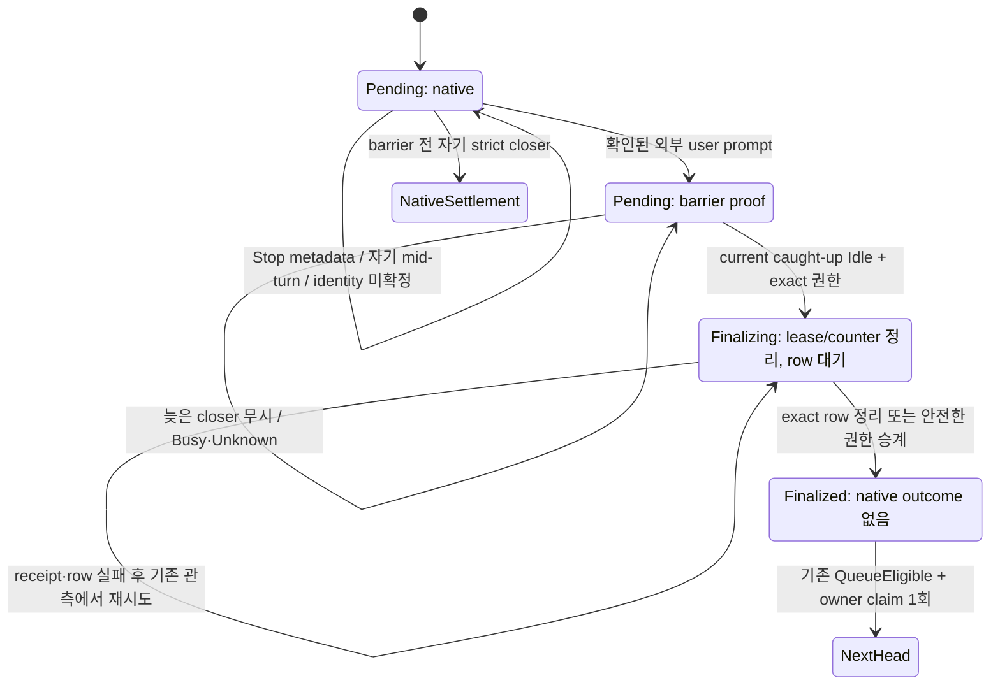

# Native foreign prompt barrier와 입력별 abstain

기준 `f5d417ef60b08c5e4e227894931ac77e4101f7d2`, 결정 mac-1658(범위 축소). 설계/모델/시험 계획이며 제품 코드는 아직 바꾸지 않는다. bad229c4e와 f5d417ef6의 착지 금지를 해소하는 구현·검증은 다음 레그다.

## 결정 반영과 수용 기준

이미 TUI에 전달돼 답한 입력의 Submitted 정산은 유지한다. foreign prompt barrier 뒤 native는 해당 입력의 Executed·Withdrawn·Cancelled를 만들지 않는다. 원본을 큐/retained에 되살리지 않고 기존 Idle 준비 판정 뒤 다음 head만 진행한다. native abstain은 전체 채널 off나 O 출력 포기와 다르다.

이슈8148의 DoD 첫째는 자기 strict closer가 있는 scheduled-task/queue fixture에서 자기 결과1·inflight 제거·queue kick이다. 그 긍정은 그대로 유지한다. PLAN의 DoD 대응 첫째/둘째 및 agent-manager 판단도 첫 자기 closer가 있는 긍정과 Stop-only 부정을 구분하며 부정에서 head0을 요구하지 않았다. 이전 조각4의 '부정 head0' 기대와 f5d 설계는 mac-1658로 대체한다. 새 부정 기대는 foreign closer에 의한 native Executed0, 원본 전송1, 실제 Idle 이후 다음 head1이다. stale stamp·corrupt·no-marker를 이 예외로 넓히지 않는다.

보존 handoff는 답을 못 받은 입력의 조용한 유실이 실제 운영에서 확인될 때만 후속 검토하며 이번에는 만들지 않는다.

## 반례와 barrier 계약

자기 UUID N1-1 [133,276), 자기 assistant end_turn [276,496), Stop metadata [496,573) 뒤 외부 human user [573,795), 외부 assistant [795,978), 외부 turn_duration [978,1079)가 왔다. 자기 strict closer는 없지만 foreign range가 own Executed proof로 저장됐다. 이 branch의 native 귀속만 차단한다.

판정은 full ticket의 identity/attempt/source/episode와 확인된 receipt UUID 대응이다. Discord ID와 transcript UUID를 직접 비교하거나 동일 본문만으로 자기로 승격하지 않는다. 정상 자기 identity의 mid-turn 합류는 barrier가 아니다. 여기서 자기 입력은 해당 run에 확인된 ADK registration/member 집합이다. 별도 Discord ticket의 ADK follower도 각자의 full identity/receipt가 같은 source·execution의 run 가입을 증명하면 자기 합류로 인정한다. 다른 ticket이라는 이유만으로 외부로 만들지 않으며, 다른 execution nonce/source의 등록은 빌리지 않는다. same-body 다른 identity는 외부다. receipt나 cold source 확정이 아직 진행 중이고 해당 user row의 잠재 ADK 소유자가 남아 있으면 자기/외부를 확정하지 않고 기존 facts 재평가에 남긴다. 이 경우 영구 barrier를 먼저 저장하지 않는다. pre-key 등록 ack가 key보다 앞서므로 공급 CAS에서 현재 registration/source/receipt fingerprint를 재확인하고, 뒤늦은 자기 receipt가 명확해진 뒤 같은 facts로 재판정한다. 확정 외부 prompt로 세운 barrier는 late own ID closer로 지우지 않는다.

B1 batch oracle은 record/boundary/registration 순서에서, 3a projection은 같은 capture의 compact prompt identity fact/registration snapshot에서 같은 barrier를 접는다. 구현 시 두 결과에는 실행 Evidence와 별도로 barrier proof 목록이 있어야 한다. proof는 새 실행 상태/Disposition이 아니며, 현재 ticket/run/member UUID와 외부 prompt의 source range를 담는 관측 근거다. 매 prefix와 receipt 변경마다 두 구현을 대조한다.

공통 `shadow/seal.rs:103`의 Open 안 Prompt 의미, O notice attachment, body/footer canonical identity는 바꾸지 않는다. seed는 기존 hash pass/reopen에서만 설치한다. source reader/open/prefix byte 추가0이며 native 등록/receipt 변화는 이미 캡처한 facts만 재평가한다.

## proof 저장과 수용

현재 `Settlement.extra`(history/v2/native.rs:104)에 foreign-prompt barrier proof를 보존한다. 새 enum 상태, Disposition, 표/파일/journal을 만들지 않는다. 기존 v3 envelope/등록과 같은 transaction/CAS·durability 복구 규칙을 사용한다. proof에는 full ticket, source identity/target nonce, own membership UUID/range, foreign prompt UUID/range, 관측 through와 registration/receipt fingerprint가 들어간다. 범위는 prefix 안이어야 하고 own strict closer가 그 전에 없어야 한다.

저장 전 live/boot 양쪽에서 source/current stamp·전체 ticket·AnyKey·actor/episode를 현재와 비교한다. 결과가 먼저 저장됐으면 proof를 소급 적용하거나 결과를 덮지 않는다. no-key는 기존 NotSent 경로 그대로다. 결과 CAS와 barrier CAS는 동일 registration lock/fingerprint를 써 한쪽 사실만 이기게 한다. 저장 실패/ack 유실은 기존 보존/재시도에 남으며 성공으로 처리하지 않는다.

저장된 marker를 가진 원본은 이후 native 실행 후보/FIFO 충돌 후보에서 제외하되, 기존 receipt UUID와 full identity의 보관 자료는 지우지 않는다. 그렇지 않으면 완료 증거를 만들지 않은 옛 입력이 다음 동일 본문의 충돌 후보로 살아난다. 분류용 집합은 outcome·cleanup 상태와 무관하게 동일 source·execution의 확인된 registration/member·receipt를 보존한다. 정상 정산된 follower와 source=None인 미확정 등록도 남긴다. 결과 생성·FIFO 충돌 후보만 따로 거른다. snapshot은 한 inspect에서 core registrations와 marker archive를 함께 읽고, 모든 core identity를 자기/외부 분류에 쓰며 실행 후보만 marker로 제외한다. 기존 core registration/receipt fingerprint는 그대로 유지하고 marker payload 자체를 그 fingerprint 안에 다시 넣어 자기 참조를 만들지 않는다. marker/result CAS는 같은 registration lock에서 marker 존재/일치도 따로 검사한다. 이미 저장된 marker를 poll마다 새 fingerprint로 덮지 않는다.

native outcome=None, cleanup_complete=false를 유지한다. outcome=None에 cleanup_complete=true를 쓰면 기존 reader가 거절하므로 사용하지 않는다. 기존 native result/withdrawal notice를 합성하지 않는다. proof는 미래 native closer 귀속을 계속 거절하는 근거이며 완료된 입력의 재접수 권한이 아니다. v2/옛 형식에 proof를 합성하지 않는다. A reader는 기존 extra 보존 규칙대로 읽으며 abstain을 모르는 reader가 성공으로 바꾸게 하지 않는다. 새 liveness는 새 consumer가 책임진다. 잘못된 proof는 fail-closed, 표식 없는 Pending은 종전 native guard를 유지한다.

## live liveness: 표식 + 기존 Idle 뒤 일반 정리

현재 단절은 native_prepare.rs:251~275의 Scope/Settled 조회, completion_admission.rs:66의 native guard, terminal_handler.rs:73의 generic Complete/GateTimeout 거절이다. bridge는 mod.rs:678에서 이미 중립 종료할 수 있다. 따라서 native 입력을 목록에서 지우거나 예전 bridge가 돌아올 것이라고 가정하는 방식으로는 진행성을 증명하지 않는다.

**새 observer 없이 기존 writer poll의 barrier/current 관측을 받는 native leaf가 Idle handoff를 구동한다.** 기존 Claude Idle 조건은 activity/tail.rs:87의 caught_up && fact.state==Idle이고 activity.rs:717이 이를 게시한다. 같은 공통 O state/같은 source capture의 caught-up 여부를 공급 관측에 운반해 이 조건을 재사용한다. 시간 경과, 외부 closer의 존재만, capture 일부의 Idle, Unknown/Busy는 충분하지 않다. 새 activity.observe 호출로 reader를 늘리지 않는다.

1. barrier proof가 유효해도 Busy/catching-up 동안은 lease/row/counter를 바꾸지 않는다. 다른 native 입력의 권한도 바꾸지 않는다.
2. current source/binding/incarnation의 caught-up Idle을 확인한 뒤 exact prepared episode+actor+nonce+generation 및 row snapshot을 재검증한다. follower와 후속 actor는 자기 completion 권한을 얻지 않는다.
3. 해당 입력의 control custody만 기존 mailbox.remove_control_custody로 제거한다. native_policy.rs:108의 no-key remove_control을 재사용해 NotSent를 위조하지 않는다. marker 검증을 거친 별도 native leaf 연결이다.
4. actor의 같은 직렬 처리 안에서 현재 entry를 검사하고 기존 phase Pending→Finalizing으로 작업을 승인한다. 캡처한 exact actor/row witness를 leaf로 돌려준다. 아래 기존 finalize/episode side effect는 finalizer actor 밖의 그 leaf에서 수행하고 ACK를 actor로 돌려보낸다. generic handle_terminal은 native 표식이 있으면 Deferred이므로 그 guard를 전역으로 열지 않는다. unrelated native Pending이나 새 actor에는 적용하지 않는다. 같은 ledger entry에 다른 비-abstain native primary debt가 남아 있으면 그 episode의 완료 권한을 소비하지 않는다. follower는 자기 debt만 소비하고 parent lease/row/counter를 건드리지 않는다. 타이머용 generic guard를 전역으로 느슨하게 하지 않는다. PG/history blocking I/O는 finalizer actor 밖의 기존 포트/side-effect 함수에서 한다. mailbox의 최종 mutation 권한 검사는 기존 exact CAS가 다시 수행하며 그 mailbox actor 안에서는 기존 try/검증 자료만 쓴다. Phase::Finalizing 동안 일반 terminal은 기존 gate로 중복 실행을 거절한다. worker의 오류/패닉은 기존 catch_unwind 방식으로 ACK하고, 이미 제거한 token은 다시 차감하지 않은 채 기존 O poll에서 row/debt 작업을 이어간다. 새 worker 감시 루프나 상태 enum을 만들지 않는다.
5. 일반 side effect는 event=Complete와 clear-inflight 가능한 기존 context(시간 deadline으로 호출하지 않음)를 사용한다. GateTimeout은 receipt_settle.rs:258에서 Failed receipt를 만들기 때문에 abstain을 그 이벤트로 위장하지 않는다. full_response에 외부 본문을 채워 성공 receipt를 꾸미지도 않는다. 기존 generic receipt bookkeeping과 native Executed proof는 별개이며 Submitted 원본의 재큐는 없다. 호출은 finalize.rs:82 do_finalize_with_probe → episode.rs:64 claim_episode의 exact mailbox CAS/row 정리 → finalize.rs:185~235의 removed_token일 때만 counter 감소 → completion_admission.rs:98의 기존 QueueEligible claim → queue_io/backstop.rs:672 listener → owner drive.rs:88 순서다. 새 lease-release 구현/시간 종결을 추가하지 않는다. generic terminal bookkeeping과 native Executed proof는 구분한다.
6. 원본은 기존 Submitted terminal identity/receipt에 남아 재전송하지 않는다. 기존 queue/drive의 front claim이 다음 입력을1회 고른다. O output 소유/legacy body 거절은 유지한다. abstain 때문에 bridge가 foreign body를 원 episode response로 흡수하지 않게 한다.

token이 이미 제거된 뒤 row만 남으면 전체 do_finalize_with_probe 재호출이나 settle_marked_row만으로 복구하지 않는다. 승인 때 캡처한 exact row witness로 기존 guarded row-clear를 재시도하고 release·counter 차감은 반복하지 않는다. row 읽기·CAS 실패 동안 Some(false)를 유지하며 successor row는 변경하지 않고 안전한 승계 조건으로 옛 debt만 소비한다.

일반 claim은 row CAS 실패 시 row를 보존할 수 있다(episode.rs:140 이후). 이를 atomic 성공으로 선언하지 않는다. 그 경우 counter는 removed_token에 맞춰1회만 차감하고, 기존 receipt mark/row admission fence와 recovery가 행을 소비할 때까지 next head를 열지 않는 것을 시험한다. 부모/후속 row가 이겼다면 기존 exact 권한 거절/정리 권한 승계로 옛 debt만 소비하며, 그 actor/counter/row를 바꾸지 않는다.

현재 CompletionAdmissionPlan은 turn_bridge/guards.rs:171에서 AfterTerminalProjectionAndDispositionSettled일 수 있다. native admission을 None으로 지우고 예전 bridge epilogue를 기다리면 이미 종료된 bridge 때문에 head가 다시 멈춘다. 따라서 이 설계는 plan을 낮추거나 projection/disposition ACK를 합성하지 않는다. 기존 native_input:Some(false)를 유지하다가 **유효 barrier + current Idle + exact lease/row 정리 완료** 뒤 기존 Some(true)로 넘긴다. 이 bool은 QueueEligible 권한 정산 완료이며 Executed outcome이 아니다. native_settled()도 이 입력에서는 소유권 정산 여부만 뜻하고, 실제 실행 결과는 반드시 history.outcome으로 검사한다. generic finalizer가 얻은 mailbox release와 기존 claim_queue_eligible을 결합해1회만 발행한다. 이 변경은 barrier 입력에만 한정한다.

native actor phase는 기존 Pending/Finalizing/Finalized만 쓴다. native_debt_pending(actor_state.rs:80)은 유효 barrier를 가진 입력이 **위 일반 정리를 마친 뒤에만** native pending debt로 세지 않는다. 단순 proof 존재로 phase/debt를 Finalized로 바꾸지 않는다. NativeScope의 body 소유는 completion abstain과 분리해 유지한다. 기존 ttl GC는 일반 종결/boot debt 소비 뒤에만 허용한다.

아래는 기존 phase와 proof 유무를 조합한 primary 경로의 표시이며 새 제품 enum이 아니다. follower는 자기 관측/debt만 소비하고 부모 종료를 대신하지 않는다.

## boot·crash

현재 native_restore.rs:145는 outcome=None이면 반환하고, NativeBootReady(native_prepare.rs:179)는 settled=false를 보고 owner 복원을 막는다. 유효 barrier가 있는 경우에만 이 조기 반환을 우회한다. validate_record(:382)도 outcome=None을 무조건 신뢰하지 말고 barrier의 full registration/source/range를 검증해야 한다.

before-reap custody에 proof를 같이 보존하고 기존 reaper→restore 순서를 유지한다. old-generation debt에 current lease/actor를 만들지 않는다. 현재 채널 binding이 가리키는 실행의 기존 caught-up Idle witness가 오면 위 generic row 정리/owner-ready handoff를 소비하고, 기존 RestoredInput.settled를 true로 한다. 현 세대 actor/다른 execution nonce의 row는 건드리지 않는다. marker의 옛 source/nonce 소유 증명과 현재 채널의 Idle 준비 증명은 별도로 검증한다. N1 source가 retired돼도 기존 registry/custody의 marker를 재사용하며, N2의 기존 O 관측으로 현재 채널 준비를 판단한다. N1 transcript를 추가 reopen/replay하지 않는다. N2 Idle은 N1에 실행 권한을 주는 증거가 아니다. reaper가 옛 row를 이미 지웠으면 중복 삭제/차감 없이 기존 boot owner recovery로 간다. 표식 없는 outcome=None과 unreadable/corrupt는 그대로 보존한다. outcome=None인 abstain은 prepare_saved_notice/settle_saved의 native 결과 전용 경로로 보내지 않는다. 그 경로는 cleanup_complete를 결과 ACK로 읽으므로 영원히 false가 된다. barrier 전용 handoff가 기존 NativeBoot 메시지/RestoredInput.settled ACK를 사용하게 연결한다. 공급의 기존 retry/offer에 현재 Idle witness를 운반하고, 저장된 marker와 조합한다. 새 poll/observer는 만들지 않는다.

marker 저장→Idle 전 crash, generic release→row/queue admission 사이 crash, event 전 crash를 각각 시험한다. 재시작 때 proof가 다시 열려도 원 입력은 Submitted 정산돼 재주입0이며 기존 owner front claim/receipt가 다음 head 중복을 막는다. 새 live lost-wake/replay/watchdog는 넣지 않는다. 현재 source가 Busy/Unknown이면 boot도 다음 head를 미리 열지 않는다.

## 진입점 전수표

좌표는 위 기준 head다. Git grep 원문은 레인 로그 `b2b3p4d-closer-census.txt`에 있다. 생성과 수용/복원은 구분한다.

| 구분 | 좌표 | 행동 |
|---|---|---|
| 공통 O 경계 | `tui_o/shadow/identity.rs:71`, `shadow/seal.rs:103` | strict E를 Idle로 분류, Open 안 Prompt는 재개방 안 함. 변경 금지 |
| B1 경계 운반 | `tui_o/writer/input_facts.rs:494`, `:620` | tracker close를 Ordered::Closed로 운반 |
| B1 batch 입구 | 같은 파일 `:583` | authenticated full capture → native::fold. 현재 test/unix oracle |
| B1 가입 | `input_facts/native/tests.rs:681` | Opened에 membership/run 연결 |
| B1 closer 귀속 생성 | 같은 파일 `:721` | Closed와 기존 member.run 일치로 Evidence 생성, closer_range는 `:735` |
| 3a compact 입구 | `input_facts/native.rs:238` | facts를 registration snapshot으로 재평가 |
| 3a 경계 운반 | 같은 파일 `:293`, `:325`, `:331` | tracker 결과를 Opened/Closed edge로 운반 |
| 3a closer 귀속 생성 | 같은 파일 `:446`, `:486`, `:500` | run membership에 closed range 귀속 |
| live admission | `discord/turn_finalizer/native_supply.rs:199`, `:237` | exact ticket/target/current evidence → NativePrepared.admit |
| source/range 검증 | 같은 파일 `:455`, `:498` | membership/closer range 정합 검증. foreign prompt barrier 검사는 현재 없음 |
| boot fresh proof | 같은 파일 `:291` | 같은 source_evidence로 Outcome 생성. 별도 우회 경로를 두면 안 됨 |
| live result 저장 | `discord/turn_finalizer/terminal_handler.rs:645`, `:669` | Evidence를 Outcome으로 복사하고 stamped CAS 저장 |
| history CAS | `human_frame/history/v2/native.rs:566` | full registration/receipt와 결과 admission 검사, closer 의미 생성은 아님 |
| saved boot 소비 | `discord/turn_finalizer/native_restore.rs:145`, `:382`, `:436` | 저장 결과/closer 범위 검증·정리; 새로운 실행 결과 생성 아님 |
| queue remove 결과 | `input_facts/native.rs:588`, `native/tests.rs:824` | withdraw/transferred는 closer_range=None. foreign prompt를 이 결과로 바꾸지 않음 |

공통 native policy의 Cancel/Terminate/clear/stop/operator release는 명시 control proof의 종결이며 source closer 귀속과 다르다. barrier가 이 기존 권한을 만들어내거나 지우지 않는다.

추가 abstain 접점(구현 예정): native.rs:238/486과 B1 fold:653/721 → barrier proof 산출, rotation/owe.rs:417 → 같은 facts/current Idle 공급, native_supply.rs:199/291 → live/boot marker CAS와 handoff, native_prepare.rs:179/251 → exact Scope/BootReady, native_policy.rs:108 → no-key 전용과 분리한 custody 제거, actor_state.rs:80 → 종결 뒤 debt 필터, terminal_handler.rs:73 및 finalize/episode/completion_admission → 위 일반 정리 연결. 표식 없는 입력에는 기존 guard를 유지한다.

## 시험 계획

| 이름/기존 입구 | 단언 | 원인 뮤턴트 |
|---|---|---|
| `native_8148_activation_isolated_herdr_stop_only_preserves_original_pg` / activation_e2e.rs:475 | 기대를 native Executed0, 원 입력 physical send1, next head는 actual Idle 뒤1로 수정. source progress/human3턴/body/footer 단일 도착 유지 | barrier 제거 / abstain 제거 |
| `native_8148_barrier_own_strict_before_foreign_pg` | own strict closer 결과1·정리1, 이후 foreign3턴 영향0 | 자기 closer까지 차단 |
| `native_8148_barrier_own_midturn_identity_pg` | 자기 receipt/full identity 합류는 barrier 아님, 정상 결과1. 같은 ticket/별도 follower ticket 및 source=None→Some·늦은 receipt를 각각 시험 | 모든 prompt 차단 / 미확정 row를 외부로 확정 |
| `native_8148_barrier_late_own_closer_abstains_pg` | foreign 뒤 late own closer도 Executed0, Idle 이후 다음 head1 | own ID로 barrier 해제 |
| `native_8148_barrier_agent_manager_three_human_turns_pg` | 12:12 입력/3 human run의 own-closer 긍정과 Stop-only 부정 분리, 응답 혼합0 | foreign close로 own proof 생성 |
| `native_8148_barrier_projection_matches_batch_every_prefix` | B1↔3a 실행/barrier proof 동등, receipt 늦음·같은 본문 다른 identity·abstain 뒤 새 동일 본문 입력 정상 처리, raw 재독0 | 한쪽 barrier만 제거 |
| `native_8148_barrier_boot_none_outcome_idle_handoff_pg` | 결과 없음+유효 proof만 boot abstain, no-remint·old row exact 정리·next head1 | outcome=None 무조건 return |
| `native_8148_barrier_no_marker_keeps_native_guard_pg` | marker 없음/stale source/receipt/actor는 기존 Pending 보호, release0 | marker/현재 identity 검사 제거 |
| `native_8148_barrier_busy_catching_up_does_not_release_pg` | Busy/Unknown/부분 prefix에서 release0, final current Idle에서1 | caught-up/Idle 검사 제거 |
| `native_8148_barrier_generic_cleanup_crash_and_successor_pg` | 실제 AfterTerminalProjectionAndDispositionSettled plan과 중립 종료된 bridge를 구성, receipt/row 오류·control 선후·restart·N1/N2·late offer에서 원 재주입0, successor 불변, current Idle 후 next1 | row/CAS 권한 검사 제거 |

실제 구현에서는 O capture→typed port→actor→generic cleanup→실제 QueueEligible 구독→owner drive→isolated Herdr physical next input을 거친다. NativeCleanup 직접 호출이나 helper만으로 e2e PASS를 세지 않는다. 기존 positivity/367+신규 집합과 P2 N1/N2 nonce 시험·읽기 ON 계측·Windows/clippy/static/뮤턴트를 최종 head에서 다시 완료해야 한다. 이 레그의 Rust 시험은 NOT_RUN이다.

## 모델과 크기

NativeInputPreparation은 own membership→assistant end_turn→Stop metadata→외부/자기 prompt→closer를 별도 행동으로 넣는다. own strict-before-foreign은 별도 OwnStrict 행동이다. NoForeignExecuted, batch↔compact 동등성, 결과1, 자기 합류/own closer 진행성을 검사한다.

NativeInputAttribution은 barrier 표식, 기존 source Idle/caught-up, generic handoff의 lease/counter와 row/ACK를 별도 행동으로 분리, row 실패/재시도, boot outcome=None, crash 뒤 재소비, successor/follower 보호, 다음 head claim을 모델링한다. NoForeignExecuted·NoReplay·IdleAuthority와 EventuallyLeavesPending·QueueEventuallyProgresses를 검사한다. 마커 없는 Pending은 별도 보호 cfg이며 전 입력의 Pending 해제를 공정성으로 강제하지 않는다. 부모 lease의 종료는 그 부모의 기존 별도 종료 행동으로만 모델링한다. parentActive는 이전 episode의 counter 기여분이며 다음 head의 새 counter를 0이라고 주장하는 값이 아니다. boot에서 옛 기여분은0으로 복원하고 live에서는 removed_token 때만1회 차감한다. stamp 교체 후 재평가, marker 없는 Pending, follower·successor cfg도 포함한다.

barrier/filter 추가 +90~150, abstain live/boot/custody/general cleanup/ACK 및 row retry +280~460, 기존 Idle witness/port 연결 +80~140으로 잔여 **+450~750 / 약12~17 prod 파일**을 재추정한다. 조각4 실측 prod3/+83 + 잔여 = **+533~833 / 약15~20 파일**, +1100 정지선 안이다. 앞 +570~950은 실측 전 전체 추정이었다. 단순 envelope 합계 +1020~1700은 이미 끝난 작업을 중복 포함하므로 실제+잔여 정지선 판단에는 쓰지 않는다. 구현 중 실측+잔여가 +1100을 넘으면 PLAN_READY로 나눈다. 30파일/+1500 공통 상한을 유지한다.

새 native leaf와 부모 연결/거절만 giant에 넣고 prod 순증0 이하를 지킨다. 필요 leaf 후보는 `turn_finalizer/native_abstain.rs` (제안)와 `history/v2/native_barrier.rs` (제안)이다. 기존 NativeSupply/Prepare/Restore/Policy/Actor/CompletionAdmission과 O native fold/projection/offer 범위에서 연결하며 공통 O tracker·notice·tmux 전용 경로를 고치지 않는다. 새 저장소/새 RuntimeState/Disposition은 없다.

## 리뷰 집중 항목

- 경계 시각: own strict-before-foreign, foreign-before-late-own, receipt 이전/이후, caught-up Idle 이전/이후를 각각 시험한다.
- 동시성: barrier/결과 first-writer CAS, exact actor/nonce/generation/current source를 재검증하고 control/successor를 덮지 않는다.
- 무기한 Pending: live/boot에 기존 Idle handoff를 실제로 연결하고 제거 뮤턴트에서 진행성이 RED여야 한다. 표식 없는 입력은 보호한다.
- 조용한 유실/중복: 입력은 실제 Submitted 상태 그대로, 원본 retained 재생성/재전송0. native 증거 부재와 O 답변/배송을 혼동하지 않는다.
- O 의미/읽기: 공통 tracker와 notice 불변, 기존 byte pass/facts만 사용, ON source reader/open/byte 실측.
- 동등성: 동일 prefix와 registration/receipt snapshot에서 B1·3a 실행/abstain proof를 모두 비교한다.
- 문서 guard/잘못된 PASS: 위 새 연결은 아직 미구현이다. TLC는 설계의 refinement 의무이며 제품 통과를 대체하지 않는다.

## 모델 값과 코드 대응

새 subspec의 단계 cursor/fixture 관측은 제품 상태가 아니다. `review.phase`는 기존 actor Phase를 나타내며 aAck만 세우고 Pending을 남기는 전이는 없다. 이전 시나리오용 base 변수의 미사용 값으로 새 subspec의 진행성을 주장하지 않는다.

| 모델 값 | 실제 대응 |
|---|---|
| barrier | 기존 Settlement.extra에 보존할 검증된 proof의 존재 |
| aAck | 기존 native completion admission의 정산 완료 + Finalized/row barrier 또는 boot RestoredInput.settled ACK |
| aIdle/aCaughtUp | 공통 TurnState::Idle와 기존 capture의 caught-up 판정 |
| aVersion=0/1/2 | 같은 registration/receipt 관측의 최초/변경/재평가. 새 저장 버전이 아니라 fingerprint 변화의 추상화 |
| aRowFail | 기존 receipt/row CAS의 실패/회복 결과 |
| lease=0/1/2, rows | 없음/자기/부모·후속 소유자의 실제 identity 비교 결과 |
| parentActive | 이전 episode의 counter 기여분. 다음 head의 global_active 총합을 뜻하지 않음 |
| aOwnSends/aNext | 실제 시험의 원 입력/다음 head 물리 주입 횟수 관측 |
| bOwn/bOwnFirst | full identity·receipt로 확인한 자기 합류 / barrier 전 자기 strict closer 존재 |

## 설계 2의 TLC 검증 결과(53e1c2d3c)

기존126 + 신규29 = Native 관련 전체155cfg를 저장소 `scripts/ci/statecharts_tlc.py`로 실행했다. runner rc0, 기대 위반 집합 일치, 총645.24초. 원문은 레인 로그 `b2b3p4e-complete-tlc-normal.txt`, meta는 `b2b3p4e-complete-tlc-meta.json`이다. 이는 설계 모델 검증이며 제품 구현/회귀 시험 PASS가 아니다.

| Before/Fixed 계열 | Before RED | Fixed GREEN |
|---|---|---|
| PreparationBarrierForeign/Identity/LateOwn | BarrierNoForeignExecuted | 같은 반례에서 native 결과 없음 |
| PreparationBarrierOneSide | BarrierFoldEquivalent, BarrierNoForeignExecuted | B1/3a 동일 판정 |
| PreparationBarrierSelf | BarrierOwnEventuallySettles | 자기 mid-turn 이후 자기 closer 정산 |
| PreparationBarrierOwnFirstFixed | 해당 없음 | 자기 strict-before-foreign 결과1 유지 |
| AttributionAbstainForeign | AbstainNoForeignExecuted | 외부 closer의 own 결과0 |
| AttributionAbstainPending/Boot | AbstainEventuallyLeavesPending, AbstainQueueEventuallyProgresses | live/boot Idle handoff 후 진행 |
| AttributionAbstainIdle/Stamp | AbstainIdleAuthority | caught-up/current witness 후에만 정리 |
| AttributionAbstainReplay | AbstainNoReplay | 원 입력 전송1, next head1 |
| AttributionAbstainRow | AbstainRowBarrier, AbstainQueueEventuallyProgresses | lease/counter와 row/ACK 분리, 실패 뒤 재시도 |
| AttributionAbstainCrash/Follower/SuccessorFixed | 해당 없음 | no-remint·외부 소유 불변·정리/주입 중복0 |
| AttributionAbstainNoMarkerFixed | 해당 없음 | marker 없는 native guard 유지; session Idle만 확인하고 무조건 head 진행을 주장하지 않음 |

별도 원시 TLC 반례도 보존했다. ForeignBefore는 Init→ACapture→AEndTurn→AStopOnly→AForeignPrompt→AForeignCloser에서 invariant 위반(rc12), PendingBefore는 foreign closer3개와 Idle 뒤에도 stuttering으로 남아 temporal property 위반(rc13)이다. 전체 runner는 이런 Before RED를 예상값과 대조해 rc0을 반환한다. 최초 TLA 괄호/우선순위 오류와 중간 실행은 기능 RED 근거로 세지 않았다.

## 구현 첫 커밋의 리뷰 보강

P2-1: 분류 집합의 수명과 실행 후보를 분리한다. A/B 결과 CAS 두 순서와 source/receipt 미확정→확정 fixture를 실제 history snapshot으로 검사한다.
P2-2: token 해제 후 exact row 재시도는 별도 단계다. 전체 finalize 재호출 뮤턴트는 row 고착으로 RED여야 한다.
P2-3: Pending 재진입마다 leads-to 의무를 검사하며 token 해제 뒤 Finalizing crash cfg를 추가한다. 재부팅 뒤 정리 누락 Before는 RED여야 한다.
P2-4: aNext는 물리 주입 관측 횟수를 증가시킨다. 동일 head guard 제거 Before는 NoReplay 위반으로 RED여야 한다.

구현 레그의 P2 보강 뒤 전체는158cfg다. 재부팅 후 Pending 의무의 leads-to, Finalizing crash, 물리 다음 head 횟수 증가를 포함하며 `b2b3p4i-final-tlc-meta.json`/`b2b3p4i-final-tlc.txt`에서158cfg rc0, 기대 위반 집합 일치를 확인했다. Boot ACK는 같은 actor ledger 안에서는 같은 full ticket/barrier에 대해 단조 유지한다. 실제 프로세스 재부팅은 기존 current Idle 관측으로 다시 정산한다.
