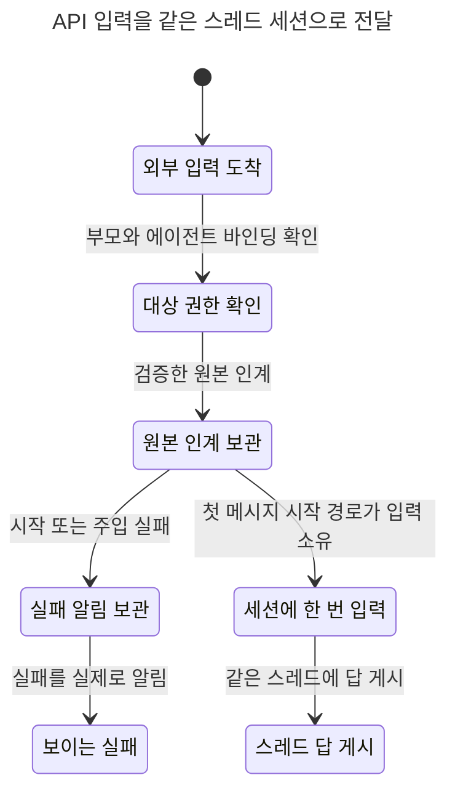

# API thread ingress 상태 차트 — #8125 설계

코드 기준: `33d1f4b5a9dce7023e2d0014e45a05ed6c530bba`. 생산 코드·운영 상태 변경과 Rust/PG 실행은 없다. **설계 포트의 TLC 검증이며 구현 수용 완료가 아니다.**

TIME start=2026-11-13T18:13:18+09:00 model_check_end=2026-11-13T18:30:05+09:00 elapsed=16m47s budget=30m

기존 색인에서 입력 큐는 [InputPath](InputPath.tla)·[InputOwnership](InputOwnership.tla), cold/warm 시작은 [TmuxSession](../session-lifecycle/TmuxSession.tla)이다. 별도 Discord thread-first-message 시작 모델은 없었다. 이 세 모델의 경계를 [ThreadIngress](ThreadIngress.tla)로 결합하고, 같은 child에 도착한 서로 다른 입력의 경합은 [ThreadIngressRace](ThreadIngressRace.tla)로 검사한다. 기존 모델·설정·알려진 RED는 변경하지 않는다. 기존 두 보고서와 README에 이 접점을 연결했다.

모든 변수·상수의 값 범위와 코드 근거 정본은 [설계 진입점 전수표 §2](../../api-thread-ingress.design.md)다. 여기서는 범위를 다시 정의하지 않는다.

## 수정 전/후

| 경계 | 수정 전 코드·모델 | 제안 후 모델 | 구현에서 확인할 것 |
|---|---|---|---|
| agent에 속한 실제 thread target | `resolve_bound_target`가 bound channel exact match만 허용해 403; Before의 `BoundThreadAdmitted` RED | 부모 관계 확인 후 실제 child를 유지해 수락 | 실제 두 HTTP 라우트에서 parent binding과 destination 분리 |
| 남의 channel/thread·부모 확인 실패 | 기존 본 채널 거부는 유지. 신규 부모 REST 경계는 아직 없음 | 각각 확정 403 또는 retryable 거부, bootstrap·custody·host effect 없음 | metadata 부모 위조, missing/wrong-kind parent와 REST 오류의 부작용 0 |
| 세션 있음/없음 | API headless 경로는 기존 thread 첫 메시지 placement를 통과하지 않음 | actual live session에 한 번 제출, 없으면 기존 첫 메시지 시작과 입력 소유권을 한 번 인계 | 준비만 하는 bootstrap과 payload를 이미 소비한 시작 결과 구분 |
| 같은 child의 동시 도착 | Before는 target 권한에서 거부하므로 이 경합을 구현한 증거가 아님 | 기존 child transition 안에서 존재를 다시 읽고 cold/warm을 결정 | API start·deliver와 Discord barrier 경합·remote worker restore |
| 부팅·재시작 | 기존 큐/custody와 ready wake가 일반 채널에서 제공하는 경계 | 원본 보관, 준비/확정 부팅 실패 뒤 깨움 또는 보이는 실패. 전송 불명은 재주입 안 함 | 실제 child own ready·retained outbox·known error 알림 연결 |
| 부모 정책과 살아 있는 child host | #8118이 정책 상속과 actual target의 정본 | 옛 live tmux child를 유지, 새 시작만 부모 정책 사용 | #8118 H 계약 없이 parent 설정으로 live target 대체 금지 |

## 실제 실행 결과

모든 아래 설정은 커밋 대상 `.cfg.example` 그대로 scratch의 실제 `.cfg`로 복제해 TLC 1.7.4와 공식 `scripts/ci/statecharts_tlc.py`로 실행했다. 정본 `harness-committed-artifacts.log`에서 19 configs / 66 TLC runs / 25.0s, 12 GREEN·7 expected RED·오류 0을 확인했다. main의 이미 충족된 안전 규칙을 Before RED로 날조하지 않는다. Before의 기능 RED는 accepted가 비어 liveness가 자명하게 통과해도 `BoundThreadAdmitted`가 별도로 잡는다.

| 설정 | distinct states | 결과 |
|---|---:|---|
| `ThreadIngressBefore.cfg.example` | 2 | BoundThreadAdmitted |
| `ThreadIngressBoundChannel.cfg.example` | 11 | GREEN |
| `ThreadIngressDoubleSubmit.cfg.example` | 10 | NoDuplicate, NoSilentLoss, SuccessBacked, AcceptedCompletes |
| `ThreadIngressDropRestart.cfg.example` | 9 | NoSilentLoss, AcceptedCompletes, DeliveredGetsOutcome |
| `ThreadIngressFixedBoot.cfg.example` | 10 | GREEN |
| `ThreadIngressFixedCold.cfg.example` | 7 | GREEN |
| `ThreadIngressFixedColdTmux.cfg.example` | 7 | GREEN |
| `ThreadIngressFixedLive.cfg.example` | 7 | GREEN |
| `ThreadIngressFixedRestart.cfg.example` | 11 | GREEN |
| `ThreadIngressForeign.cfg.example` | 2 | GREEN |
| `ThreadIngressForeignChannel.cfg.example` | 2 | GREEN |
| `ThreadIngressNoReadyWake.cfg.example` | 6 | NoDeadlock, AcceptedCompletes |
| `ThreadIngressParentFail.cfg.example` | 2 | GREEN |
| `ThreadIngressParentMalformed.cfg.example` | 2 | GREEN |
| `ThreadIngressParentOpen.cfg.example` | 7 | ParentFailClosed |
| `ThreadIngressPolicyOverridesLive.cfg.example` | 7 | LiveActualHostPreserved |
| `ThreadIngressRaceFixed.cfg.example` | 618 | GREEN |
| `ThreadIngressRaceStale.cfg.example` | 1,070 | NoStaleBootstrap |
| `ThreadIngressRaceTwo.cfg.example` | 67 | GREEN |

단일 입력 설정의 safety는 `NoDuplicate`, `NoSilentLoss`, `RejectedNoEffects`, `ForeignForbidden`, `ParentFailClosed`, `BoundThreadAdmitted`, `SuccessBacked`, `HttpAcceptanceBacked`, `LiveActualHostPreserved`와 deadlock이다. `AcceptedCompletes`와 `DeliveredGetsOutcome`를 각각 temporal property로 실제 검사했다. 경합 설정은 입력별 중복·성공 근거, 한 child의 시작 소유권과 stale bootstrap 금지, 입력별 진행성과 답 게시를 검사한다.

정확히 한 번의 뜻은 **성공으로 전달된 원본은 제출 한 번이며, 실패로 종결된 원본은 보이는 실패 근거가 남는다**는 것이다. 수락된 원본은 미처리 custody, 전달 근거 또는 실제로 보인 실패 중 하나에 남는다. failure 알림 시도나 큐 삽입 시도만으로 완료를 선언하지 않는다. 전송 뒤 재시작으로 결과가 불명인 경우의 알림은 자동 재전송 허가가 아니다.

## 포트와 코드 대응

| 모델 행동·규칙 | 코드 경계·의미 | 검증 한계 |
|---|---|---|
| `Authorize` / 거부 부작용 0 | `src/server/routes/agents_turn_target.rs:59-72`; 제안된 checked-parent + agent binding 검증 | 외부 metadata를 증거로 쓰지 않는 새 부모 검증은 구현 전 |
| `Admit` / HTTP 수락 근거 | `src/services/discord/router/message_handler/intake_turn/runtime_transition.rs:35-79`; 기존 source/custody 인계 | 원본 수락·durable commit·응답 원자성은 모델의 포트 가정 |
| `ColdStart` / 없는 세션 경로 | `src/services/discord/session_runtime.rs:505-535`; `src/services/discord/router/message_handler/intake_turn/adk_thread.rs:179-198,247-258` | bootstrap 함수 자체가 prompt를 제출한다는 뜻이 아니다. 모델은 준비+실제 시작을 합친 한 입력 소유권 인계다 |
| `ColdStart` / placement·forward | `admit_text_intake:229,357,442` → cluster hook `:388,392` → placement `:97` (정확한 파일은 설계 전수표) | **공개 headless 경로는 현재 이 placement seam을 우회한다.** forward/restore가 provenance·reservation을 보존하고 한 owner만 제출하는 것은 제안 포트이며 main 보장이 아니다 |
| `WarmSubmit` / `LiveActualHostPreserved` | `src/services/session_host/resolve.rs:239-260`; `turn_deliver/inject.rs`의 actual InputTarget operation | 부모 정책·actual host 해소와 executor는 #8118/#8125 구현 의무. pane/nonce·native source는 추상화 |
| `Ready` | `src/services/tui_o/writer/host.rs:1007-1010` → `src/services/discord/runtime_bootstrap/o_writer_host.rs:397-407` → `src/services/discord/queue_io.rs:370-390` | child own writer-ready는 #8118 O-b 포트. O-a reader 준비만으로 ready를 주장하지 않음 |
| active reconcile / transition release | `src/services/discord/runtime_bootstrap.rs:35-41` → `src/services/discord/session_transition.rs:145-155`; `intake_turn/runtime_transition.rs:47-64` | 기존 wake 재사용 연결이 빠지면 `NoReadyWake` RED |
| `Restart` | `src/services/discord/runtime_bootstrap/queued_recovery.rs:26,67-77`; 기존 retained queued/inflight 복원 | DB·outbox·파일 commit과 crash 사이 원자성, 다중 노드 분할은 모델 밖 |
| `TakeTransition` / fresh recheck | `src/services/discord/session_transition.rs:165`; `intake_turn/runtime_transition.rs:36-79` | 동일 lock을 재획득하는 연결 금지. actual route barrier 시험으로 재확인해야 함 |
| `PublishReply` / `ShowFailure` | 기존 thread destination의 output owner·source receipt·notice 경계 | 게시 transport의 실제 성공을 추상화. 호출/로그만 성공으로 세지 않음 |

liveness는 적용된 `SPECIFICATION Spec`의 행동별 weak fairness를 사용한다. 부팅은 준비 또는 확정 실패의 실제 결과를 내고, 보관된 알림은 결국 실제 게시된다는 포트 가정이 있다. 준비된 입력을 깨우는 행동은 별도로 모델링해 삭제 제어에서 진행성이 깨짐을 확인했다. 영구 daemon 정지·영구 Discord 전송 장애·영구 REST/DB 장애까지 진행한다고 주장하지 않는다. `SYMMETRY`는 사용하지 않았다.

## 반례 replay와 원인 제어

| 설정·규칙 | 최단 경로 | 소스 대조 / 남은 구현시험 |
|---|---|---|
| Before / `BoundThreadAdmitted` | 도착 → bound thread 403 | `agents_turn_target.rs:65-72`가 exact binding 외 override를 거부함을 소스에서 확인. HTTP RED는 설계 레그에서 미실행 |
| ParentOpen / `ParentFailClosed` | 도착 → 부모 미확정인데 권한 허용 | 제안 fail-closed 분기 제거 제어. REST failure/forged metadata 실제 라우트 mutant 필요 |
| DoubleSubmit / `NoDuplicate`, `NoSilentLoss`, `SuccessBacked`, `AcceptedCompletes` | 도착 → 수락/custody → 첫 시작이 입력 소비 → 기존 세션으로 재주입 | 준비와 prompt consumption 결과 혼동 제어. 실제 executor/headless callback+provider spy의 제출 횟수로 RED→GREEN 필요 |
| DropRestart / `NoSilentLoss`, `AcceptedCompletes` | 도착 → 수락/custody → 재시작에서 원본 제거 | 기존 retained 복원 포트 제거 제어. delivered 뒤 재시작 경로는 `DeliveredGetsOutcome`도 RED |
| NoReadyWake / `NoDeadlock`, `AcceptedCompletes` | 도착 → 수락/보류 → 준비되었지만 깨우지 않음 | 위 ready wake chain이 설계의 실제 연결 지점. child API held 원본의 release/ready barrier 시험 필요 |
| PolicyOverridesLive / `LiveActualHostPreserved` | 도착 → 수락 → parent 정책으로 live actual target 교체 | actual target을 정책으로 대체하는 제어. live tmux/parent Herdr에서 tmux 제출 1·Herdr 제출 0 시험 필요 |
| RaceStale / `NoStaleBootstrap` | 첫 관측 → 첫 transition → 둘째도 없음 관측 → 첫 시작 → ready → 둘째 transition → stale cold start | lock 전에 읽은 없음을 lock 뒤 재사용하는 설계 제어. 실제 API start·deliver·Discord 동시 barrier, session bootstrap/submit count 검증 필요 |

위 controls는 **TLA+ 설계 뮤턴트**다. Before의 source replay 외 신규 구현 경로가 존재하지 않아 Rust/PG production mutant와 실제 iMessage 답장은 미실행이다. 소스와 달리 모델이 보이는 반례를 제품 결함으로 확정하지 않는다. 포트 연결 뒤 실제 route RED→GREEN과 원인 제거 mutant RED, 원복 바이트 동일을 구현 레그에서 남겨야 한다.

## 차트

[Before](thread-ingress-before.chart.mmd), [cold 시작](thread-ingress-cold.chart.mmd), [부팅](thread-ingress-boot.chart.mmd), [재시작](thread-ingress-restart.chart.mmd), [ready wake 제거](thread-ingress-no-ready-wake.chart.mmd), [경합 stale read](thread-ingress-race-stale.chart.mmd).

`RaceFixed` GREEN은 chart 예산을 넘으므로 도구가 전체 차트를 만들지 않았다. `RaceStale`은 도구가 최단 반례 경로만 그린다. view는 행동을 임의로 숨기지 않으며 같은 reader label을 유지하는 terminal stutter만 차트에서 생략된다. 경합 반례의 각 상태는 보관/관측/준비/시작/전달/답/실패 수와 세션 상태로 구분한다.



## 재현과 원시 증거

`*.cfg.example`은 이 설계 레그의 수동 실행 입력이다. 저장소 `expected.tsv`는 변경하지 않았으며 CI 자동 실행에 등록됐다고 주장하지 않는다. `scripts/ci/statecharts_tlc.py:369-426`의 dependency 선택은 기존 등록 cfg가 이 새 모듈을 소비하지 않으므로 PR에서 `NO_TARGETS`가 될 수 있다. 그것은 모델 PASS가 아니라 미실행이다. 구현 조각에서 코디네이터가 cfg 정식 등록을 승인한 뒤 `.cfg`와 manifest를 함께 연결한다.

scratch를 새로 만들어 공식 harness를 다시 실행한다. 각 sample의 기대값 header는 제어의 예상 규칙이며 실제 결과에서 동적으로 만들어 PASS를 맞추지 않는다.

```sh
unset TMUX TMUX_PANE
scratch=$(mktemp -d /tmp/i8125-statecharts.XXXXXX)
python3 - "$PWD" "$scratch" <<'PYCODE'
from pathlib import Path
import re, shutil, sys
src = Path(sys.argv[1]) / "docs/statecharts/input-single-path"
out = Path(sys.argv[2])
for name in ("ThreadIngress.tla", "ThreadIngressRace.tla", "thread-ingress.view.mjs", "thread-ingress-race.view.mjs"):
    shutil.copyfile(src / name, out / name)
rows = []
for sample in sorted(src.glob("ThreadIngress*.cfg.example")):
    text = sample.read_text()
    safety, liveness = re.search(r"EXPECTED_SAFETY=(\S+) EXPECTED_LIVENESS=(\S+)", text).groups()
    name = sample.name.removesuffix(".example")
    (out / name).write_text(text)
    module = "ThreadIngressRace" if name.startswith("ThreadIngressRace") else "ThreadIngress"
    rows.append(f"{name}\t{module}\t{safety}\t{liveness}")
(out / "expected.tsv").write_text("\n".join(rows) + "\n")
print(f"materialized={len(rows)} scratch={out}")
PYCODE
TLA2TOOLS=~/.local/share/tla2tools/tla2tools-1.7.4.jar \
JAVA=/opt/homebrew/opt/openjdk/bin/java \
python3 scripts/ci/statecharts_tlc.py --root "$scratch" --jobs 3
TLA2TOOLS=~/.local/share/tla2tools/tla2tools-1.7.4.jar \
JAVA=/opt/homebrew/opt/openjdk/bin/java \
~/.codex/skills/statechart/scripts/statechart "$scratch/ThreadIngress.tla" \
 --config "$scratch/ThreadIngressFixedCold.cfg" \
 --view "$scratch/thread-ingress.view.mjs" --out "$scratch/chart-cold"
```

원시 로그 정본: `/Users/itismyfield/.adk/release/lane-runs/hl-20260925/i8125/logs/statecharts/`. 최종 단일-ticket wrapper는 `ThreadIngress*-final-v4/`, 경합 wrapper는 `ThreadIngressRace*-final-v3/`의 `tlc.out`·규칙별 반례·`report.md`, 공식 harness는 최종 sample을 그대로 materialize한 `harness-committed-artifacts.log`이며, 동일 포트 모델의 `harness-final-v4.log`도 보존했다. 초기 parser/기대값 교정 로그는 이 최종 증거로 사용하지 않는다. Java/TLC 입력은 같은 최종 model bytes다. `model-sha256.txt`의 23개 model/cfg/view 경로·SHA256을 커밋 대상 파일 바이트와 다시 대조해 모두 일치함을 확인했다.

추상화 한계: 단일 ticket 모델은 같은 GUID의 중복 HTTP 요청이나 서로 다른 원본의 body 동등성을 dedupe했다는 증거가 아니다. 경합 모델은 서로 다른 accepted tickets가 동일 child transition을 경합하는 projection이며 다중 node/outbox 원자성·외부 API retry identity·attachment/cancel/clear/stop·provider transcript 수신 receipt는 직접 모델링하지 않는다. 이 항목은 설계의 실제 route/worker/outbox 시험과 negative assertions에 남긴다.
