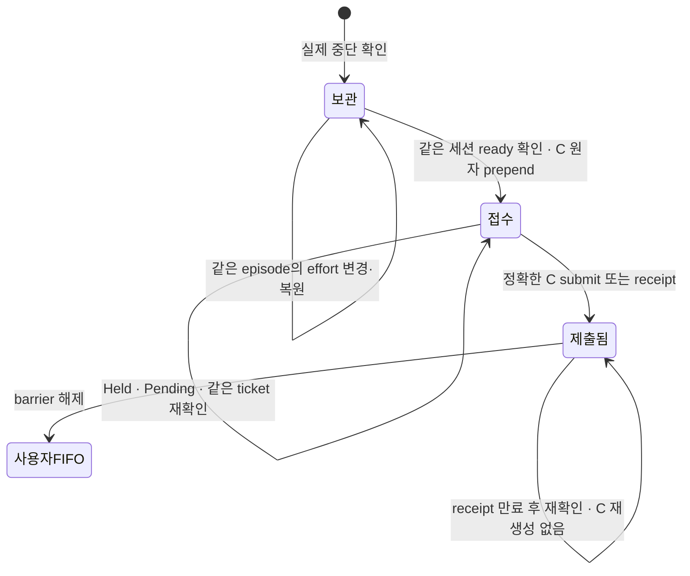
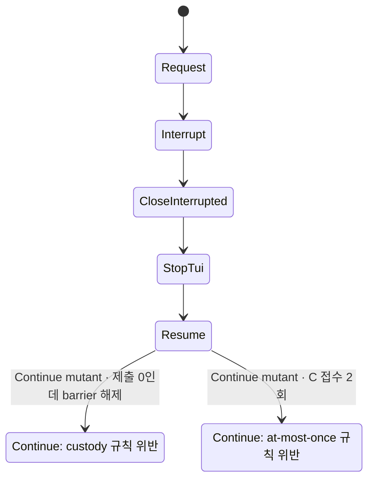

# Effort continuation custody

S3는 확인된 interruption의 C 하나를 owner snapshot에 보존한다. S4/S5의 verified caller가 `prepare_effort(Some(request), ...)`로 기록·ready를 갱신하고, 일반 headless ingress는 `None`으로 이미 기록된 intent만 복원한다. source metadata로 새 debt를 만들거나 ready를 승격할 수 없다. command launch와 취소 hook은 이 조각에 포함하지 않는다.

그림은 출력 POST·notice·launch 실패 및 사용자 개별 완료를 생략한다. 기존 모델은 이를 그대로 포함하며, C의 접수와 제출을 분리했다. 접수로 barrier를 해제하지 않는다.

## 진입점과 값 범위

전수 검색은 `git grep -n -E 'agentdesk_effort_continue|prepare_effort|effort_input|effort_blocks|check_effort_admission|effort_continue::(original|prepend|submitted|queue_full)|settle_binds\(' -- src`로 재생한다. 생성·소비 본체는 아래 경계에 모인다.

| 경계 | 코드 | 모델 관계 |
|---|---|---|
| verified intent 생성·coalesce·재조회 | `src/services/turn_orchestrator/queued_head/v2/effort_continue.rs` | interrupted root 1..2; 현재 C가 제출된 뒤 새 episode만 교체 가능 |
| synthetic source·고정 문구·ticket·generation 저장 | 같은 파일 `prepare_effort`; `v2_types/effort_restart.rs` | 사용자 원본과 별도 domain; root의 동등성만 모델링 |
| headless 기존 C 복원 | `src/services/discord/queue_io/input_owner/effort_continue.rs`; `start.rs` | metadata는 identity 확인만 함; ready는 caller가 기록한 값 |
| machine 분류 | `v2/effort_continue.rs`; `input_owner/origin.rs` | C는 사용자와 합치지 않는 한 입력 |
| 단일 commit prepend + queued bind index 이동 | `v2/source_admission.rs`의 `admit_with_context`; `v2/effort_continue.rs`의 `prepend` | `EffortContinue`: 접수 1, 아직 제출 0 |
| Held·front grant·reserve·legacy claim | `queued_head/v2.rs`의 `prefer_person`, `front`, `reserve`, `blocks_claim`; `provider_dispatch/owner_input.rs` | barrier가 C보다 앞선 사용자 제출을 막음 |
| 정확한 submit/receipt 정산 | `input_owner/effect.rs`의 `run` → `v2/retained.rs:112` → `source_admission.rs`의 `settle_binds` | `EffortSubmitContinuation`: 제출 1과 barrier 해제 |
| optional 필드 없는 snapshot·Settled 영수증 복원 | `v2_types.rs`; `v2/migration.rs` | debt 없음; 기존 사용자 FIFO 보존. submitted 누락은 exact Settled receipt로 복구 |
| 큐가 찬 경계 | `v2/effort_continue.rs`의 `queue_full` | 사용자 한도 30 + C 전용 1. 모델의 사용자 2개는 상대 순서 반례를 위한 대표값; 용량은 Rust 시험으로 검증 |

C-only intent는 `src/services/turn_orchestrator/queued_head/compat.rs`의 `holds_input()`으로 boot catalog와 mailbox held bit에 남긴다. idle·미중단·이미 제출된 C는 보유 입력으로 세지 않는다. submitted 필드가 없는 옛 C는 정확한 Settled 영수증으로 복구하고 Armed/Unknown을 제출로 간주하지 않는다.

현재 큐와 unconfirmed candidate 양쪽의 pending C를 확인한다. 공개 metadata는 priority override가 아니다. C의 old native session/episode는 verified caller의 identity이며, 물리 end/ready 확인은 S4/S5의 전제다. S6 stop/Cancel/clear/Terminate는 pending C를 취소하는 별도 경계이며 여기서 추가 연결하지 않는다. MayHaveSent는 기존 exact attempt custody에 남기고 원문을 자동 재전송하지 않는다.

## 전후 검증

| 경우 | 이전 | 이후 |
|---|---|---|
| C 접수와 제출 | 한 action으로 합침 | `EffortContinue`와 `EffortSubmitContinuation`으로 분리 |
| custody·중복·barrier | 접수 후 상태 구별 없음 | `EffortContinuationCustody`, `EffortContinuationAdmittedOnce`, `EffortNoUserBeforeBarrier` |
| request → ready → C 제출 → release | 기존 request/continuation 진행성 | `EffortSubmitReleasesBarrier`를 PROPERTY로 추가 |
| EffortRestart 19 cfg + TmuxSession | 기존 기대 집합 | 같은 기대 집합 유지, 새 정상 cfg 규칙 통과 |
| 접수 즉시 release mutant | 중간 단계가 없어 표현 못 함 | `EffortContinuationCustody` 위반 |
| 접수 2회 mutant | 접수 계수 없음 | `EffortContinuationAdmittedOnce` 위반 |

두 모델 mutant의 최단 경로는 Initial → Request → Interrupt → CloseInterrupted → StopTui → Resume → Continue의 7상태다. 마지막 상태에서 각각 미제출 C의 barrier가 0이 되거나 접수 계수가 2가 된다. 기존 UserFirst 모델은 `EffortContinuationFirst` 위반을 그대로 보인다. 실제 코드의 tail enqueue 반례는 두 사용자를 먼저 저장한 뒤 C를 넣으면 사용자 101이 먼저 front가 되는 Rust RED로 재생했다.

검증 명령은 `python3 scripts/ci/statecharts_tlc.py --root <격리 사본> --java /opt/homebrew/opt/openjdk/bin/java --jar ~/.local/share/tla2tools/tla2tools-1.7.4.jar --timeout 50`이다. 사본에는 EffortRestart cfg 19개, TmuxSession cfg/tla와 원본 `expected.tsv`의 해당 행만 넣는다. 원시 로그와 trace는 레인 보고서의 증거 목록에 있다. 새 expected/baseline/allowlist 항목은 추가하지 않았다.

## 실행 증거

| 검증 | 결과 |
|---|---|
| 대상 exact filter, 실제 PostgreSQL 17.11 | 선택 27 = 통과 27, 실패 0, skip 0 |
| source ID 재사용 / 접수 즉시 barrier 해제 / C 2회 prepend / compat 조건 제거 | 각각 실행 RED, 원본 SHA256 복원 |
| Claude native continuation 억제 제거 | 격리 fake provider에서 RED, 실제 모델 요청 0 |
| clippy workspace/all-targets/all-features | 수정 파일 경고 0 |
| production cap (기본 / exclude-test-modules) | 두 방식 모두 13파일, 순증 313줄 |

모델 mutant의 실패 경로를 같은 접수 상태에서 분기해 표시한다. 실제 코드의 mutation 실행과 모델 trace는 레인 보고서의 서로 다른 로그로 구분한다.

전체 raw diff, 승인 파일 diff, 바이너리 SHA256, PG 실행 환경, exact 시험별 선택·통과 수, source 복원 SHA는 레인 보고서 `report-impl-s3.md`에 남긴다.

Continuation의 원본 입력 타입은 generic으로 주입한다. durable 타입 모듈은 PendingQueueItem을 import하지 않으며 기존 상위 snapshot·owner가 구체 타입을 공급한다. 직렬화 필드와 기존 snapshot 형태는 동일하다.
