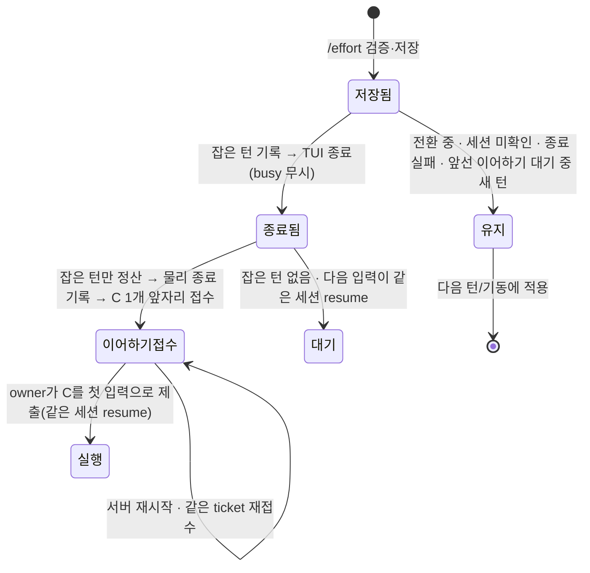

# Effort 즉시 재기동: tmux 흐름(S4b)

S4b는 `/effort` 저장 뒤 로컬 tmux TUI를 같은 세션으로 곧바로 다시 여는 흐름을 연결한다. 모델은 기존 `TmuxSession.tla`의 `Effort*` 투영이고, 이번에 "늦게 온 옛 턴 완료"와 "서버 재시작 뒤 복원" 두 전이를 더했다. 그림 도구(statechart skill)는 이 레그의 작업 호스트에 없어 chart·cfg별 report는 만들지 않았고, TLC 결과와 이 문서만 남긴다.



그림은 출력 게시, 사용자 입력 도착, 중단 안내 게시를 생략한다. TLC는 생략하지 않는다.

## 진입점 전수표

경로는 `src/services/discord/` 기준이다(그 밖은 전체 경로).

| 경계 | 코드 | 모델 전이·값 |
|---|---|---|
| 명령 진입 | `commands/tui_passthrough.rs` `effort_save_notice` → `saved_effort_notice` | `EffortRequest`. 검증·저장이 실패하면 진입하지 않음 |
| 전환 직렬화 | `commands/effort_restart/tmux.rs` `restart`: `session_transition_completion` → `acquire_session_transition` | 한 요청의 재기동 구간. 잡지 못하면 `Kept`(아무것도 끝내지 않음) |
| 대상 확인 | 같은 함수: 세션 이름·native session·`tmux_session_has_live_pane` | TUI 없음 → 재기동 0, 저장만 |
| 진행 중 턴 포착 | `herdr_terminate.rs` `capture_turn`(mailbox token + user message id + nonce + 일치하는 inflight row) | `active # "none"` 판정의 선형화 지점. 포착 실패 → `Kept` |
| 앞선 이어하기 | `tmux.rs` `stored`(owner snapshot의 `effort_restart`) | Coalesce: 미제출 C가 있고 새 턴이 없으면 같은 episode 유지. 새 턴이 돌고 있으면 `Kept` |
| 입력 경로 확인 | `tmux.rs` `owner_takes`(`ingress::execution`·`adopt`) | C를 접수할 owner가 없으면 턴을 끊지 않음 |
| 종료 원인 기록 | `record_turn_stop_tombstone(.., "effort_restart")` | watcher가 이 종료를 crash handoff로 읽지 않게 함 |
| 물리 종료 | `commands/tmux_recreate.rs` `end_channel_tmux_keeping_session`(busy 판정 없음, host guard·계정 marker 보존) | `EffortInterrupt`/`EffortStopTui`. 거절·kill 실패 → `Kept` |
| 옛 턴 정산 | `herdr_terminate.rs` `settle_captured` → `TerminalEvent::HostTerminated` | `EffortCloseInterrupted`: 잡은 row·token만, 큐 보존, 취소 표시 없음 |
| 물리 종료 기록 | `commands/effort_restart/witness.rs` `bound`·`record` → `tui_o/store/restart_end.rs` `append` | 옛 Open을 닫는 witness. native closer가 있으면 쓰지 않음 |
| 이어하기 접수 | `tmux.rs` `admit`: `prepare_effort(Some(ready))` → `owner_admit_start` | `EffortResume`의 ready + `EffortContinue`(C 1개, 앞자리) |
| Claude 첫 제출 소유 | `claude_tui/session/effort.rs` `expect_owner_first_submit` → `claude/tui_session_launch/prepared.rs` | resume launch가 native 자동 이어하기를 끔 |
| owner 깨움 | `SessionTransitionCompletion` drop | `wake` |
| 서버 재시작 복원 | `router/message_handler/provider_dispatch/owner_input.rs` `recover` → `commands/effort_restart/recovery.rs` `resume_owed` | `EffortDaemonRestart`: 같은 ticket 재접수 |
| launch 시점 재검증 | `commands/config/effort.rs` `channel_effort_level` → `Capability::lacks` | 모델이 지원하지 않는다고 확인된 저장값은 launch에 싣지 않음 |

같은 상태를 소비하는 인접 경로(이번에 바꾸지 않음, S6가 연결):

| 경로 | 코드 | S4b에서의 관계 |
|---|---|---|
| 사용자 stop | `turn_bridge/tmux_runtime/judged_stop.rs:345` `begin_user_stop` | 같은 mailbox token을 본다. 재기동이 token을 정산한 뒤에는 `NoActiveTurn`이며, 대기 중 C는 취소하지 않는다(S6 몫) |
| `/clear` | `commands/control.rs:510` | 전환 guard를 같이 쓴다. 큐·세션을 버리는 clear의 범위는 그대로이고, snapshot의 intent는 큐와 함께 사라진다 |
| 다음 턴 재기동 소비 | `commands/control.rs` `reset_provider_session_if_pending` | 즉시 재기동이 끝나면 `channel_relaunch_pending`을 풀어 두 번 재기동하지 않는다. `Kept`이면 기존 경로가 그대로 처리 |
| Herdr terminate | `herdr_terminate.rs` `terminate_scoped` | 같은 `capture_turn`·`settle_captured`를 쓴다. 로컬 tmux 채널만 S4b 대상 |
| watcher의 종료 감지 | `watchers/lifecycle/liveness.rs` | tombstone이 있으면 restart handoff를 하지 않는다 |

입력 출처: `/effort`는 명령 권한 검사(`check_auth`)를 지난 사용자만 낼 수 있고, 저장은 `check_settings_owner`가 실행 노드 소유를 확인한 뒤에만 된다. C는 사용자 메시지가 아니라 `agentdesk_effort_continue` 출처의 owner 입력이다.

## 규칙

| 규칙 | 모델 | 코드 시험 |
|---|---|---|
| 한 번의 `/effort`에 재기동은 많아야 1 | `EffortOneRestartPerRequest`(binding ≤ changes) + 기존 `EffortRequestResolves` | `busy_effort_restarts_now_same_session_pg`, `a_second_effort_keeps_the_one_waiting_continuation_pg` |
| 늦은 옛 완료는 후속 턴 상태를 바꾸지 않음 | `EffortLateKeepsSuccessor` | `late_old_completion_keeps_successor_pg` |
| 종료·접수 실패 시 대기 입력 유실 0, C 0 | 기존 `EffortInputNotLost`, `EffortFailedKeepsCustody` | `failed_end_keeps_turn_and_queue_and_owes_no_continuation_pg` |
| 복원된 의도는 ticket 하나만 재개 | 기존 `EffortContinuationAtMostOnce`(이번에 제출 수를 누적으로 바꿈) | `restored_intent_resumes_one_ticket_pg` |
| 결국 ready 또는 실패로 끝남 | 기존 `EffortRequestResolves` | — (모델만) |

## 전/후

기존 19 cfg와 `TmuxSession.cfg`는 깨지는 규칙 집합이 그대로다. 새 cfg 4개:

| cfg (`EffortRestart` 접두사) | 결과 | 뜻 |
|---|---|---|
| `Late` | GREEN | 옛 턴의 완료가 재기동 뒤에 와도 아무것도 바꾸지 않음 |
| `LateClobber` | RED: `EffortLateKeepsSuccessor` | 늦은 완료가 채널의 현재 row를 정산하는 mutant |
| `Recover` | GREEN | 재기동 도중 서버 재시작. 저장된 의도가 같은 단계·같은 ticket으로 이어지고 owner를 깨움 |
| `RecoverTwice` | RED: `EffortContinuationAtMostOnce`, `EffortContinuationCustody`, `EffortLateKeepsSuccessor`, `EffortOneRestartPerRequest`, `EffortReplyOnce` + liveness `EffortContinuationEventuallyInjected`, `EffortSubmitReleasesBarrier` | 복원이 재기동을 처음부터 다시 하며 새 ticket을 만드는 mutant |

`RecoverTwice`는 재기동을 통째로 되풀이하는 넓은 mutant라 여러 규칙이 함께 깨진다. 이 중 이번 조각이 지키려는 것은 `EffortOneRestartPerRequest`와 `EffortContinuationAtMostOnce`다.

## 모델과 코드가 다른 곳

1. 모델의 `EffortResume`은 "같은 세션의 새 실행이 ready"다. 코드에는 프롬프트 없이 TUI를 띄우는 경로가 없어, 새 실행은 C(또는 대기 입력)의 턴 시작이 띄운다. 그래서 코드의 ready는 "옛 프로세스 종료 확인 + C 접수 가능"이고, 끊긴 턴이 없으면 다음 입력이 올 때까지 TUI는 없다.
2. 모델은 의도를 종료 전에 기록한다. 코드는 종료·정산·종료 기록 뒤에 한 번만 owner snapshot에 기록한다. 종료와 기록 사이에 서버가 죽으면 C는 없다(기존 "프로세스가 죽은 턴" 복구 경로가 처리). 종료 전 기록과 그 취소는 다음 조각 몫이다.
3. 중단 안내(`EffortTellInterrupted`)의 durable 게시는 이번 조각에 없다. 명령 응답이 중단 사실을 알릴 뿐이다.
4. 자연 완료와 중단의 경합은 포착 시점으로 가른다. 포착된 뒤 종료 전에 턴이 자연 완료해도 C는 접수된다.

## 재실행

```sh
R=/tmp/effort-sc && mkdir -p $R/session-lifecycle
cp docs/statecharts/session-lifecycle/{TmuxSession.tla,TmuxSession.cfg,EffortRestart*.cfg} $R/session-lifecycle/
(head -1 docs/statecharts/expected.tsv; grep -E 'EffortRestart|TmuxSession.cfg' docs/statecharts/expected.tsv) > $R/expected.tsv
python3 scripts/ci/statecharts_tlc.py --root $R --jar ~/.local/share/tla2tools/tla2tools-1.7.4.jar --timeout 120 --jobs 4
```

24 cfg, 약 70초. 실패 0.
