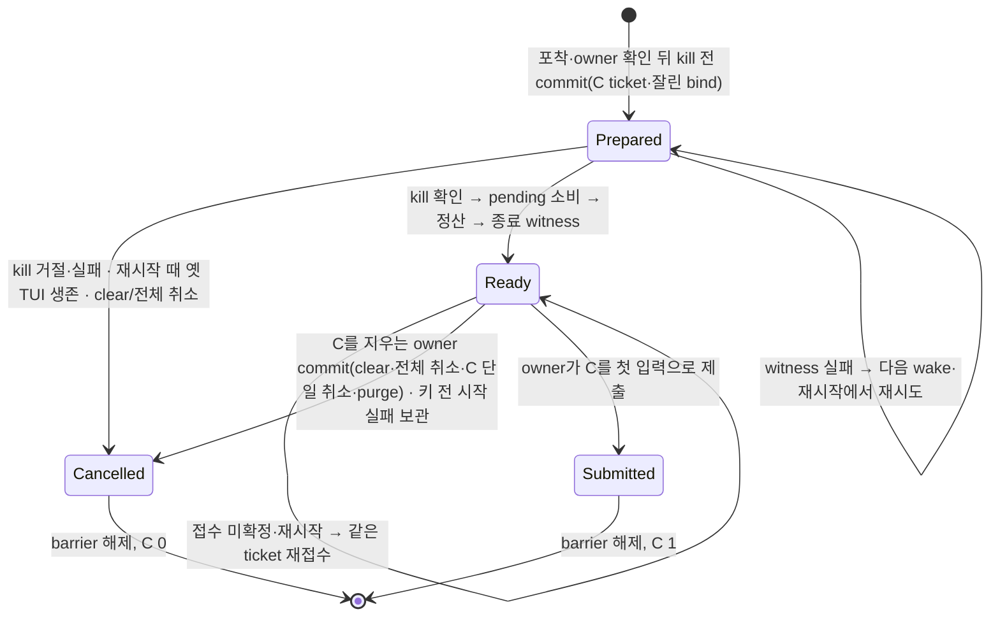

# Effort 즉시 재기동: S4b 수리(kill 전 Prepared, owner 정리, 반영한 pending 소비)

S4b 첫 리뷰의 P1 3건과 설계 리뷰의 P1 1건을 `TmuxSession.tla`의 `Effort*` 투영과 코드로 닫는다.

- `/clear`·대기열 취소 뒤 barrier가 남는다.
- 정산 뒤 intent 저장 전에 crash하면 C가 0이다.
- 기존 fast/model pending이 C에서 세션을 초기화한다.
- C의 시작이 키 전송 전에 두 번 실패하면 C는 보관되지만 barrier가 남는다.

그림 도구가 작업 호스트(WSL)에 없어 cfg별 chart는 만들지 않았다. TLC 결과와 이 문서만 남긴다.



## 진입점 전수표

경로는 `src/services/` 기준이다.

### 재기동과 복구

| 경계 | 코드 | 모델 전이 |
|---|---|---|
| kill 전 intent | `discord/commands/effort_restart/tmux.rs` `restart` → `prepared`·`record`(`prepare_effort(ready:false)`) | `EffortPrepare` |
| kill 거절·실패 | 같은 함수 → `cancel` → `turn_orchestrator/queued_head/v2/effort_continue.rs` `Owner::cancel_effort` | `EffortKillFails` |
| kill·정산 | `tmux.rs` `end_channel_tmux_keeping_session`·`settle_captured` | `EffortInterrupt`·`EffortCloseInterrupted` |
| 반영한 pending 소비 | `tmux.rs` → `discord/commands/control.rs` `consume_reflected` | `EffortStopTui`의 `resetPending` |
| 종료 witness → Ready → 안내 → 접수 | `tmux.rs` `advance`(`end_record`→`witness.rs` `record`, `record(ready)`, `notice::interrupted`, `admit`) | `EffortResume`·`EffortContinue` |
| 접수 미확정 | `tmux.rs` `admit`(같은 ticket 3회) → `Restart::Admitting` | `EffortContinue`의 `wake` |
| C 턴의 세션 초기화 생략 | `discord/router/message_handler/headless_turn/replay_start.rs` `pending_reset` | `EffortSubmitContinuation`의 `sameSession` |
| 서버 재시작 복구 | `discord/router/message_handler/provider_dispatch/owner_input.rs` `recover` → `effort_restart/recovery.rs` `resume_owed`(pane 생존·bind nonce로 kill 여부 판정) | `EffortDaemonRestart`·`EffortBootResolve` |
| owner drive 한 바퀴 끝 | `owner_input.rs` `owner_drive`의 `settled` → `recovery.rs` `kick` | `EffortBootResolve`(wake) |
| 재기동 뒤 새 `/fast`·`/model` | `discord/commands/config/provider_settings.rs` `update_channel_fast_mode`·`update_channel_model_override` | `EffortNewerChange` |

### owner가 큐에서 항목을 빼는 곳(전수)

`route`(`turn_orchestrator/queued_head/v2/control.rs`)의 wildcard 없는 match는 mailbox 메시지 분류만 보장한다. `v2_request` closure에서 owner 메서드를 직접 부르는 경로는 보장하지 않는다. 그래서 `git grep 'items\.\(drain\|remove\|clear\|truncate\|retain\|pop\|split_off\)'`로 `queued_head/`의 owner 쪽 제거를 모두 세었다(시험 파일 제외).

| 위치 | 함수 | C 처리 | 모델 |
|---|---|---|---|
| `v2/control.rs` | `clear`(`/clear`, idle 정리, host guard 정리) | `close_dropped(All)` | `EffortClear`(clear) |
| `v2/control.rs` | `clear_waiting`(`/cancel-queued` 전체) | `close_dropped(All)` | `EffortClear`(clear) |
| `v2/control.rs` | `cancel`(`/cancel-queued <id>`) | `close_dropped(Only(지운 항목))` | `EffortClear`(cancel-c) |
| `v2/projection.rs` | `v2_purge_if_unchanged`(force Cancel의 checked purge) | `close_dropped(All)` | `EffortClear`(clear) |
| `v2/start_failure.rs` | `start_failed`(키 전 시작 실패 보관) | 보관할 때 `close_dropped(Only(members))` | `EffortCStartFails` |
| `v2/retained.rs` | `retain_not_sent`(키 전 거절, `remove_members`) | 영구 거절일 때만 `close_dropped(Only)`. 재시도 가능하면 C는 다시 큐로 돌아온다 | 같은 종류 |
| `v2/retained.rs` | `notice_enqueued`(재시도 안내를 보낸 확정 미전달 입력) | `close_dropped(Only)`. 안내를 보낸 입력은 다시 제출하지 않는다 | 같은 종류 |
| `v2/retained.rs` | `requeue_known_not_sent`(`split_off`) | 해당 없음. 항목을 다시 넣는다 | — |
| `v2/retained.rs` | `isolate_told_copies` | 해당 없음. 안내한 보관 항목의 큐 사본만 빼고 원본은 보관에 남는다(`notice_enqueued`가 닫음) | — |
| `v2/control.rs` | `complete_claimed_locally` | 바꾸지 않음. C는 provider 턴이라 front 로컬 완료 대상이 아니다 | — |
| `v2/sources.rs` | `ungroup`(restore) | 해당 없음. 원본을 다시 큐에 배치한다 | — |
| `v2/claude_handoff.rs` | 시험 안의 `items.clear()` | 해당 없음(시험) | — |

`close_dropped`는 C가 head(시도 중)에 있거나, 전달 여부가 모호한 `Unconfirmed` 보관에 있으면 닫지 않는다. 이때는 기존 custody가 이어진다.

## crash cutpoint와 재시작 결과

| 끊는 곳 | 재시작 때 상태 | 결과 | C |
|---|---|---|---|
| Prepared 전 | intent 없음, 옛 TUI 생존 | 옛 턴을 그대로 관찰 | 0 |
| Prepared 뒤 kill 전 | Prepared, pane 생존·bind nonce 같음(또는 모름) | 취소, 다음 턴의 기존 재기동 | 0 |
| kill 직후 정산 전 | Prepared, pane 없음, 행 남음 | 행은 기존 부팅 dead 분기가 정산. resolver가 witness → Ready → 접수 | 1 |
| 정산 뒤 EOF 읽기 중 | Prepared, 행 없음 | witness 기록 → Ready → 접수 | 1 |
| witness 뒤 ready 저장 전 | Prepared, witness 있음 | 같은 기록 확인(`tui_o/store/restart_end.rs` `append`) → Ready → 접수 | 1 |
| ready 뒤 접수 전 | Ready, C 미접수 | 같은 ticket 재접수 | 1 |

## 규칙

| 규칙 | 뜻 |
|---|---|
| `EffortCutEventuallyResolved` | 끊긴 턴마다 결국 C 1개 또는 명시 종결 |
| `EffortBarrierEventuallyReleased` | barrier는 결국 풀린다 |
| `EffortNoSecondRestart` | 재기동이 반영한 pending 때문에 세션을 다시 초기화하지 않는다 |
| `EffortNewerChangeKept` | 재기동 뒤 저장된 변경은 사용자 턴이 적용할 때까지 자기 pending을 유지한다 |
| `EffortSameSession`(기존) | C는 같은 세션에서만 돈다 |
| `EffortContinuationCustody`(기존, 넓힘) | resume한 C는 제출됐거나, barrier 아래 큐에 있거나, 명시 종결됐다 |

## 전/후

기존 24 cfg는 결과가 그대로다. 새 cfg 15개:

| cfg(`EffortRestart` 접두사) | 결과 | 뜻 |
|---|---|---|
| `Clear`, `CancelC` | GREEN | C를 지우는 commit이 intent도 닫음 |
| `ClearKeeps` | RED: `EffortContinuationCustody` + 진행 5개 | S4b 첫 head: 큐 항목만 지움 |
| `StartFails` | GREEN | 키 전 시작 실패로 보관된 C가 intent를 닫고 사용자 입력은 진행 |
| `StartFailsKeeps` | RED: `EffortContinuationCustody` + 진행 5개 | 시작 실패 보관이 intent를 그대로 둠(설계 리뷰 P1) |
| `Crash` | GREEN | 모든 단계 crash. kill 전이면 취소, 뒤면 C 1. 재시작 뒤 wake는 복구가 준다 |
| `CrashNoWake` | RED: 진행 5개 | 재시작 복구가 resolver·wake를 부르지 않음 |
| `LateIntent` | RED: 진행 `EffortCutEventuallyResolved` | S4b 첫 head: intent가 ready에서야 durable |
| `KillFails` | GREEN | kill 실패가 intent를 취소 |
| `KillFailsKeeps` | RED: 진행 `EffortBarrierEventuallyReleased`, `EffortPendingEventuallyProcessed` | kill 전 기록만 하고 취소를 빠뜨림 |
| `Reset` | GREEN | 저장된 fast/model pending을 재기동이 소비 |
| `ResetC` | RED: `EffortSameSession`, `EffortNoSecondRestart` | S4b 첫 head: 소비하지 않고 C 또는 다음 사용자 턴이 초기화 |
| `ResetKept` | RED: `EffortNoSecondRestart` | C는 건너뛰지만 소비하지 않음 |
| `ResetNewer` | GREEN | 재기동 뒤 새 `/fast`는 자기 pending을 유지하고 다음 사용자 턴에서 한 번 적용 |
| `ResetNewerLost` | RED: `EffortNewerChangeKept` | C 턴이 새 pending을 지움 |

## 모델과 코드가 다른 곳

1. 모델의 `EffortClear`·`EffortCStartFails`는 C가 head(시도 중)에 있는 상태를 따로 두지 않는다. 코드에서 시도 중이거나 전달이 모호한 C는 닫지 않는다(기존 custody). 모델은 C 제출이 원자 전이다.
2. 재시작 때 옛 TUI 생존 판정(pane + bind nonce)을 모델은 "prepared면 생존"으로 줄였다.
3. witness 실패와 접수 미확정의 재시도는 모델에서 Prepared/Ready에 머무는 것과 `EffortBootResolve`의 wake로만 보인다. 코드는 owner drive가 front 없이 끝날 때마다 resolver를 부른다. 시간 polling은 없다.

## 재실행

```sh
R=<빈 디렉터리> && mkdir -p $R/session-lifecycle
for f in $(grep -P "\tTmuxSession\t" docs/statecharts/expected.tsv | cut -f1); do cp docs/statecharts/$f $R/$f; done
cp docs/statecharts/session-lifecycle/TmuxSession.tla $R/session-lifecycle/
(head -3 docs/statecharts/expected.tsv; grep -P "\tTmuxSession\t" docs/statecharts/expected.tsv) > $R/expected.tsv
python3 scripts/ci/statecharts_tlc.py --root $R --jar ~/.local/share/tla2tools/tla2tools-1.7.4.jar --timeout 200 --jobs 4
```

39 cfg, 약 142초, 기대와 전부 일치.
