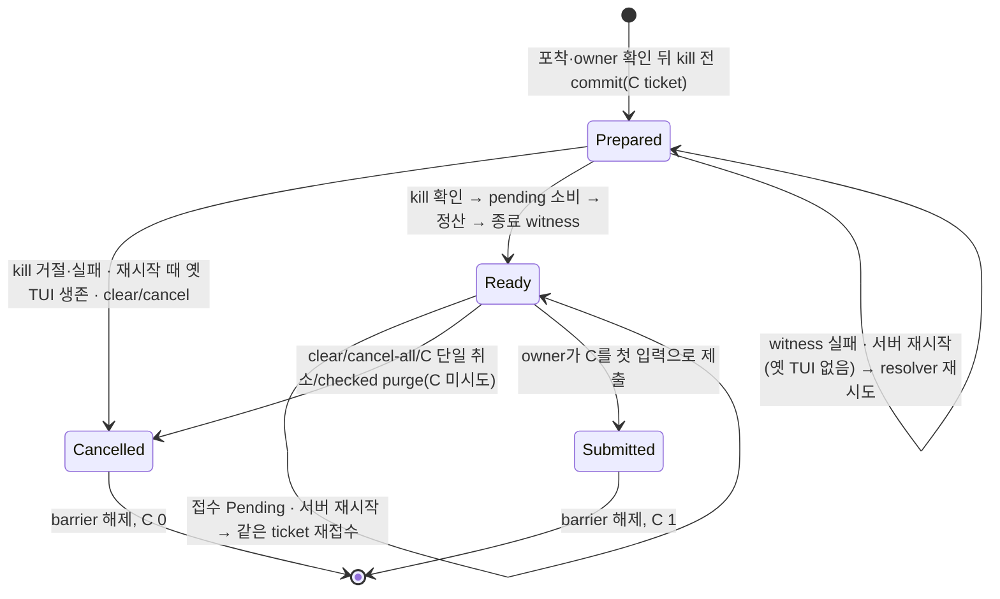

# Effort 즉시 재기동: S4b 개정(kill 전 Prepared, 명시 취소, 반영한 pending 소비)

S4b 첫 리뷰의 P1 3건을 고치는 설계를 `TmuxSession.tla`의 `Effort*` 투영으로 확인했다.

- P1-1: `/clear`·대기열 취소 뒤 barrier가 남는다.
- P1-2: 정산 뒤 intent 저장 전 crash면 C가 0이다.
- P1-3: 기존 fast/model pending이 C에서 세션을 초기화한다.

코드 기준은 S4b head `56eb31e24`이고, 이 문서는 설계 단계다. 코드는 아직 바꾸지 않았다. 그림 도구가 작업 호스트(WSL)에 없어 cfg별 chart는 만들지 않았다. TLC 결과와 이 문서만 남긴다.



## 진입점 전수표

경로는 `src/services/` 기준이며 줄 번호는 `56eb31e24` 기준이다.

| 경계 | 코드 | 모델 전이 |
|---|---|---|
| kill 전 intent | `discord/commands/effort_restart/tmux.rs:94-104` 사이(새 `prepare_effort(ready:false)`) | `EffortPrepare` |
| kill 거절·실패 | `tmux.rs:104-111` → 새 `Owner::cancel_effort` | `EffortKillFails` |
| kill·정산 | `tmux.rs:104-122` | `EffortInterrupt`·`EffortCloseInterrupted` |
| 반영한 pending 소비 | `tmux.rs:113` → `discord/commands/control.rs:427-463` | `EffortStopTui`의 `resetPending` |
| 종료 witness → Ready | `tmux.rs:128` → `witness.rs:98-136` → `tmux.rs:212-218` | `EffortResume` |
| C 접수 | `tmux.rs:223-229` | `EffortContinue` |
| C 턴의 세션 초기화 생략 | `discord/router/message_handler/headless_turn/replay_start.rs:148-173` | `EffortSubmitContinuation`의 `sameSession` |
| `/clear` | `discord/commands/control.rs:510` → `turn_orchestrator/queued_head/v2/control.rs:285-313` | `EffortClear`(clear) |
| 대기열 전체 취소 | `discord/queue_io.rs:138-146` → `v2/control.rs:412-454` | `EffortClear`(clear) |
| C 단일 취소 | `discord/queue_io.rs:98` → `v2/control.rs:207-282` | `EffortClear`(cancel-c) |
| checked purge | `turn_orchestrator/checked_purge.rs:305` → `v2/projection.rs:180-214` | `EffortClear`(clear) |
| 서버 재시작 복구 | `discord/router/message_handler/provider_dispatch/owner_input.rs:680` → `effort_restart/recovery.rs:19-40`(새 resolver) | `EffortDaemonRestart`(crash) |
| owner drive 한 바퀴 끝 | `discord/queue_io/input_owner/drive.rs:114-116` | `EffortContinue`의 `wake` |
| 재기동 뒤 새 `/fast`·`/model` | `discord/commands/config/provider_settings.rs:249-271, 325-336` | `EffortNewerChange` |

## crash cutpoint와 재시작 결과

| 끊는 곳 | 재시작 때 상태 | 결과 | C |
|---|---|---|---|
| Prepared 전 | intent 없음, 옛 TUI 생존 | 옛 턴을 그대로 관찰 | 0 |
| Prepared 뒤 kill 전 | Prepared, pane 생존·bind nonce 같음 | 취소, 다음 턴의 기존 재기동 | 0 |
| kill 직후 정산 전 | Prepared, pane 없음, 행 남음 | 행은 기존 dead 분기가 정산, resolver가 witness → Ready → 접수 | 1 |
| 정산 뒤 EOF 읽기 중 | Prepared, 행 없음 | witness 재기록 → Ready → 접수 | 1 |
| witness 뒤 ready 저장 전 | Prepared, witness 있음 | 같은 기록 확인 → Ready → 접수 | 1 |
| ready 뒤 접수 전 | Ready, C 큐에 없음 | 같은 ticket 재접수 | 1 |

모델의 `crash` 모드는 prepared·interrupted·stopped·booting·ready 각 단계에서 한 번 재시작한다.

## 규칙

| 규칙 | 뜻 |
|---|---|
| `EffortCutEventuallyResolved` | 끊긴 턴마다 결국 C 1개 또는 명시 취소 |
| `EffortBarrierEventuallyReleased` | barrier는 결국 풀린다 |
| `EffortNoSecondRestart` | 재기동이 반영한 pending 때문에 세션을 다시 초기화하지 않는다. 재기동 뒤 새로 저장된 변경만 그럴 수 있다 |
| `EffortSameSession`(기존) | C는 같은 세션에서만 돈다 |
| `EffortContinuationCustody`(기존, 넓힘) | resume한 C는 제출됐거나, barrier 아래 큐에 있거나, 명시 취소됐다 |
| `EffortInputNotLost`·`EffortUserFifo`·`EffortPendingEventuallyProcessed`(기존, 넓힘) | 사용자가 clear로 버린 입력은 유실로 세지 않는다 |
| `EffortRequestResolves`(기존, 넓힘) | 취소로 끝난 요청(`kept`)도 해소다 |

## 전/후

기존 24 cfg는 결과가 그대로다. 새 cfg 11개:

| cfg(`EffortRestart` 접두사) | 결과 | 뜻 |
|---|---|---|
| `Clear` | GREEN | clear·cancel-all이 C와 intent를 같은 commit으로 닫음 |
| `CancelC` | GREEN | C 단일 취소, 대기 사용자는 남음 |
| `ClearKeeps` | RED: `EffortContinuationCustody` + 진행 `EffortBarrierEventuallyReleased`, `EffortContinuationEventuallyInjected`, `EffortCutEventuallyResolved`, `EffortPendingEventuallyProcessed`, `EffortSubmitReleasesBarrier` | 현재 head: 큐 항목만 지우고 intent 유지 |
| `Crash` | GREEN | 모든 단계 crash. kill 전이면 취소, 뒤면 C 1 |
| `LateIntent` | RED: 진행 `EffortCutEventuallyResolved` | 현재 head: intent가 ready에서야 durable |
| `KillFails` | GREEN | kill 실패가 intent를 취소 |
| `KillFailsKeeps` | RED: 진행 `EffortBarrierEventuallyReleased`, `EffortPendingEventuallyProcessed` | kill 전 기록만 하고 취소를 빠뜨린 수리 |
| `Reset` | GREEN | 저장된 fast/model pending을 재기동이 소비 |
| `ResetC` | RED: `EffortSameSession`, `EffortNoSecondRestart` | 현재 head: 소비하지 않고 C 또는 다음 사용자 턴이 초기화 |
| `ResetKept` | RED: `EffortNoSecondRestart` | C는 건너뛰지만 소비하지 않은 수리 |
| `ResetNewer` | GREEN | 재기동 뒤 새 `/fast`는 다음 사용자 턴에서 한 번 적용 |

`ResetC`는 idle 경로(끊긴 턴 없음)에서도 `EffortNoSecondRestart`를 깬다. 현재 head에서 로컬 Codex의 fast pending + idle `/effort`는 TUI를 종료한 뒤 다음 사용자 턴에서 세션을 한 번 더 초기화한다.

## 모델과 코드가 다른 곳

1. 모델의 `EffortClear`는 C가 head(시도 중)에 있는 상태를 따로 두지 않는다. 코드에서 시도 중이거나 전달이 모호한 C는 취소하지 않는다(기존 custody). 모델에서는 C 제출이 원자 전이라 그 사이 상태가 없다.
2. 부팅 때 옛 TUI가 살아 있는지 판정(pane + bind nonce)은 모델에서 "prepared면 생존"으로 줄였다. kill 직후 crash는 모델의 interrupted 단계다.
3. witness 실패와 접수 Pending의 재시도는 모델에서 Prepared/Ready에 머무는 것으로만 보인다. 재시도를 깨우는 것은 wake뿐이고 시간 polling은 없다.

## 재실행

```sh
R=<빈 디렉터리> && mkdir -p $R/session-lifecycle
for f in $(grep -P "\tTmuxSession\t" docs/statecharts/expected.tsv | cut -f1); do cp docs/statecharts/$f $R/$f; done
cp docs/statecharts/session-lifecycle/TmuxSession.tla $R/session-lifecycle/
(head -3 docs/statecharts/expected.tsv; grep -P "\tTmuxSession\t" docs/statecharts/expected.tsv) > $R/expected.tsv
python3 scripts/ci/statecharts_tlc.py --root $R --jar ~/.local/share/tla2tools/tla2tools-1.7.4.jar --timeout 200 --jobs 4
```

35 cfg, 약 93초, 기대와 전부 일치.
