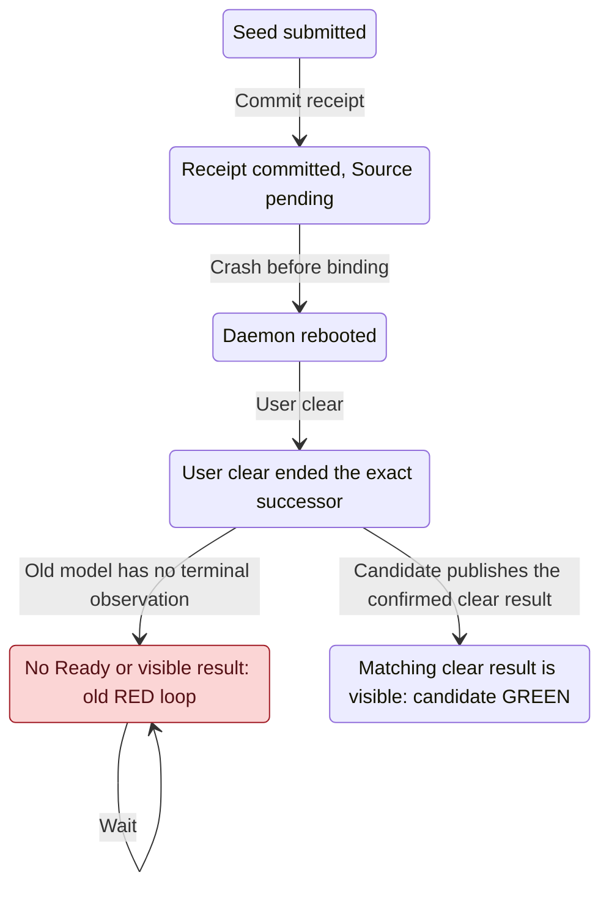

# Herdr restart B2 상태 차트 — 설계 포트 부분 결과

**SC_PLAN_INCOMPLETE. canonical TLA/cfg/expected는 변경하지 않았다.** 부모의 크기 게이트/30분 지시로 새 실행과 확장을 중단했다. 이 보고서와 필요한 그림만 저장소에 둔다. B2 생산 코드는 외부 WIP로 보존 후 부모가 canonical fc4 baseline으로 복원하며, 아래 source 좌표는 canonical 기존 포트와 외부 proposed 구현을 구별한다. B2 Rust·cargo·PG·운영 실행/PASS는0이다.

canonical 기준 `fc4b3dd8474603d2696bf79fa9472d8334445977`, Owner SHA256 `0bfe4d61abc4dc24a9fb99f93377c5efea85bb70a77546b534f3f2f9bf36b3eb`. 외부 최종 후보 SHA256 `3de2b179d42c706525d02e3d5fa5cd01c2cc1e35fa5a3692d0f767b8c5efd979`, view SHA256 `805fad9b543db706d98da19634fc0c87a0f6c883ab9510633b6809d392019cec`. candidate는 정상28개 GREEN이지만 기존 음성 cfg 한 행에서 추가 진행성 위반이 나왔으므로 전체 통과라고 쓰지 않는다. guard 철회나 expected 변경으로 반례를 숨기지 않았다.

## 수정 전/후와 실제 검사 결과

| 입력/목적 | 실제 실행 | 결과 |
|---|---|---|
| canonical0bfe + HeadBusyCrash/clear any, RequestResolves 단독 재현 | 18,683 states, State1~23의22전이, TLC exit13 | 기존 receipt→crash→boot→clear 반례 재현 RED |
| final3de2 같은 복합 경로, RequestResolves 단독 | 23,014 states, TLC exit0 | exact seed successor의 clear 결과를 가시 종결로 연결한 candidate GREEN |
| final3de2 seedless delta3 | Seedless/SeedlessClear/SeedlessCrash,29 TLC,19.2초, exit0 | 정상3개 GREEN. seedless crash 뒤 durable operation 보장은 제외 |
| final3de2 전체63cfg | 615 TLC,215.9초, checker exit1 | **기대일치62/63**, 정상28 GREEN·음성35 RED, 그 중 SeedBehind 한 행의 위반집합 불일치 |
| final3de2 wrapper 정상11cfg | report11개, 모두 exit0 | 500-state 넘은 HeadBusy/HeadBusyCrash/SeedlessClear/Crash/ClearAny는 그림 없음, 관측 states 보존 |
| final3de2 외부 원인6변형 | safety4개 exit12, liveness2개 exit13 | 아래 개별 규칙의 실제 RED. 추가 cfg/manifest 행 없음 |

Source495b의 이전 전체63검사는615 TLC/529.2초/exit1로 SeedlessClear false RED와 SeedBehind 불일치가 있었다. SeedlessRestartCompletes 정의만 정정한 final3de2를 별도로 전체63검사했다. source SHA가 다른 검사 결과를 최종 통과로 합치지 않았다. 모든 검증 프로세스는 종료됐고 진행 중 TLC는0이다.

## 사용자 네 결정과 진입점 census

| 결정 | 모델 행동/규칙·cfg | canonical 기존 연결 자리 / proposed B2 포트 |
|---|---|---|
| dispatch 중에도 restart | DispatchRestart/DispatchCrash, NoInheritedDispatch/NoDispatchRepost, operation별 close/create/seed admission 계수 | src/services/discord/commands/restart.rs:259, :218; herdr_terminate.rs:401, :217, :224; retired_exclusion.rs:100. `src/services/discord/commands/restart/herdr.rs`(proposed)·`src/services/discord/herdr_terminate/restart.rs`(proposed)가 exact 종료·seed-only disconnect를 소유 |
| clear가 이김 | ClearBegin→기존 grant 배수→exact teardown→PublishClearResult. RequestResolves/ClearedSeedResolves | src/services/discord/commands/control.rs:523; control/clear_teardown.rs:73, :164, :199. proposed seed ticket/attempt의 exact successor와 관측한 clear 결과 연결 |
| seed가 대기 입력보다 먼저 | 보호 prefix 뒤 seed, 그 뒤 tail·late arrival. SeedQueueOrder, HeadBusy/Concurrent/Crash | src/services/turn_orchestrator/queued_head/v2.rs:398, :444, :456; source_admission.rs:1007. `src/services/turn_orchestrator/queued_head/v2/source_admission/restart_seed.rs`(proposed)가 삽입과 bind index 이동을 소유 |
| Full이어도 restart | SeedMode none에서도 종료·인사말 실패 안내. SeedlessRestartCompletes | source_admission.rs:7의 Full/Pending/Conflict 구별, effort_continue.rs:200의 기존30/31. `src/services/discord/queue_io/input_owner/restart_seed.rs`(proposed)와 명령 결과 분류 |

위 짧은 파일명은 `src/services/discord/` 또는 `src/services/turn_orchestrator/queued_head/v2/` 아래 canonical 자리다. 새 child의 file:line은 고정되지 않은 proposed 포트이며 실제 연결·시험 PASS가 아니다. 생산 WIP의 새 SourceState는 logs/impl-b2/wip-freeze/source 아래 archive 근거로만 읽고 canonical 실재 값으로 취급하지 않는다.

실재 값 범위는 source_admission.rs:7 AdmitError, :114 TicketStatus(Committed/Pending/Absent), :137 TurnBind(Armed/NotArmed/Settled/Unknown/Absent), v2_types.rs:63 BindAt(Queued/Opaque/Attempt/Settled)다. canonical 상세 ticket 응답은 bind·retained·drop receipt의 조합이며 새 serde variant/V2 필드를 추가한 것이 아니다. N=1/2/3의 작은 경계와 기존63cfg를 사용했고30/31 운영 한도나 TLC 임계값을 올리지 않았다.

## 보강한 상태와 규칙

- order/protected는 seed 삽입 직전의 head+followers를 고정하고 그 뒤 대기 입력·late arrival을 구별한다. HeadBusy N=3에서는 입력3이 이미 대기했거나 나중에 오는 두 초기값을 검사한다. 실제 Queued bind index·전체 original identity 직렬화는 Rust 시험 범위다.
- closeCalls/seedAdmissions/seedCreates는 단순 opSeen 표식과 별도로 operation 효과 횟수를 기록한다. ReplayLookup→ReplayRequest로 기존 결과 읽기를 구별했다. alias·Expired·Pending commit의 상세 내구 원장은 아직 모델링하지 않았으며 실제 B2 시험이 필요하다.
- **operation 보장 범위:** seeded는 기존 durable ticket의 범위, seedless 완료 재호출은 같은 프로세스의 Gate 메모리 범위다. OperationEffectsAtMostOnce는 `(Seeded OR !crashed)` 조건으로 검사한다. 이 모델의 seedless 검사는 첫 crash 전 프로세스에만 한정한다. crash 뒤 새 프로세스 안의 재호출에 대한 메모리 중복0은 별도로 모델 증명하지 않았다. 프로세스별 Gate 메모리 보장이라는 구현 목표와 이 검증 범위를 구별한다. seedless crash 뒤에는 내구 기록이 없다는 r3 기존 예외를 유지하고 같은 op의 영속 중복0을 주장하지 않는다.
- SeedlessRestartCompletes는 이전처럼 seed가 없어서 공허하게 통과하지 않는다. old 실행이 끝나고 정상 실패 안내 또는 clear epoch 이동에 따른 visible superseded로 종결돼야 한다. seedless에서 즉시 새 Ready를 강제하지 않고 대기/다음 일반 입력이 기존 경로로 시작한다.
- PublishClearResult는 Settled를 Cancelled로 바꾸지 않는다. 해당 seed ticket/attempt가 소유한 exact successor를 clear가 끝냈다는 증거와 사용자가 보는 clear 결과를 연결한다. 새 자동 repair/store가 아니다. 이 소유증명·가시 결과 포트가 실제 코드에 없으면 candidate GREEN을 적용할 수 없다.

## before22-step 반례와 candidate 종결

기존 raw 경로는 seed submit→Settled receipt→Source bind 전 daemon crash→boot→명시 clear의 exact 종료에서 멈추며 Ready도 visible failure도 없었다. old TLC raw State1~23은 before-clear-crash.log에 보존한다. final candidate에서는 같은 소유의 clear 결과가 visible superseded가 되고 seedEffects·Settled receipt를 재작성하거나 재전송하지 않는다.



이 그림은 두 모델의 확인한 경로를 읽는 말로 투영했다. 일반 owner/queue 자기 단계·create 세부는 숨겼고 receipt/crash/clear/가시 종결 경계를 남겼다. [operation](herdr-restart-owner-b2-After.chart.mmd), [dispatch](herdr-restart-owner-b2-DispatchRestart.chart.mmd), [seed 우선](herdr-restart-owner-b2-Concurrent.chart.mmd), [seedless](herdr-restart-owner-b2-Seedless.chart.mmd)는 외부 final candidate의 정식 wrapper 산출이다. canonical 모델의 그림으로 오인하지 않는다.

## 실패 세 경우를 구분

| 실패 | 원시 결과·원인 | 처리 |
|---|---|---|
| 초기 파싱 | checker-first12.log, Unknown operator ActiveClaim, TLC 검사0 | 선언 순서 오류를 수리. 재현 RED/검증 PASS로 세지 않음 |
| 신규 seedless 속성의 false RED | source495b SeedlessClear의 SeedlessRestartCompletes. clear가 먼저 old 실행을 끝내고 restart가 visible 실패했으나 성공 answered flag를 강제 | 정상 응답 또는 epoch 이동+visible 실패로 정의 정정. raw 보존, final delta3 및 final63에서 이 case GREEN |
| **최종 SeedBehind 미완** | 최종3de2에서 RequestResolves·RestartAvailable 추가 위반 | 비소유 successor에 SeedJoin을 막는 guard는 있지만 가시 거절 분기가 없어 대기한다. guard 철회/expected 수정하지 않고 외부 WIP로 보존 |

SeedBehind의 원인 경로는 seed admission 뒤 일반 입력이 먼저 NewBound를 만들고, seedPaneOwned guard가 합류를 막는데 visible refusal이 없어 대기하는 것이다. 이것은 정적 원인 추적이며 새 최단 경로 실행을 발사하지 않았다. 비소유 successor를 가시 거절로 끝내는 실제 포트/모델 분기를 만든 뒤 기존 속성으로 다시 검사해야 한다.

정확히 불일치한 registry 행은 아래 하나다. 두 번째 줄은 관측한 후보 위반집합이지 적용할 expected 변경안이 아니다.

```tsv
session-lifecycle/HerdrRestartOwnerSeedBehind.cfg	HerdrRestartOwner	NoOldPaneInput	-
session-lifecycle/HerdrRestartOwnerSeedBehind.cfg	HerdrRestartOwner	NoOldPaneInput	RequestResolves,RestartAvailable
```

expected.tsv/새 cfg 행/감사 예외 변경0. canonical TLA·view·63cfg 복사0. B1의 기존 정상 모델 수치도 바꾸지 않았다.

## 외부 원인 변형

아래는 final3de2에서 독립적으로 한 동작만 바꾼 모델 source 변형이다. 생산 Rust mutation은 아니다. 기존 cfg 이름의 외부 복사본에서 단일 규칙을 검사했고 원본 후보 바이트는 동일하게 유지했다.

| 변형 | 깨진 규칙 | TLC exit | raw State 수 |
|---|---|---:|---:|
| clear-result-removed | RequestResolves | 13 | 29 |
| full-refused | SeedlessRestartCompletes | 13 | 7 |
| seed-before-protected-unit | SeedQueueOrder | 12 | 2 |
| lookup-removed | ReplayReadsExistingTicket | 12 | 3 |
| seedless-replay-recloses | OperationEffectsAtMostOnce | 12 | 9 |
| recovery-recloses | OperationEffectsAtMostOnce | 12 | 6 |

State 수는 원시 TLC 경로의 번호 개수이며0이면 경로 미제공인 것이지 실행0/PASS가 아니다. liveness 경로를 최단이라고 주장하지 않는다. proof-source-final/controls.json의 source SHA·cfg·규칙·실제 command와 각 log가 근거다.

## 가정과 증명하지 않은 범위

I/O가 반환하거나 deadline으로 분류되고 owner·notice·clear 스케줄러가 계속 실행한다는 fairness를 쓴다. 영구 Discord 단절의 메시지 도착, native 직접 키, 임의 source spoofing, actor/row 교체 전수, operation alias/Expired/Pending commit 전체, 실제 dispatch 최종 상태·재시도/게시 수 parity는 증명하지 않는다. Request future 취소와 detach 수명도 코드/실제 시험이 필요하다.

startup은 여전히 BindSource까지 추상화한다. 실제 B1은 물리 submit 반환에 카운터를 끝내므로 늦은 bind CAS·sticky overlap은 실제 시험 계약이다. A의 immutable offset/Resume cause/ordinary fresh 모델은 변경하지 않았고 B2의 typed origin→resume 배선은 실제 시험이 필요하다. canonical과 외부 WIP를 섞어 B2 수용 전체 PASS로 표시하지 않는다.

## 증거·재현

로그 root `/Users/itismyfield/.adk/release/lane-runs/hl-20260925/i8128/logs/impl-b2/model/`:

- before-inputs/와 before-clear-crash.log: canonical0bfe의22전이 RED.
- inputs-final/: 외부 final TLA/view/기존63cfg/기존 expected 복사본. control-inputs/와 proof-source-final/은 독립 원인별 입력·command·raw log다.
- checker-all63.log: source495b의 이전 실패. checker-final-delta3.log: 정정3개 GREEN. **checker-final-all63.log: final3de2,63cfg/615 TLC,62/63 일치, exit1**.
- render-source-final/: 정상11개 report와 생성 가능한 chart. 그림 상한을 넘은 case의 states는 개별 report 값이며 steps 미제공을0으로 채우지 않는다.
- execution-manifest.json: 입력·산출 SHA, 실행수·실패집합, canonical/expected 불변 확인. 관련 운영 데이터·프로세스는 건드리지 않았다.

```sh
unset TMUX TMUX_PANE
export TLA2TOOLS=/Users/itismyfield/.local/share/tla2tools/tla2tools-1.7.4.jar
export JAVA=/opt/homebrew/opt/openjdk/bin/java
python3 scripts/ci/statecharts_tlc.py --root /Users/itismyfield/.adk/release/lane-runs/hl-20260925/i8128/logs/impl-b2/model/inputs-final --jobs 3
# Expected exit1: SeedBehind의 추가 진행성 위반 한 행
```

단일 before/after·원인 재현 command는 proof-source-final/controls.json에 보존했다. 각 control-inputs 디렉터리에서 같은 cfg/rule로 새 metadir를 사용한다. wrapper는 inputs-final의 TLA/cfg/view에 새 --out 폴더를 줘 재현한다. 환경은 OpenJDK/TLC1.7.4·Node의 기존 도구 경로이며 cargo/PG profile은 미사용이다. 모든 TLC/helper 세션은 종료했다. process-exits.json에 기존 exec 종료코드와 읽기 전용 PID/PGID 점검(관련 활성 프로세스0)을 남겼다. 추가 중단 신호는 보내지 않았다.

TIME B2_start=2026-11-14T01:59:29+09:00 model_first_run=2026-11-14T02:14:40+09:00 stopped=2026-11-14T02:43:57+09:00
