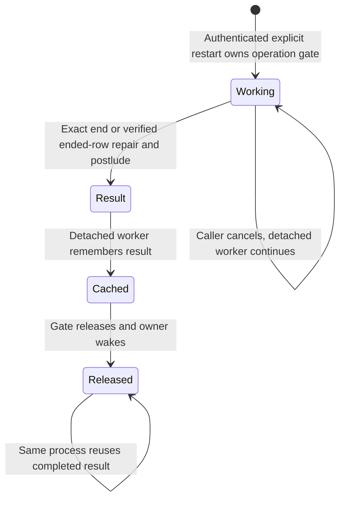

# Herdr restart B2a — 종료 포트·메모리 operation 상태 차트

canonical0bfe를 기준으로 **B2a의 종료·clear 우선 postlude·selector 보존 disconnect·wake·이미 끝난 idle row의 명시 재진입**만 보강했다. TLA SHA256 `8b3d8c032b73041dde10117d3d4b8e326c7c11c1ae9815af92b9e3291f8bbd55`, view `d4c2be204dc74c1493859e2eb5d0bacc68bd7f3dca55f6246895d4d43ec8c474`. seed 생성·admission·우선순위·successor join의 새 행동은 추가하지 않았다. 외부 B2 후보3de2의 SeedJoin guard와 SeedBehind 추가 진행성은 B2b 이월이며 이번 canonical에 넣지 않았다.

모델 담당 cargo/PG/운영 실행0·생산 source 변경0이다. B2a 생산 호출은 현재 checkout에 적용됐으나 이 문서 갱신 시점의 Rust/PG PASS는0이며 첫 cargo 자원 대기 중이다. 소스 연결의 존재를 확인한 것과 실행 검증을 구별한다. 모델 GREEN을 B2a 생산 PASS로 표시하지 않는다.

## 실제 결과

**기존63cfg/617 TLC, 기대63/63 일치, GREEN28·기존 expected RED35, checker exit0,397.2초, cfg 최대77.8초**. expected.tsv 바이트/행 변경0·새cfg0·음성cfg 수정0이다. 정상 Seedless/SeedlessClear/SeedlessCrash 세 cfg에만 새4 invariant/2 liveness를 추가해 각각24 invariant/10 liveness다. 다른 cfg의 기존 검사 목록은 그대로다.

SeedStartable/SeedRefused/SeedToOld/SeedJoin/LaunchBegin 등18개 정의는0bfe 원문과 동일하다(seed-projection-certificate.json). Seeded=true에서는 새 operation metadata가 비활성이고 Postlude wrapper는 identity, 추가 close 조건은TRUE다. 새 B2a action도 비활성이다. 따라서 기존 seed guard를 철회하거나 외부 후보의 반례를 숨겨 기대집합을 맞추지 않았다.

## 수정 전 RED → 포트 적용 GREEN

수정 전은 새 포트를 한 가지씩 제거한 **독립 모델 원인 변형**이다. 생산 코드 RED/PG 재현과 혼동하지 않는다. 외부 기존 cfg 복사본을N=1로 줄여 단일 규칙을 검사했고 manifest를 추가하지 않았다.

| 경계/변형 | 검사 규칙 | 실제 결과 |
|---|---|---|
| caller 취소가 detached worker도 끝냄 | B2aCancelledCallerResolves | before exit13 → 정상 후보 exit0 |
| 결과 캐시 전 gate 해제 | B2aCachePrecedesGateRelease | before exit12 → 정상3cfg GREEN |
| 완료 cache 재호출이 다시 close | B2aNoRepeatClose | before exit12 → 정상3cfg GREEN |
| 이미 끝난 idle entry에 close 재전송 | B2aIdleRepairSendsNoClose | before exit12 → 정상3cfg GREEN |
| 명시 재진입의 ended-row repair 제거 | B2aDetachedResultResolves | before exit13 → 정상3cfg GREEN |
| matched disconnect 누락 | B2aPostludeContract | before exit12 → 정상3cfg GREEN |
| clear epoch 이동 무시 | B2aPostludeContract | before exit12 → SeedlessClear GREEN |
| gate 해제 때 wake 누락 | B2aCachePrecedesGateRelease | before exit12 → 정상3cfg GREEN |

proof/controls.json은9실행(정상1+독립 원인8)의 실제 exit·cfg·규칙·source SHA·command·raw 경로를 기록한다. 원본 후보 바이트를 건드리지 않고 복사본만 변형했다. parse/compile 오류나0개 검사를 RED로 세지 않았다.

## 행동과 불변식

명시 restart가 operation gate를 소유하면 기존 종료 worker가 close/관측/retire/결산/postlude를 수행한다. postlude가 끝나도 **operation gate는 아직 보유**한다. detached worker가 결과를 메모리에 넣은 뒤 gate를 풀고 owner를 깨운다. caller 취소는 caller flag만 바꾸며 worker·gate·cache의 소유를 없애지 않는다.

- B2aCachePrecedesGateRelease: gate 해제 당시 실제 결과 cache와 wake가 존재한다. postlude record와 release record를 관측하므로 기대값을 단순 복제한 표식이 아니다.
- B2aNoRepeatClose: 같은 프로세스의 고정 operation 재호출은 기억한 결과를 반환하고 다시 close하지 않는다.
- B2aIdleRepairSendsNoClose: 명시 restart가 이미Ended인Bound/placed Pending을 만나면 종료 증거를 확인하고 retire/결산/postlude로 진행하며 close0이다. autonomous boot repair가 아니다.
- B2aPostludeContract: snapshot epoch 기준 clear가 앞섰으면 selector 삭제, 아니면 보존하고 matched disconnect·captured settlement를 확인한다.
- B2aDetachedResultResolves/B2aCancelledCallerResolves: 시작된 worker/취소된 caller는 cache+gate 해제 또는 daemon crash로 끝난다. I/O가 응답/분류되고 해당 단계가 공정하게 실행된다는 조건이다.



[정식 작은 그림](herdr-restart-owner-b2a-Small.chart.mmd)은 기존 Seedless cfg의 외부N=1 복사본이다. [정식 Seedless 그림](herdr-restart-owner-b2a-Seedless.chart.mmd)과 각 보고서는 기존 ordinary input의 후속 동작도 포함하며 restart가 새 인사말/Ready를 만들었다는 뜻이 아니다. 위 요약 그림은 그 후속 단계와 self-step을 숨기고 cache-before-release 경계를 남겼다.

## 범위와 초기 진단

Rust Gate 대기는 처음 관측한 `Arc` 세대에 고정해 A 해제 직후 B가 재진입해도 B/C의 생애로 늘어나지 않게 한다. `a_restart_waiter_finishes_when_its_observed_gate_is_replaced`가 다른 채널 알림·실패한 begin·세대 교체를 구별한다. 이 다중 operation 경합은 고정 operation 모델 밖이며 Rust 실행은 부모 보고서에서 별도 확인한다.

메모리 결과는 첫 프로세스에서만 유지하며 crash 때 cache/gate를 잃는다. 같은 operation의 crash 뒤 영속 중복0이나 새 프로세스 안의 재호출 전체를 증명하지 않는다. 새 durable store·TTL/개수 제한 정책을 도입하지 않았고 기존 Discord dedup을 그 증거로 쓰지 않는다. 모델의 한 고정 operation/한 caller 취소/한 replay 범위를 넘는 경쟁은 실제 시험이 필요하다.

초기 진단1241에서는 '이전 crash로 이미Ended인 idle row의 명시 재진입'과 '이번 요청 도중 daemon crash'를 겹쳐 두 번째 crash 뒤 자동 복구 주체가 없는 경로를 만들었다. SeedlessCrash와 GapSeedlessDispatchCrash에 AcceptedInputResolves가 추가로 깨졌다(checker-first6.log). 이를 PASS로 세거나 expected를 바꾸지 않았다. 최종8b3은 **이미Ended row 재진입(no current crash)**과 **현재 요청 중 단일 crash(original live/inflight)**를 별도 시나리오로 검사한다. 둘의 조합은 검증하지 않았다. 새 생산 예외가 아니라 이번 작은 모델의 명시 범위다.

초기 ended row는 실제 종료 관측이 확인됐다는 포트 입력이다. canonical CloseReply confirmed를 이 성공 관측으로 추상화하며 위치·witness·nonce 검증을 생략해도 된다는 뜻이 아니다. row/captured dispatch 불일치·disconnect CAS=false·동시 row 교체는 이 모델의 matched snapshot 밖이다. 실제 계약은CAS=false만으로 종료 실패로 바꾸지 않으며 부모의 PG 시험이 확인해야 한다. DB dispatch 최종 상태/게시 수 전체도 이 bool 모델의 증명이 아니다.

## 진입점 census와 생산 연결 경계

모델 증거는 위8b3 원본으로 동결했다. 아래 좌표는 P2 커밋 `5b8811fd4efd57f1de15df806002afc868a9523d` 뒤 **미커밋 B2a source가 적용된 현재 checkout**의 읽기 전용 조사다. 커밋 자체에 B2a가 모두 포함됐다는 뜻이 아니며 소스 SHA 목록은 원시 로그의 doc-source-census.json에 보존한다. TLA/cfg/expected 변경·재실행0이다.

| 실제 진입점/포트 | 현재 file:line | B2a 동작과 한계 |
|---|---|---|
| `/restart` 등록·인증·공통 분기 | `src/services/discord/commands/restart.rs:380`, `:334`, `:337`, `:262`, `:283` | slash policy 뒤 Herdr 설정 채널만 child로 보낸다. operation ID는 interaction `ctx.id()`(`:346`) |
| `!restart` | `src/services/discord/commands/text_commands.rs:129`; `src/services/discord/commands/restart.rs:355`, `:371` | 기존 intake 정책 뒤 같은 공통 분기. 원 message ID가 operation ID이고 원 명령에 답한다 |
| 결과 재호출·Gate 획득 | `src/services/discord/commands/restart/herdr.rs:39`, `:43`, `:46`, `:49`, `:54` | 같은 operation 완료 결과를 먼저 조회하고 Gate 획득 뒤 재확인. 경쟁 요청은 결과/다른 요청 진행 응답이며 새 close를 병렬 시작하지 않음 |
| detached 종료·결과 응답 | `src/services/discord/commands/restart/herdr.rs:57`, `:59`, `:65`, `:66`, `:69`; `src/services/discord/herdr_terminate/http_force.rs:60`, `:62`, `:66`, `:67` | snapshot→warn→spawn. **spawn 뒤** caller 취소와 worker 소유를 분리, 결과 cache 뒤 Gate 해제. warn의 await는 spawn 전이라 그 이전 취소의 완료 의무까지 주장하지 않음 |
| row·owner·dispatch 선택 | `src/services/discord/commands/restart/herdr.rs:85`, `:105`, `:108`, `:124`, `:130`; `src/services/discord/herdr_terminate/restart_recovery.rs:5`, `:20` | Known/placed/동일 provider·token·channel만 진행. Missing/unknown/unplaced는 보이는 실패이며 seed를 만들지 않음. row dispatch와 captured dispatch가 같은지 별도로 기록 |
| 명시 idle close-crash 재진입 | `src/services/discord/commands/restart/herdr.rs:141`; `src/services/discord/herdr_terminate/restart_recovery.rs:32`, `:74`, `:90`, `:111`, `:134`, `:140`, `:149`, `:152` | 새 명시 요청이 이미Ended Bound/placed Pending을 transition·fence·row/dispatch 재검사 후 retire/결산. close 재전송0. Retired는 endpoint proof(`:118`, `:125`)로 정리 재개. 살아 있음이 확인된 경우만 `Ok(None)`→기존 exact terminate(`herdr.rs:156`) |
| exact close·captured settlement | `src/services/discord/herdr_terminate.rs:478`, `:500`, `:520`, `:549`, `:590`, `:595`, `:597`, `:604`; `src/services/discord/herdr_terminate.rs:338`, `:355` | actor/token·row/dispatch·old fence로 묶고 종료 확인 후 HostTerminated finalizer로 정확한 captured snapshot을 결산. 새 retry dispatch나 successor launch를 만들지 않음. dispatch 최종 상태·게시 수의 tmux 동등성은 Rust/PG 미검증 |
| clear 우선 postlude | `src/services/discord/commands/restart/herdr.rs:206`, `:207`, `:215`, `:223`, `:229`; `src/services/herdr_launch/clear_epoch.rs:46`, `:57`, `:65` | epoch snapshot과 postlude 전후 확인. clear가 겹치면 exact retired selector CAS 삭제, 아니면 provider 보존 disconnect. clear 응답은 selector CAS 성공에만 붙임 |
| selector 보존 disconnect | `src/services/discord/herdr_terminate/retired_exclusion.rs:100`, `:113`; `src/db/dispatched_sessions/hosted_execution/http_force.rs:34`, `:44`, `:45`, `:55`, `:75` | exclusion 아래 retired owner/nonce/dispatch 조건으로 status/active dispatch를 disconnect하고 provider selector는 유지. `Ok(false)`는 row 이동이며 이것만으로 종료 실패로 바꾸지 않음. 모델의 matched snapshot 밖 경합은 별도 실제 시험 대상 |
| operation·메모리 cache 모듈 | `src/services/turn_orchestrator.rs:115`; `src/services/turn_orchestrator/restart_operation.rs:3`, `:10`; `src/services/discord/queue_io/input_owner/mod.rs:15`; `src/services/discord/queue_io/input_owner/restart_gate.rs:10`, `:11`, `:14`, `:22` | provider/token namespace+channel+요청 ID. 첫 프로세스 메모리만 검사하며 crash 후 영속 operation 복구·cache 제한 정책은 주장하지 않음 |
| owner Gate·wake | `src/services/discord/router/message_handler/provider_dispatch/owner_input.rs:175`, `:181`, `:613`; `src/services/discord/queue_io/input_owner/restart_gate.rs:56`, `:76`, `:82`, `:83` | Gate 중 front를 hold, Gate Drop이 waiter notify 후 기존 owner drive를 wake. 큐 purge·입력 재생성0. 기존 transition wake(`src/services/discord/session_transition.rs:145`)와 별도로 Gate 해제 wake가 있음 |
| `!clear`·`/clear` | `src/services/discord/commands/text_commands.rs:100`; `src/services/discord/commands/control.rs:523`, `:530`; `src/services/discord/commands/control/clear_teardown.rs:73` | 같은 clear epoch. clear는 즉시 epoch을 올리고 transition timeout 뒤에도 진행; startup/effect 종료 대기는 B1 기존 포트. B2a는 종료 postlude에서 clear를 다시 반영 |
| 일반 headless·부팅 | `src/services/discord/router/message_handler/headless_turn.rs:159`, `:165`; `src/services/discord/runtime_bootstrap/queued_recovery.rs:50`, `:57`, `:210` | 기존 일반 Herdr headless 거절·큐/inflight 복원 유지. B2a의 ended-row repair는 **새 명시 요청** 진입이고 autonomous boot repair가 아님. restart seed/admission/우선순위·내구 operation 복구/새 Ready는 B2b 미완 |

### 모듈·모델 액션 대응

| 모델 액션/규칙 | 실제 연결 | 증명·미증명 경계 |
|---|---|---|
| Request·OwnerFree | `restart/herdr.rs:39`의 Operation, `:46`의 Gate; `owner_input.rs:175`의 hold | Gate 소유와 한 operation 추상화. 위 전수표의 전체 경로를 따른다 |
| CloseExact·Retire | `restart/herdr.rs:156`→`herdr_terminate/http_force.rs:62`→기존 exact 서비스 | pane identity/witness·스위치·actor·DB가 실제로 검증됐다는 실행 증거는 아직0 |
| B2aRepairEnded | `restart_recovery.rs:74`, `:140`, `:149`, `:152` | ended 증거를 두 번 확인하고 close 없이 retire/settle. 자동 boot 연결0 |
| Postlude·B2aPostludeContract | `restart/herdr.rs:206`·`:214`·`:229` | 모델은 matched disconnect/epoch snapshot만. 불일치 CAS·dispatch 최종 상태/게시 수 미증명 |
| B2aCancelCaller·B2aObserveResult | `restart/herdr.rs:59`·`:60`·`:69` | detached worker 시작 뒤 caller 취소. scheduler·I/O 응답/분류는 liveness 전제 |
| B2aCacheResult·B2aReleaseGate·B2aReplayCompleted | `restart/herdr.rs:43`·`:65`·`:66`; `restart_gate.rs:22`·`:76` | 결과 저장→Gate 해제→wake, 같은 프로세스 재호출. 첫 crash 뒤 durable 보장0 |
| ClearBegin·기존 효과 허가 | `clear_epoch.rs:65`·`:176`; `control.rs:523` | B1 계약 재사용. 새 seed launch·source attach 포트는 B2b |

짧은 경로는 위 전수표의 실제 전체 경로를 뜻한다. module 선언은 `restart.rs:14`, `herdr_terminate.rs:4`, `input_owner/mod.rs:15`, `turn_orchestrator.rs:115`다. 새 serde/V2 필드·trait·Core는0이다.

### 입력 출처 분류와 B2a 수락 범위

| 출처 | 실제 file:line | B2a 처리·범위 |
|---|---|---|
| Discord 사람의 slash/text 명령 | `src/services/discord/commands/restart.rs:334`, `:337`, `:355`; `src/services/discord/router/intake_gate.rs:516` | 기존 인증/정책 뒤 공통 Herdr 종료 분기. interaction/message ID로 operation을 고정. 명령 본문을 인사말 seed로 접수하지 않음 |
| Discord 사람의 일반 대기 입력 | `src/services/discord/router/intake_queue_transaction.rs:36`, `:43`, `:121`; `src/services/discord/router/message_handler/provider_dispatch/owner_input.rs:175` | durable owner original/receipt 범위. Gate 동안 hold하고 해제 wake; 명시 restart가 큐를 purge하지 않음. 진행 중 captured 턴은 경고 후 기존 종료 결산 |
| Discord 허용 봇/announce·기타 봇 | `src/services/discord/router/intake_gate.rs:352`, `:355`, `:361`, `:491`, `:496`, `:514`; `src/services/discord/router/intake_queue_transaction.rs:38`, `:45`, `:47` | 허용 봇은 기존 필터·인증 예외/텍스트 명령 정책대로 처리하고, 기타 봇은 접수하지 않음. 봇의 기존 cancel-preservation 차이(`intake_gate.rs:526`)를 사람과 같다고 확대하지 않음. 이미 owner에 접수된 original의 custody만 모델 대상 |
| TUI의 관측·claim된 실제 턴 | `src/services/discord/tui_prompt_relay/synthetic_start/claim.rs:54`; `src/services/discord/tui_prompt_relay/synthetic_start_wiring.rs:618`; `src/services/discord/herdr_terminate.rs:478` | captured actor/token/snapshot으로 종료 결산. TUI에서 입력한 문자 `/restart` 자체를 Discord control 명령으로 라우팅하는 새 경로0 |
| TUI 직접 키·미제출 draft | `src/services/claude/herdr_turn/composer.rs:59`; `src/services/session_host/herdr_gate.rs:549`; `src/services/discord/commands/restart.rs:291` | owner durable original 접수와 별개. pane 종료 때 중단될 수 있으며 무손실0 계수에 넣지 않음 |
| API·HTTP·루틴·iMessage 일반 시작 | `src/services/discord/router/message_handler/headless_turn.rs:159`, `:165`; `src/services/turn_host.rs:191` | 기존 Herdr executor_not_wired 거절 유지. 명시 Terminate HTTP는 기존 별도 endpoint이며 restart/seed 시작 권한으로 승격하지 않음 |
| restart 인사말·일반 boot 복구 | `src/services/discord/commands/restart.rs:298`, `:312`; `src/services/discord/commands/restart/herdr.rs:26`; `src/services/discord/runtime_bootstrap/queued_recovery.rs:50` | Herdr 분기는 tmux seed 호출 전 return하며 '인사말 turn은 시작하지 못했습니다'라고 응답. seed/일반 boot에서 restart debt 복구는 B2b 미완 |

B2a의 old pane 입력 차단 선형화는 기존 exact 서비스의 transition+termination fence 획득이다. 명령 수신·메모리 Gate 획득·종료 확인·seed 내구 수락을 같은 사건으로 취급하지 않는다. B2a에는 seed 내구 수락 자체가 없다. unknown ACK와 기존 uncertain 입력은 재전송하지 않으며 queue/history purge를 추가하지 않는다.

## 원시 결과·재현

로그 root `/Users/itismyfield/.adk/release/lane-runs/hl-20260925/i8128/logs/impl-b2a/model/`:

- checker-all63.log: 최종617 TLC/기대63/63/exit0. cfg별 실제 위반집합과 시간을 보존한다.
- proof/controls.json 및 각 log, control-inputs/: 독립 원인별 source SHA·cfg·규칙·실제 command. 안전6개RED12, 진행성2개RED13, 정상1개GREEN0.
- render-final/: canonical 정상3cfg+외부N1 small wrapper, 전부GREEN0. 그림 상한을 넘은 case는 report만 유지한다. states는 관측값, steps 미제공을0으로 채우지 않는다.
- baseline-inputs/: 원래0bfe. diagnostic-first-inputs/·checker-first6.log: 초기 두 사건 조합 실패. inputs-final/·execution-manifest.json: 최종 TLA/view/기존63cfg 및 SHA/실행수/바이트 일치.
- seed-projection-certificate.json: 기존18개 정의 원문 동일 및 Seeded=true 투영의 비활성 메타데이터/identity 논거.

```sh
unset TMUX TMUX_PANE
export TLA2TOOLS=/Users/itismyfield/.local/share/tla2tools/tla2tools-1.7.4.jar
export JAVA=/opt/homebrew/opt/openjdk/bin/java
python3 scripts/ci/statecharts_tlc.py --root /Users/itismyfield/.adk/release/lane-runs/hl-20260925/i8128/logs/impl-b2a/model/inputs-final --jobs 3
```

원인 재현은 control-inputs의 해당 디렉터리에서 controls.json의 cfg/rule command를 새 metadir로 실행한다. wrapper는 inputs-final의TLA/cfg/view에 새 --out 폴더를 사용한다. 새 cfg 등록/expected 수정/시험·감사 예외/임계값 인상0이며, 모델 담당은운영파일·프로세스·Herdr server를 조작하지 않았다. 이 문서 갱신 시점의 B2a Rust/PG PASS는0이고 후속 결과는 부모 lane 보고서를 따른다.

| wrapper | TLC states/steps | 결과 |
|---|---:|---|
| [Seedless](herdr-restart-owner-b2a-Seedless.report.md) | 490/1704 | GREEN0 |
| [SeedlessClear](herdr-restart-owner-b2a-SeedlessClear.report.md) | 6946/미제공(그림상한) | GREEN0 |
| [SeedlessCrash](herdr-restart-owner-b2a-SeedlessCrash.report.md) | 645/미제공(그림상한) | GREEN0 |
| [Small](herdr-restart-owner-b2a-Small.report.md) | 238/712 | GREEN0 |

TIME model_start=2026-11-14T02:54:57+09:00 cap=30m evidence_frozen=2026-11-14T03:24:46+09:00

검증 프로세스는 모두 종료했다. process-exits.json에 exec 종료코드와 읽기 전용 PID/PGID 점검(관련 활성 Java/checker/view0)을 보존했고 중단 신호는 보내지 않았다.
