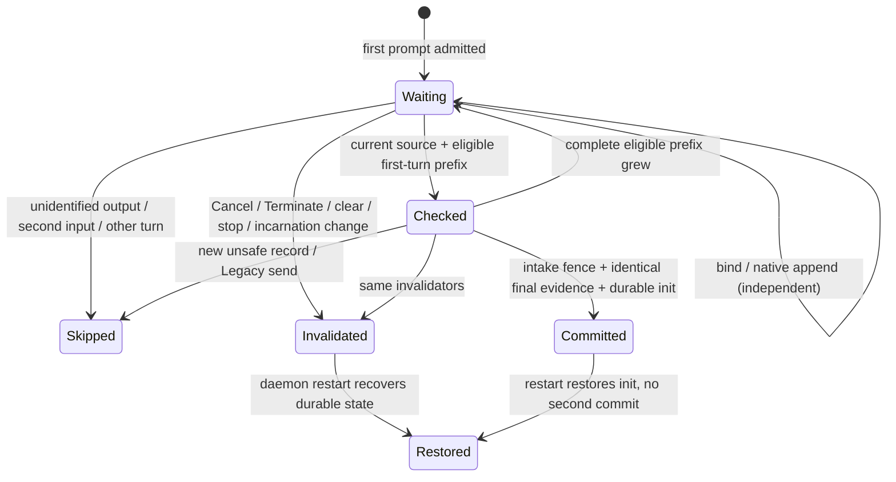

DESIGN_READY

# Codex 첫 턴 buffered output 채택 설계 — 독립 리뷰 요청

기준 소스: `ce14302831181da6b75e4242f322537700e7d012`. 부분 A의 시작 대화창/argv 신뢰 변경과 별도다. **부분 B Rust 구현은 이 커밋에 없다. 독립 리뷰 승인 뒤 구현한다.** 이 문서와 `docs/statecharts/tui-o-writer/WriterAdoption.tla`는 기존 “native 출력 전만 채택” 계약을 변경하는 제안이다. 부분 A만으로 #8165를 닫지 않는다. 실제 짧은 응답/!clear 메시지 ID 검증은 B 구현 뒤 필요하다.

## 추천안 A: 현재 intake fence 아래 첫 턴의 buffered output을 검증한다

흐름: 첫 입력 admission에서 `(send-start, send-finish, bind-seq, turn-order)`를 고정 → 현재 incarnation이 입증한 fresh rollout 발견 시 **기존 source authority/retired/child 검사 그대로** 바인딩을 publish → 비동기 adoption actor가 첫 prompt와 이후의 완전한 기록을 분류 → 기존 intake fence 획득 → 같은 규칙으로 다시 읽고 source/binding/nonce/입력/전송 경계를 확인 → durable init을 offset 0으로 기록 → Committed 뒤 O가 기존 캡처/identity/ledger를 통해 재생한다. 첫 출력이 첫 판정 전이나 fence 대기 중 이미 쓰여도 이 첫 턴으로 입증되면 버리지 않는다. 출력이 증가한 경우 기존 `Taken::Again`처럼 최신 완전한 prefix로 다시 판정하며, 알려진 prefix 바이트가 바뀌면 거절한다.

근거: `first_input.rs:45-55`는 prompt를 이미 argv에 싣는다. `rollout_tail/handoff.rs:67-83`의 discovery/marker는 binding event가 아니다. `session.rs:304-375`, `runtime_binding/codex_hook.rs:15`, `binding_events.rs:564-589`를 통과한 publication이 필요하다. `late_adopt/codex.rs:203-230`과 `:314-347`의 두 판정 모두 바꿔야 한다. `activation.rs:195-246`의 adoption lock, custody 검사, durable init 후 Committed 순서는 유지한다. 이 절의 생략 경로는 아래 전수표의 `src/services/` 접두사를 따른다.

구현 접점: `first_input::observe`가 가진 prepared BindingContext와 pinned provider home/source selection을 discovery observer에 전달해야 한다. cwd/mtime로 찾았다는 사실만 받아 publication하면 안 된다. 기존 post-tail 설치와 같은 source의 반복 publish는 idempotent해야 하며, 새 seq/rebind를 만들어 baseline을 이동시키지 않아야 한다.

비용: CLI 프로토콜은 유지한다. prefix 판정은 단순 “출력 없음”에서 첫 턴 provenance 및 출력 분류를 반환하는 구조로 바꿔야 한다. 최초 판정과 final recheck는 **동일한 판정 함수/타입**을 사용한다. 현재 `MAX_READ_BYTES` 한도를 유지하며, 첫 턴이 한도를 넘으면 takeover를 보장하지 않는다. 매번 커지는 파일을 재판정하는 굶주림은 유한한 첫 턴/완료 후 수렴을 활성 전제로 명시한다.

위험: native key가 있다는 사실만으로 첫 턴 provenance가 성립하지 않는다. `session_meta`, parent 여부, execution nonce, binding seq, inode, admitted prompt, turn opener, 두 번째 입력 금지를 함께 확인해야 한다. 지원되지 않는 출력은 계속 Refuse한다. `Verdict::Refuse`를 삭제하는 패치는 허용하지 않는다. 현재 prefix의 len/hash equality를 단순 완화하면 prefix rewrite와 다른 턴을 놓친다.

### 새 불변식

1. **단일 게시 권한**: initial baseline부터 commit까지 Legacy body send가 새로 시작하지 않아야 한다. fence 전·후 started가 같고, fence 동안 finished도 같아야 한다. in-flight body, queued body, 다른 delivery custody, relaying은 기존처럼 차단한다. Announced/native record와 Discord send는 다른 사건이다 (`codex.rs:255-286`, `:322-340`, `activation.rs:163-170`, `:206-217`, `channel_policy/adoption.rs:294-343`).
2. **하나의 실행·소스·입력**: 두 판정은 같은 현재 execution nonce/source authority, binding seq, canonical path+file identity, native session, first admitted prompt 및 그 turn을 가리켜야 한다. old source/restart/clear 경계가 발견되면 현재 시도를 폐기한다. cwd/mtime는 발견 힌트일 뿐 권한이 아니다.
3. **첫 턴 보존**: 허용된 buffered 기록을 init의 delivery_start=0으로 보존한다. announced record는 봉인·게시 증거가 아니다. 기존 O derive가 matching sealing record와 native identity를 확인할 때까지 보류한다. ID 없는 output과 다른 턴/입력은 거절한다.
4. **원자적 채택**: intake hold와 gateway epoch, adoption lock을 유지한 상태에서 final recheck와 durable init publication을 끝낸다. write가 오류를 반환해도 실제 init이 readable하면 기존 settled 판정으로 Committed를 복구한다. 실패를 이유로 새 init을 중복 발행하지 않는다 (`activation.rs:234-278`).
5. **무효화 우선**: Cancel/Terminate/clear/stop, incarnation 변경, binding 이동을 final recheck가 관찰하면 그 시도는 commit하지 않는다. 이미 commit된 init/posted ledger는 유지하며 기존 stop/clear/recovery가 처리한다. 부분 B에 새로운 kill/delete/cleanup 권한을 추가하지 않는다.

### 제안하는 lifecycle 동기화 접점

문서상의 가드를 실제로 만들기 위해, 현재 `Candidate::lock` (`channel_policy/adoption.rs:264`, `writer/activation.rs:195-246`)에 **해당 first admission의 무효화 stamp**를 함께 보호하도록 확장한다. stamp는 기존 turn-mark order와 active token의 turn nonce에 묶고, first admission에서만 새로 만든다. late attempt는 이것을 initial/final에 비교한다. 오래된 stop 토큰이 새 admission을 무효화하지 않도록 nonce/order 일치를 먼저 확인한다. 이 필드는 제안이며 부분 A에는 추가하지 않는다.

Cancel·user stop·clear·Terminate가 그 실행을 변경하기 **전** 동일한 candidate lock 아래 그 stamp를 invalid로 바꾼다. lock을 획득했을 때 이미 Committed이면 현재 O 소유 상태로 기존 stop/clear/termination 판정을 다시 실행한다. adoption은 같은 lock 아래 stamp 비교부터 durable init 및 Committed 설정까지 유지하므로, lifecycle가 먼저 이기면 그 시도는 commit할 수 없고 adoption이 먼저 이기면 lifecycle는 O 소유를 관찰한다. 무효화 이후 효과는 기존 권한/토큰/clearance만 사용한다. 무효화 자체가 kill/delete 허가가 아니다.

lock 순서는 기존 activation의 intake fence→candidate를 따른다. lifecycle는 candidate에서 무효화만 기록하고 **lock을 놓은 뒤** source authority, DB, host I/O를 수행한다. candidate를 잡은 채 async await하거나 source-authority guard를 가진 채 candidate를 기다리는 새 경로는 만들지 않는다. 원격 요청은 기존 home/owner 라우팅에서 invalidate하며, home/ownership을 확인하지 못하면 takeover를 fail-closed로 유지한다. restart는 이 메모리 stamp를 복원 증거로 쓰지 않는다. durable init이 없으면 재증명하고 있으면 기존 recovery를 쓴다. 구현 리뷰는 아래 모든 실제 진입점에서 이 호출과 lock 순서를 확인해야 한다.

### 입력·출력 출처 분류 (최초 판정 = 최종 재판정)

| 기록/사건 | 요구 증거와 판정 | 최종 재판정/재생 |
|---|---|---|
| 첫 `session_meta` | bound native session과 strict parent 일치; 첫 기록이어야 함 | inode/path/session/header 다시 확인; 중복 meta 거절 |
| context + 첫 user prompt | 기존 context 예외 유지. execution에 admission된 first prompt digest/text와 동일; 하나만 허용 | prompt 경계/digest 불변. argv prompt라고 추정만 하지 않음 |
| 첫 `task_started(turn_id)` | 한 opener만 허용. native turn ID 없으면 output association이 입증되지 않는 동안 Wait | named output/turn end와 같은 ID를 확인할 때만 허용. 끝까지 ID 없는 구형 형식은 자동 takeover 대상에서 제외 |
| prompt mirrors | 현재 `Mirror`의 종류별 1회/text/turn 일치 규칙 유지 | 서로 다른 text, named mirror ID 불일치, 반복 mirror 거절 |
| announced output (`item_completed/AgentMessage`) | nonempty item.id + 첫 턴과의 연결이 입증되면 채택 가능. sealing/payload 게시 증거 아님 | 같은 함수로 재판정. O의 후속 sealing 전에는 게시하지 않음; 미완성 announcement로도 adoption은 가능하나 answer delivery 활성 보장은 별개 |
| identified native output (`RecordFact::Unit`) | 지원 종류·native key + 첫 턴 경계 안이라는 증거가 모두 필요 | body/tool/tool-result의 기존 identity/excluded 정책 유지. ID만 있다고 다른 턴 출력까지 허용하지 않음 |
| native ID 없는/지원 불가 output (`Blocked`) | Refuse; Legacy와 O의 중복/손실을 판정할 수 없음 | final에서도 Refuse. 임의 ID 생성/빈 ID 수용 금지 |
| turn end (`Idle`) | 첫 named opener와 같은 turn ID로 확인된 종료만 허용. ID 없는 composer-ready/strict E는 단독 authority가 아님 | known closed first turn을 재생하되 successor는 아직 admission하지 않음. 이미 끝난 짧은 답도 채택 대상 |
| 두 번째 입력 | mirror가 아닌 두 번째 prompt는 Refuse. commit 후 새 입력은 기존 turn-mode intake hold를 통과해야 함 | fence 대기 중 추가돼도 동일하게 Refuse. first-turn 선택을 최신 입력으로 슬쩍 바꾸지 않음 |
| 다른 턴 | 두 번째 opener, ID 불일치 end/output, 첫 end 뒤 새 assistant/autonomous activity는 Refuse | 초기와 final 모두 거절. 첫 턴 출력만 잘라 채택하는 별도 알고리즘은 제안하지 않음 |
| 부분 줄/IO 오류/한도 초과/파일 교체 | 기존처럼 부분 줄·일시 IO는 Wait; 한도·교체·malformed는 Refuse | 완전한 prefix가 길어졌으면 Again, 이미 판단한 prefix 바이트 변경은 Refuse |

`RecordFact`는 turn association 정보를 모두 보존하지 않는다. 구현 시 `classify`의 결과만 보고 허용하지 말고 **원래 raw record의 turn ID와 순서/경계를 보조 검사**한다. response_item 자체에 turn ID가 없는 지원 형식은 하나의 named opener 이후, 다른 입력/opener/end가 없다는 순차 증거로 연결한다. 같은 첫 턴임을 입증할 수 없는 구형 형식은 Wait/Refuse로 남긴다. 분류 근거는 `shadow/identity.rs:32-46`, `:268-337`, `late_adopt/codex/prefix.rs:110-212`다. 이 설계는 native ID 없는 output을 정상 output으로 승격하지 않는다.

## 대안 B: launch/input handshake

흐름: provider를 prompt 없이 시작 → current-incarnation의 source와 **실제 첫 prompt 수령 증거**를 얻되 출력은 barrier 뒤에 둠 → adoption commit acknowledgement → 그 뒤 첫 모델 실행/출력을 허용한다. 또는 source/init을 prompt 이전에 채택하고 그 뒤 입력하는 새 admission 계약을 별도로 설계한다. 현재 `codex.rs:210-213`은 prompt 없는 prefix를 채택하지 않고, `first_input.rs:45-55`는 prompt를 spawn argv에 싣기 때문에 지금 있는 watch notification/yield/짧은 polling으로는 이 순서를 만들 수 없다. `owner_input` argv frame reservation도 provider의 native output barrier가 아니다.

비용: CLI가 수령·출력을 분리해 acknowledge하는 프로토콜을 지원해야 하거나, source-before-prompt를 허용하는 새 계약과 launch/input owner 경로를 만들어야 한다. 아직 이 capability를 입증하지 않았다. 옵션 하나로 해결됐다고 구현하지 않는다.

위험: barrier 중 crash/cancel 후 prompt가 0회 또는 2회 전송될 수 있다. durable input receipt/ack와 nonce별 복구, pending turn custody 및 stop-before-first-key를 함께 설계해야 한다. 장점은 모델의 strict native output-before-commit 금지가 간단하다는 점이다. `WriterCodexLateFencedDesign.cfg`는 이 barrier를 **가정**한 대조군이다. 현재 제품 기능이 아니다. 추천안 A가 CLI 변경 비용이 작으며 기존 no-Legacy-send fence를 유지하므로 기본안이다.

## 재시작·부팅·incarnation

| 경로 | 유지/추가할 판단 |
|---|---|
| cold fresh / !clear 뒤 첫 입력 | 현재 prepared execution의 spawn nonce, admitted prompt와 turn mark를 먼저 고정한다. discovery publish는 소유권 검사 후에만 한다. first output보다 actor가 늦어져도 위 분류로 재판정한다 |
| warm / resume | 기존 resumed offset·selected native session·source path를 유지한다. fresh buffered prefix 정책을 offset 0이 아닌 임의 resume에 적용하지 않는다. executed resume proof는 tail 전(`tail_launch.rs:75-99`) 순서 유지 |
| daemon restart 전 commit 없음 | 메모리의 checked prefix/baseline을 복원 권한으로 쓰지 않는다. pane source를 기존 rehydration/verified proof로 복원한 뒤 새 admission/현재 turn evidence가 없으면 Deferred/Held. 예전 실행의 prefix만으로 commit 금지 |
| durable init 뒤 crash (Committed 메모리 표기 전 포함) | `activation::settled`, `host/recover.rs:47-98`로 init·era·posted ledger를 복구한다. 두 번째 init/전송을 발행하지 않는다. offset0 재생은 기존 prepared/posted identity 중복제거 아래서만 실행 |
| boot snapshot | `cutover.rs:24-30`, `channel_policy/adoption.rs:112-161`의 boot policy/init scope를 유지한다. boot의 init·damaged store·missing root 처리를 cold discovery로 대체하지 않는다 |
| incarnation/source 교체 | execution context, spawn nonce, current binding seq/source identity 모두 final에서 비교. 이전 incarnation notification/동일 cwd·mtime/retired source는 증거가 아니다. old format의 missing nonce는 새 권한으로 만들지 않는다 |

## 인접 소비 경로 전수 (같은 binding / first-turn / custody 상태)

| 소비 경로 | 현재 코드 좌표 (`src/services/` 아래) | B가 지켜야 할 효과 |
|---|---|---|
| Cancel / user stop 진입 | `discord/commands/stop.rs:84-110`, `discord/turn_bridge/tmux_runtime/judged_stop.rs:174-220`, `:351-455` | mailbox의 current token을 재확인. cancelled attempt의 checked prefix 재사용 금지 |
| native preserve-stop | `discord/turn_bridge/tmux_runtime/native_stop.rs:58-95`, `:199-289`, `codex_stop_delivery.rs:416` | source incarnation과 turn nonce를 함께 유지. buffered output이 있다고 legacy completion으로 강제 정리하지 않음 |
| clear commit/retire | `discord/commands/control.rs:510-564`, `control/clear_teardown.rs:61-132`, `runtime_binding/codex_policy/clear_relaunch.rs:83-113`, `:205` | 기존 clear boundary/retirement commit 뒤 이전 prefix·baseline을 폐기; confirmed end가 없으면 retirement 권한 확대 금지 |
| Terminate / teardown | `provider_teardown.rs:40-82`, `session_resume.rs:330`, `:632`, `discord/commands/control/clear_teardown.rs:139-201`, `discord/herdr_terminate.rs:224`, `:401` (HTTP 진입은 `src/server/routes/herdr_terminate.rs:40`) | 기존 clearance/execution exclusion만 사용. takeover용 오류가 새로운 kill/delete 허가가 되지 않음 |
| writer cleanup transition | `tui_o/writer/transition_port.rs:115-179`, `tui_o/store/spool/transition.rs:1`, `writer/rotation/clear_end.rs:26-103` | candidate source가 current execution과 겹치면 막는 기존 판단 유지. clear end는 첫 턴 E와 동일한 권한으로 취급하지 않음 |
| next input / turn mode | `tui_o/cutover/intake_route.rs:117-122`, `cutover.rs:81-120`, `channel_policy/adoption.rs:196-238` | commit만으로 두 번째 입력을 자동 해제하지 않음. native first-turn confirmation이 기존 hold 해제 조건 |
| headless/process/remote | `tui_o/cutover/channel_gate.rs:186-208`, `writer/late_adopt/codex.rs:86` | fresh local Codex 범위 밖. 기존 원격/다른 provider 입력·body gate 변경 없음 |

기존 main의 `clear`는 transition lock timeout 뒤에도 진행할 수 있다(`control.rs:519-532`). B는 이 기존 결함을 넓히지 않는다. final recheck와 clear boundary/incarnation invalidation을 연결해 takeover commit을 막아야 하며, 전역 clear lock 계약을 고치는 작업은 범위 밖이다. HTTP Terminate는 현재 Herdr host/execution exclusion을 사용한다. tmux cold adoption으로 그 권한을 확장하지 않는다. 단지 문서에서 “같은 fence니까 안전”이라고 선언하는 구현은 거절한다. 위의 candidate invalidation stamp가 cancel/terminate와 recheck를 **같은 synchronization scope에서 linearize**하는 코드 근거를 구현 리뷰에 제시해야 한다. 이 모델의 `LateInvalidate`는 그 요구 동작을 추상화하며 현재 Rust가 이미 제공한다고 주장하지 않는다.

## 진입점 전수표 및 모델 값 출처

원시 `git grep -n`은 `/home/adk/adk/lane-runs/i8165/logs/leg2/entrypoints-{adoption,lifecycle,adjacent,callers,terminate}-git-grep.txt`에 있다. leg1 원본은 `logs/entrypoints-git-grep.txt`. 아래는 Codex production symbol의 호출/상태 소비를 묶은 표다. inline cfg(test) 블록, Claude-only 및 headless는 생산 경로에서 제외했다. 이 표와 위 인접 소비 표에 없는 값·시간 예산은 모델 도메인에 추가하지 않았다.

| 진입점 | `src/services/` 아래 file:line | 모델 사실/범위 |
|---|---|---|
| admission→turn mark | `discord/router/turn_start.rs:587`, `tui_o/cutover.rs:99-120`, `tui_o/channel_policy/adoption.rs:204-238` | first prompt/admission된 경계. clean과 secondInput 구분 |
| argv create / observe | `codex/tui_session_launch/first_input.rs:45-55`, `:171`, `codex_tui/tail_launch.rs:104` | modal 유무; provider 출력과 actor는 독립 |
| fresh discovery | `codex_tui/rollout_tail/handoff.rs:67-83` | binding absent/present; 발견 자체는 권한 아님 |
| warm/resume discovery | `codex_tui/rollout_tail.rs:296`, `:435`, `:459`, `codex_tui/tail_launch.rs:75-99` | 기존 resume proof/offset 유지 |
| post-tail binding | `codex/tui_session_launch.rs:430`, `codex.rs:552`, `codex_tui/session.rs:304-375` | lateBefore 바인딩 순서 |
| ordinary hook / launched publication | `tui_prompt_dedupe/runtime_binding/codex_hook.rs:15`, `:299-345`, `:441`, `runtime_binding.rs:257-273` | current incarnation authority 확인. shadow first proof(:93-192)는 publication이 아님 |
| verified ingress / resolution | `runtime_binding/codex_verified.rs:534`, `:616`, `:698`, `:771`, `codex/absence_launch.rs:390` | verified proof는 별도. cold 변경으로 우회 금지 |
| durable event / wake | `tui_prompt_dedupe/binding_events.rs:564-589`, `tui_o/writer/late_adopt.rs:25-35` | bind와 check가 별도 전이 |
| rehydrate / manual rebind | `runtime_binding.rs:350-428`, `runtime_binding/pane_registration.rs:88`, `:249`, `discord/recovery_engine/manual_rebind/episode_handoff.rs:135`, `discord/tui_prompt_relay/herdr_source.rs:314` | restarted→restore. init 복원과 새 commit 구분 |
| output classification / emission | `tui_o/shadow/identity.rs:268-337`, `codex_tui/rollout_tail/parser.rs:163-208`, `:714`, `:856-868`, `following_source.rs:297` | clean/announced/identified/unidentified/turnEnd/secondInput/otherTurn. native record와 send를 분리 |
| first judge | `tui_o/writer/late_adopt/codex.rs:203-230`, `codex/prefix.rs:110-212` | waiting→checked/skipped |
| fence / final recheck | `late_adopt/codex.rs:255-286`, `:314-347`, `writer/activation.rs:195-246` | checked 뒤 output 증가; 전송 0/1, unsafe commit 여부 |
| body claim | `tui_o/channel_policy/adoption.rs:294-343` | Legacy sends 0/1. 1은 첫 send 시작 사실이며 무제한 운영 counter를 1로 제한했다는 뜻 아님 |
| lifecycle 경로 (전 행은 위 표) | `judged_stop.rs:174`, `native_stop.rs:58`, `control.rs:510`, `clear_teardown.rs:61`, `provider_teardown.rs:75`, `host/recover.rs:47` | live/restarted/cancelled/terminated/cleared/stopped. 환경이 한 번 무효화. current/old nonce를 문자열 숫자로 invent하지 않음 |
| startup reason | `codex_tui/rollout_tail/legacy_selection.rs:14-31`, `codex_tui/input.rs:1013-1041` | waiting/timeout/reasonedFailure |

`lateCheckedOutput`는 initial과 final 사이 바이트 증가 유무, `lateBadCommit`는 commit 시점의 잘못된 증거 여부를 기록하는 ghost다. lifecycle 변경 뒤 과거의 정상 commit을 잘못 위반으로 세지 않는다. `lateRestored`는 restart 후 durable init 복원을 별도로 기록한다. commit 수 0/1(restore mutant만 2), skip 수 0/1은 해당 첫 채택 1회의 범위다. 기존 모델 변수 0 고정은 비활성 placeholder이며 운영 도메인이 아니다.

## 상태 차트 및 cfg 전/후

`LateSpec`는 cold first-turn의 추상 전이만 검사한다. 기존 Spec의 fence/custody/epoch/ledger 구현을 대신 증명하지 않는다. buffered 설계는 native output-before-binding도 허용하므로 `LateBindingPrecedesOutput`은 buffered cfg의 불변식에서 **의도적으로 제거**한다. 대신 `LateNoUnsafeCommit`, `LateCommitAtMostOnce`와 조건부 `LateEligibleCommits`를 검사한다. 원래 issue의 “첫 native 출력보다 binding 선행”은 이 추천안의 보장과 다르며, 코디네이터가 받아들인 계약 변경을 명시적으로 승인받아야 한다.

| cfg | 이전/변형 | 결과 (안전 / 활성) |
|---|---|---|
| WriterCodexLateBefore | main post-tail bind, modal timeout | RED: BindingPrecedesOutput / ModalExplained |
| WriterCodexLateEarlyBinding | 바인딩만 앞당김 | RED: BoundBeforeNeverSkipped / BoundBeforeCommits |
| WriterCodexLateBufferedDesign | 추천안: first-turn buffered output + 동일한 final 판정 + lifecycle/send guards | GREEN: NoUnsafeCommit·CommitAtMostOnce / EligibleCommits·ModalExplained·RestartRestores |
| WriterCodexLateFencedDesign | 대안: commit acknowledgement 전 native output 금지 가정 | GREEN: 기존 safety 3 / liveness 2 |
| WriterCodexLateUnfencedMut | 추천안에서 no-Legacy-send check 제거 | RED: NoUnsafeCommit / 나머지 활성 확인 |
| WriterCodexLateBufferedIdentityMut | 식별 불가/다른 입력·턴도 수용 | RED: NoUnsafeCommit |
| WriterCodexLateBufferedRecheckMut | final에서 최초 판정만 재사용 | RED: NoUnsafeCommit (fence 대기 중 invalid record) |
| WriterCodexLateBufferedIncarnationMut | lifecycle/current-incarnation check 제거 | RED: NoUnsafeCommit |
| WriterCodexLateBufferedRestoreMut | init 복원에서 재commit | RED: CommitAtMostOnce |
| WriterCodexLateTimeoutMut | 시작 대화창 failure 제거 | RED: ModalExplained |

모든 GREEN은 **설계 모델의 결과**이며 제품 시험 완료가 아니다. `LateEligibleCommits`는 유효 prefix, zero new Legacy sends, 현재 incarnation이 유지되는 경우에 commit한다는 조건부 활성이다. 환경이 invalid input/send/lifecycle를 추가하면 안전하게 제외되므로 성공 응답 무조건 보장이 아니다. announced output 이후 sealing record가 영원히 없으면 answer delivery 활성은 증명하지 않는다. WF는 Bind/NativeOutput/Judge/Commit/StartupEnd/Restore에만 부여하며 Cancel/Restart/LegacySend 같은 환경을 공정성으로 강제하지 않는다.

실행기: 저장소 공식 `scripts/ci/statecharts_tlc.py`의 `check_cfg`/fairness precheck. cold cfg 10개 TLC 44회 + fairness 10회, 기존 cfg 9개 TLC 50회 + fairness 9회; 기대 위반 불일치 0. 합계 cfg 19개/TLC 94회/fairness 19회. 최초 모델 작성 중 불완전한 boolean assignment 1건은 수정 후 전체를 다시 검증했으며 실패 실행을 GREEN에 포함하지 않는다. 결과와 원시 로그: `logs/leg2/statechart/results.log`, `existing-models.log`, `WriterCodexLate*.log`. 예상 위반 목록은 `docs/statecharts/expected.tsv`에 있다. 무위반과 mutant의 예상 RED를 구별했다. 모델의 liveness 결과로 runtime race 시험을 대체하지 않는다.

## 독립 리뷰가 답해야 할 항목 / 구현 검증 요구

- buffered first-turn 정책과 위의 native-output-before-binding 허용을 승인하는가. 코드에서 prefix class와 source/admission proof가 하나의 타입으로 final까지 유지되는가.
- Cancel/Terminate/clear/stop·source authority와 adoption init의 실제 linearization 위치가 충분한가. clear timeout 경로를 포함해 atomicity를 코드/경합 fixture로 입증해야 한다.
- old/missing-turn-ID output은 자동 수용에서 제외하는 범위가 맞는가. named opener 없는 legacy restore를 새 source authority로 승격하지 않는가.
- 구현 시 baseline RED→GREEN: first output이 bind 전/후, initial judge 전/후, intake fence 대기 중, final recheck 직전 각각 발생하는 fixture; 2초 미만 완료 및 !clear 이후 새 incarnation.
- 입력 분류 각 행은 초기와 final 양쪽 시험을 둔다. 별도 fence/sends/nonce/ID/final-recheck/restore mutation은 각각 RED여야 한다. Cancel/Terminate/clear/stop을 각 경계에서 삽입하고 duplicate body/cleanup authority 증가가 없는지 확인한다.
- restart는 init 전·publication 뒤 메모리 commit 전·Posted 뒤로 나눠 복원하며 duplicate init/send가 없어야 한다. 기존 adopted/trusted 채널·headless/remote tests를 유지하고 실기 메시지 ID/commit 로그를 코디네이터가 확보한다.
