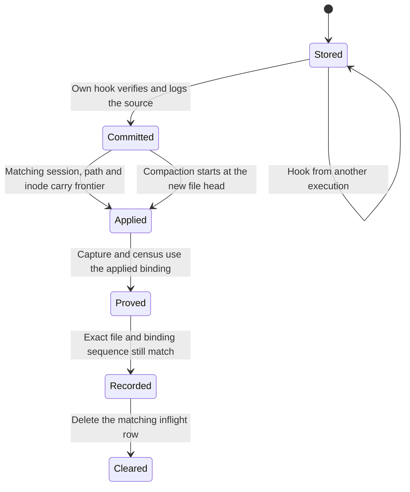

# Hook transcript refresh

Baseline `a0f46b03165bf3d37eccadbebc0d62eb47464b21`. The proposed
transition refines the source labels in `WriterRebound.tla`, the proof recovery
in `NoticeEvidence.tla`, and exact scope in
`../input-single-path/NativeInputTerminal.tla`. Each source has a session,
path, inode and device. The model tracks one native turn and begins with a
nonzero cursor frontier under the original device.

| Case | Before | Proposed transition |
| --- | --- | --- |
| Own hook after volume renumber | Cursor and observations keep the old device. Native outcome and notice stay pending. | Apply the new identity at the retained offset and prefix. Native outcome and owned notice settle, then inflight clears. Existing output posts zero times. |
| Compaction changes session and path | A source switch starts a separate frontier. | Capture begins at the new file's head. The model allows one new output post. |
| Hook from another execution | Pane name mismatch must leave the binding alone. | The binding and cursor stay on the original file. This hook enables no settlement. |

TLC 1.7.4 ran all four safety invariants and `OwnedHookSettles` for both
configs. The before config breaks only `OwnedHookSettles`. The after config
passes all five rules. Weak fairness assumes hook intake, application,
capture, observation, settlement and inflight cleanup can each finish when
enabled. One restart can discard an observed proof at any point.

The model treats the cursor update and checkpoint as one atomic action.
A production implementation must recover interrupted writes behind that
boundary. The model abstracts inherited-row deduplication, storage layout
and durable notice projection.
