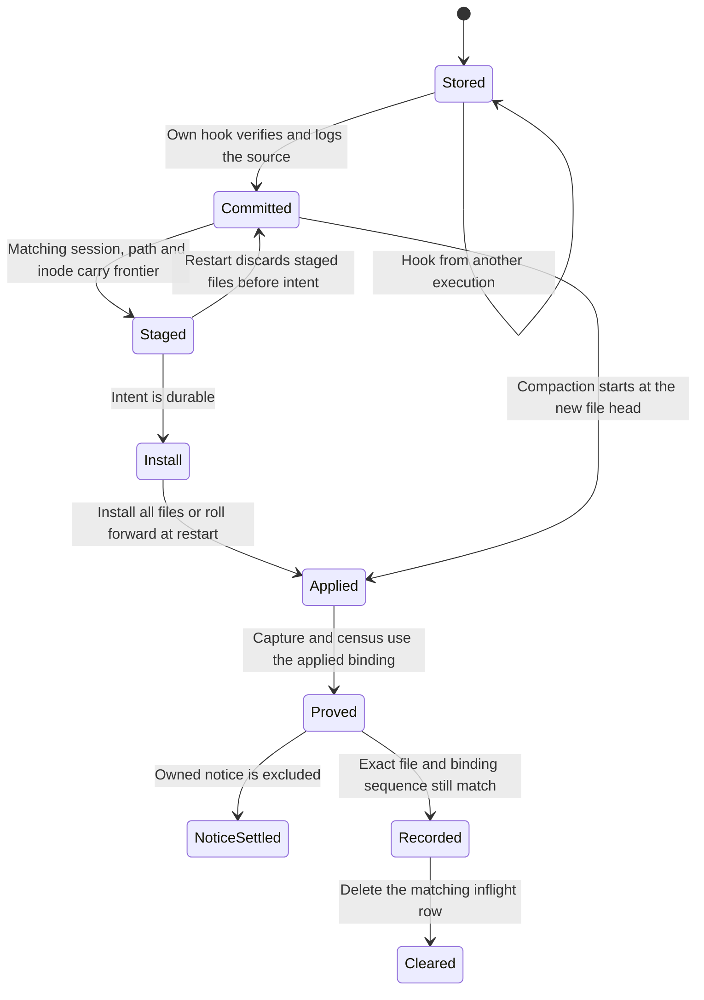

# Hook transcript refresh

Baseline `a0f46b03165bf3d37eccadbebc0d62eb47464b21`. The proposed
transition refines the source labels in `WriterRebound.tla`, the proof recovery
in `NoticeEvidence.tla`, and exact scope in
`../input-single-path/NativeInputTerminal.tla`. Each source has a session,
path, inode and device. The model tracks one native turn and begins with a
nonzero cursor frontier under the original device. Native settlement is
modeled for the same execution nonce across an application restart. The
device change is a writer stat input; native history still stats the file
on its original OS device. On a real OS device change, native history’s exact
stat checks can still hold the ticket, even with the same nonce.

| Case | Before | Proposed transition |
| --- | --- | --- |
| Own hook with the writer device shifted | Cursor and observations keep the old device. Native outcome and notice stay pending. | Apply the new identity at the retained offset and prefix. Where native history still validates its original device, the outcome and owned notice settle, then inflight clears. Existing output posts zero times. |
| Compaction changes session and path | A source switch starts a separate frontier. | Capture begins at the new file's head. The model allows one new output post. |
| Hook from another execution | Pane name mismatch must leave the binding alone. | The binding and cursor stay on the original file. This hook enables no settlement. |
| Restart before durable intent | No cursor transfer. | Recovery keeps only the original key and cursor frontier. The next application can retry. |
| Restart after durable intent | No cursor transfer. | Recovery installs only the new key before allowing reads. The checkpoint can still lag. The saved frontier produces zero re-posts. |

TLC 1.7.4 checks the refresh and first-pin configs. `Before` disables the original refresh and
breaks `OwnedHookSettles`. `ReviewBefore` keeps refresh enabled and breaks
`OldTicketSettles` and `BootStopApplied`. `After` passes all seven safety
invariants and all five liveness properties.

| Review case | ReviewBefore | After |
| --- | --- | --- |
| Keyed ticket survives an application restart with the same nonce | Settlement stays pending after the current cursor is installed. | The writer’s device lineage admits the original ticket in the fixture; native history still validates its actual stat. It records one outcome and the matching inflight row clears. Existing output is posted zero times. |
| Same UUID Stop arrives before pane recovery | The receiver consumes the Stop and never applies its refresh. | The receiver keeps the request retryable. After restoration the same request applies the refresh. |

A same-session refresh requires an existing verified pin for the bound
source. The normal registration path can still verify its matching first
stat. `UnregisteredBefore` permits the refresh to mint a first pin from a
matching first record after absent registration or inode replacement and
breaks `FirstPinIsVerified`. The verified-pin gate preserves
`RegisteredPinAppears` and rejects a foreign first record.

Weak fairness assumes hook intake, pane restoration, staging, intent commit,
application, capture, observation, notice settlement, outcome recording and
inflight cleanup can each finish when enabled. One restart can discard an
observed proof at any point.

Both key files can exist while an intent is committed. The model withholds
observation during that phase and requires one matching key whenever
publication is complete. A restart before intent commit discards staged
files. A restart after commit rolls forward the source and frontier, then
the writer can advance the checkpoint. The model abstracts inherited-row
deduplication, storage layout and durable notice projection.
